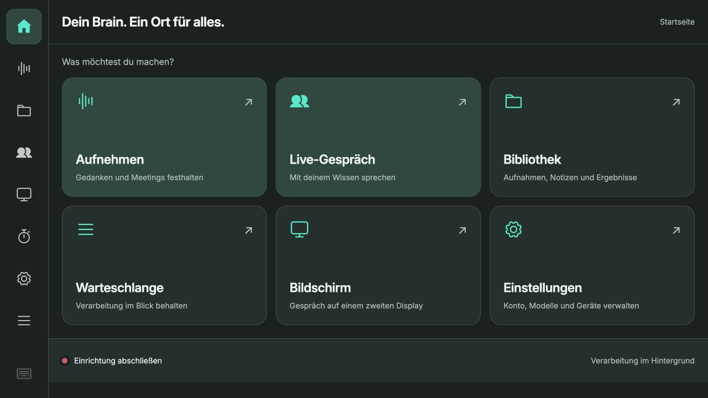

# Corporate Digital Brain Desktop Recorder

## 0.5.69 – Countdown-Abschluss ohne falsche Fehlermeldung

Beim Pi-Test endete der Countdown planmäßig am Timerende, wurde aber kurz als
Audiofehler angezeigt. Ein bestätigtes Beenden an dieser Frist gilt jetzt als
normaler Abschluss; echte Fehler und fehlgeschlagene Prozessbeendigung bleiben
sichtbar. Keine Änderung an Frist, Schutzregeln, Sprachpaket oder Datenformat.

## 0.5.68 – Timer auf Deutsch herunterzählen

Separater Opt-in für „fünf, vier, drei, zwei, eins“ vor dem Timerende.
Vorgefertigte Standardstimme, Vorrang für Aufnahme/Gespräch, keine verspätete
Nachholwiedergabe. Auf dem Pi installiert und eingeschaltet; Timerablauf und
Abbruch wurden technisch geprüft. Persönliche Hörabnahme des Countdowns offen.
[Bedienung, Schutzregeln und Prüfumfang](docs/local-announcements/countdown.md).

## 0.5.67 – Lokale Verbindungsansage vor dem Gespräch

Die optionale Ansage „Ich verbinde dich.“ erklingt einmal vor dem Öffnen des
Gesprächsmikrofons. Wiedergabe und Nachhall bleiben abbrechbar; Aufnahme und
Pause haben weiterhin Vorrang. Bestehende Ansagepakete und Einstellungen bleiben
erhalten. Keine neuen Runtime-Abhängigkeiten oder Datenmigrationen.
[Bedienung, Prüfung und Bereitstellung](docs/local-announcements/connecting.md).

## 0.5.66 – Vorbereitete lokale Sprachansagen

Optionale deutsche Ansagen für fehlgeschlagene Gespräche, Timer und Erinnerungen
verwenden geprüfte, vorberechnete Dateien. Aufnahme und Pause haben Vorrang;
Sprachansagen bleiben während einer Unterhaltung aus. Beide Optionen sind bei
der Ersteinrichtung ausgeschaltet. Keine neue Laufzeitabhängigkeit oder
Datenbankmigration; ein Sprachpaket wird getrennt bereitgestellt.
[Bedienung, Schutzregeln und Abnahme](docs/local-announcements/README.md).

## 0.5.65 – Einheitliche App-Dialoge und helle Papierkörbe

Meeting- und Vorlagenlöschung verwenden einen eigenen Dialog im aktuellen Theme.
Abbrechen hat den Anfangsfokus; Escape und Schließen löschen nichts. Papierkörbe
sind in dunklen Themes hell. Die bisherige Browserwarnung beim Verlassen weicht
einer erneuten lokalen Entwurfssicherung.
[Prüfumfang und Auslieferung](docs/app-dialogs/README.md).

## 0.5.64 – Fehlgeschlagene Aufträge direkt löschen

Die Warteschlange zeigt bei Fehlern einen Papierkorb neben Wiederholen.
Eine Bestätigung nennt das Meeting; die Aktion verwendet den bestehenden
Löschweg und entfernt auch einen leeren Aufnahmeversuch dauerhaft aus der Liste.
[Prüfung und Auslieferung](docs/queue-delete/README.md).

## 0.5.63 – Dateigröße und Fortschritt pro Warteschlangenauftrag

Jede Zeile zeigt die Größe der Audiodatei und eine eigene Fortschrittsspalte
mit Verarbeitungsschritt, Laufzeit und verfügbarem Abschnittsstatus. Laufende
Balken bleiben ohne erfundene Prozentwerte; Aktualisierungen erhalten Seite
und Buttonfokus. [Vorschau und Prüfungen](docs/queue-columns/README.md).

## 0.5.62 – Aufnahme über die gewählte gemeinsame Audioquelle

Aufnahme und Mikrofontest verwenden wie die Sprachaktivierung die exakt
zugeordnete PipeWire-Quelle. Dadurch verhindert ein vom Audiodienst offenes
ReSpeaker-Gerät nicht mehr den Aufnahmestart. Die Aktivierungswort-Sperre während
der Aufnahme und die anschließende Bereitschaft bleiben erhalten.
[Fehlernachweis und Prüfung](docs/recording-source-fix-20261019/README.md).

## 0.5.61 – Handy-Fernbedienung für den Staging-Test

Unter **Einstellungen → Gerät & Verwaltung → Handy-Fernbedienung** lässt sich
cdbMOBILE per Einmalcode und ausdrücklicher Bestätigung am Pi koppeln. Start,
Ende und Stummschaltung verwenden denselben geschützten Gesprächsdienst.
Der Server muss die Funktion freischalten; bis dahin bleibt sie nicht verfügbar.
Bestehende Brain-, Audio- und Wake-Einstellungen bleiben erhalten.
[Bedienung, Prüfungen und Auslieferungsstand](docs/remote-control/IMPLEMENTATION-63.md).

## 0.5.60 – Nabu-Erkennung nachvollziehbar prüfen

Die lokale Diagnose hält jetzt auch Modellwerte unterhalb der Erkennungsschwelle
fest. So lassen sich verpasste Rufe von fehlendem Audio unterscheiden, ohne
Raumton oder Gesprächsinhalte zu speichern. Schwelle und Modell bleiben
unverändert; dies ist noch keine abgeschlossene Erkennungsoptimierung.
[Modellvergleich, Raumtests und Grenzen](docs/wake-word-research/2026-10-16/README.md).

## 0.5.59 – Zurück zu „Okay Nabu“

Unter **Einstellungen → Audio → Aktivierungswort** steht wieder **Okay Nabu**
mit dem dedizierten lokalen microWakeWord-Modell zur Auswahl. Bitte beide Wörter
sprechen. Zum Wechseln zunächst ausschalten, Rufwort wählen, dann einschalten.
Die Auswahl bleibt gespeichert; Aufnahme, Pause, Gespräch und Wiedergabe haben
weiterhin Vorrang. Nach „Gespräch beenden“ kehrt das Gerät zur gewählten
Bereitschaft zurück. Bestehende Profile werden beim Update nicht umgestellt.
[Prüfung, Auslieferung und Image-Auswirkung](docs/wake-nabu-0.5.59/README.md).

## 0.5.58 – Hey KAI anhand natürlicher Rufe kalibrieren

Die Testvariante „Hey KAI“ berücksichtigt niedrigere Wortkonfidenzen, die am
ReSpeaker gemessen wurden. Andere Rufwörter und die Audio-Sperren bleiben
unverändert. Zwei isolierte natürliche Rufe wurden damit erkannt; dies ist
noch keine allgemeine oder Langzeitabnahme.
[Messwerte, Grenzen und Auslieferung](docs/wake-kai-0.5.58/README.md).

## 0.5.57 – Ereignisströme nach Gesprächswechsel schließen

Ein alter Live-Ereignisstrom bleibt an seine ursprüngliche Gesprächs- und
Kontogeneration gebunden. Ein neues Gespräch hält ihn nicht mehr offen.
Auf dem Pi installiert:
[Fehlernachweis, Tests und Auslieferung](docs/live-event-scope/README.md).

## 0.5.56 – Symbol im Ruhezustand nicht neu laden

Der Testplayer behält sein unverändertes Play-/Pause-Symbol über Statusabfragen
hinweg. Das verhindert wiederholte SVG-Neuladungen auch bei geschlossenen
Audioeinstellungen. [Nachweis und Auslieferungsstatus](docs/idle-icon-0.5.56/README.md).

## 0.5.55 – Weniger Oberflächenarbeit in Bereitschaft

Unveränderte Wake-Anzeigen und Seitenbeschriftungen werden nicht fortlaufend
neu geschrieben. Erkennungstakt und Zustandswechsel bleiben erhalten.
[Vergleich, Tests und Auslieferungsstatus](docs/idle-render-0.5.55/README.md).

## 0.5.54 – Audioreservierung bei Freigabefehlern erhalten

Wenn ein Audioprozess nicht sauber beendet werden kann, bleibt seine
Reservierung erhalten. Die App versucht die Freigabe erneut und verhindert
zwischenzeitlich einen zweiten Mikrofonzugriff.
[Fehlernachweis, Schutz und Testumfang](docs/audio-release-0.5.54/README.md).

## 0.5.53 – Rufwörter auswählen und testen

Unter Einstellungen → Audio → Aktivierungswort sind Hey Brain, Hey KAI und
Okay KAI auswählbar. Die KAI-Varianten sind ausdrücklich zum Testen; Auswahl
und Status bleiben konsistent, Aufnahme und Gespräch sperren Änderungen.
[Bedienung, Messwerte und Grenzen](docs/wake-phrases-0.5.53/README.md).

## 0.5.52 – Erkennung nach leisem Grundrauschen

Nach anhaltendem sehr leisem Grundrauschen erhält der Decoder beim Anstieg
des Eingangssignals einen frischen Zustand. Audio und Konfidenzschwellen bleiben
erhalten; digital stille und lautere Phasen werden nicht so erneuert.
[Reproduktion, Vergleich und verbleibende Langzeitabnahme](docs/wake-stability-0.5.52/README.md).

## 0.5.51 – Wake-Diagnose ohne Raumtexte

Die lokale Erkennung liefert begrenzte Pegel- und Entscheidungsdaten, um
fehlende Aktivierungen nach Ruhe einzugrenzen. Kein Mitschnitt und keine
gespeicherten Raumtexte; die Erkennungsschwellen bleiben unverändert.
[Akustischer Test und offene Fehleranalyse](docs/wake-stability-0.5.51/README.md).

## 0.5.50 – Verständliche Freigabe nach Verbindungsfehlern

Eine unterbrochene Verbindung gibt das Gespräch kontrolliert frei und bewahrt
die Fehlermeldung. Verspätete Audio- oder Netzwerkfehler verfälschen keinen
gewollten Abbruch. [Fehlerinjektion und Langzeitabnahme](docs/wake-stability-0.5.50/README.md).

## 0.5.49 – Stabile Erkennung nach Hintergrundsprache

Nach abgeschlossener Sprache erhält die lokale Hey-Brain-Erkennung einen frischen
Decoder. Das Modell bleibt geladen; während Stille wird nicht fortlaufend neu
initialisiert. 1.000 gemischte Sprachabschnitte und der separate Sprachkorpus
bestanden. [Vergleich, Tests und offene Langzeitabnahme](docs/wake-stability-0.5.49/README.md).

## 0.5.48 – Versionswechsel ohne Reload-Schleife

Die Oberfläche erhält die Version direkt vom Backend und lädt nach einem Update
höchstens einmal automatisch pro Zielversion neu. Entwürfe und aktive Aufnahmen
bleiben dabei geschützt. [Auslieferungsprüfung](docs/wake-stability-0.5.46/README.md).

## 0.5.47 – Wake-Unterprozess aus aktivem Release

Nach einem App-Update verwendet auch der lokale Erkenner ausdrücklich den neuen
Release-Ordner. Damit stimmen Eltern- und Kindprozess überein, unabhängig vom
Arbeitsverzeichnis des Systemdiensts. [Installationsnachprüfung](docs/wake-stability-0.5.46/README.md).

## 0.5.46 – Wake-Störungen abfangen

Hängende lokale Erkennung wird kontrolliert neu gestartet, sofern das Gerät frei
ist. Cloud-Heartbeats blockieren den sprachlichen Ende-Befehl nicht mehr; alte
Fehlermeldungen können kein neues Gespräch beenden.
[Stresstests und offene Langzeitabnahme](docs/wake-stability-0.5.46/README.md).

## 0.5.45 – Aktivierung nach Standzeit und Neustarthilfe

Wake-Start blockiert die Oberfläche nicht mehr während einer Anmeldungserneuerung.
Erkennungshinweise laufen zuverlässig ab; unter Gerät & Verwaltung können die
Oberfläche neu geladen und ein geschützter Pi-Neustart angefordert werden.
[Diagnose, Bedienung und Testgrenzen](docs/idle-wake-0.5.45/README.md).

## 0.5.28 – Ausgewählte Knowledge Areas prüfen

„Ausgewählt (N)“ neben der Suche zeigt auf Wunsch nur gewählte Bereiche über alle
Seiten hinweg. Antippen wechselt zurück zu allen Bereichen. Feste Abstände und
Bedienleisten bleiben erhalten. [Nachweis](docs/live-areas-0.5.28/README.md)

## 0.5.27 – Gesprächswissen in der rechten Seitenleiste

Knowledge Areas vor dem Gespräch mehrfach auswählen, suchen und mit nummerierten
Seitenbuttons durchblättern. Während des Gesprächs bleibt die Auswahl gesperrt;
die bestätigten Bereiche stehen rechts neben dem Verlauf. Feste Bedienleisten,
Touch-Tastatur und alle Themes bleiben erhalten.

[Prüfungen und Vorschauen](docs/live-areas-0.5.27/README.md)

## 0.5.26 – Suchaktivität sichtbar machen

Ein kleiner Indikator unten rechts zeigt laufenden Suchton, Ausklingen sowie die Suche bei pausiertem oder ausgeschaltetem Ton. Sein Platz bleibt reserviert; das Layout bewegt sich nicht. Die Tonanzeige folgt der tatsächlichen Ausgabe des Python-Players.

[Prüfungen und Vorschauen](docs/live-search-indicator-0.5.26/README.md)

## 0.5.25 – Ruhiger Gesprächsverlauf und fließender Suchklang

Kleine Nutzerblasen rechts, offene Antworten links und feste Bedienleisten. Lange Antworten werden anhand ihrer tatsächlichen Darstellung auf Seiten verteilt. Beim Zurückblättern bleibt der Verlauf stehen. Kurze Suchen beenden eine 1,6-Sekunden-Klangphrase mit sanfter Ausblendung; Folgeaufrufe teilen sich einen Player.

[Bedienung](docs/live-conversation.md) · [Prüfungen und Screenshots](docs/live-conversation-0.5.25/README.md)

## 0.5.21 – Bluetooth-Geräte verwalten

Unter **Einstellungen → Audio → Bluetooth** Geräte suchen, mit Code/PIN koppeln, verbinden, trennen und gespeicherte Kopplungen entfernen. Verfügbare Audiomodi unterscheiden Musik und Freisprechen. Mikrofon und Lautsprecher werden anschließend in den vorhandenen Audioeinstellungen gewählt. Aufnahme, Live-Gespräch und Bluetooth-Einrichtung sind gegenseitig abgesichert.

[Bluetooth-Anleitung](docs/bluetooth.md) · [Tests und Screenshots](docs/bluetooth-0.5.21/README.md)

## 0.5.20 – Live-Audio direkt am Pi

CDB Voice One verwendet jetzt das eingerichtete Pi-Mikrofon und den gewählten Pi-Lautsprecher über Python. Der Browser steuert die Oberfläche, ohne zusätzliche Mikrofonfreigabe oder separate Geräteauswahl. Aufnahme und Gespräch bleiben gegenseitig gesperrt; Stummschaltung und Abbruch geben keine alten Audioblöcke weiter.

[Bedienung](docs/live-conversation.md) · [Tests und Screenshots](docs/native-live-0.5.20/README.md)

## 0.5.18 – ReSpeaker-LEDs und Live-Gespräch

Der ReSpeaker-Ring zeigt Aufnahme blau, Pause gelb und App-Stumm rot blinkend. Die physische Stummtaste behält ihre eigene rote Anzeige. In der Navigation öffnet **Live-Gespräch** CDB Voice One mit ein bis acht Knowledge Areas, Browser-Mikrofonwahl und lokalem Chatverlauf. Eine zentrale Zustandsprüfung sperrt Aufnahme und Gespräch gegenseitig, auch bei Verbindungsaufbau, Abbruch und mehreren Browsern.

[Bedienung und Grenzen](docs/live-conversation.md) · [ReSpeaker einrichten](docs/respeaker.md) · [Abnahme und Screenshots](docs/leds-live-0.5.18/README.md)


## 0.5.11 – Mikrofon und Testplayer

Die Audioseite nutzt zwei feste Spalten: Mikrofon, Live-Pegel und ein Player im aktiven Theme links, geordnete Einrichtungsprüfungen rechts. Alte Testaufnahmen werden von einem aktuellen Eingangssignal unterschieden. [Prüfung und Screenshots](docs/audio-0.5.11/README.md).

## 0.5.10 – Einheitliche Touchansichten und dauerhafte Modellnachweise

Aktives Modell und Teststatus bleiben klar getrennt. Ergebnisse bleiben pro Modell gespeichert; die übernommenen Pi-Nachweise werden gegen Modell und Laufzeit geprüft. Header, Fußleisten, Auswahlfelder und Such-/Seitennavigation sind vereinheitlicht. Bibliothek und Queue zeigen vollständige Seiten. Siehe [Audit und Screenshots](docs/stable-models-0.5.10/README.md).


Eine Desktop-Anwendung zum Aufzeichnen, Verwalten und Wiedergeben von Audio-Sessions mit Raspberry Pi Touch-Optimierung.

> In Entwicklung: [cdbMOBILE als Pi-Fernbedienung, Kopplung und Abnahme](docs/remote-control/IMPLEMENTATION-63.md). Noch nicht produktiv freigeschaltet.

## Raspberry-Pi-Grundfunktionen

Der Pi verwendet die HTML-Studio-Oberfläche mit dem vorhandenen Python-Backend, der bisherigen Meeting-Datenbank und lokalen Whisper-/Ollama-Modellen. Installation, Autostart, isolierte Funktionsvorschau und Rückkehr zur bisherigen Oberfläche: [docs/STUDIO.md](docs/STUDIO.md). Gestaltung und Prüfungsumfang: [design-qa.md](design-qa.md). Die gemeinsame Python-Engine ist auf Version 0.2.6 gepinnt. Zustandsregeln und Entwurfswiederherstellung: [docs/STUDIO.md](docs/STUDIO.md).

Die Bibliothek bietet einen festen Rückweg „Zur Aufnahmeliste“ mit großer Touchfläche und eigener Positionsanzeige. CDB-Zusammenfassungen wiederholen abgeschnittene Antworten einmal mit größerem Ausgabebudget; unvollständige Texte bleiben Fehler. Prüfung mit einer Stunde synthetischem Audio: [Testbericht](docs/cdb-hour-0.5.5/README.md).

Neu in 0.5.9: Brain-Konto und KI & Modelle bündeln Anmeldung, Standardbereich und aktive Verarbeitung. Lokale und Online-Modelle lassen sich direkt mit synthetischen Daten testen und ausdrücklich aktivieren. [Prüfung und Screenshots](docs/brain-models-0.5.9/README.md).

Neu in 0.5.8: Kachelübersicht für Einstellungen, Unterseiten mit Rückweg statt Seitennavigation, eingerückte App-Icons und einheitliche Touch-Abstände. Standard-Zusammenfassungen prüfen Aufgaben, Namen und Fristen gegen wörtliche Transkriptbelege. Ergebnisse und Grenzen des frischen CDB-Stundentests: [Prüfbericht](docs/task-quality-0.5.8/README.md).

Die folgenden Abschnitte beschreiben auch historische Funktionen der Desktop-Anwendung. Für den aktuellen Pi gelten die lokalen Einrichtungsanweisungen in [docs/STUDIO.md](docs/STUDIO.md) und [docs/LOCAL_AI.md](docs/LOCAL_AI.md).

## Features

- **Audio-Aufnahme** mit Live-Pegelanzeige und Laufzeit-Anzeige
- **Audio-Wiedergabe** mit Play/Pause/Stop und Fortschrittsbalken
- **CRUD-Verwaltung** für Sessions (Create, Read, Update, Delete)
- **Geräteauswahl** zwischen allen verfügbaren Mikrofonen
- **Suchfunktion** nach Titel und Notizen
- **CSV-Export** der Session-Liste
- **Datei öffnen** im Standard-Audio-Player
- **AI-Integration mit OpenAI**
  - Automatische Transkription mit gpt-4o-transcribe
  - Text-Transformation mit GPT-5 (Zusammenfassen, Übersetzen, Strukturieren)
  - Hintergrund-Verarbeitung ohne UI-Blockierung
- **Raspberry Pi Optimierung**
  - Automatische Touch-optimierte UI auf ARM-Systemen
  - 24px breite Scrollbars für einfache Touch-Bedienung
  - 50px große Buttons für Finger-Bedienung
  - Kompaktes Layout für 1280x720 Displays
  - Fullscreen-Modus mit verstecktem Toggle (5x Logo klicken)
  - Autostart-Konfiguration für Kiosk-Systeme

## OpenAI Integration

Die App unterstützt automatische Transkription und AI-gestützte Textverarbeitung.

### Setup

1. **API-Key konfigurieren**: Öffne die Einstellungen (⚙️ in der Toolbar) und trage deinen OpenAI API-Key ein
2. Der API-Key wird sicher in `~/.config/audio_sessions/settings.json` gespeichert

### Transkription

Die Transkription verwendet das Modell **gpt-4o-transcribe** (Nachfolger von whisper-1):

```python
# Modell: gpt-4o-transcribe
# Response Format: json (nicht verbose_json!)
# Sprache: auto-detect oder manuell (de, en, etc.)
# Prompt: "Audio Sessions, Transkription, Notizen"
```

**Wichtig**: Das `gpt-4o-transcribe` Modell unterstützt nur `response_format="json"` oder `"text"`, nicht `"verbose_json"`. Die Response enthält:
- `text`: Der transkribierte Text
- `language`: Erkannte Sprache (falls verfügbar)
- `duration`: Audio-Länge (falls verfügbar)

**Verwendung**:
1. Wähle eine Session in der Tabelle
2. Öffne den AI-Tab im Detail-Bereich
3. Klicke auf "Transkribieren"
4. Die Transkription läuft im Hintergrund (Worker-Thread)
5. Status wird in der Tabelle angezeigt (🔄 laufend, ✓ fertig)

### Text-Transformation mit GPT-5

Die Text-Transformation verwendet **GPT-5** mit dem Chat Completions API:

```python
# Modell: gpt-5
# API: Chat Completions (client.chat.completions.create)
# Parameter: reasoning_effort (minimal, low, medium, high)
# Parameter: verbosity (low, medium, high) - wird im Prompt verarbeitet
```

**Wichtig**:
- GPT-5 verwendet die **Chat Completions API**, nicht die Responses API
- Der Parameter `reasoning_effort` steuert die Denktiefe des Modells
- `max_completion_tokens` statt `max_tokens` verwenden
- Response-Struktur: `response.choices[0].message.content`

**Verfügbare Transformationen**:
1. **Zusammenfassen**: Erstellt eine prägnante Zusammenfassung
2. **Übersetzen**: Übersetzt ins Englische
3. **Strukturieren**: Gliedert den Text in übersichtliche Abschnitte

**Verwendung**:
1. Transkribiere zuerst eine Session (siehe oben)
2. Wähle eine Transformation (Zusammenfassen/Übersetzen/Strukturieren)
3. Passe optional Reasoning Effort und Verbosity an
4. Klicke auf "Ausführen"
5. Das Ergebnis erscheint im unteren Textfeld

**Fallback**: Falls GPT-5 nicht verfügbar ist (z.B. API-Fehler), wird automatisch auf GPT-4o mit äquivalenten Parametern zurückgegriffen.

### Technische Details

**Service-Architektur**:
- `services/audio_session_service.py`: OpenAI API-Aufrufe
- `services/workers.py`: Qt QThread Worker für async Verarbeitung
- Cache-System für Transkriptionen (verhindert doppelte API-Calls)

**Python 3.9 Kompatibilität**:
```python
# Statt: dict | None (Python 3.10+)
# Verwenden: Optional[dict] (Python 3.9)
from typing import Optional, Dict, Any
```

**GPT-5 vs GPT-4o**:
| Feature | GPT-5 | GPT-4o (Fallback) |
|---------|-------|-------------------|
| API | Chat Completions | Chat Completions |
| Reasoning | `reasoning_effort` Parameter | Gemappt auf `temperature` |
| Verbosity | Im Prompt | Im Prompt |
| Max Tokens | `max_completion_tokens` | `max_tokens` |

**Fehlerbehandlung**:
- Netzwerkfehler werden abgefangen und im UI angezeigt
- API-Fehler zeigen Details in der Terminal-Ausgabe
- Transkriptionsstatus wird in der Datenbank persistiert

## Technologie

- **Python 3.9+** (getestet mit Python 3.9.6)
- **PySide6 (Qt)** für die GUI
- **sounddevice + soundfile** für Audio I/O
- **SQLite** für die Datenbank
- **OpenAI SDK** (>=1.57.0) für AI-Features
  - gpt-4o-transcribe für Transkription
  - GPT-5 für Text-Transformation

## Installation

1. Erstelle ein virtuelles Environment (empfohlen):
```bash
python3 -m venv venv
source venv/bin/activate  # macOS/Linux
# oder
venv\Scripts\activate  # Windows
```

2. Installiere die Dependencies:
```bash
pip install -r requirements.txt
```

## Verwendung

### Desktop (Mac/Windows/Linux)

Starte die App mit:
```bash
./run.sh
```

Oder manuell:
```bash
source venv/bin/activate
python3 app.py
```

### Raspberry Pi (Touch-optimiert)

Die App erkennt automatisch Raspberry Pi (ARM-Architektur) und aktiviert:
- Touch-optimierte UI mit 24px Scrollbars
- 50px große Buttons für Finger-Bedienung
- Kompaktes Layout für 1280x720 Displays
- Automatischer Fullscreen-Modus

**Starten:**
```bash
./run.sh
```

**Fullscreen beenden:**
- 5x schnell auf das Logo klicken (links oben)
- F11-Taste drücken
- ESC-Taste drücken

**Autostart einrichten:**
```bash
./install-autostart.sh
```

Zum Deaktivieren:
```bash
./remove-autostart.sh
```

**Environment Variables:**
```bash
FULLSCREEN=false ./run.sh      # Kein Fullscreen
LAYOUT_MODE=desktop ./run.sh   # Desktop-Layout erzwingen
```

**Wichtig**: Stelle sicher, dass die OpenAI SDK im virtuellen Environment installiert ist. Falls `ModuleNotFoundError: No module named 'openai'` erscheint:
```bash
./venv/bin/pip install "openai>=1.57.0"
```

### Aufnahme

1. Wähle dein Mikrofon aus dem Dropdown
2. Klicke auf "Aufnahme starten"
3. Beobachte den Live-Pegel und die Laufzeit
4. Klicke auf "Aufnahme stoppen"
5. Die Session wird automatisch in der Datenbank gespeichert

### Session-Verwaltung

- **Suchen**: Nutze das Suchfeld in der Toolbar
- **Auswählen**: Klicke auf eine Session in der Tabelle
- **Bearbeiten**: Ändere Titel und Notizen im Formular rechts
- **Speichern**: Klicke auf "Speichern"
- **Löschen**: Wähle eine Session und klicke auf "Löschen" in der Toolbar
- **CSV-Export**: Klicke auf "CSV Export" in der Toolbar
- **Datei öffnen**: Wähle eine Session und klicke auf "Datei öffnen"

## Projektstruktur

```
audio_sessions/
├── app.py                          # Main-Einstiegspunkt
├── recorder.py                     # Audio-Recorder Klasse
├── ui/
│   ├── main_window.py              # Hauptfenster
│   ├── session_form.py             # Session-Formular
│   ├── table_widget.py             # Sessions-Tabelle
│   ├── ai_view.py                  # AI-Integration UI
│   ├── settings_dialog.py          # Einstellungen-Dialog
│   └── player_widget.py            # Audio-Player
├── services/
│   ├── audio_session_service.py    # OpenAI API Service
│   ├── workers.py                  # Qt Worker für async AI-Tasks
│   └── settings_manager.py         # Settings Management
├── data/
│   ├── repo.py                     # SQLite Repository
│   └── sessions.db                 # Datenbank (wird automatisch erstellt)
├── recordings/                     # Aufnahmen (wird automatisch erstellt)
├── translations/                   # i18n Übersetzungen
└── requirements.txt                # Dependencies
```

## macOS Hinweis

Bei macOS muss die App Mikrofonberechtigungen erhalten. Beim ersten Start wird ein Dialog angezeigt. Falls die Berechtigung verweigert wurde, kann sie in den Systemeinstellungen unter "Sicherheit & Datenschutz" → "Mikrofon" aktiviert werden.

## Packaging / Distribution

Die App kann als eigenständige Anwendung gebaut werden. **Wichtig**: Verwende das automatisierte Build-Skript, das die notwendigen Mikrofon-Berechtigungen korrekt setzt:

```bash
# App bauen (empfohlen - automatisiert)
./build_app.sh

# Gebaute App öffnen
open dist/CorporateDigitalBrainRecorder.app

# Optional: Installation in /Applications
cp -r dist/CorporateDigitalBrainRecorder.app /Applications/
```

### Manueller Build (nur falls notwendig)

Falls du manuell bauen möchtest:

```bash
# 1. App mit PyInstaller bauen
./venv/bin/pyinstaller AudioSessions.spec --clean

# 2. WICHTIG: Berechtigungen fixen (sonst funktioniert Mikrofon nicht!)
./fix_app_permissions.sh

# 3. App öffnen
open dist/CorporateDigitalBrainRecorder.app
```

**Warum das Fix-Skript notwendig ist:**
- PyInstaller überschreibt die `Info.plist` beim Build
- Die `NSMicrophoneUsageDescription` (Mikrofon-Berechtigung) geht verloren
- Das Fix-Skript fügt sie wieder hinzu und signiert die App mit Audio-Input Entitlements

### Build-Dateien

- `build_app.sh` - Kompletter automatisierter Build-Prozess
- `fix_app_permissions.sh` - Patcht Info.plist und signiert die App
- `entitlements.plist` - Entitlements für Mikrofon-Zugriff
- `AudioSessions.spec` - PyInstaller Konfiguration
- `Info.plist` - Basis Info.plist mit App-Metadaten

Die gebaute `.app` kann ohne Python-Installation verwendet werden.

Detaillierte Anleitung: siehe [BUILD.md](BUILD.md)

## Troubleshooting

### OpenAI API Fehler

**Problem**: `ModuleNotFoundError: No module named 'openai'`
```bash
# Lösung: OpenAI SDK im virtuellen Environment installieren
./venv/bin/pip install "openai>=1.57.0"

# App mit venv starten
./venv/bin/python3 app.py
```

**Problem**: `TypeError: unsupported operand type(s) for |: 'type' and 'NoneType'`
- **Ursache**: Python 3.9 unterstützt keine Union Types mit `|` Operator
- **Lösung**: Code verwendet jetzt `Optional[dict]` statt `dict | None`

**Problem**: `response_format 'verbose_json' is not compatible with model 'gpt-4o-transcribe'`
- **Ursache**: Das neue gpt-4o-transcribe Modell unterstützt kein `verbose_json` Format
- **Lösung**: Code verwendet jetzt `response_format="json"`

**Problem**: `GPT-5 nicht verfügbar, Fallback auf GPT-4o`
- **Ursache**: Frühere Version versuchte die Responses API zu nutzen
- **Lösung**: Code verwendet jetzt Chat Completions API für GPT-5
- **Parameter**: `reasoning_effort`, `max_completion_tokens`
- **Response**: `response.choices[0].message.content`

**Problem**: `'NoneType' object is not subscriptable` bei Transformation
- **Ursache**: Fehlerhafte Zugriffe auf Responses API Struktur
- **Lösung**: Umstellung auf Chat Completions API mit korrekter Response-Struktur

### API-Key Konfiguration

Falls die AI-Features nicht funktionieren:
1. Öffne Einstellungen (⚙️)
2. Trage deinen OpenAI API-Key ein
3. Speichere und starte die App neu
4. Prüfe die Terminal-Ausgabe auf Fehlermeldungen

### Mikrofon funktioniert nicht in gebauter .app

**Problem**: Die gebaute App (`.app` Datei) zeigt keinen Mikrofon-Pegel / keine Waveform, obwohl es beim Start über Python funktioniert.

**Ursache**:
- PyInstaller überschreibt beim Build die `Info.plist`
- Die `NSMicrophoneUsageDescription` (Mikrofon-Berechtigung) fehlt in der gebauten App
- macOS verweigert daher den Mikrofon-Zugriff

**Lösung**:
```bash
# Option 1: Automatisiertes Build-Skript verwenden (empfohlen)
./build_app.sh

# Option 2: Manuell fixen nach dem Build
./venv/bin/pyinstaller AudioSessions.spec --clean
./fix_app_permissions.sh
```

**Verifikation**:
```bash
# Prüfe ob NSMicrophoneUsageDescription in der gebauten App enthalten ist
/usr/libexec/PlistBuddy -c "Print :NSMicrophoneUsageDescription" \
  dist/CorporateDigitalBrainRecorder.app/Contents/Info.plist

# Prüfe Code-Signing Entitlements
codesign -d --entitlements - dist/CorporateDigitalBrainRecorder.app
```

**Wenn das Problem weiterhin besteht**:
1. Öffne Systemeinstellungen → Sicherheit & Datenschutz → Mikrofon
2. Entferne "Corporate Digital Brain Desktop Recorder" aus der Liste (falls vorhanden)
3. Starte die App neu - macOS wird erneut nach Mikrofon-Berechtigung fragen
4. Erlaube den Zugriff

## Lizenz

MIT

## Recorder Studio 0.5.0: Firmenanmeldung und CDB

Die Pi-Oberfläche bietet direkt anwählbare Einstellungsseiten sowie Microsoft-Anmeldung,
getrennt wählbare lokale/CDB-Transkription und Zusammenfassung und die bewusste
Textübertragung in eine Knowledge Area. Lokale Aufnahme und Verarbeitung bleiben verfügbar.
Bedienung, Datenschutzgrenzen, Auslieferungsnachweise und noch offene Live-Abnahme:
[docs/cdb-integration/README.md](docs/cdb-integration/README.md).

### Studio 0.5.1: Standardbereich für „Ins Brain“

Nach der Microsoft-Anmeldung werden die Knowledge Areas automatisch geladen. Unter **Einstellungen → Verbindung** einen Standardbereich wählen; die Auswahl bleibt für dieses Firmenkonto gespeichert und ist dort oder unter **Knowledge Areas** jederzeit änderbar. Am Meeting öffnet **Ins Brain übertragen …** ein eigenes Touchfenster mit vorbelegtem Ziel. Ein dort gewählter anderer Bereich gilt nur für dieses Meeting. **Jetzt übertragen** startet den Versand. Aufnahme und lokale Verarbeitung bleiben unabhängig davon verfügbar.

## Studio 0.5.2

[Rechte Arbeitsansichten, Touchbedienung und Meetingaufgaben](docs/workspace-0.5.2/README.md): Bibliothek und Einstellungen öffnen neben der Aufnahme; Zusammenfassung bietet Meetingprotokoll oder vereinbarte Aufgaben statt Übersetzung.

## Stummschaltung, Pause und Bluetooth (Studio 0.5.17)

Während der Aufnahme stehen unter der Pegelanzeige zwei Touchbuttons bereit:
**Mikro stumm** speichert Stille, die Aufnahmedauer läuft weiter.
**Pause** speichert keine Audiodaten; **Fortsetzen** führt dieselbe Aufnahme weiter.
Ein stummgeschaltetes Mikrofon bleibt auch nach dem Fortsetzen stumm, bis es ausdrücklich eingeschaltet wird.
Bibliothek, Warteschlange und Einstellungen bleiben während einer Pause gesperrt.
**Stoppen** schließt die Aufnahme auch im Pausenzustand ab und stellt genau einen Auftrag in die Warteschlange.
Notizen können weiterhin bearbeitet werden. Ab Studio 0.5.18 zeigt der ReSpeaker-Ring App-Stumm durch rotes Blinken, Aufnahme blau und Pause gelb. Die physische Mute-Taste bleibt unabhängig und hat Vorrang.

Verbundene Bluetooth-Mikrofone erscheinen zusätzlich in der Mikrofonauswahl, wenn
PipeWire/PulseAudio sie im Headset-/Freisprechprofil als Quelle bereitstellt.
Bloßes Pairing oder ein reines A2DP-Wiedergabeprofil reicht nicht. Die App übernimmt
keine Kopplung und schaltet Profile nicht selbstständig um. Bluetooth-Lautsprecher
werden bereits über die Lautsprecherauswahl angeboten, sobald sie verbunden sind.

Details, Tests und ReSpeaker-Diagnose: [Aufnahmesteuerung 0.5.17](docs/capture-0.5.17/README.md).

## ReSpeaker XVF3800 am Raspberry Pi

[Anschluss, erneutes Verbinden, Firmware und Fehlerbehebung](docs/respeaker.md).
Die Firmware bleibt im Mikrofon gespeichert: Beim erneuten Anschließen ist **kein erneutes Flashen** nötig. Ein neues Gerät mit I²S-Firmware muss dagegen einmalig auf USB umgestellt werden. Die Anleitung enthält die geprüfte Version, Safe Mode, Mikrofontest, Mute/Pause, LED-Status und Diagnosebefehle.

## Gesprächsbereiche merken · Studio 0.5.29

Gewählte Knowledge Areas bleiben für das nächste Gespräch erhalten, getrennt
nach Brain-Konto, Mandant und Server – auch nach einem Neustart des Pi.
[Bedienung und Prüfung](docs/live-areas-0.5.29/README.md).
Zum geplanten externen Gesprächsdisplay:
[Mira-Codeprüfung und Übertragungskonzept](docs/mira-receiver-review.md).

## Startseite und Gesprächsbildschirm · Studio 0.5.30

Haus-Symbol und große Kacheln öffnen die Bereiche direkt. Unter dem neuen
Monitor-Symbol lässt sich ein Browser im selben Netzwerk per Code koppeln.
Er zeigt den vollständigen aktuellen Gesprächsverlauf, mit Heartbeat und
Wiederverbindung. [Bedienung, Grenzen und Testnachweise](docs/display-0.5.30/README.md).

### 0.5.31 · Aktivierungswort und lokale Timer

Unter **Einstellungen → Audio → Aktivierungswort** lässt sich „Okay Nabu“
einschalten und lokal testen. Aufnahme, Pause, Gespräch und Wiedergabe haben
Vorrang. **Timer & Erinnerungen** ist über ein eigenes Symbol erreichbar;
Einträge überstehen einen Neustart. Alarme bleiben während Aufnahme/Gespräch
zunächst leise. Timer-Sprachbefehle benötigen noch die CDB-Tool-Brücke.
[Bedienung, Installation und Testnachweise](docs/wake-timers-0.5.31/README.md).

### Studio 0.5.32 · Alarmtöne und vorbereitete Live-Geräteaufträge

Timer und Erinnerungen besitzen auswählbare Alarmtöne mit Vorhören am Pi.
Der neue Geräte-Executor verarbeitet bestätigte CDB-Tool-Aufträge idempotent;
Sprachsteuerung setzt den passenden TQS-/BFF-Rollout voraus.
[Bedienung, Vertrag und Teststand](docs/device-tools-0.5.32/README.md).
Der externe Mira-Receiver wurde auf dem Tailscale-Server wiedergefunden:
[Bestand und Integrationsplan](docs/mira-receiver-review.md).

### Studio 0.5.33 · Aktivierungswort einrichten und Browser entlasten

Unter **Einstellungen → Audio → Aktivierungswort** stehen Brain-Konto, Geräte
und Gesprächswissen jetzt zusammen. Bereiche suchen, über Seiten auswählen oder
mit **Ausgewählt** filtern, dann einschalten. Die Auswahl wird beim Einschalten
pro Brain-Konto gespeichert und auch im nächsten Live-Gespräch verwendet.
Fehlende Voraussetzungen und Fehler werden direkt auf der Seite angezeigt.
Zum Ändern der Bereiche zuerst ausschalten; der lokale Erkennungstest startet
kein Cloud-Gespräch. Aufnahme, Gespräch und Wiedergabe haben weiterhin Vorrang.

Unveränderte Touch-Auswahlfelder erzeugen keine Aktualisierungsschleife mehr.
Unsichtbare Gesprächsverläufe werden erst beim Öffnen neu vermessen.
[Prüfprotokoll und Screenshots](docs/wake-setup-0.5.33/README.md).

### Studio 0.5.34 · Ruhiger Start und sichere Touchbedienung

Die Startseite öffnet ohne vorgewählte Kachel und ohne farbige Hover-Rahmen.
Tastaturnavigation behält einen sichtbaren Fokus, sobald mit Tab navigiert wird.
Bedientexte und Symbole lassen sich nicht versehentlich markieren oder ziehen.
Eingabefelder bleiben bearbeitbar; der Microsoft-Anmeldecode bleibt gezielt kopierbar.

Geprüft am Pi mit 1280 × 720: Startfokus auf der Überschrift, alle sechs Kacheln
ohne Fokusrahmen/Schatten, Doppelklick auf Überschrift ohne Textmarkierung,
Tab-Fokus auf „Aufnehmen“, Bibliothekssuche inklusive Textauswahl weiterhin nutzbar.
93 JavaScript-Tests bestanden. Backendlogik unverändert.



### Studio 0.5.35 · Startseite ohne automatischen Inhaltsfokus

Korrektur zu 0.5.34: Auch die Überschrift erhält keinen automatischen Fokus mehr.
Beim Öffnen der Startseite wird der native Dialog-Autofokus unmittelbar freigegeben.
Das gilt beim Start und bei der Rückkehr aus einer anderen Ansicht. Spätere
Tastaturnavigation und deren Fokusmarkierung bleiben erhalten; der Statuspoll
entfernt keinen bewusst gesetzten Fokus.

94 JavaScript-Tests bestanden. Im Browser am Pi geprüft: `activeElement` ist
`BODY`, innerhalb der Startseite ist kein Element fokussiert; die Überschrift
besitzt weder `autofocus` noch `tabindex`. Start und Rückkehr aus der Bibliothek geprüft.
[Prüfnachweis](output/playwright/start-focus-0.5.35/focus-check.json).

### Studio 0.5.36 · Hey Brain und Gespräch per Sprache beenden

Unter **Einstellungen → Audio → Aktivierungswort** startet jetzt **„Hey Brain“**
das Live-Gespräch mit den gewählten Wissensbereichen. Sprich „Brain“ englisch
(„Brejn“) und warte auf **Hört zu**. Die Erkennung bleibt lokal und speichert
keinen Ton. Die bestehende Ein/Aus-Auswahl und Kontobindung bleiben erhalten.

Sage im Gespräch **„Gespräch beenden“** oder **„Okay, Gespräch beenden“** als
separaten Satz. Nach einer kurzen Pause beendet der Pi die Verbindung und gibt
das Mikrofon frei. Bei eingeschaltetem Aktivierungswort wartet er automatisch
wieder auf „Hey Brain“. Der Bildschirmbutton funktioniert weiterhin. Fragen,
Negationen und Antworten des Assistenten sind keine Beendigungsbefehle.

Die lokale Erkennung verwendet Vosk 0.3.45 mit dem kleinen englischen
Apache-2.0-Modell 0.15 und begrenztem Wortschatz. Installation auf weiteren
Geräten: `scripts/install-wake.sh`; das Modell wird vom Hersteller geladen,
mit SHA256 geprüft und nicht in Git gespeichert. Die bestehende
Micro-Wake-Word-Installation wird nicht entfernt, aber nicht mehr benutzt.
Details, Messwerte und Grenzen: [Prüfbericht](docs/hey-brain-0.5.36/README.md).

### Studio 0.5.37 · Erkennung sichtbar, Timer überall im Blick

„Hey Brain erkannt“ erscheint kurz als feste Statusmeldung, auch während der
Verbindung zum Gespräch. Ein kleiner Punkt am Gesprächssymbol zeigt die lokale
Bereitschaft. Die Erkennung findet die Phrase jetzt auch nach anderen Wörtern
oder bei zwei unmittelbar wiederholten Aufrufen im selben Audioabschnitt.

Ein laufender Timer zeigt oben rechts Namen und Restzeit; ein Tipp öffnet die
Timeransicht (außer während Aufnahme/Gespräch). Auch das Timersymbol zeigt den
Countdown. Mehrere Einträge werden mit dem nächsten Termin und „+N“ dargestellt.

Fällige Timer wiederholen ihren gewählten Ton **bis zu 60 Sekunden**. Über
**Alarm stoppen** oder **+5 Min.** lassen sie sich sofort beenden bzw. verschieben.
Nach einer Minute verstummt der Ton, der Hinweis bleibt bis zur Bestätigung.
Die Tonvorschau bleibt drei Sekunden lang. Während Aufnahme oder Gespräch wird
der Ton weiterhin zurückgestellt; der fällige Timer ist trotzdem sichtbar.
[Prüfbericht](docs/device-feedback-0.5.37/README.md).


### Studio 0.5.38 · Alarm im Gespräch und hörbare Bereitschaft

Timer und Erinnerungen ertönen jetzt auch während eines laufenden Live-Gesprächs,
parallel zur Stimme. **Alarm stoppen** und **+5 Min.** bleiben bedienbar, ohne das
Gespräch zu beenden. Bei Aufnahmen, Geräteänderungen und Audiotests wartet der
Alarm weiterhin. Die Begrenzung auf 60 Sekunden bleibt bestehen.

Ein kurzer, steigender Doppelton bestätigt die tatsächlich aufgebaute
Audioverbindung. Erst danach sprechen. Der Ton läuft einmal pro Sitzung über
den gewählten Pi-Lautsprecher, unabhängig vom abschaltbaren Suchton.

Zum Beenden funktionieren mehrere klare, eigenständige Sätze:
**„Beende das Gespräch“**, **„Gespräch beenden“**, **„Unterhaltung beenden“**,
**„Ende“** oder **„Das war’s“** – auch mit „Okay“ oder „Bitte“.
Fragen, Verneinungen und Assistentenantworten schließen das Gespräch nicht.
Nach dem Ende wartet das eingeschaltete Aktivierungswort wieder, sobald keine
Aufnahme, Wiedergabe oder kein Alarm mehr läuft. Die Erkennung dieser Befehle
setzt eine vollständige Nutzertranskription voraus; der Bildschirmbutton bleibt verfügbar.

Prüfnachweis: [Live-Audio 0.5.38](docs/live-audio-0.5.38/README.md).

### Studio 0.5.39 · Zuverlässiger Gesprächsstart bei gestörter IPv6-Verbindung

Der Brain-Verbindungsaufbau versucht nach 250 ms einen weiteren verfügbaren
Netzwerkweg, statt auf eine nicht antwortende IPv6-Adresse zu warten. Kurzes
Zwischenspeichern der Namensauflösung vermeidet wiederholte DNS-Wartezeiten.
Zertifikatsprüfung, Anmeldung und Bereichsfreigaben bleiben unverändert.

Beim Start zeigt die feste Statusleiste jetzt den aktuellen Schritt und die
vergangenen Sekunden: Pi-Audio, Brain-Freigabe, Wissensbereiche, Sitzung und
Audioverbindung. **Erst nach erfolgreicher Audioverbindung erscheint „Hört zu“.**
Warte auf den Bereitschaftston, bevor du sprichst. Die Audio-Verhandlung benötigt
auf diesem Pi derzeit etwa fünf Sekunden; der gesamte Start lag in drei Tests
bei 7,4–8,0 Sekunden. [Messungen und Prüfung](docs/startup-0.5.39/README.md).

### Studio 0.5.40 · Verbindungston und gesprochene Begrüßung

Nach „Hey Brain“ oder manuellem Gesprächsstart begleitet ein leiser, pulsierender
Ton den Verbindungsaufbau. Sobald die Audioverbindung steht, blendet er aus;
der kurze Bereitschaftston folgt, anschließend begrüßt CDB Voice One selbst:
„Hallo, wie kann ich dir helfen?“ Die echte Antwort erscheint im Gesprächsverlauf.

Eine Begrüßung pro Sitzung, auch bei wiederholten Verbindungsereignissen.
Abbrechen stoppt alle Gesprächstöne. Während der lokalen Starttöne werden keine
Mikrofondaten zum Modell geschickt. Eine bestehende Stummschaltung bleibt erhalten.
Ein nicht bestätigter Begrüßungsauftrag wird nicht erneut gesendet und blockiert
das Gespräch nicht. Der abschaltbare Suchton bleibt davon unabhängig.

[Prüfung und technische Grenzen](docs/welcome-0.5.40/README.md).

### Studio 0.5.41 · „Hallo“ als erster gesprochener Satz

Die feste Startanweisung an Voice One verlangt jetzt ausdrücklich, sofort selbst
zu sprechen und nicht auf eine Nutzerfrage zu warten. Erstes Wort: „Hallo“;
kurzer Satz: „Hallo, wie kann ich dir helfen?“ Keine Vorrede, Vorstellung,
Recherche oder erneute Begrüßung innerhalb derselben Sitzung. Die Ergänzung wird
wie zuvor als bestätigte Session-Anweisung übergeben; der zentrale Brain-Prompt
und seine Wissens-/Werkzeugregeln bleiben bestehen.

Geprüft: 14 Audio-/Starttests bestanden. Echte CDB-Staging-Sitzung mit synthetischer
Stille, bestätigter Startanweisung, Audioantwort und Transkript „Hallo, wie kann
ich dir helfen?“. [Nachweis](docs/welcome-0.5.41/synthetic.json).

### Studio 0.5.42 · Wiederholte Aktivierung und zuverlässiger Begrüßungsauftrag

Der Mehrfachtest hat zwei Lücken aufgedeckt: Eine bestätigte Startanweisung führte
gelegentlich zu keiner gesprochenen Begrüßung. Außerdem erkannte die lokale
Ende-Steuerung die transkribierte Variante „Gespräche beenden“ nicht.

Jetzt bereitet eine feste Session-Anweisung die kurze Begrüßung vor; erst nach
Bestätigung folgt ein ausdrücklicher `session.commentary.append`-Sprechauftrag.
Keine zweite Begrüßung oder Wiederholung bei unklarem ACK. Der Ende-Befehl akzeptiert
auch den beobachteten Plural sowie `ae` oder ein einzelnes beschädigtes Umlautzeichen
in diesem fest definierten Wort. Ganze Nutzeräußerungen bleiben erforderlich;
Fragen, Negationen, Zitate und Assistentenansagen beenden weiterhin nichts.

[Mehrfachtest und Messwerte](docs/wake-repeat-0.5.42/README.md).

Nachprüfung am realen Gerät: Ein gezielter Neustart des lokalen Detectors stellte
„Hey Brain“ wieder her; Chris bestätigte den Sprachstart. Ein unabhängig davon
fehlender Einrichtungsabschluss wurde nach bestandenen Prüfungen gespeichert.
Kein Hardware-Neustart nötig; die Ursache der vorübergehend ausbleibenden
Erkennung bleibt offen. [Befund und Wiederherstellung](docs/wake-repeat-0.5.42/README.md#nachprüfung-am-realen-gerät-erkennung-reagiert-nicht).

### Studio 0.5.43 · Geräteverwaltung und signierte App-Updates

Unter **Einstellungen → Gerät & Verwaltung** lässt sich der Pi per Einmalcode
mit der [Gerätezentrale](https://cdblab.de/devices/) koppeln. Sie zeigt Status und
Diagnosewerte und erlaubt kontrollierte App-/Geräteneustarts sowie signierte
App-Updates mit Rückkehr zur vorherigen Version. Laufende Arbeit und aktive Timer
sperren Wartung. Die erste Stufe verwaltet eine Organisation über einen separaten
Verwaltungsschlüssel; Microsoft-Administrator-SSO folgt später.

[Bedienung, Sicherheitsgrenzen, Mender-Entscheidung und Betrieb](docs/device-management-0.5.43/README.md).

## Erststart und Kunden-Image (0.5.44)

Lokaler Touch-Assistent für WLAN, Verwaltungscode und Übergang zur Audioeinrichtung. Bestehende Installationen werden nicht zurückgesetzt. Das saubere Kunden-Image ist als pi-gen-Baupaket vorbereitet; Boot-Abnahme auf einer separaten SD-Karte steht aus. [Bedienung, Build und Tests](docs/first-start-0.5.44/README.md).

### Architektur und wiederholbarer SD-Image-Bau

[Architekturbild und Systemübersicht](docs/architecture/README.md) erklären Gerät,
CDB/TQS, Geräteverwaltung und externen Bildschirm.
[Image-Pflege und Build-Anleitung](docs/customer-image/README.md) beschreiben,
wie neue Funktionen in künftige SD-Images und kompatible App-Updates eingehen.

## Vorbereitete lokale Ansagen (in Entwicklung)

Optionale feste Offline-, Timer- und Erinnerungsansagen ohne KI-Rechenlast im Betrieb. Standardmäßig aus; Aufnahme und Pause bleiben geschützt. Bedienung, Paketvorbereitung, Update-/Image-Einfluss und offener Gerätecheck: [Lokale Ansagen](docs/local-announcements/README.md).

## LCD-Timerdisplay · Entwicklung

USB-Prototyp mit automatischer Erkennung und Wiederverbindung nach einmaliger
Dienstinstallation für das Waveshare ESP32-S3-Touch-LCD-5B: getrennte
Begleitsoftware und Display-Firmware, vorhandene Timer als reine Anzeige. Noch
nicht auf einem Gerät installiert oder abgenommen. Aufbau, Tests und offene
Hardwareprüfungen: [LCD Remote Display](docs/lcd-display/README.md).
