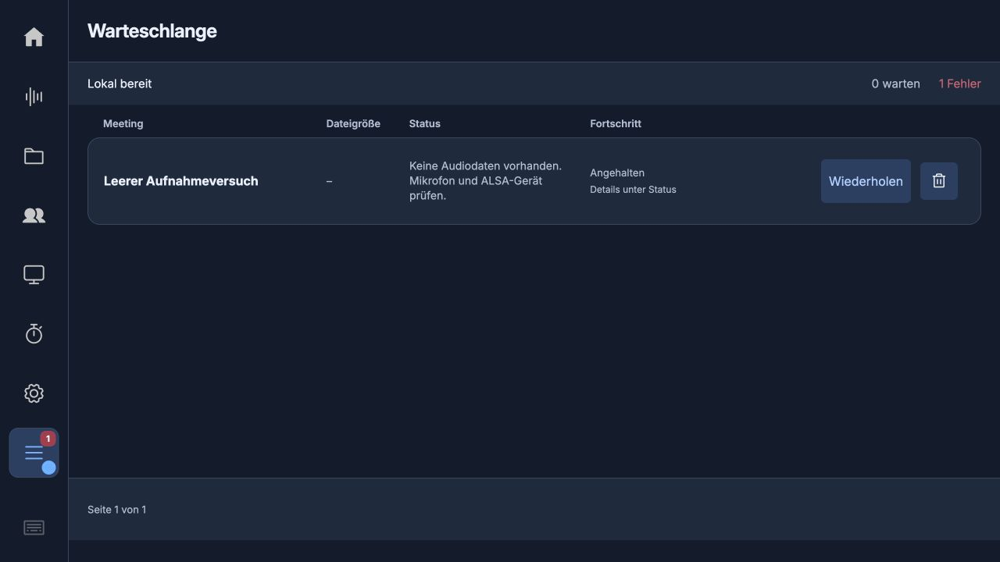
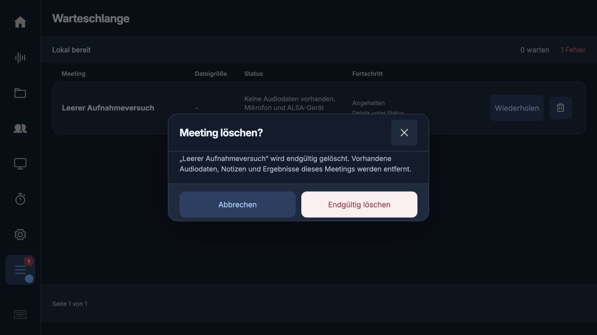

# App-eigene Bestätigungen · 0.5.65

Die vollständige ausgelieferte Web-Oberfläche wurde nach alert(), prompt(), confirm() und beforeunload durchsucht. Gefunden wurden zwei native Löschbestätigungen (Meeting und eigene Vorlage) und der Browser-Verlassensschutz bei ungespeicherten Entwürfen. Keine nativen JS-Eingabefenster waren vorhanden. Bereits eigene Dialoge für Wiedergabe, Titelbearbeitung, Netzwerk, Theme-Löschung und Neustart bleiben erhalten. Betriebssystem-/Browser-Berechtigungen und Dateiauswahl gehören nicht zu diesen App-Dialogen.

Beide Löschaktionen nutzen denselben modal geöffneten, beschrifteten und im Theme gestalteten HTML-Dialog. Zielname und Konsequenz sind Klartext, keine HTML-Interpolation. Fokus zuerst auf Abbrechen; Escape, X und Abbrechen antworten negativ. Nur der ausdrücklich beschriftete Aktionsbutton bestätigt. Ein zweiter Aufruf überschreibt keinen offenen Dialog. Danach kehrt der Fokus zum Auslöser zurück. Meeting-/Vorlagenkennung wird vor dem Warten festgehalten. Keine produktiven Meetings wurden zur Prüfung gelöscht.

Die synchrone Browser-Verlassenswarnung wurde entfernt. Texte werden bereits bei jeder Änderung lokal als Entwurf gesichert; pagehide sichert verbleibende schmutzige Felder nochmals synchron. Eine Web-App kann beim tatsächlichen Schließen eines Browserfensters keinen eigenen asynchronen Bestätigungsdialog erzwingen. Daher erfolgt hier Entwurfssicherung statt eines vermeintlichen Ersatzdialogs. Bestehende Speichern-/Fehlermeldungen und Entwurfswiederherstellung bleiben erhalten.

Papierkorb-Icons nutzen den Theme-Filter. In Mitternacht, Graphit und CDB werden sie ausdrücklich weiß; benutzerdefinierte Themes verwenden ihren vorhandenen Icon-Kontrastwert. Keine produktive Theme-Auswahl wird geändert.

121 JavaScript-Tests bestanden, einschließlich neuer Tests für Escape, Abbrechen, explizite Zustimmung, Fokus, Zielschutz, Textdarstellung und Verbot nativer JS-Dialoge in allen ausgelieferten JS-/HTML-Dateien. Browserprüfung mit synthetischem Fehlerfall: helles Papierkorb-Icon in Mitternacht, eigener kompakter Dialog, Abbrechen und Escape erhalten den Auftrag und bringen den Fokus zurück. Die alte Chrome-Testbestätigung aus dem vorherigen Versuch blockierte dessen Steuerkanal; die aktuelle Prüfung erfolgte in einem unabhängigen In-App-Browser ohne native JS-Dialoge.

Image-Auswirkung: ausschließlich bereits erlaubte Dateien web_server.py, studio/app.js, studio/index.html, studio/themes.css und studio/workspace.css. Kein neues Asset, keine Runtime, keine Datenmigration, keine Factory-/Dienständerung. Neuer App-Stand wird beim sauberen Image-Export übernommen; kein neues Image gebaut oder gebootet.
