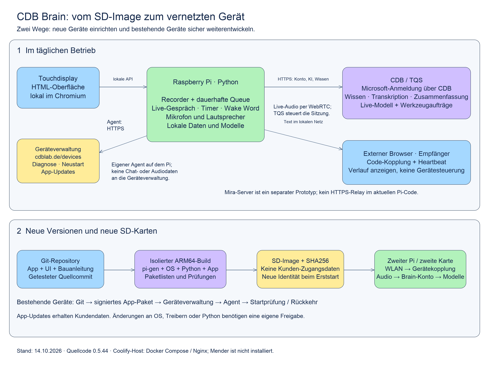

# Wie die Brain-Systeme zusammenspielen

Stand: 14. Oktober 2026, Recorder 0.5.44. Diese Übersicht beschreibt den hier
vorliegenden Code. Historische Entwürfe sind nicht automatisch produktive Funktionen.

[Bearbeitbare Grafik](brain-architecture.excalidraw) ·
[Im Browser öffnen](https://excalidraw.com/#json=gW2g1hNhQoQNYwrWs1XmP,tTwrMdAgNUc35jAFOOisxQ) ·
[Image bauen und weiterentwickeln](../customer-image/README.md)

## Ein Gerät, drei unterschiedliche Verbindungen

**Das Gerät arbeitet selbst.** Chromium zeigt die HTML-Oberfläche auf dem
Touchdisplay. Python auf demselben Pi besitzt Mikrofon, Lautsprecher,
Aufnahmen, dauerhafte Verarbeitungsschlange, Timer und Aktivierungswort.
Die Oberfläche spricht die lokale API auf `127.0.0.1:8088` an. Aufnahme und
Live-Gespräch schließen sich aus; die Verarbeitung bereits fertiger Aufnahmen
kann parallel weiterlaufen. Lokale Whisper-/Ollama-Modelle werden nach der
Installation ausgewählt und heruntergeladen.

**Das Brain-Konto erschließt Wissen und Online-KI.** Die Microsoft-Anmeldung
läuft über den Device-Code-Ablauf. Python bewahrt die Sitzung auf; der Browser
bekommt keine Microsoft-Tokens. Der Pi ruft die öffentliche CDB-API auf.
Das CDB-WebOS-Backend (BFF) reicht TQS-Anfragen an den zuständigen Dienst weiter.
TQS vermittelt Transkription, Zusammenfassung, Wissenssuche und Live-Sitzungen.
Die Auswahl „lokal“ beziehungsweise „CDB“ bestimmt, wo die Verarbeitung erfolgt.
Die Übertragung in eine Knowledge Area ist ein eigener, quittierter Auftrag.

Im Live-Gespräch laufen Steuerung und Ereignisse über die CDB-API
`/api/v1/tqs/voice-live`. Das native Python-Audio verwendet die von CDB
vermittelte WebRTC-Verbindung zum Sprachdienst. TQS verwaltet die Modellseite,
Suchwerkzeuge und die Geräteaufträge. Bei „Stelle einen Timer“ interpretiert
das Modell die Sprache; **der Pi** prüft und speichert den Auftrag in seiner
lokalen Datenbank und quittiert ihn. Ein wiederholter Abruf erzeugt keinen
zweiten Timer. Der Timer kann anschließend unabhängig vom Gespräch auslösen.
Die konkret eingesetzte Cloud-Modellbereitstellung ist Serverkonfiguration.

**Die Geräteverwaltung betreibt die Hardware.** Unter
[cdblab.de/devices](https://cdblab.de/devices/) koppelt der Administrator Geräte
per Einmalcode. Ein separater Agent auf dem Pi meldet sich alle 30 Sekunden
über ausgehendes HTTPS: Version, Erreichbarkeit, Temperatur und technische
Aktivität. Er holt feste Aufträge für Diagnose, App-Neustart, Pi-Neustart und
signierte App-Updates ab. Diese Verwaltung erhält keine Aufnahmen,
Chatverläufe, Knowledge Areas oder persönlichen Brain-Tokens. Aufnahme,
Gespräch und andere belegte Ressourcen verhindern einen Wartungsstart.
Die Geräteberechtigung und die persönliche Microsoft-Anmeldung sind getrennt.

## Was „Remote Controller“ hier bedeutet

| Baustein | Aufgabe | Grenze |
| --- | --- | --- |
| Studio im Kiosk | Aufnahme, Gespräch, Einstellungen und lokale Steuerung | Lokaler Dienst; nicht öffentlich ins Internet stellen |
| Geräteportal | Diagnose, Neustart und signierte App-Versionen | Keine beliebige Shell, kein Zugriff auf Gesprächsinhalte |
| Gekoppelter Browser-Empfänger | Vollständigen aktuellen Gesprächsverlauf anzeigen | Nur lesend, kein Mikrofon und keine Gerätesteuerung |
| Mira-Server auf dem Infrastrukturhost | Separater Sender-/Empfänger-Prototyp | Im aktuellen Recorder nicht als öffentliches HTTPS-Relay integriert |

Der aktuelle Empfänger wird vom Pi auf Port 8090 im vertrauten lokalen Netz
bereitgestellt. Der Browser fordert einen Code an; der Benutzer bestätigt ihn
am Pi. Ein eigener Cookie und Heartbeats begrenzen den Zugriff. Kontowechsel,
Entkoppeln und Ablauf widerrufen ihn. **Diese LAN-Verbindung nutzt HTTP.**
Der Mira-Prototyp verwendet dagegen einen eigenen Server, andere Kopplungsrichtung
und WebSockets. Diese beiden Protokolle dürfen nicht gleichgesetzt werden.
Siehe [Codeprüfung und belegter Serverbestand](../mira-receiver-review.md).

**Erweiterung im Feature-Branch, als 0.5.61 auf dem Test-Pi installiert;
serverseitige Staging-Freischaltung und Verbundabnahme noch offen:** Die CDB-Mobile-App
steuert denselben Pi-Gesprächsdienst über einen eigenen CDB-Control-Kanal.
Bluetooth-Tastenfernbedienungen sind zunächst zurückgestellt.
Persönliche Steuerrechte bleiben von Geräteadministration und lesender
Bildschirmkopplung getrennt. [Umsetzung, Vertrag und Abnahmegrenzen](../remote-control/IMPLEMENTATION-63.md).

## Wo die Server laufen

Die Gerätezentrale läuft auf dem Infrastrukturhost mit dem Namen
`coolify-test`, über Docker Compose hinter dem vorhandenen Nginx. Der Name
bedeutet nicht, dass dort schon ein Coolify-Controller läuft. Mender wurde
bewertet, ist aber nicht installiert. Tailscale dient dem administrativen
Zugang zum Infrastrukturhost; es ist keine Voraussetzung für die normalen
Gerätemeldungen über HTTPS. Das Kunden-Image enthält keine Tailscale-Identität.

CDB/TQS sind eigenständige Dienste der gewählten Brain-Umgebung. Das Recorder-
Repository liefert weder TQS noch dessen Modelle aus. Für neue Sprachwerkzeuge
müssen bei Bedarf Pi, TQS und BFF gemeinsam kompatibel weiterentwickelt werden;
ein neues SD-Image allein erweitert nicht die Server-API.

## Image und Update gehören zu derselben Produktversion

Ein **SD-Image** kombiniert Raspberry Pi OS, Desktop, Systemdienste, Treiber-
Unterstützung, Python-Pakete und einen festgehaltenen App-Commit. Nach Schreiben
auf eine zweite Karte startet ein neues Gerät mit eigenem Hostnamen, leerem
Profil und Erststart-Assistenten. WLAN, Gerätekopplung, Brain-Anmeldung und
Modellwahl erfolgen auf diesem Gerät. Die Karte ist kein Klon von Chris' Pi.

Ein **App-Update** enthält nur zugelassenen Code und Oberflächen-Dateien.
Signatur und Kompatibilität werden geprüft, die Version atomar umgeschaltet
und der Start geprüft. Bei Fehlern kehrt der Agent zur vorherigen Version
zurück. Kundendaten und Modelle liegen außerhalb der ausgetauschten Version.
Systemdienste, Agent, Python-Abhängigkeiten und OS werden damit nicht ersetzt.

Eine Weiterentwicklung kann deshalb zwei Auslieferungen erzeugen: ein
App-Paket für kompatible bestehende Geräte und ein aktuelles SD-Image für neue
Geräte. Bei veränderter Runtime ist ein eigenes, getestetes Migrationsverfahren
nötig; inkompatible App-Pakete werden abgewiesen. Die verbindliche
[Image-Pflegeanleitung](../customer-image/README.md) hält diese Entscheidung fest.

## Quellen im Repository

- `web_server.py`, `services/app_activity.py`: API und gegenseitige Sperren.
- `services/cdb_integration.py`: Microsoft-Anmeldung, CDB-Verarbeitung, Übertragung.
- `services/live_conversation.py`, `services/live_audio.py`: Live-Vertrag und Audio.
- `services/schedules.py`: lokale Timer und Gerätequittungen.
- `services/remote_display.py`, `studio/receiver/`: LAN-Empfänger und Heartbeat.
- `fleet/agent.py`, `fleet/server.py`, `fleet/releases.py`: Verwaltung und Updates.
- `scripts/prepare_customer_image.py`, `deploy/customer-image/`: Image und Erststart.
- [TQS-/BFF-Abnahme](../device-tools-0.5.32/README.md),
  [Geräteverwaltung](../device-management-0.5.43/README.md),
  [Erststart](../first-start-0.5.44/README.md).

## Vorbereitete Sprachansagen

`services/announcements.py` verwaltet feste, geprüfte WAV-Clips und separate Opt-ins. `StudioApp` entscheidet unter den vorhandenen Gerätesperren über Ausgabe; `AudioOutput` besitzt den Wiedergabeprozess bis zum bestätigten Ende. Phonon wird ausschließlich vom optionalen Vorbereitungswerkzeug auf einem anderen Rechner verwendet. Kein zweiter Mikrofonpfad, keine Runtime-Synthese. [Verhalten und Installation](../local-announcements/README.md).

## USB-Timerdisplay (Entwicklung, PR 16)

Der optionale `cdb-lcd-display.service` läuft getrennt vom Recorder. Er liest nur
`/api/lcd/timers` über Loopback und öffnet ausschließlich einen anhand der
USB-Metadaten erkannten CDB-Timerdisplay-Port. Keine Mikrofon-, Audio- oder
Timer-Schreibbefehle; keine neue Option pro Timer. Firmware und Begleitdienst
werden einmal separat eingerichtet. Details, Ausfälle, Installation und offene
Hardwareabnahme: [LCD-Display](../lcd-display/README.md).
