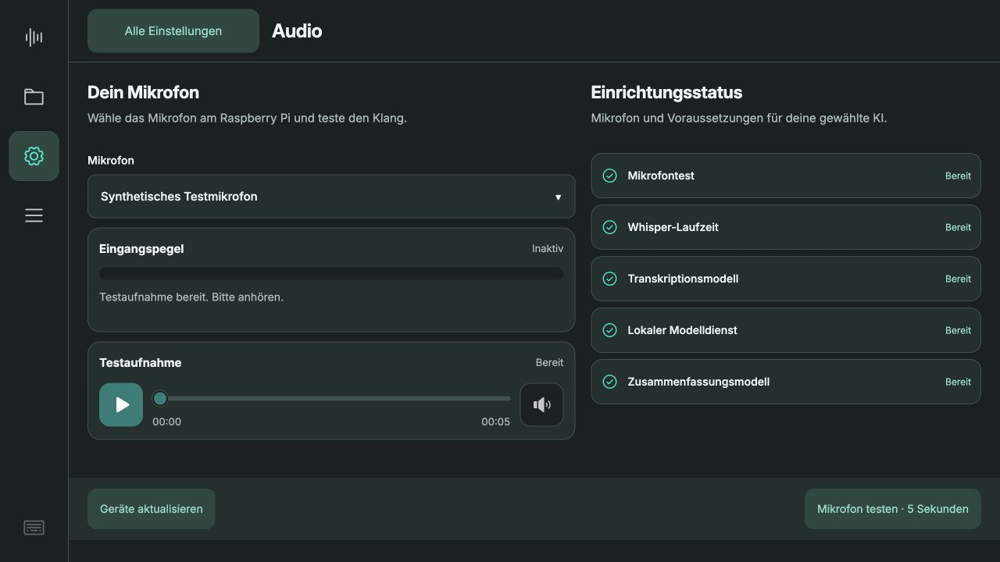

# Mikrofon und Testplayer · Studio 0.5.11

12. Oktober 2026. Ziel: Touch Display 2, Querformat 1280 × 720.

## Gestaltung

- Zwei feste Spalten: Mikrofon, Live-Pegel und Testplayer links; Einrichtungsstatus rechts.
- Prüfungen als gleichmäßig hohe Zeilen mit Name, Symbol und Status. Keine umbrochenen Chips und keine doppelte Beschriftung „bereit · bereit“.
- Eigener Player im gewählten Theme, mit 56-Pixel-Play/Pause- und Ton-Buttons, 44-Pixel-Suchleiste sowie aktueller Zeit und Gesamtdauer.
- Live-Pegel nur während eines laufenden Mikrofontests. Der gespeicherte Spitzenpegel einer alten Aufnahme wird nicht mehr als aktuelles Signal dargestellt.
- Ohne erkanntes Mikrofon ist der Test gesperrt. Ein gespeichertes Testaudio bleibt als „Frühere Aufnahme“ abspielbar. „Geräte aktualisieren“ prüft nach dem Anschließen erneut.
- Ein neuer Test, eine laufende Hauptaufnahme, Verbindungsverlust oder das Verlassen von Audio pausiert die Wiedergabe. Sehr leise Aufnahmen und Testfehler bleiben verständlich sichtbar.
- Die rechte Liste zeigt Einrichtungsvoraussetzungen. Die ausführlichen, modellgebundenen Gerätetests bleiben unter „KI & Modelle“.

## Prüfung

78 Python-Tests auf dem Pi bestanden, 34 JavaScript-Tests bestanden (darunter fünf neue zustandsbezogene Tests für den Mikrofonplayer). Keine Browserfehler im geprüften Ablauf.

Im isolierten Pi-Testdienst mit künstlicher PCM-Quelle geprüft: fünf Sekunden aufnehmen, Testwiederholung, Play/Pause, Spulen, Ton an/aus, Rückkehr zur Einstellungsübersicht, simuliertes fehlendes Mikrofon und erneute Geräteerkennung. Keine Kundenaufnahme oder Cloudübertragung.

Bei 1280 × 720 benötigt die Audiofläche 532 Pixel und hat exakt dieselbe Scrollhöhe; keine zusätzliche Inhaltsseite. Header 80 Pixel, Footer 80 Pixel, unveränderte Player-Position vor und nach dem Test. Geometrie in `geometry.json`.

Die Screenshots 01–05 stammen aus dem isolierten Testdienst (synthetisches Mikrofon). Helles und Graphit-Theme wurden geprüft. Die Produktionsansicht wird nach Auslieferung separat dokumentiert. Am produktiven Pi wurde vor Auslieferung kein Hardware-Mikrofon erkannt; diese Änderung behauptet deshalb keinen neuen physischen Mikrofontest.

