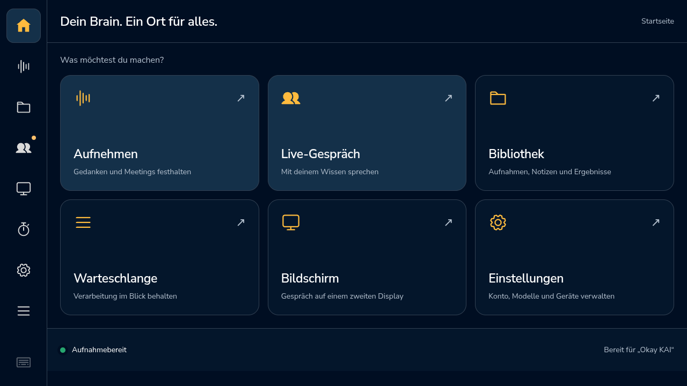

# Audiofreigabe erst nach bestätigtem Beenden · 0.5.54

15. Oktober 2026. Im isolierten Fehleraudit von `fddfb50` wurden zwei
Sicherheitslücken reproduziert: Nach einem abgewiesenen Prozesssignal verlor
WakeWord die Referenz auf den noch laufenden Detektor. Nach einem Fehler beim
Schließen des nativen Live-Audios gab LiveConversation die Reservierung frei
und verwarf das Audioobjekt. Die Prüfwerte `wake_tracks_unreleased_child`,
`live_blocks_second_owner_after_close_failure` und
`live_tracks_unreleased_audio` waren jeweils `false`.

Das sind gezielt injizierte Fehler, kein Nachweis ihrer Ursache bei den früheren
natürlichen Wake-Aussetzern. Es wurden weder ein produktiver Prozess beschädigt
noch Raumaufnahmen erzeugt.

## Korrektur

- Der Wake-Prozess bleibt bis zum bestätigten Ende im Besitz der App. Bei
  fehlgeschlagenem Signal oder Timeout wird die Freigabe nach zehn Sekunden
  erneut versucht. Bis dahin werden weder Erkennungen übernommen noch neue
  Detektoren gestartet. Die normale Aufnahmesperre bleibt erhalten.
- Ein zweiter Fehler beim Aufräumen beendet die Bereitschaftsschleife nicht.
  Der Benutzer erhält einen lokalen Hinweis statt interner Fehlerdetails.
- Live bleibt bei fehlgeschlagener Audiofreigabe im gesperrten Zustand
  `closing`. Audioobjekt, Sitzungsgeneration und Reservierung bleiben erhalten;
  erst eine erfolgreiche Wiederholung gibt sie frei. Die Prüfung läuft im
  vorhandenen lokalen Überwachungsthread mit fünf Sekunden Wiederholabstand.
- Native Audio unterscheidet jetzt „Stopp angefordert“ von „Ressourcen
  vollständig geschlossen“. Die Eingabe wird sofort stummgeschaltet. Bei einem
  fehlgeschlagenen Aufräumen bleibt die Ereignisschleife für den nächsten Versuch
  verfügbar. Ein gesetztes Stopp-Flag allein zählt nicht mehr als Freigabe.

Bei einer dauerhaft nicht behebbaren Betriebssystemstörung bleibt das Gerät
sichtbar gesperrt. Ein zweiter Audiobesitzer wird nicht als Ausweg gestartet.
Diese Korrektur aktiviert keinen Browser-, Backend- oder Pi-Neustart und keinen
automatischen Wartungs-Watchdog.

## Prüfung und Grenzen

Die neuen Regressionen in `tests/test_audio_release.py` prüfen verweigerte
Signale, Timeout auch nach SIGKILL, einen echten ausschließlich vom Test
gestarteten stillen Kindprozess, verhinderte zweite Reservierung, erneute
Freigabe und eine Cloud-Schließbestätigung vor dem lokalen Abschluss.
`test_studio.py` prüft zusätzlich, dass wiederholte Freigabefehler die
Bereitschaftsschleife nicht beenden. Alle Profile und Dienste sind isoliert;
keine produktiven Zugangsdaten, Mikrofone oder Lautsprecher werden verwendet.

Die vollständigen Testläufe bestehen mit jeweils **338 Tests**: [Mac](python-tests-mac.txt)
und [Pi](python-tests-pi.txt). Die Pi-Prüfung läuft aus einem separaten
Testverzeichnis; die produktive App bleibt währenddessen unverändert. Die
anschließende sichere Auslieferung wird separat belegt.
Eine echte dauerhafte Kernelblockade wird nicht erzeugt. Die Tests belegen
die lokale Reservierungslogik, keine fehlerfreie Hardware unter allen Bedingungen.

## App-Update und Kunden-Image

Geändert werden die vorhandenen Dateien `services/wake_word.py`,
`services/live_audio.py`, `services/live_conversation.py` und `web_server.py`.
Keine neue Abhängigkeit, Firmware, Berechtigung, Datenmigration, Audioauswahl
oder Modellkonfiguration. Alle Laufzeitdateien gehören bereits zur App-
Positivliste. Ein neues Kunden-Image übernimmt sie aus dem ausgewählten Commit;
das vorhandene Image 0.5.44 bleibt unverändert. Testdateien und Berichte sind
keine zusätzlichen Produktdienste.

Die laufende Beobachtung von 0.5.53 wird nicht als Prüfung von 0.5.54 ausgegeben.
Nach einer bestätigten Auslieferung ist für die neue Version eine eigene
24-Stunden-Beobachtung nötig; der bisherige Teilbericht bleibt erhalten.

## Ausgeliefert und am Gerät geprüft

[Signiertes Update, Sequenz 11](deployment.json) aus Commit
`14f9dc571b5d7f712bd12f4ba139009f893cb8d5`: Version 0.5.54, gespeicherte
Einstellungen unverändert. Der vorhandene Verwaltungsagent reservierte die
Wartung atomar und prüfte Signatur, kompatible Runtime und Startgesundheit.
Keine laufende Aufnahme wurde beendet.

[Installationsprüfung](installation-check.json): API und ausgeliefertes HTML
melden 0.5.54; sämtliche vier geänderten Laufzeitdateien haben dieselben
SHA256-Werte wie der getestete Quellstand. 18 Stichproben über rund 34 Sekunden
zeigen durchgehend Bereitschaft mit genau einem unveränderten Wake-Prozess.
Das ist eine Startprüfung, kein Sprach- oder Langzeitnachweis.

Der [neue Messplan](observation-plan.json) reicht vom **15.10.2026, 20:56:47 Uhr
bis 16.10.2026, 20:56:47 Uhr Europe/Berlin**. Der echte Beobachterprozess wurde
als aktiv bestätigt; unveränderte Revision 2, weiterhin ausschließlich lesend.
Okay KAI bleibt aktiviert. Die automatische Nachprüfung wurde auf diese Version
und Frist aktualisiert und reicht bis 16.10., 22:00 Uhr.

Der [vorherige Teilbericht](previous-partial-observation.json) umfasst etwa
55 Minuten. Archiv auf dem Pi: `baseline-053-before-audio-release-fix`.
Sein abschließender Backend-Wechsel und die Beobachtungslücke gehören zur
bestätigten Installation; sie werden nicht aus den Daten entfernt. Der isolierte
Pi-Testlauf erzeugte vor dem Update zusätzliche Testlast. Weder diese Zeitreihe
noch die 18 Startstichproben zählen als bestandener 24-Stunden-Lauf.

Offen bleiben die vollständige neue Langzeitmessung, ein echter Wake nach
mindestens acht Stunden Pause und die akustischen Grenzen der KAI-Varianten.
Diese Freigabekorrektur ändert weder Modell noch Erkennungsschwellen.

## Ergänzender Wiederholungstest ohne Änderung am Pi

Die neue Regression `test_100_concurrent_close_retries_leave_no_audio_threads`
führt auf dem Mac 100 Runden mit jeweils zwei gleichzeitigen Aufrufern aus.
Jede Runde verwendet eine echte neue Python-Ereignisschleife und deren Thread.
Der erste Aufräumversuch wird absichtlich mit einem Fehler beendet; der zweite
muss erfolgreich schließen. Nach jeder Runde werden geschlossener Loop,
beendeter Thread und null aktive Audioprozesse geprüft. **100/100 Runden
bestanden**, zusammen mit den übrigen sieben gezielten Freigabetests.
[Testprotokoll](concurrent-close-tests-mac.txt).

Keine Audiohardware, keine Cloud-Verbindung und keine produktiven Daten waren
beteiligt. Das prüft Wiederholbarkeit und Nebenläufigkeit des lokalen
Aufräumpfads, nicht 100 echte Sprachgespräche. Ausschließlich Test und Bericht
werden ergänzt; produktives Paket 0.5.54, Kunden-Image und laufender Messzeitraum
bleiben unverändert. Der neue Test ist nicht Bestandteil des früheren
338-Test-Protokolls und wird nicht nachträglich in dessen Zähler eingerechnet.
