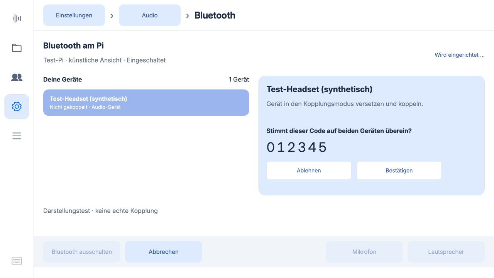
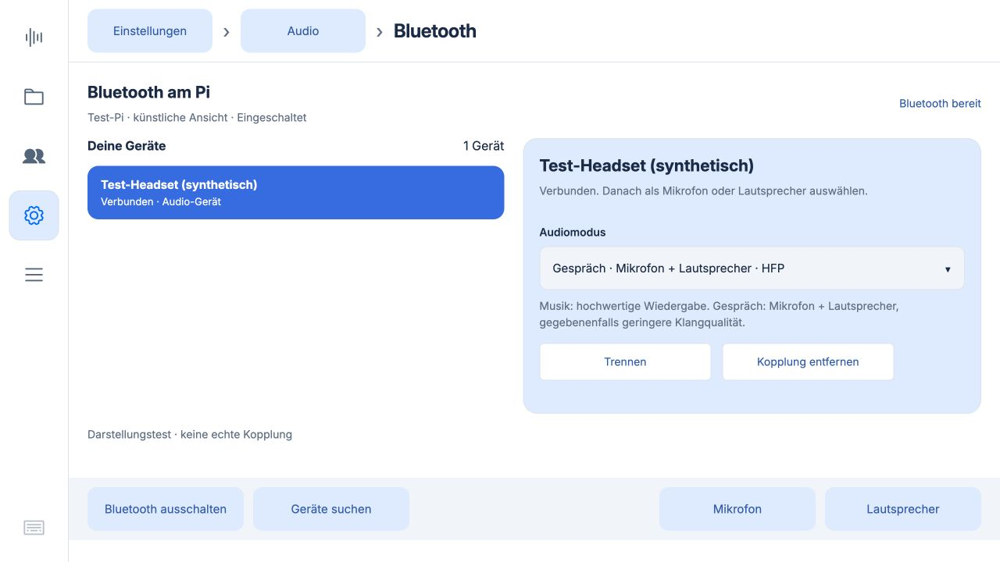
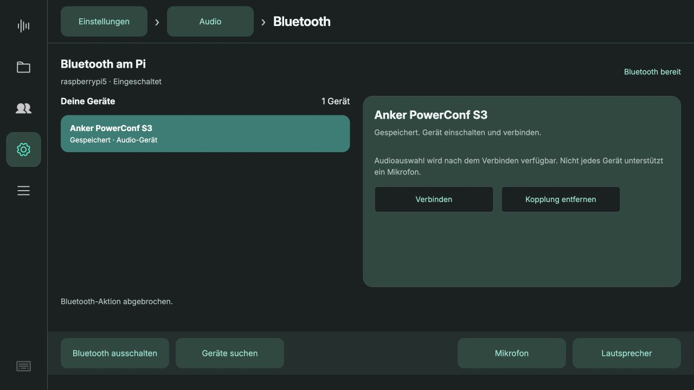
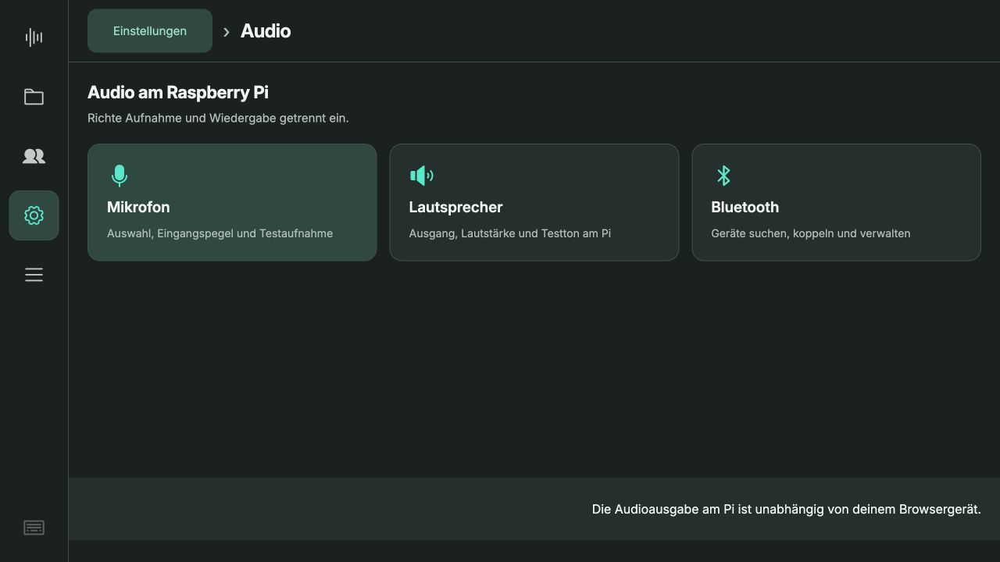

# Bluetooth-Abnahme 0.5.21

13.10.2026. Neuer Bereich **Einstellungen → Audio → Bluetooth** mit vorhandenen Themes, Breadcrumbs, fester Aktionsleiste und direkt anwählbaren Geräteseiten.

## Automatisiert geprüft

137 Python-Tests und 59 JavaScript-Tests bestanden. Abhängigkeiten konsistent. Prüfungen umfassen:

- Codes werden vor dem Vertrauen ausdrücklich bestätigt; abgelehnte/fremde Anfragen führen nicht zur Freigabe.
- Ungültige oder veraltete PIN-/Codeantworten und unbekannte Geräte werden verworfen.
- Eigene Suche endet beim Abbruch. Abbruch direkt beim Start sowie Wechsel von Suche zu Verbindung geben die Reservierung erst nach Bereinigung frei.
- Ein abgebrochener Verbindungsaufbau wird zusätzlich bei BlueZ getrennt, damit eine verspätete Verbindung nicht erst nach Freigabe erscheint.
- Nur Profile der exakt ausgewählten Bluetooth-Adresse werden angeboten; Musik-/Gesprächsmodi statt Eingangs-/Monitorprofilen.
- Serverseitige gegenseitige Sperren für Aufnahme, Live-Gespräch und Bluetooth; CSRF-Schutz.

## Oberfläche

1280 × 720: Startansicht, Gerätedetail, Profilwahl, Kopplungscode, Entfernen-Bestätigung und PIN-Eingabe mit Touch-Tastatur (Ziffer eingeben, Tastatur schließen, Wert bleibt erhalten). Keine scrollende Geräteübersicht: drei Geräte pro Seite. Kopplungsdialog ist ein Bereich innerhalb der View, kein neues Modal.

Die folgenden Ansichten verwenden ausdrücklich synthetische Daten. Sie belegen das Layout, keine echte Hardwarekopplung:

## Echte Hardware

BlueZ und PipeWire auf dem Pi erreichbar; gespeichertes Anker PowerConf S3 wird korrekt als getrennt angezeigt. Kein vorhandenes Gerät entfernt oder neu gekoppelt. Die Marshall-Box des Benutzers war beim Implementieren ausgeschaltet. Ihr Pairing und hörbarer Testton sowie ein echter Bluetooth-Mikrofontest bleiben deshalb als gemeinsame Hardwareabnahme offen.

Version 0.5.21 wurde auf den Pi gespielt (Code `7d4391a`). Echte BlueZ-Suche gestartet, 14 Geräte sichtbar, parallele Aufnahme/Gespräch/Einstellungsänderung serverseitig abgewiesen, Suche sauber beendet und Steuerung wieder freigegeben. Vorhandene Kopplungen unverändert. Backend und Kiosk aktiv, SHA256 aller geänderten Laufzeitdateien stimmt mit dem Commit überein; 22 Meetings und vorhandene Konfiguration erhalten. [Deployment-Protokoll](deployment.json). [Anleitung](../bluetooth.md).

## Produktive Oberfläche

