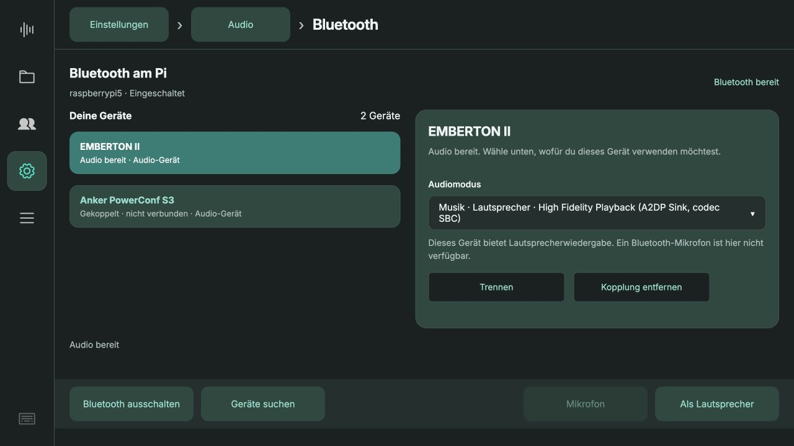
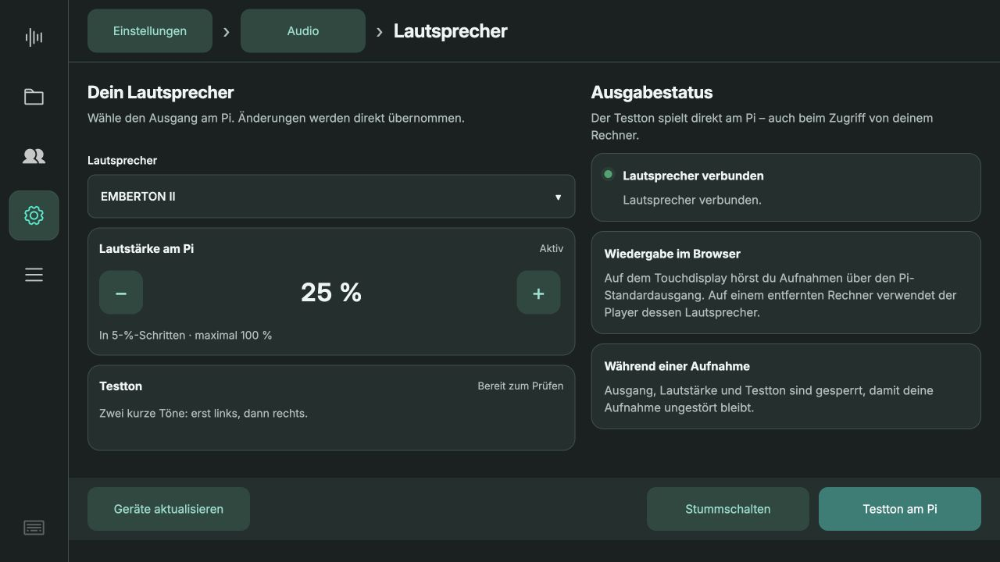

# Bluetooth-Audio 0.5.22

13.10.2026. Korrigiert die Unterscheidung zwischen gespeicherter Kopplung, Bluetooth-Verbindung und tatsächlich verfügbarem Audio.

- Audioausgänge und Eingänge werden der exakten Bluetooth-Adresse zugeordnet. Monitorquellen und nicht verfügbare Profile werden ausgeschlossen.
- „Als Lautsprecher“ aktiviert genau den markierten Bluetooth-Ausgang. Bei fehlendem Ausgang bleibt der Button gesperrt. Kein stiller Wechsel zum USB-Lautsprecher.
- Verbindungsausfälle zeigen Hinweise zu Handyverbindung und erneutem Koppeln; Trennen und Entfernen erhalten eigene Rückmeldungen.
- Eine reine Musikbox bietet keinen Mikrofon-Shortcut.

## Abnahme

142 Python-Tests auf dem Pi und 61 JavaScript-Tests bestanden. Zusätzlich echte PipeWire-Audiozuordnung geprüft. Tests decken fehlende Endpunkte, veraltete Verbindungsdaten, Fehlerbehandlung und die exakte Lautsprecherauswahl ohne Navigation bei Fehler ab.

Marshall EMBERTON II war zunächst gespeichert, aber getrennt. Nach erneuter Aktivierung des Kopplungsmodus ließ sich die A2DP-Verbindung herstellen. Kein Löschen der Kopplung und keine Treiberänderung nötig. Ursache der ursprünglichen Verbindungsablehnung nicht abschließend belegt.

Marshall wurde bei 25 % ausgewählt; der Testton wurde auf ihrem eigenen PipeWire-Ausgang vollständig abgespielt. **Benutzer bestätigt: beide Töne gehört.** ReSpeaker bleibt als Mikrofon eingestellt.

## Produktiv geprüft

Code-Commit `11a1dd0` auf dem Pi aktiv, Backend und Kiosk laufen. Laufzeitdateien gegen die committed SHA256-Prüfsummen verglichen. Alle 22 Meetings, Kontoverbindung und Verarbeitungskonfiguration erhalten. [Deployment-Nachweis](deployment.json).

1280 × 720: Marshall korrekt als „Audio bereit“, gespeicherte getrennte Anker korrekt als „Gekoppelt · nicht verbunden“. Mikrofon-Shortcut bei Marshall gesperrt. „Als Lautsprecher“ geöffnet und danach **EMBERTON II bei 25 %** in der produktiven Auswahl bestätigt. Keine Browserfehler. Testansicht separat geschlossen; keine neue Testaufnahme erzeugt.

