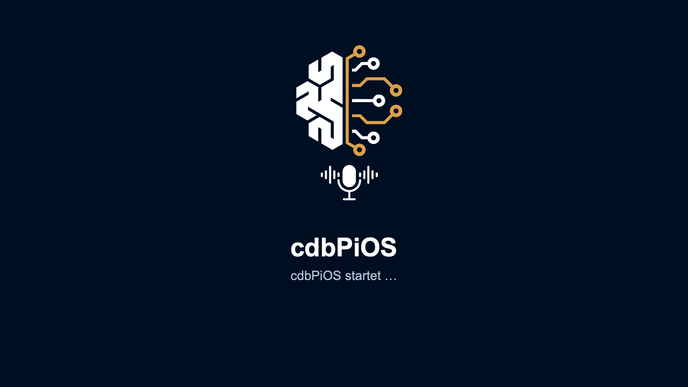

# cdbPiOS · Startbildschirm und Geräteklänge

Stand: 23.11.2026. Schreibweise vom Benutzer vorgegeben: **cdbPiOS**.

Der neue Startbildschirm zeigt das vorhandene CDB-Brain-Signet mit Mikrofon auf
dunkelblauem Grund, den Produktnamen und **„cdbPiOS startet …“**. Ein kleiner
Bernsteinpunkt pulsiert ohne erfundene Prozentangabe. Beim Ausschalten lautet der
Text **„cdbPiOS wird heruntergefahren …“**. Das Bild ist eine gerenderte Oberfläche
aus dem bestehenden `icon.png`, keine neu erfundene Logoform.



## Klänge

Recorder Studio 0.5.93 enthält einen eigenen kurzen Startakkord und einen
absteigenden Abschied. Keine aus dem Netz übernommenen Apple-Aufnahmen. Der
Startklang bestätigt die erstmals bereite Bedienoberfläche, nicht schon das
Einschalten des Netzteils. Das passt zum USB-Lautsprecher, der erst nach dem
Audiostart verfügbar ist. Der Abschied begleitet den bestätigten Ausschaltvorgang
über das Menü. Er bedeutet nicht, dass die Stromversorgung bereits getrennt
werden darf. Die Klangoptionen, Stummschaltung und der Aktivitätsschutz sind
in der [Klangdokumentation](../device-sounds-0.5.93/README.md) beschrieben.

## Befund am vorhandenen Pi

- Raspberry Pi 5, Raspberry Pi OS / Debian 13, Plymouth 24.004.60-5, Theme `pix`.
- Offizielles 7-Zoll Touch Display 2, DSI-1: native Auflösung 720 × 1280.
- Kanshi dreht erst den Desktop mit `transform 90` ins Querformat. Daher steht
  das bisherige frühe Startbild hochkant.
- `quiet splash`, automatische initramfs und KMS sind bereits eingerichtet.
- Das neue Theme benutzt für native Hochkantflächen um 90° gegen den Uhrzeigersinn
  vorgedrehte Bilder; für tatsächlich querformatige Ausgänge normale Bilder.
  270° ist als alternative Einbaurichtung vorbereitet. Desktop und Touch werden
  nicht ein zweites Mal gedreht. Der reale Kaltstart muss die Einbaurichtung
  noch bestätigen.

Der Installer ergänzt `logo.nologo` gegen die Kernel-Raspberry-Logos und
`disable_splash=1` gegen den Firmware-Farbbildschirm. Er wählt das eigene
Plymouth-Theme und aktualisiert die initramfs. Firmware-Fehlerdiagnosen und
Bootloader-Recovery werden dadurch nicht ersetzt. Escape und erforderliche
Plymouth-Rückfragen bleiben verfügbar. Das Theme ändert weder Root-Partition,
KMS-Modus, Touch-Zuordnung, Benutzerrechte noch Desktop-Autostart.

## Vorhandenes Gerät installieren

Die Systeminstallation ist ein ausdrücklicher, separater Administrationsschritt;
der signierte App-Updater führt keinerlei Root-Installer aus.

```sh
# Im vorbereiteten Paket auf dem Pi (Prüfung ohne Änderungen):
python3 /home/bik/cdb-boot-brand/install.py --check
# Einmalig im Terminal mit den Administratorrechten des Pi:
sudo python3 /home/bik/cdb-boot-brand/install.py
```

Der Installer startet den Pi **nicht** neu. Nach erfolgreicher Ausgabe bei
freiem Gerät über das Menü neu starten. Prüfen: Logo waagerecht, exakte
Schreibweise cdbPiOS, Übergang zur Bedienoberfläche, Startklang einmalig,
Touch korrekt, beide Audio-Schalter weiterhin gesetzt. Anschließend einen
regulären Ausschaltvorgang mit Abschied testen. Kein Wiederholungston bei
Seitenneuladen oder App-Neustart. Lautlose Einstellung bleibt lautlos.

Jede Änderung sichert die drei betroffenen Konfigurationsdateien und ein ggf.
vorhandenes CDB-Theme unter `/var/backups/cdb-boot/`. Die Ausgabe nennt den
genauen Ordner. Bei fehlgeschlagener initramfs-Erstellung stellt das Skript
die alten Einstellungen wieder her und versucht erneut, die vorherige
Startkonfiguration in die initramfs zu übernehmen.

```sh
sudo python3 /home/bik/cdb-boot-brand/install.py --restore /var/backups/cdb-boot/ZEITSTEMPEL
```

`ZEITSTEMPEL` durch den tatsächlich ausgegebenen Ordner ersetzen. Ein erneuter
Aufruf mit unverändertem Paket macht nichts. Falls das Display entgegengesetzt
montiert ist, mit `--portrait-rotation 270` installieren. Nicht gleichzeitig
Kanshi oder Kernel-Rotation ändern.

## Neue SD-Images und Reproduzierbarkeit

Die Dateien unter `deploy/boot-brand/` werden ausdrücklich in das Factory-Paket
exportiert, über dessen Inhaltsmanifest gehasht und im geschützten pi-gen-Schritt
installiert. Plymouth, dessen Themes und initramfs-tools stehen ausdrücklich in
der Paketliste. Der Renderer `scripts/render_boot_brand.py` benötigt nur die
vorhandene Entwicklungsumgebung mit PySide6; das Gerät verwendet fertige PNGs,
ohne neue Python-Grafikabhängigkeit. Landscape-Master: 1280 × 720; beide
Hochkant-Einbaurichtungen: 720 × 1280; kleinere Displays werden proportional
eingepasst. Die persönlichen Klangoptionen werden nicht ins Factory-Image kopiert.

35 gezielte Tests bestanden: schreibfreie Vorprüfung, bestehende Bootoptionen,
Installation, wiederholte Installation, Rücknahme, fehlgeschlagene initramfs,
Verbot von verlinkter Bootkonfiguration, PNG-Größen, Auswahl beider Rotationen,
getrennte App-/Factory-Auslieferung, Geräteklänge und Erststart. Das Shellskript
und die Änderungen wurden auf Syntax/Whitespace geprüft. Die Vorschau wurde
visuell kontrolliert. **Kein neues SD-Image gebaut; kein Kaltstart mit diesem
Theme auf Hardware bestätigt.**

## Quellen

- [Raspberry Pi: Splashscreens](https://www.raspberrypi.com/documentation/computers/configuration.html#configure-splash-screens)
- [Raspberry Pi: config.txt](https://www.raspberrypi.com/documentation/computers/config_txt.html#disable_splash)
- [Touch Display 2: native Auflösung](https://www.raspberrypi.com/documentation/accessories/touch-display-2.html#specifications)
- Plymouth-Skript-API anhand der installierten offiziellen Beispiele
  `/usr/share/plymouth/themes/script/script.script` und `pix/pix.script` geprüft.
