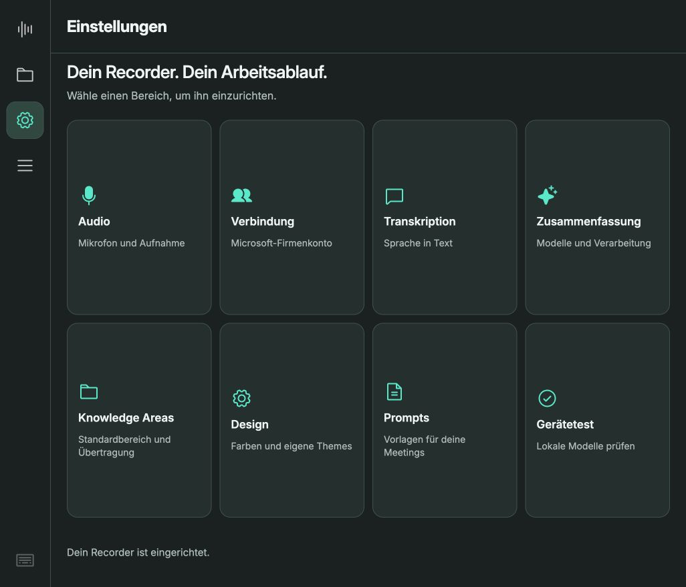
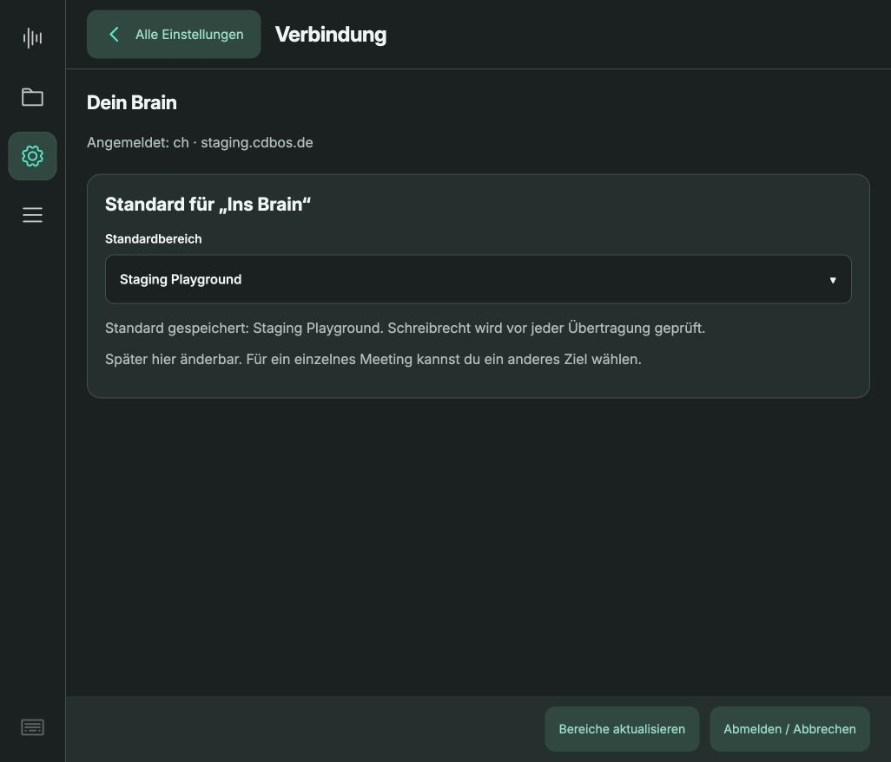
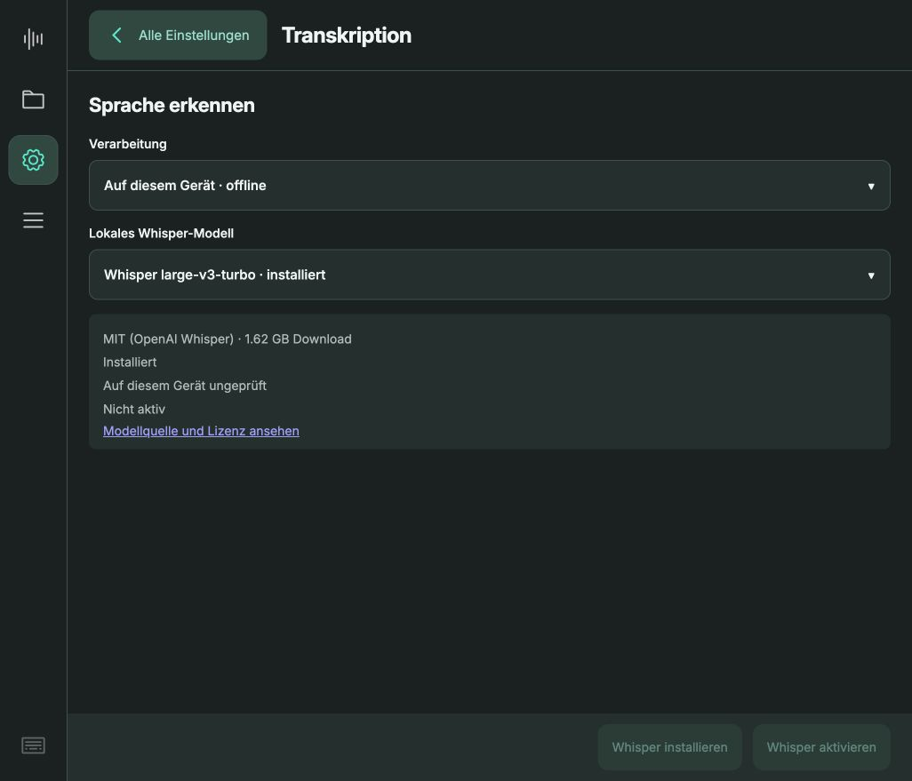
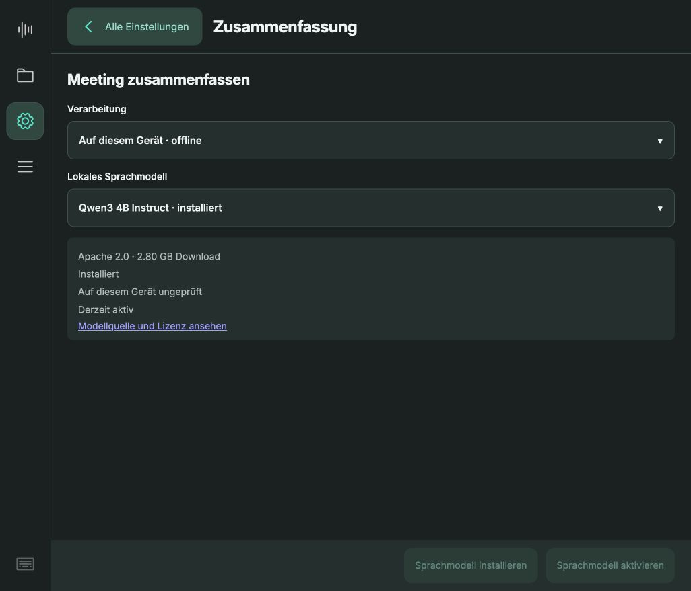
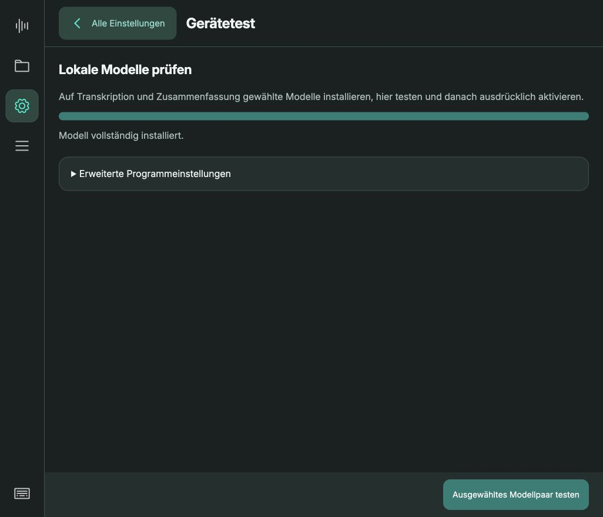
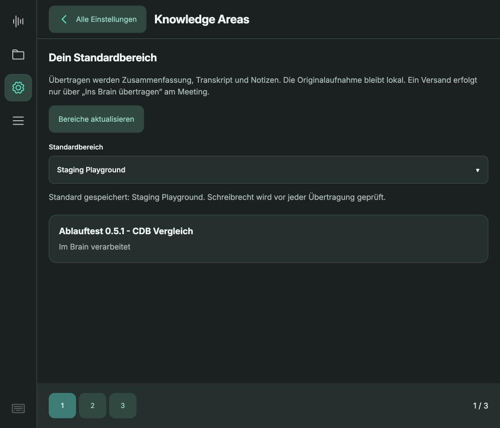

# Brain-Anmeldung und Modellwahl: Audit

12.10.2026 · produktive Oberfläche über Port 8096 · aktueller Browser-Viewport 1026 × 879.
Alle sechs Screens wurden in diesem Audit neu aufgenommen und visuell geprüft. Dies ist eine Bestandsaufnahme mit Umsetzungsvorschlag; Anwendung und Verarbeitungseinstellungen wurden nicht verändert.

## Ergebnis

Die Einstellungen sind optisch konsistent, bilden den Einrichtungsablauf aber nicht verständlich ab. Anmeldung, Auswahl, Installation, Prüfung und Aktivierung sind voneinander getrennt. Wichtigster Befund: Das ausgewählte Whisper-Modell ist nicht zwangsläufig das aktive Modell.

Zum Prüfzeitpunkt: Brain angemeldet, Standardbereich Staging Playground. Gespeicherte Verarbeitung für Transkription und Zusammenfassung jeweils lokal. Aktiver Whisper-Pfad endet auf ggml-medium.bin; die Oberfläche bietet gerade large-v3-turbo als ausgewählten Kandidaten an und bezeichnet ihn als nicht aktiv. Die Zusammenfassung zeigt Qwen3 4B Instruct als aktiv. Die produktive Sitzung wurde nicht abgemeldet.

## 1. Einstellungen – verständlich gestaltet, Status fehlt

Große beschriftete Kacheln und klare Rückwege sind gut. „Verbindung“ ist für die Aufgabe „Ins Brain anmelden“ zu abstrakt. Die Übersicht zeigt weder Konto noch aktive Modelle. „Dein Recorder ist eingerichtet“ unterscheidet Audio-Bereitschaft nicht von Modellbereitschaft.

Empfehlung: Kachel „Brain-Konto“ mit Anmeldestatus. Kachel „KI & Modelle“ mit getrennten Statuszeilen für Transkription und Zusammenfassung. Aktive Konfiguration immer sichtbar, auch wenn ein anderer Kandidat betrachtet wird.

## 2. Verbindung – angemeldet, nächste Schritte fehlen

Konto und Standardbereich sind sichtbar. Der Ablauf nach Anmeldung endet jedoch bei der Bereichsauswahl. Es fehlt die Verbindung zur Aktivierung von Online-Verarbeitung. „Abmelden / Abbrechen“ vermischt zwei zustandsabhängige Aktionen.

Empfehlung: „Brain-Konto“ → „Mit Microsoft anmelden“ → Standardbereich festlegen → „KI-Verarbeitung einrichten“. Anmeldung allein darf die Verarbeitung nicht stillschweigend umstellen. Je nach Zustand nur „Abmelden“ oder „Anmeldung abbrechen“. Kontostatus mit Text und Symbol, nicht nur Farbe.

## 3. Transkription – höchste Priorität: gewählt ist nicht aktiv

Whisper large-v3-turbo ist installiert, ungeprüft und nicht aktiv. Beide Fußaktionen sind deaktiviert, ohne direkten Weg zur Prüfung. Im Backend ist weiterhin Whisper medium konfiguriert. Der Modell-Selektor kann deshalb irrtümlich als Anzeige des aktiven Modells verstanden werden.

Empfehlung: Feste Zeile „Aktiv für neue Aufnahmen: Whisper medium · lokal“. Darunter Kandidatenauswahl mit eindeutigem Status und passender nächster Aktion: „Herunterladen“, „Testen“ oder „Für neue Aufnahmen verwenden“. Tests auf derselben Seite, Fortschritt und Fehler dort anzeigen. Änderungen gelten für neue Jobs; vorhandene Queue-Aufträge behalten ihre Konfiguration.

## 4. Zusammenfassung – lokale Auswahl vorhanden, Online-Zugang schwer erkennbar

Aktuell lokal: Qwen3 4B Instruct. Das Verarbeitungsmenü bietet zusätzlich „Azure OpenAI · Firmenkonto“. Die Oberfläche bezeichnet Qwen zugleich als aktiv und auf diesem Gerät ungeprüft; Aktivstatus und Prüfstatus brauchen eine Erklärung. Laut Implementierung wird bei CDB der Unternehmensstandard verwendet, ohne Auswahl einzelner Online-Modellnamen.

Empfehlung: Zwei große Optionen „Auf dem Pi“ und „Über Brain“. Lokale Modelle mit eigenem Test-/Aktivierungsablauf. Online: Anmeldung, zentral bereitgestelltes Modell bzw. „Unternehmensstandard“ und Verbindungstest anzeigen. Keine frei wählbaren GPT-Modelle suggerieren, solange der Dienst keinen Modellkatalog bereitstellt. Bei fehlendem Konto direkter Weg zur Anmeldung und danach Rückkehr zur ursprünglichen Modellseite.

## 5. Gerätetest – unnötiger Umweg

Die Seite verlangt Auswahl auf zwei anderen Seiten, anschließenden Paar-Test hier und erneute Rückkehr zum Aktivieren. Beim Testbutton sind die konkreten Namen des Modellpaars nicht sichtbar. Installationserfolg ist noch kein erfolgreicher Laufzeittest.

Empfehlung: Einzeltest direkt bei Transkription bzw. Zusammenfassung, optional kompletter Ablauf-Test darunter. Technische Programmeinstellungen separat unter „Gerät & Diagnose“. Testumfang und tatsächlich getestete Modelle ausdrücklich nennen.

## 6. Knowledge Areas – funktioniert, doppelte Zuständigkeit

Standardbereich erscheint sowohl hier als auch bei Verbindung. Zusätzlich enthält die Seite einen Übertragungsverlauf, dessen Zweck aus der Kachel kaum hervorgeht. Positiv: Die Oberfläche erklärt, welche Texte übertragen werden und dass Audio lokal bleibt.

Empfehlung: Standardbereich dauerhaft unter Brain-Konto verwalten; beim ersten Login direkt dort wählen. Pro Meeting Ziel wie bisher überschreibbar. Übertragungsverlauf als klar bezeichnete Unterseite „Übertragungen“ bzw. verlinkt aus der Warteschlange.

## Empfohlene Zielstruktur

- Audio
- Brain-Konto — Konto, Standardbereich, Verbindung prüfen
- KI & Modelle — Transkription und Zusammenfassung mit jeweils Lokal/Brain, aktivem Modell und direktem Test
- Vorlagen — bisher Prompts
- Design
- Gerät & Diagnose — Laufzeiten, Speicher, technische Einstellungen

Unterseiten behalten den vereinbarten Rückweg zur Übersicht. Kein zusätzliches Seitenmenü. Bei jeder Auswahl ist sichtbar, ob sie nur betrachtet, heruntergeladen, geprüft oder wirklich aktiviert wurde. Erst explizites Aktivieren verändert die Verarbeitung. Übernahme/Rücknahme soll konsistent sein; aktuell speichern Anbieterwechsel sofort, lokale Kandidaten dagegen erst nach Test und Aktivieren.

## Prüfgrenzen

Keine Abmeldung, keine Änderung der Anbieter, kein neuer Modelltest und keine Übertragung in diesem Audit. Der vollständige erneute Microsoft-Login sowie Fehler-/Ablaufzustände wurden daher nicht live durchlaufen. Semantische Namen der Hauptnavigation sind vorhanden, ihre rein grafische Darstellung kann für Erstnutzer trotzdem schwer auffindbar sein. Kleine Status- und deaktivierte Aktionstexte sollten am tatsächlichen Touchdisplay auf Lesbarkeit geprüft werden. Keine umfassende Screenreader-, Kontrast- oder WCAG-Prüfung. Die sechs Screens zeigen den aktuellen Desktop-Browser, keine erneute 1280×720-Abnahme.
