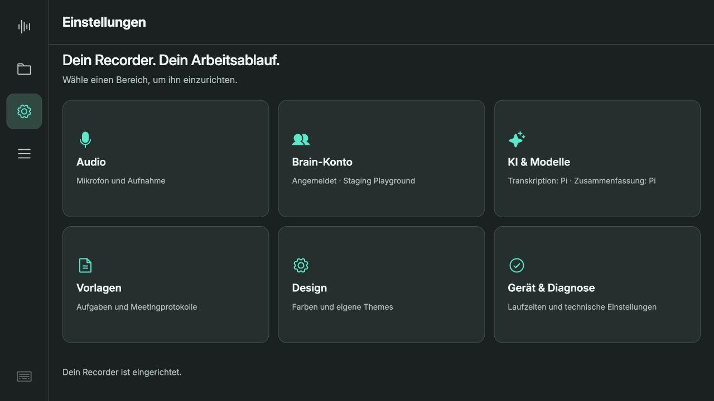
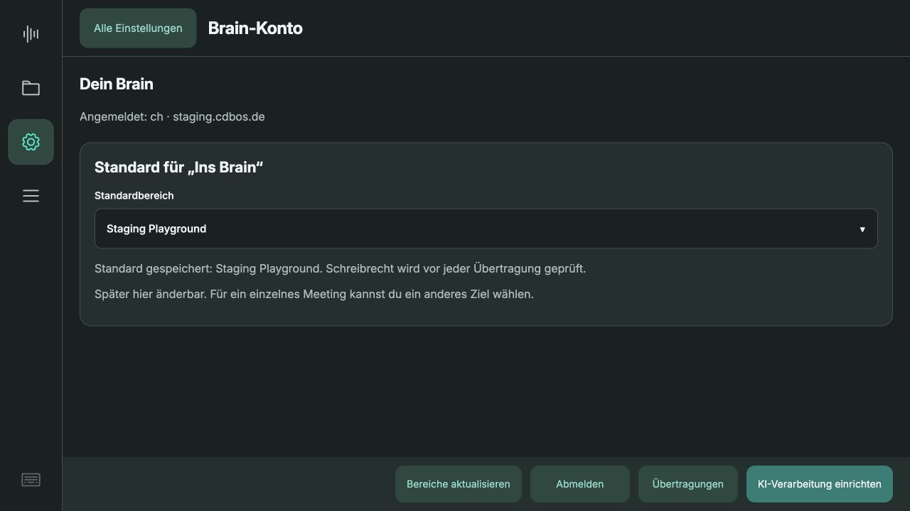
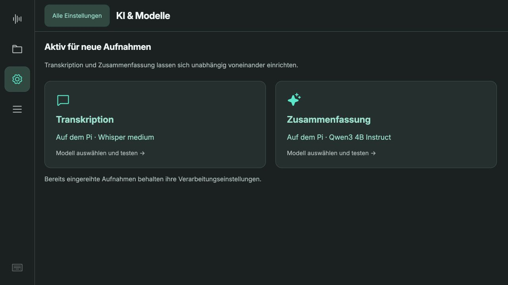
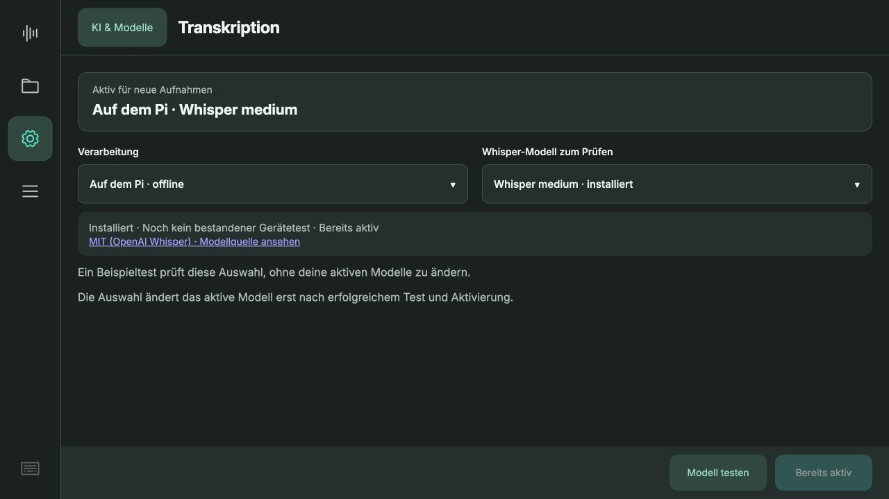
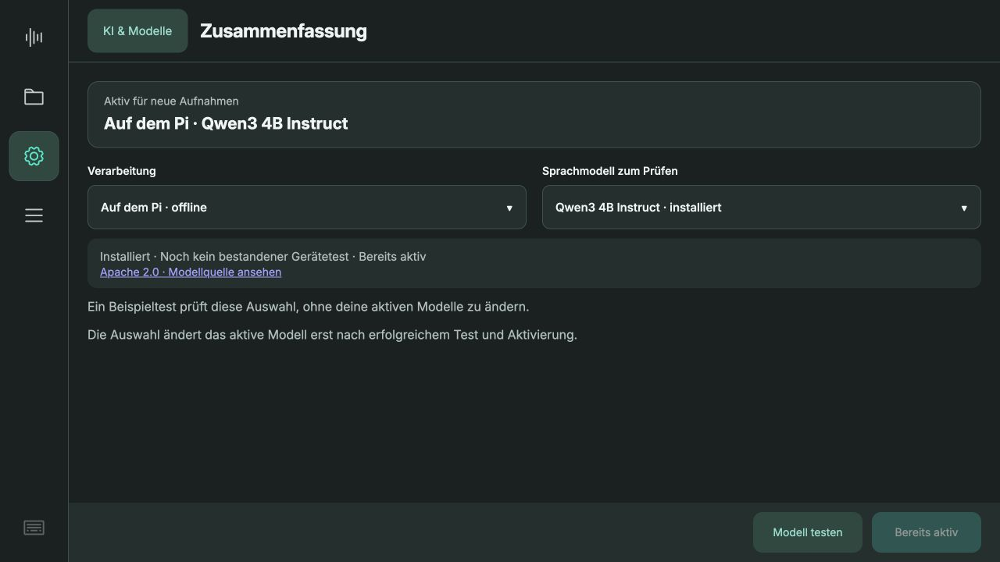
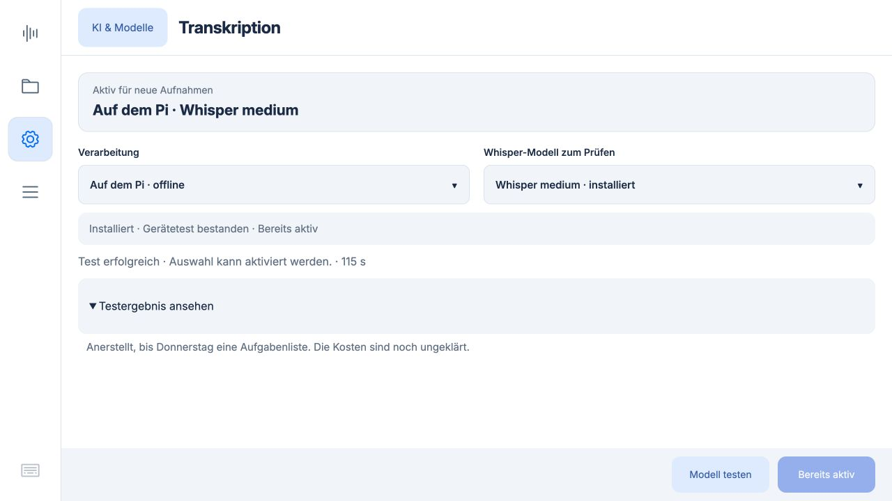
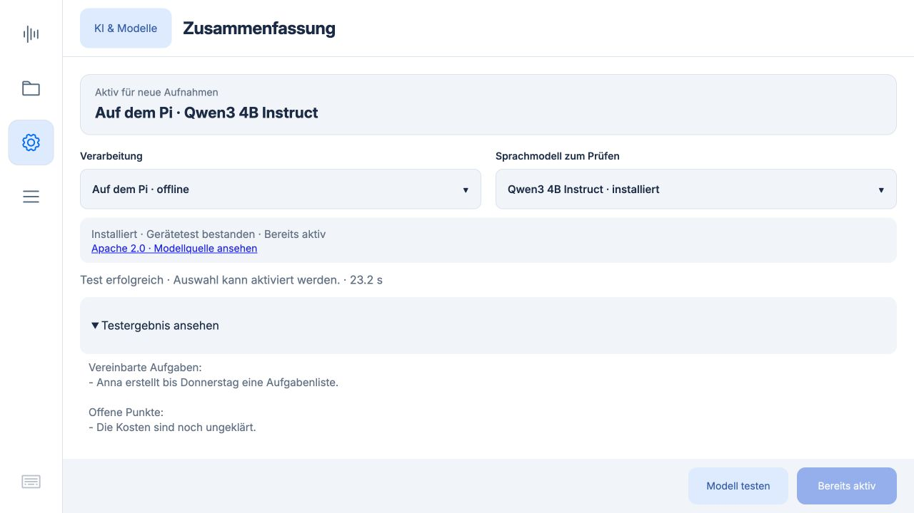
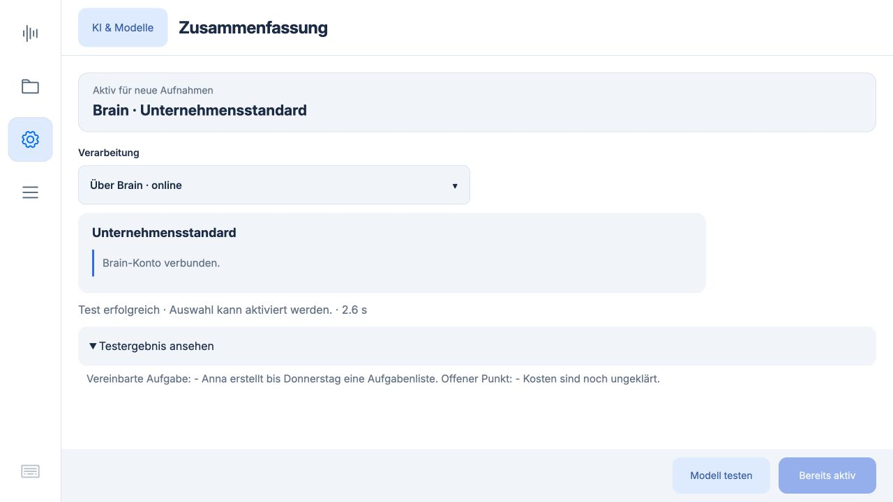
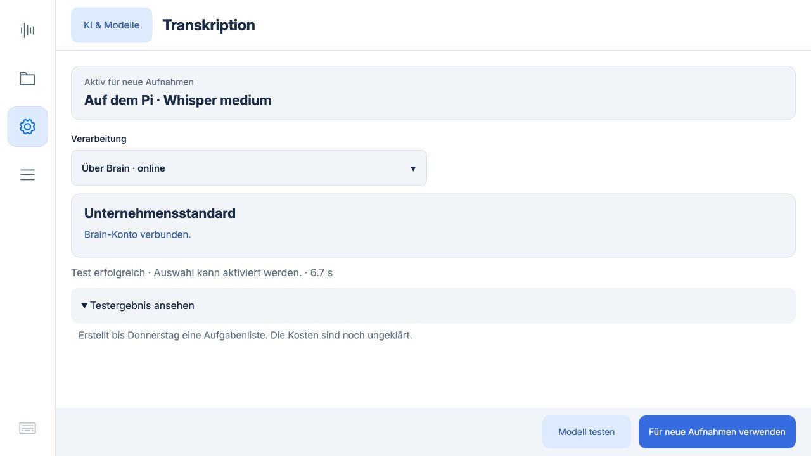

# Brain-Konto und KI & Modelle · 0.5.9

12.10.2026. Die Einstellungen enthalten sechs Kacheln. Brain-Konto bündelt Microsoft-Anmeldung und Standardbereich; KI & Modelle zeigt die aktiven Modelle für Transkription und Zusammenfassung. Unterseiten haben einen eindeutigen Rückweg. Übertragungen sind unter Brain-Konto erreichbar.

Die Anbieterauswahl bleibt ein Entwurf. Herunterladen, unabhängiger synthetischer Test und ausdrückliche Aktivierung erfolgen direkt auf der Modellseite. Aktive Konfiguration und ausgewählter Kandidat bleiben getrennt sichtbar. Ein Test allein ändert keine Verarbeitung. Online-Modelle werden zentral durch Brain verwaltet.

## Verifikation

77 Python-Tests und 27 JavaScript-Tests bestanden. Abgedeckt: getrennte Modelltests ohne zweite Laufzeit, fehlgeschlagene/unterbrochene Tests, unveränderte Konfiguration nach Test, Aktivierung nur getesteter Modelle, Bindung an Konto/Server/Verarbeitungsschritt, Aufnahmesperren, Anbieterentwürfe, Rückwege, aktive Modellanzeige und bestehende Recorder-/Bibliothekslogik.

Echte Modelltests auf demselben Pi mit getrennten Testdaten, keine persönlichen Meetings:

| Prüfung | Dauer | Ergebnis |
|---|---:|---|
| Whisper medium, 5,2 s synthetische Sprache | 115,0 s | Laufzeit erfolgreich, erkannter Text vorhanden |
| Qwen3 4B Instruct, fester Beispieltext | 23,2 s | Aufgabe und offener Kostenpunkt korrekt wiedergegeben |
| Brain / Azure-Zusammenfassung | 2,6 s | Aufgabe und offener Punkt korrekt wiedergegeben |
| Brain-Transkription, synthetische Sprache | 6,7 s | Text zurückgegeben |

Online-Zusammenfassung und Transkription wurden in der Testinstanz explizit aktiviert. Die Zusammenfassung blieb nach Neuladen aktiv. Anschließend wurde über dieselbe Oberfläche das erfolgreich getestete lokale Whisper wieder aktiviert. Die produktive Modellkonfiguration wurde für diese Prüfungen nicht verändert.

Grenze: „Test erfolgreich“ ist eine technische Laufzeitprüfung, kein Qualitätszertifikat. Bei beiden Transkriptionsmodellen wurde der synthetisch gesprochene Name Anna nicht korrekt erkannt. Es wurde kein neuer Stundentest durchgeführt; die Meetingverarbeitung wurde durch diesen Einstellungsumbau nicht verändert. Brain-Modelltests übertragen nur die im Code festgelegten künstlichen Beispiele. Kein automatischer Upload in eine Knowledge Area.

## Screens

Die produktive Version 0.5.9 wurde nach Leerlaufprüfung und Sicherung unter `/home/chris/backups/recorder-before-0.5.9` bereitgestellt. Alle sechs ausgelieferten Laufzeitdateien stimmen per SHA-256 mit Commit `466a794` überein. Backend und Kiosk sind aktiv. 22 bestehende Aufnahmen, Anmeldung, Standardbereich und aktive Konfiguration sind unverändert. Beide produktiven Anbieter bleiben lokal. Die temporäre Kopie der Anmeldung für die Testinstanz wurde entfernt.

Produktive Screens, 1280 × 720:

Die folgenden Screens zeigen echte Tests in der isolierten Instanz. Deren Testnachweise werden nicht automatisch in die produktive Datenablage übernommen; dort bleiben vorhandene aktive Modelle aktiv und können bei Bedarf erneut geprüft werden:

Die ersten beiden Screens stammen vor der letzten Korrektur der Ergebnishöhe; die produktiven Screens zeigen den finalen Aufbau. Die Modellseiten wurden bei 1280 × 720 geprüft. Keine vollständige WCAG-/Screenreader-Abnahme oder physischer Touchtest.
