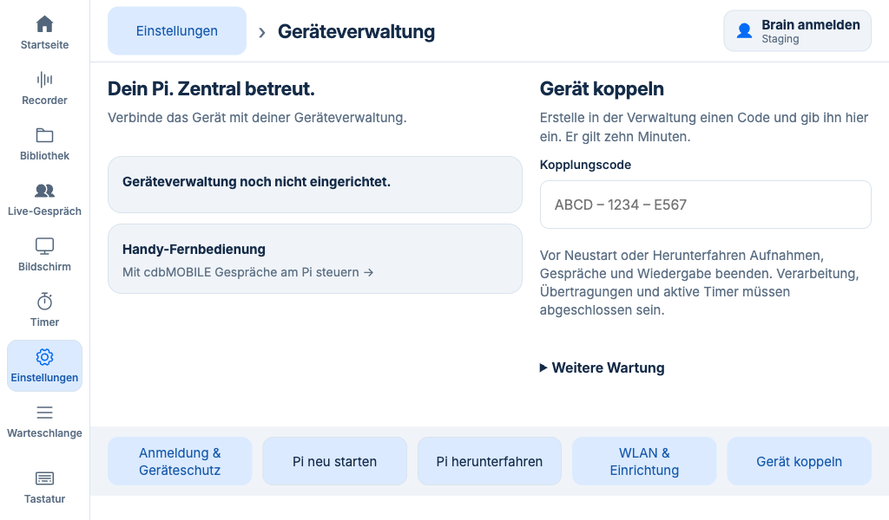
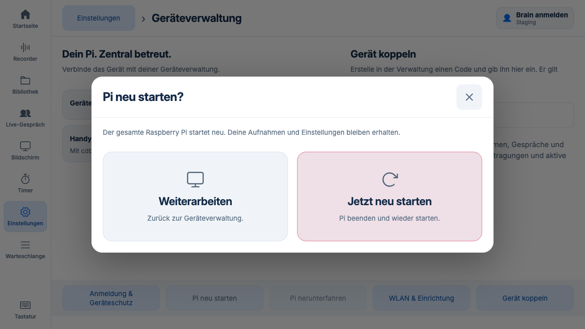

# Neustart direkt erreichbar · 0.5.100

24. November 2026. Chris möchte den Neustart neben dem Ausschalten direkt in
den Einstellungen finden. Der vorhandene Neustartknopf wurde aus „Wartung &
Neustart“ in die feste Aktionsleiste unter **Gerät & Verwaltung** verschoben.
„Weitere Wartung“ enthält nur noch Diagnose und das Neuladen der Oberfläche.
Die Übersichtskachel und lokale Hilfe nennen den Neustart ausdrücklich.

Die Aktionsleiste berücksichtigt auch den dynamisch ergänzten Knopf für
Anmeldung und Geräteschutz: fünf Spalten, alle Aktionen vollständig sichtbar,
auch bei 1024 × 600 und geöffneter Bildschirmtastatur. Neustart und Ausschalten
bleiben getrennt und verwenden die vorhandenen großen Bestätigungsdialoge.
Sperren bei Aufnahme, Gespräch, Timer, Wiedergabe und Verarbeitung sowie die
erneute Prüfung nach Bestätigung bleiben unverändert. Keine neue Systemaktion.

## Prüfung

- 8 bestehende JavaScript-Prüfungen für Bestätigung, konkurrierende Aktionen,
  Entwurfssicherung und Gerätesperren bestanden.
- 11 Python-Prüfungen für Neustart und Herunterfahren bestanden.
- Browserprüfung bei 1024 × 600 und 1280 × 720: direkt sichtbarer Neustart,
  Bestätigung, Abbrechen ohne Neustart sowie Tastatur und vollständig sichtbare
  Aktionsleiste. Nur lokale Vorschau, kein echter Neustart durch den Test.

## Auslieferung

Die Änderungen an bestehenden App-Dateien sind von den vorhandenen Freigabelisten
für signierte Updates und saubere SD-Image-Baupakete erfasst. Keine neue Runtime,
Datenmigration oder Berechtigung. Kein SD-Image gebaut oder hardwaregeprüft.
Am 24.11.2026 um 09:39 Uhr (Europe/Berlin) auf dem freien Pi installiert:
Quellstand `99a0577030602636873d11a870b823c91aa5ba07`, signiertes Paket mit 152
geprüften Dateien, Vorgänger 0.5.99. Anwendung und Kiosk laufen; Einstellungen,
Raummodus, NFC-Zuordnungen und Aufnahmebestand sind unverändert. Das Update hat
keinen Systemneustart ausgelöst. Die zurückliegende Version bleibt für eine
Rücknahme erhalten. [Installationsnachweis](deployment-2026-11-24.json).

Die Startansicht wurde direkt vom physischen 1280-×-720-Pi-Display aufgenommen:
[Kiosk nach der Installation](kiosk-installed-1280.png). Einstellungen und
Bestätigungsdialog wurden in der lokalen Vorschau geprüft; über den neuen
Knopf wurde noch kein echter Neustart ausgelöst.

Zusätzlich ein sauberes SD-Image-Baupaket aus demselben Commit exportiert und
die Prüfsummen seiner Dateien kontrolliert: 159 App-Quelldateien. Dies ist ein
geprüftes Baupaket, weiterhin kein gebautes oder am Gerät gestartetes SD-Image.
