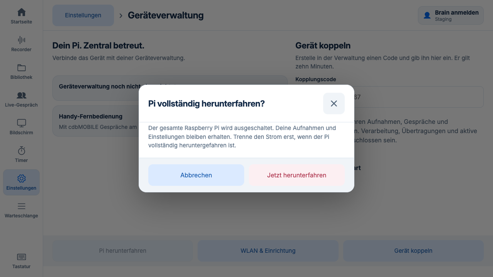

# Pi sauber herunterfahren – 0.5.89

23.11.2026. Recorder Studio auf dem physischen Pi, ausgehend von 0.5.88.

## Vor dem Transport

1. Aufnahmen und Gespräche beenden, Wiedergabe stoppen und die Verarbeitung sowie Übertragungen abwarten. Aktive Timer/Erinnerungen abschließen oder löschen.
2. **Einstellungen → Gerät & Verwaltung → Pi herunterfahren** öffnen.
3. **Jetzt herunterfahren** bestätigen. **Abbrechen**, das Schließen-Symbol und Escape lösen keinen Abschaltbefehl aus.
4. Den Strom angeschlossen lassen, bis der Pi vollständig heruntergefahren ist. Danach kann das Gerät vom Strom getrennt und umgestellt werden.

Die Funktion schaltet das Betriebssystem des gesamten Pi herunter. Sie löscht keine Aufnahmen oder Einstellungen. Das Aktivierungswort allein verhindert das Herunterfahren nicht; nach der Freigabe wird es über die bestehende Wartungssperre angehalten.

## Schutz und Rückmeldung

Der Browser sichert offene Notizentwürfe vor der Anfrage. Die lokale API verlangt den CSRF-Schlüssel und eine ausdrückliche Bestätigung. Unter denselben Sperren wie beim Aufnahmestart prüft sie Aufnahme/Pause, Live-Gespräch, Audio- und Modelltests, Bluetooth-Einrichtung, Downloads, offene Verarbeitung, Wiedergabeleases, Übertragungen sowie aktive Timer. Bis zum Abschluss oder Fehler kann keine neue Arbeit starten. Mehrfaches Antippen plant keinen zweiten Auftrag.

Die Freigabe wird an die aktuelle Boot-ID und eine kurzlebige Auftragskennung gebunden. Ein eigener, um zwei Sekunden verzögerter Systemdienst gibt der HTTP-Antwort Zeit zur Rückkehr. Er prüft die Freigabe erneut und ruft ausschließlich den festen, normalen Poweroff-Weg auf; kein erzwungenes Ausschalten und keine frei übergebenen Befehle.

Bei einer Ablehnung wird die Sperre gelöst und der Fehler angezeigt. Bleibt der Pi nach 60 Sekunden erreichbar, gilt der Auftrag als nicht abgeschlossen. Ein Verbindungsverlust wird **nicht** als bestätigtes Ausschalten dargestellt. Die Wartungssperre und alte Statusmeldungen gelten nach einem neuen Boot nicht mehr.

## App-Update und neues SD-Image

- Die bestehende Positivliste übernimmt `services/device_power.py`, die Geräteverwaltung und die Studio-Dateien sowohl ins signierte App-Paket als auch in den sauberen Image-Export. Keine neue Python-Abhängigkeit und keine Datenmigration.
- Auf Bestandsgeräten wird zunächst `login1.CanPowerOff` im Kontext der Recorder-Anwendung abgefragt. Nur die Antwort `yes` erlaubt den nichtinteraktiven `PowerOff(false)`-Aufruf. Andernfalls wird eine bereits vorhandene, eng begrenzte `sudo -n /usr/bin/systemctl poweroff`-Freigabe verwendet. Ohne eine solche Freigabe erscheint ein Einrichtungsfehler; die App erweitert keine Berechtigungen.
- Die Factory-Anleitung ergänzt für den Benutzer `cdb` genau `systemctl poweroff` neben dem bisherigen `systemctl reboot`. Die Datei bleibt root-eigen, Modus 0440 und wird mit `visudo` geprüft. Das Factory-Skript darf ausschließlich in einem neuen pi-gen-Dateisystem laufen, niemals auf dem laufenden Pi.
- Kein SD-Image für diese Änderung gebaut oder als auf Hardware geprüft freigegeben.

## Prüfung

- 140 JavaScript-Tests bestanden, einschließlich Abbrechen, doppeltem Antippen, Start einer Aufnahme während der Bestätigung oder Entwurfssicherung und erneuter Freigabe nach Fehlern.
- 78 gezielte Python-/HTTP-Tests bestanden: feste Befehle, verweigerte Berechtigungen, Preview-Sperre, Aktivitätsschutz, CSRF/Bestätigung, einmaliges Planen, Boot-/Ablaufprüfung, Fehlerbehandlung, bestehender Neustart und sauberer Image-Export.
- Browserprüfung mit synthetischen Daten bei 1280 × 720 und 1024 × 600: direkt erreichbare Taste, Abbrechen als Anfangsfokus, mindestens 56 Pixel hohe Aktionen, Bestätigungs- und Statusdialog. Angenommener Abschaltauftrag und Systemablehnung wurden im Browser simuliert.
- Ein echter Poweroff wurde bei der Installation bewusst nicht ausgelöst. Der vollständige Hardware-Abschaltablauf bleibt beim ersten ausdrücklich gewünschten Herunterfahren zu prüfen.

## Installation am Gehäuse-Pi

Am 23.11.2026 um 12:47 Uhr MEZ wurde das signierte App-Paket aus Commit `4a390ba` installiert. Alle 132 Paketdateien wurden verifiziert. Die laufende API und die ausgelieferte Oberfläche melden 0.5.89. Konfiguration und Sitzungsbestand sind unverändert, die vorherige Version bleibt für eine Rückkehr erhalten. Recorder und Kiosk laufen, die Wartungssperre ist gelöst.

Die neue Taste und der Bestätigungsdialog wurden direkt auf dem physischen 1280 × 720-Display im eingestellten dunklen CDB-Design kontrolliert. **Abbrechen** wurde am Pi betätigt; das Gerät bleibt eingeschaltet. Die installierte Berechtigungsprüfung meldet im tatsächlichen Benutzer-Dienstkontext `logind`, ohne einen Abschaltbefehl auszuführen. Es waren keine Änderungen an den Systemrechten dieses Pi nötig.

Zusätzlich wurde ein sauberes SD-Baupaket mit 139 Quelldateien exportiert: neuer Abschalt-Worker und feste Factory-Freigabe sind enthalten. Dies ist ein geprüftes Baupaket, kein gebautes SD-Image.

[Bereinigter Installationsnachweis](deployment.json)
