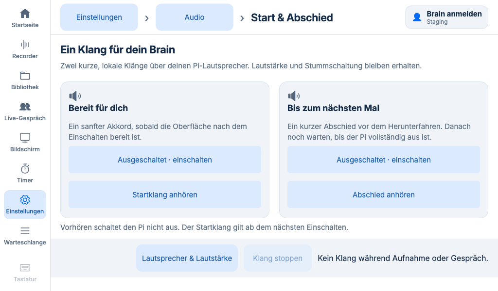
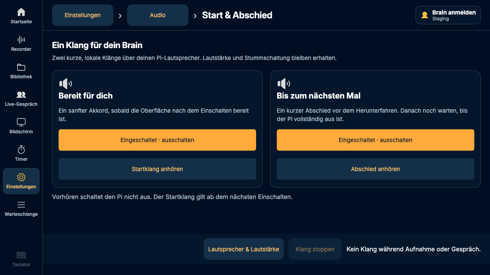

# Geräteklänge · 0.5.93

Stand: 23.11.2026. **Auf dem Pi installiert.** Das Gerät war zunächst nicht
erreichbar, ist inzwischen wieder gestartet. Das signierte Update wurde bei
freiem, abgemeldetem Gerät installiert; Einstellungen, Raumregeln und
Aufnahmeinventar sind unverändert. Beide Klangoptionen sind auf diesem Pi
auf Benutzerwunsch eingeschaltet. Die Ausgabe beider Klangvorschauen wurde
vom Audioprozess erfolgreich abgeschlossen. Ein tatsächlicher Boot-/Abschaltzyklus
und die subjektive Hörprobe vor Ort stehen noch aus.
[Installation](deployment.json) · [Ausgabeprüfung](sound-check.json).

## Bedienung

**Einstellungen → Audio → Lautsprecher → Start & Abschied** öffnet zwei Karten:

- **Bereit für dich:** 1,2 Sekunden langer, sanfter Startakkord. Er spielt erst,
  wenn die Oberfläche erstmals erfolgreich geladen wurde und das Gerät frei ist.
- **Bis zum nächsten Mal:** 0,7 Sekunden langer, absteigender Abschied vor dem
  bestätigten Herunterfahren über das Menü. Der Ton bedeutet „Herunterfahren
  beginnt“. Erst nach dem vollständigen Ausschalten den Strom trennen.

Beide Optionen sind getrennt schaltbar. **Startklang anhören** und **Abschied
anhören** spielen nur die Vorschau; sie starten oder stoppen das Gerät nicht.
**Klang stoppen** beendet die Wiedergabe. Die vorhandene Lautsprecherwahl,
Lautstärke und Stummschaltung gelten auch hier. Es gibt keine Lautstärkeanhebung.

Die Klänge sind eigene, lokal synthetisierte PCM-Kompositionen; keine übernommenen
Mac-Töne, keine Cloud- oder Sprachmodell-Anfrage. [Startklang](startup.wav) ·
[Abschied](shutdown.wav). Diese WAVs dienen der Dokumentation; zur Laufzeit
erzeugt der versionierte Code identische Klangdaten ohne zusätzliches Audiopaket.

## Verhalten und Schutz

- Neue und bestehende Geräte haben beide Optionen zunächst aus. Die neue Datei
  `device-sounds.json` bleibt außerhalb des App-Releases. Bei Updates wird sie
  erhalten; vorhandene Audio-, Rufwort- und Raum-Einstellungen bleiben gleich.
- Die erste erfolgreiche Anzeige meldet ihre Bereitschaft per CSRF-geschützter
  Anfrage. Sie verändert weder Anmeldung noch Ruhefrist und benötigt keine PIN.
  Die Einstellungen und das Vorhören bleiben durch die Betreiberfreigabe geschützt.
- Die Boot-ID wird vor dem Klangversuch dauerhaft mit Dateisperre quittiert:
  kein erneuter Klang durch mehrere Tabs, Neuladen oder App-Neustart. Auch ein
  zunächst ausgeschalteter Startklang wird erst beim nächsten Einschalten aktiv.
- Aufnahme einschließlich Pause, Live-Gespräch, Tests, Wiedergabe, Verarbeitung
  und Wartung haben Vorrang. Ein verhinderter oder fehlgeschlagener Startklang
  wird ausgelassen, nicht verspätet nachgeholt. Es gibt keine Klangwarteschlange.
- Startklang und Vorhören verwenden den vorhandenen Audio-Eigentümer und dessen
  bestätigte Prozessbeendigung. Das Rufwort wird vor dem Ton suspendiert; danach
  gilt derselbe Nachhallabstand wie bei lokalen Ansagen. Der reine Klangprozess
  ist auf zwei Sekunden begrenzt; normale Ansagen und Timer bleiben unverändert.
- Der Abschied läuft ausschließlich im bereits freigegebenen Poweroff-Worker
  unter dessen Wartungssperre. Er prüft den gewählten Ausgang, ohne auf einen
  anderen Lautsprecher auszuweichen. Bei fehlender Auswahl gilt der Pi-Standard.
  Stumme und virtuelle Ausgänge bleiben still. Audioabfragen und Wiedergabe sind
  zusammen auf ungefähr zwei Sekunden begrenzt. Fehlendes oder hängendes Audio
  verhindert das Ausschalten nicht. Danach wird die Boot-/Auftragsfreigabe erneut
  geprüft. Kein Klang bei Abbrechen oder bloßem Öffnen des Abschaltdialogs.
- Ein App-Update, App-Neustart oder extern ausgelöstes Ausschalten erhält keinen
  Abschiedston. Die Integration betrifft den vorhandenen Menü-Poweroff-Weg.
- Die bestehende Raumregel bleibt erhalten: Beim Start der Recorder-Anwendung
  wird eine vorherige persönliche Anmeldung verworfen. Aufnahmen und Einstellungen
  werden dadurch nicht gelöscht.

## Prüfung und Auslieferung

145 Python-Tests und 152 JavaScript-Tests bestanden. Darunter PCM-Format, Dauer,
Pegel/Fades, neue und bestehende Einstellungen, beschädigte Einstellungsdateien,
gleichzeitige Boot-Quittierung, Aktivitätsschutz, PIN/CSRF, fehlende Audiogeräte,
Timeouts, Widerruf des Abschaltauftrags sowie der Export für saubere SD-Images.

Die Browservorschau wurde mit künstlichem Audiozustand bei 1024 × 600 und
1280 × 720 geprüft: getrennte Schalter werden gespeichert, Vorhören löst keinen
Abschaltauftrag aus, Touch-Tasten sind mindestens 56 Pixel hoch und passen auf
den Bildschirm. Keine JavaScript-Fehler. Diese Prüfung öffnete weder Mikrofon
noch Lautsprecher des Macs. Eine Hörprobe und ein tatsächlicher Start-/Abschaltzyklus
am Pi stehen noch aus. [Prüfnachweis](acceptance.json).

Die neue Datei `services/device_sounds.py` fällt unter die bestehende Positivliste
für App-Updates und Image-Quellen; auch die geänderten Studio-Dateien sind erfasst.
Keine neuen Pakete, Dienste, Betriebssystemrechte oder Datenmigrationen. Persönliche
Klangoptionen und Boot-Quittierungen werden nicht in ein Kunden-Image übernommen.
Das signierte Update aus Commit `104c1d1d` wurde exportiert; Signatur und
alle 137 App-Dateien sind geprüft. Das saubere Image-Baupaket enthält
144 Quelldateien einschließlich der Geräteklänge. Die Pakete liegen
lokal für die spätere Installation bereit. Es wurde kein SD-Image gebaut oder
auf Hardware boot-zertifiziert. Die damaligen Verbindungsversuche blieben zunächst erfolglos. Nach dem
erneuten Start wurde genau dieses signierte Paket installiert und geprüft.
Die separate [cdbPiOS-Startbildschirm-Ergänzung](../boot-brand/README.md) betrifft
das Betriebssystem und braucht einmalig Administratorrechte.
