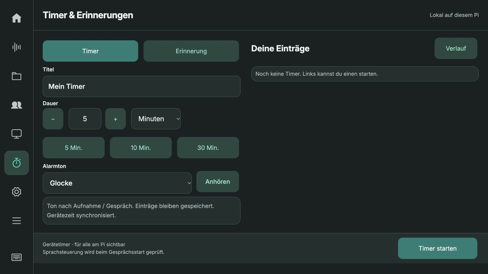
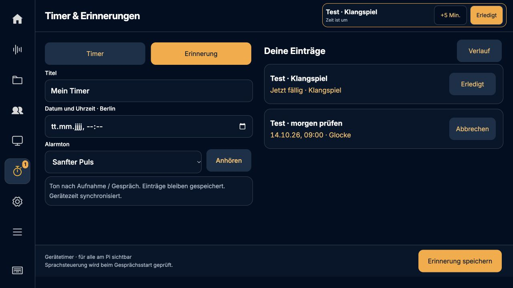

# Timer, Alarmtöne und Live-Geräteaufträge · 0.5.32

## Bedienung

Unter **Timer & Erinnerungen** einen Titel und die Dauer oder den Termin wählen.
**Alarmton** bietet Glocke, Klangspiel, Sanfter Puls und Lautlos. **Anhören** spielt
über den ausgewählten Pi-Lautsprecher; der Remote-Browser spielt keinen Ton.
Die Auswahl bleibt mit jedem Eintrag gespeichert und steht in der Liste. Alte
Einträge erhalten bei der additiven Datenbankmigration den Ton Glocke.

Der Ton folgt nach einer laufenden Aufnahme oder einem Gespräch. Der sichtbare
Alarm erscheint sofort; Erledigt und +5 Min. bleiben verfügbar. Lautlos spielt
auch später keinen Ton. Diese Signale sind keine dauerhaften Weckerschleifen.

## Sprache: Servervoraussetzung

Diese Version enthält den Pi-Executor. Erst nach Auslieferung der zugehörigen
TQS- und BFF-Änderungen wird er bei einem **neuen** Live-Gespräch aktiv. Der Pi
fragt `capabilities.device_tools_v1` ab; alte Server erhalten unveränderte
Startanfragen. Ohne Serverfreigabe ist die Sprachfunktion nicht verfügbar.

Beispiele nach Server-Rollout:

- „Stelle einen Timer für fünf Minuten mit dem Klangspiel, Titel Tee.“
- „Erinnere mich morgen um neun Uhr an den Rückruf.“
- „Welche Timer laufen?“ / „Brich den Tee-Timer ab.“

Der Delegationsserver registriert `create_timer`, `create_reminder`,
`list_schedules`, `cancel_schedule`, `acknowledge_alarm`, `snooze_alarm` nur für
optierte Gerätesitzungen. Ein zufälliger Sitzungsschlüssel bleibt im Python-
Backend; im Serverdatensatz liegt nur sein Hash. Konto, Mandant, Sitzung und
Schlüssel werden beim Abruf und der Ergebnisübermittlung geprüft.

Der Pi holt Aufträge über `POST …/sessions/{handle}/device-tools`. Geräteauftrag
und Quittung landen atomar in SQLite. Eine verlorene Antwort führt beim nächsten
Abruf zur identischen Quittung, nicht zur zweiten Aktion. Ablaufzeit 60 Sekunden;
keine Ausführung nach Konto-/Sitzungswechsel. Unklare Termine/DST-Faltungen
werden abgelehnt. Änderungen erfordern die aktuelle Revision. Ein fehlender
Ergebnisbeleg ist ausdrücklich **unbestätigt**: zuerst Liste prüfen, keine
automatische Neuanlage. Es gibt keine Auswertung von Transkript-Schlüsselwörtern.

Timer überleben App-/Pi-Neustarts. Der Gerätekanal gehört dagegen zur aktuellen
Live-Sitzung. Bei einem vollständigen Verlust dieser Sitzung ist eine eventuell
bereits ausgeführte Aktion anhand der lokalen Liste zu klären; es wird kein
sitzungsübergreifendes Wiederholen versprochen.

## Prüfstand

- 191 Python-Tests vollständig auf dem Pi bestanden, einschließlich
  Gerätequittungs-/Kontowechselprüfung.
- 85 JavaScript-Tests bestanden.
- TQS: 151 Tests für Geräteaufträge und bestehende Live-/Wiederverbindungs-/
  Gesprächsverläufe bestanden, mit simulierten Serverdiensten.
- BFF: 73 Weiterleitungstests bestanden.
- UI bei 1280 × 720 auf isolierter Pi-Instanz: Ton wählen, Timer speichern,
  Ton nach Neuladen in der Liste erhalten, feste Leisten, kein Inhaltsüberlauf.
- Echter Sprachauftrag über Azure/CDB ist **noch nicht abgenommen**: dafür
  müssen erst beide Server-PRs auf Staging ausgerollt sein. Keine Behauptung,
  dass ein künstlich injizierter Tool-Auftrag ein echter Sprachtest wäre.

Die drei synthetisierten Alarmtöne wurden auf der isolierten Pi-Instanz über
`paplay` am ausgewählten Ausgang vollständig abgespielt (jeweils Status
`completed`). Eine Hörbestätigung durch den Benutzer wurde dabei nicht erhoben.

Server-Änderungen zur Freigabe:
[TQS #1999](https://github.com/BIK-GmbH/cdb_tqs/pull/1999) und
[BFF #1332](https://github.com/BIK-GmbH/cdb_webos/pull/1332).

## Auslieferung

Laufzeit-Commit **9670d74** ist am 13.10.2026 auf dem Pi aktiv. Backend und Kiosk
laufen; der Kiosk wurde im Leerlauf neu geladen. SHA256 aller acht Laufzeitdateien
stimmt mit dem Repository überein ([deployment.json](deployment.json)). Alle
22 Aufnahmen, Konto, Zielbereich und Modellkonfiguration bleiben erhalten.
Backup inklusive Timer-Datenbank: `/home/chris/backups/recorder-before-0.5.32`.
Die isolierte Testinstanz wurde anschließend beendet.

