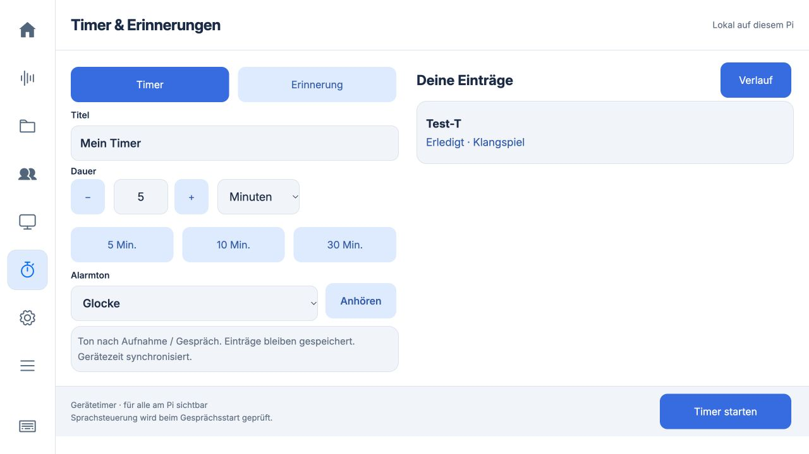
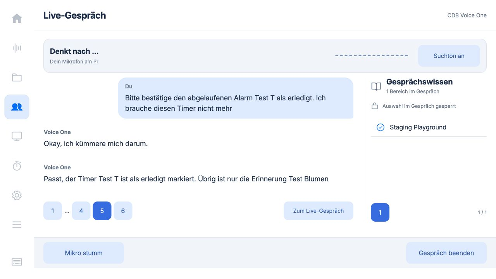
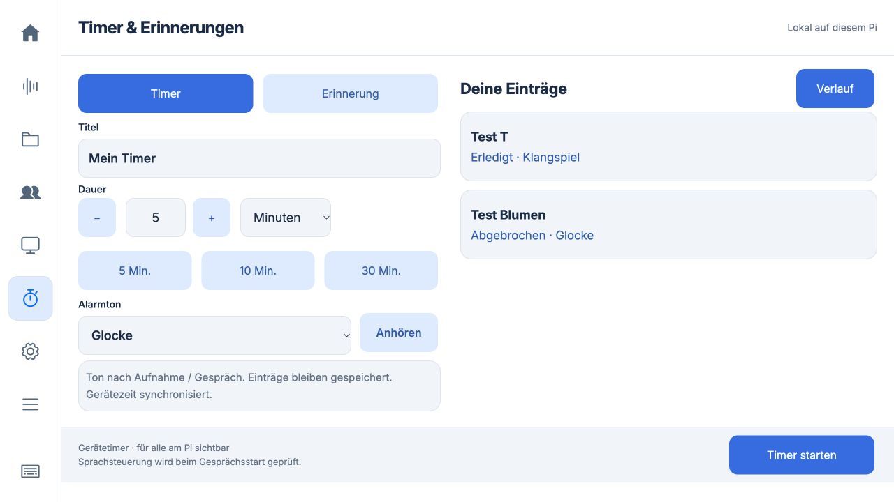

# Timer, Alarmtöne und Live-Geräteaufträge · 0.5.32

## Bedienung

Unter **Timer & Erinnerungen** einen Titel und die Dauer oder den Termin wählen.
**Alarmton** bietet Glocke, Klangspiel, Sanfter Puls und Lautlos. **Anhören** spielt
über den ausgewählten Pi-Lautsprecher; der Remote-Browser spielt keinen Ton.
Die Auswahl bleibt mit jedem Eintrag gespeichert und steht in der Liste. Alte
Einträge erhalten bei der additiven Datenbankmigration den Ton Glocke.

Der Ton folgt nach einer laufenden Aufnahme oder einem Gespräch. Der sichtbare
Alarm erscheint sofort; Erledigt und +5 Min. bleiben verfügbar. Lautlos spielt
auch später keinen Ton. Diese Signale sind keine dauerhaften Weckerschleifen.

## Sprache: Servervoraussetzung

Diese Version enthält den Pi-Executor. Erst nach Auslieferung der zugehörigen
TQS- und BFF-Änderungen wird er bei einem **neuen** Live-Gespräch aktiv. Der Pi
fragt `capabilities.device_tools_v1` ab; alte Server erhalten unveränderte
Startanfragen. Ohne Serverfreigabe ist die Sprachfunktion nicht verfügbar.

Beispiele nach Server-Rollout:

- „Stelle einen Timer für fünf Minuten mit dem Klangspiel, Titel Tee.“
- „Erinnere mich morgen um neun Uhr an den Rückruf.“
- „Welche Timer laufen?“ / „Brich den Tee-Timer ab.“

Der Delegationsserver registriert `create_timer`, `create_reminder`,
`list_schedules`, `cancel_schedule`, `acknowledge_alarm`, `snooze_alarm` nur für
optierte Gerätesitzungen. Ein zufälliger Sitzungsschlüssel bleibt im Python-
Backend; im Serverdatensatz liegt nur sein Hash. Konto, Mandant, Sitzung und
Schlüssel werden beim Abruf und der Ergebnisübermittlung geprüft.

Der Pi holt Aufträge über `POST …/sessions/{handle}/device-tools`. Geräteauftrag
und Quittung landen atomar in SQLite. Eine verlorene Antwort führt beim nächsten
Abruf zur identischen Quittung, nicht zur zweiten Aktion. Ablaufzeit 60 Sekunden;
keine Ausführung nach Konto-/Sitzungswechsel. Unklare Termine/DST-Faltungen
werden abgelehnt. Änderungen erfordern die aktuelle Revision. Ein fehlender
Ergebnisbeleg ist ausdrücklich **unbestätigt**: zuerst Liste prüfen, keine
automatische Neuanlage. Es gibt keine Auswertung von Transkript-Schlüsselwörtern.

Timer überleben App-/Pi-Neustarts. Der Gerätekanal gehört dagegen zur aktuellen
Live-Sitzung. Bei einem vollständigen Verlust dieser Sitzung ist eine eventuell
bereits ausgeführte Aktion anhand der lokalen Liste zu klären; es wird kein
sitzungsübergreifendes Wiederholen versprochen.

## Prüfstand

- 191 Python-Tests vollständig auf dem Pi bestanden, einschließlich
  Gerätequittungs-/Kontowechselprüfung.
- 85 JavaScript-Tests bestanden.
- TQS: 152 Tests für Geräteaufträge und bestehende Live-/Wiederverbindungs-/
  Gesprächsverläufe bestanden, mit simulierten Serverdiensten.
- BFF: 73 Weiterleitungstests bestanden.
- UI bei 1280 × 720 auf isolierter Pi-Instanz: Ton wählen, Timer speichern,
  Ton nach Neuladen in der Liste erhalten, feste Leisten, kein Inhaltsüberlauf.
- Echter synthetischer Sprachtest über Azure/CDB nach dem Server-Rollout:
  Timer, Erinnerung (exakter Termin und Ton), Auflisten und lokale Quittierung
  bestanden. Der am 13.10. gefundene Hänger bei mehreren Werkzeugrunden ist
  mit TQS #2000 korrigiert. Vollständiger Wiederholungstest am 14.10. bestanden
  (siehe unten), einschließlich Fortsetzung, Löschen und Entsperren.

Die drei synthetisierten Alarmtöne wurden auf der isolierten Pi-Instanz über
`paplay` am ausgewählten Ausgang vollständig abgespielt (jeweils Status
`completed`). Eine Hörbestätigung durch den Benutzer wurde dabei nicht erhoben.

Server-Änderungen gemergt und auf Staging aktiv:
[TQS #1999](https://github.com/BIK-GmbH/cdb_tqs/pull/1999) und
[BFF #1332](https://github.com/BIK-GmbH/cdb_webos/pull/1332).

## Auslieferung

Laufzeit-Commit **9670d74** ist am 13.10.2026 auf dem Pi aktiv. Backend und Kiosk
laufen; der Kiosk wurde im Leerlauf neu geladen. SHA256 aller acht Laufzeitdateien
stimmt mit dem Repository überein ([deployment.json](deployment.json)). Alle
22 Aufnahmen, Konto, Zielbereich und Modellkonfiguration bleiben erhalten.
Backup inklusive Timer-Datenbank: `/home/chris/backups/recorder-before-0.5.32`.
Die isolierte Testinstanz wurde anschließend beendet.

## Staging-Abnahme am 13.10.2026

- TQS #1999: `46c4b818`, Backend-Revision `tqs-backend-stg--0000960`.
- BFF #1332: `15d61776`, Revision `cdb-webos-bff-stg--0000218`.
- Deployments und Tests nach Merge grün; WebOS-Version 1.309.0.
- [Echter Sprachtest und Gerätequittungen](staging-voice-result.json).
  Native WebRTC-Verbindung, synthetisches PCM statt Raum-Mikrofon, echte CDB-
  Verarbeitung mit `staging_playground`, getrennte Pi-Datenbank.
- [Freigabe nach Gesprächsende](release-after-end.json): `busy=false`,
  Aufnahme und Einstellungen wieder erlaubt; im Browser ebenfalls geprüft.
- [Bereinigte Azure-Ereignisfolge](azure-continuation-events.jsonl): ausschließlich
  Ereignistypen, Werkzeugnamen und flüchtige IDs, keine Schlüssel oder Inhalte.

Der Nachfolgetool-Aufruf wird noch der ersten Antwort zugeordnet, weil Azure
Fortsetzungen nur mit `response.in_progress` und neuer ID ankündigt. Deshalb
wird eine zweite Gerätequittung nicht weitergereicht. Fix:
[TQS #2000](https://github.com/BIK-GmbH/cdb_tqs/pull/2000), mit negativem/positivem
Regressionstest und 152 bestandenen Tests; Changelog
[WebOS #1337](https://github.com/BIK-GmbH/cdb_webos/pull/1337). Beide am 14.10.
nach Freigabe und grüner CI gemergt; erneute Abnahme unten. Pi-Laufzeit braucht
dafür kein Update.

Testgrenzen: Die synthetische Stimme wurde vereinzelt als „Test T“ statt „Test Tee“
erkannt. Ein undeutliches Datum wurde korrekt nachgefragt. Ein Vorlauf ohne
Zeitfreigabe wurde korrekt abgelehnt. Der Testtreiber war anfangs zu grob getaktet;
für den dokumentierten Lauf liefert er 20-ms-Blöcke wie das echte Mikrofon und
prüft die NTP-Synchronisierung vor Erinnerungen. Diese Vorläufe sind keine
bestandenen End-to-End-Tests. Keine Hörbestätigung oder Wake-Word-Abnahme in diesem Lauf.

Nach den Tests: Pi-Backend und Kiosk aktiv, 22 Aufnahmen und Konfiguration gegen die Sicherung unverändert. Temporäre Zugangskopien aller isolierten Testinstanzen entfernt; diagnostische Audio-Instrumentierung zurückgenommen.

## Erneute vollständige Staging-Abnahme am 14.10.2026

- TQS #2000: `e15980a3`, Backend `tqs-backend-stg--0000965`.
- WebOS #1337: `89432539`, Changelog **1.309.2**. Den zwischenzeitlich
  veröffentlichten Eintrag 1.309.1 erhalten. CI und beide Deployments grün.
- [Ergebnis mit echten Gerätequittungen](staging-voice-2026-10-14-passed.json):
  fünf gesprochene Aufträge, acht tatsächlich ausgeführte Geräteaufrufe,
  fünf abgeschlossene Antworten, Gesprächsende nach rund **153 Sekunden**.
- Timer 60 Sekunden / Klangspiel, Erinnerung **15.10.2026, 11:30 Europe/Berlin** /
  Glocke, aktuelle Liste, fälligen Timer erledigen und Erinnerung löschen.
- Quittieren nutzte **Liste → Quittierung**; Löschen sogar **Liste → Löschen →
  Kontrollliste**. Beide mehrstufigen Runden antworten vollständig; die letzte
  Kontrollliste ist leer. Der frühere Fortsetzungshänger ist damit live geprüft.
- Timer im Verlauf `done`, Erinnerung `cancelled`, nach erneutem Öffnen der
  SQLite-Datenbank identisch. Während des Gesprächs Aufnahme/Einstellungen
  gesperrt, danach freigegeben; Timeransicht und Einstellungen im Browser geprüft.
- [Erneuter Pi-Abgleich](deployment-after-retest.json): 22 Aufnahmen,
  Konfiguration, vorhandene Timer, Konto und Dienste unverändert. Isolierte
  Testinstanz beendet, temporäre Sitzungskopien entfernt.

Der [erste Versuch am 14.10.](staging-voice-2026-10-14-first-attempt.json) endete
nach Timer und Erinnerung vorzeitig und zählt ausdrücklich nicht als bestanden.
Der Server protokollierte nach 57 Sekunden `reason=user`; die auslösende Ursache
ist aus diesem Vorlauf nicht eindeutig rekonstruierbar. Der vollständige
Wiederholungstest nach abgeschlossenem Rollout lief ohne vorzeitiges Ende.
Beim beabsichtigten Ende meldete der Pi eine generische Ausnahme der Close-Anfrage;
der Server bestätigte unabhängig `reason=user` nach 150 Sekunden, lokal waren
alle Sperren aufgehoben. Es blieb keine offene Testsitzung.

[Reproduzierbarer Testtreiber](staging-acceptance.py): läuft auf dem Pi mit
vorhandener Staging-Anmeldung, echter CDB-/WebRTC-Verbindung und synthetischem
20-ms-PCM. Er ersetzt nur Audioquelle/-ausgabe und die lokale Testablage. Die
Sprachantworten wurden nicht im Raum abgespielt. Keine Hör-, Wake-Word-, Snooze-
oder Namensgenauigkeits-Abnahme; „Test Tee“ wurde als „Test T“ verstanden.

