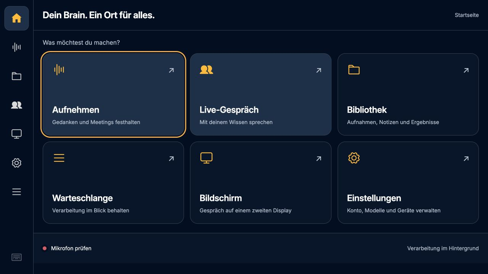
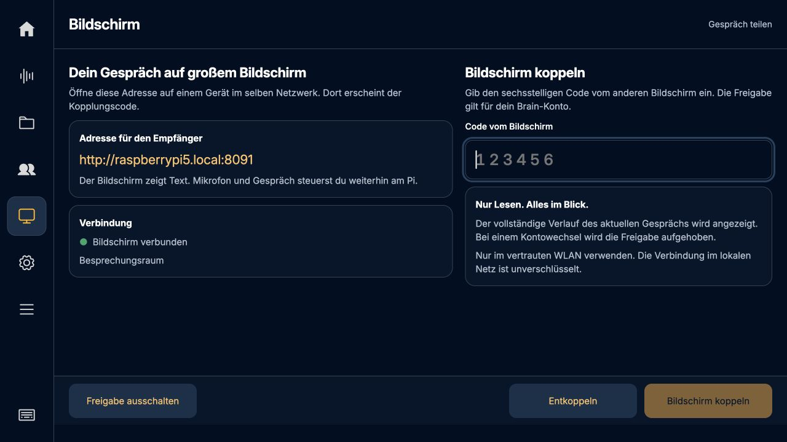
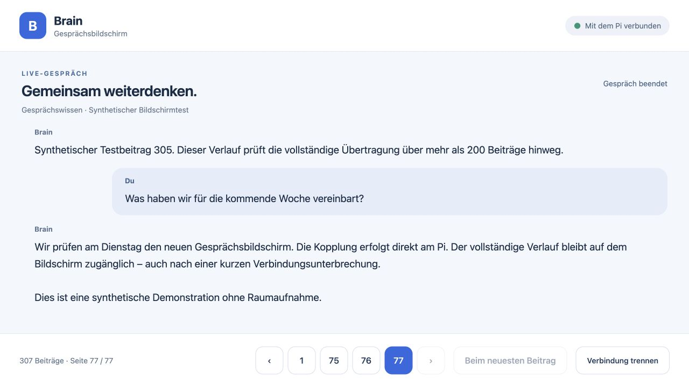
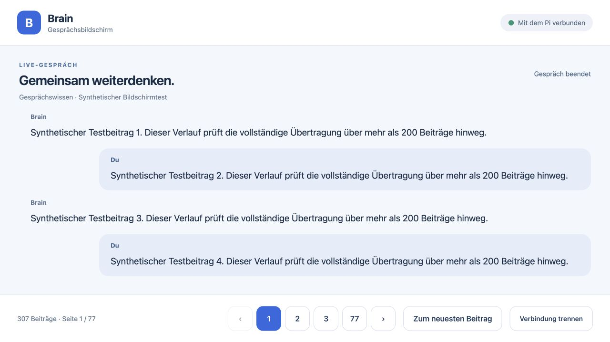
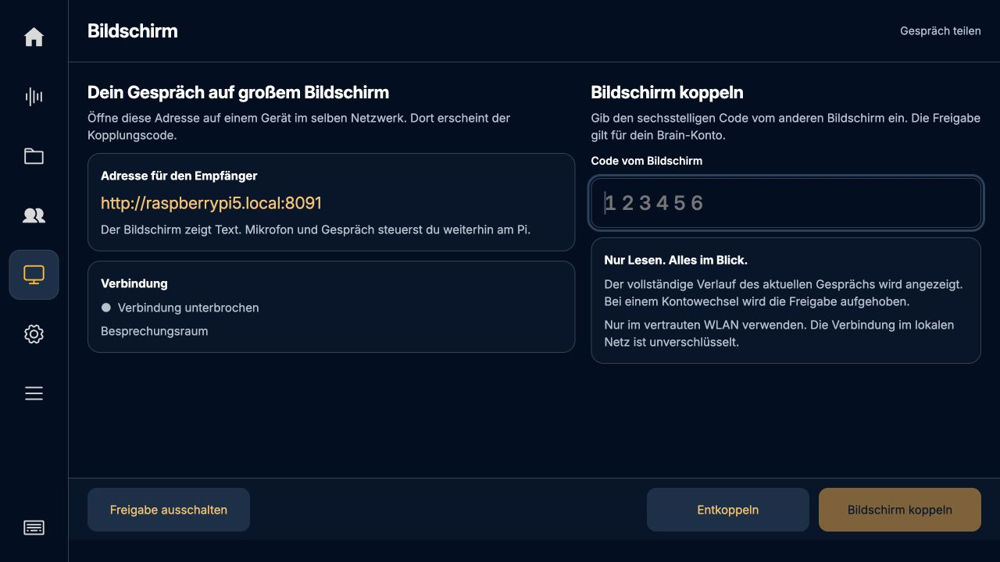
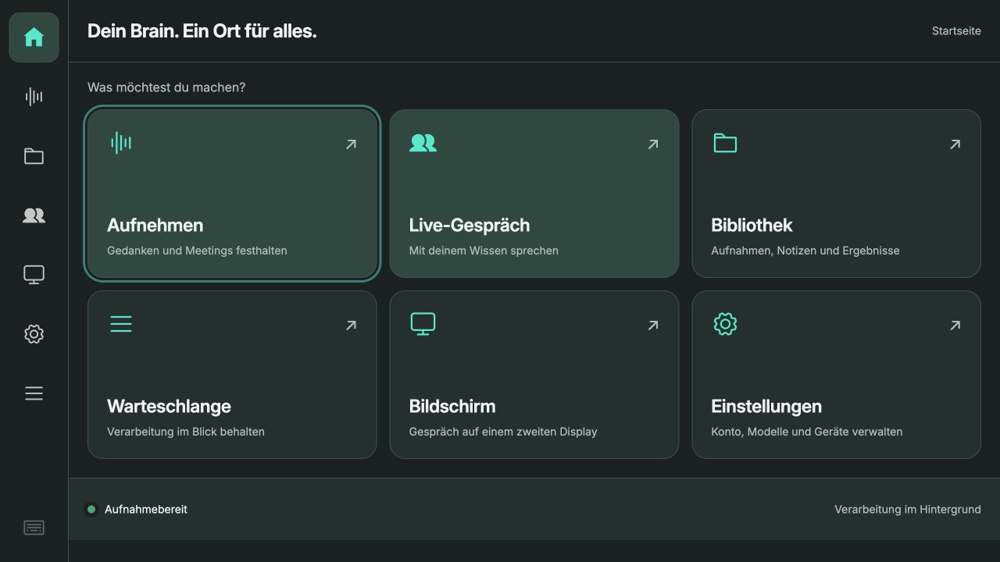
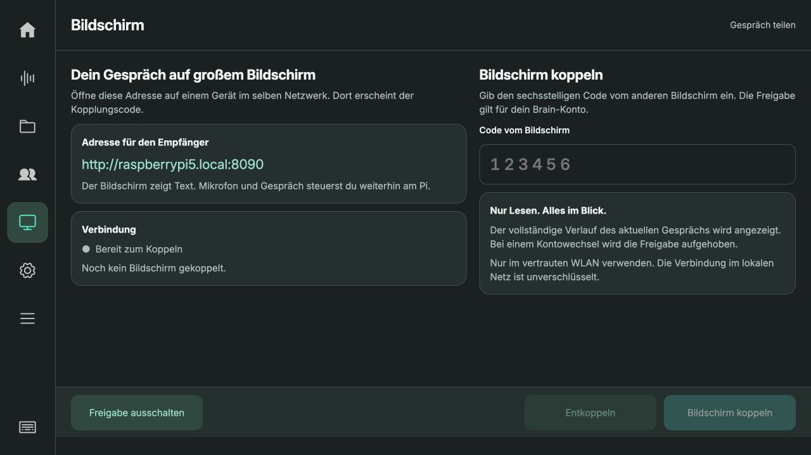

# Externer Gesprächsbildschirm · Studio 0.5.30

Die neue **Startseite** öffnet die wichtigsten Bereiche über große Kacheln. Links
steht zuerst das Haus, der Recorder bleibt separat. Der **Bildschirm** ist eine
eigene Ansicht mit Monitor-Symbol in der linken Navigation, keine Unterseite der
Einstellungen und kein Modal.

## Koppeln

1. Am Pi links **Bildschirm → Freigabe einschalten** wählen.
2. Auf dem anderen Gerät im selben vertrauten Netzwerk
   `http://raspberrypi5.local:8090/` öffnen. Alternativ die LAN-IP des Pi mit Port
   8090 verwenden, falls der Rechner `.local` nicht auflösen kann.
3. Den Empfänger benennen und **Code anfordern** wählen.
4. Den sechsstelligen Code innerhalb von zwei Minuten am Pi eingeben und
   **Bildschirm koppeln** antippen. Die Touch-Tastatur öffnet bei diesem Feld
   direkt die Zahlentasten.
5. Live-Gespräch am Pi öffnen und starten. Mikrofon, Lautsprecher und sämtliche
   Gesprächssteuerungen bleiben am Pi. Der Empfänger zeigt ausschließlich Text.

Der Empfänger zeigt den vollständigen Verlauf des aktuellen bzw. zuletzt
wiederhergestellten Gesprächs. Seitenbuttons öffnen frühere Beiträge, **Zum
neuesten Beitrag** folgt wieder der laufenden Antwort. Lange Beiträge werden
anhand ihrer tatsächlichen Texthöhe auf Seiten aufgeteilt. Es gibt kein
200-Beiträge-Limit mehr. Vor diesem Update bereits abgeschnittene Altverläufe
können nicht nachträglich rekonstruiert werden. Eine Archivsuche durch alle
früheren Gespräche ist nicht Teil dieser Ansicht.

## Verbindung und Zustand

- Alle drei Sekunden prüft der Empfänger den Pi. Nach 15 Sekunden ohne Abruf
  zeigt der Pi **Verbindung unterbrochen**. Kurze Unterbrechungen erfordern kein
  neues Pairing; der vollständige aktuelle Verlauf wird wieder geladen.
- Nach zehn Minuten ohne Heartbeat, spätestens nach 24 Stunden, einem
  Kontowechsel, einer Abmeldung oder einem Backend-Neustart neu koppeln.
- **Entkoppeln** am Pi oder **Verbindung trennen** am Empfänger widerruft den
  Zugriff. Der Empfänger entfernt den angezeigten Verlauf spätestens beim
  nächsten erfolgreichen Abruf; bei Netzwerkverlust wird er ebenfalls geleert.
- **Freigabe ausschalten** beendet den separaten Empfängerdienst. Die gewählte
  Ein-/Aus-Einstellung bleibt über einen Neustart erhalten; Kopplungen nicht.
- Es wird jeweils ein Empfänger freigegeben. Eine neue Kopplung ersetzt die alte.
- Neue Kopplungen sind während Aufnahme oder Live-Gespräch gesperrt. Eine vorher
  gekoppelte Anzeige läuft weiter. Der Widerruf bleibt serverseitig möglich.

## Grenzen und Sicherheit

Der Empfänger hat einen separaten, lesenden HTTP-Dienst. Er bekommt weder
Microsoft-Tokens noch Aufnahme-/Gerätesteuerung. Der lokale Studio-Dienst bleibt
auf 127.0.0.1. Der Browser besitzt nur ein zufälliges HttpOnly-/SameSite-Cookie;
Chats und Zugangsdaten werden nicht in LocalStorage gespeichert. Freigaben sind
an Brain-Konto, Mandant, Server und Anmeldegeneration gebunden. Codes verfallen,
Versuche und offene Kopplungen sind begrenzt; fremde Ursprünge werden abgewiesen.
Text wird als Text dargestellt, nicht als ausführbares HTML.

Diese erste Version nutzt HTTP im **vertrauten lokalen Netzwerk**, keine
verschlüsselte Internetverbindung. Keine Portweiterleitung ins Internet
anlegen. Ein externer Relay-/HTTPS-Dienst ist noch nicht enthalten. Bildkarten
und vom Modell ausgelöste Display-Toolcalls benötigen zusätzliche CDB-Ereignisse
und sind ebenfalls noch nicht Bestandteil dieser Version.

Der Sender speichert vollständige Gesprächsverläufe lokal, maximal alle 15
Sekunden bei Änderungen und abschließend beim Beenden. Bei einem plötzlichen
Stromausfall können die letzten Sekunden seit dem Checkpoint fehlen. Der
Empfänger liest in Paketen von 100 Beiträgen; unveränderte Revisionen übertragen
keinen Text erneut. Nach einem Serverneustart wird die letzte abgeschlossene
bzw. gesicherte Sitzung beim Koppeln wiederhergestellt.

## Nachweise

- 169 Python-Tests auf dem Pi bestanden; 85 JavaScript-Tests bestanden.
- Nach letzter Ergänzung gezielter HTTP-Integrationstest erneut bestanden:
  lokale Codefreigabe, CSRF, Aufnahme-/Live-Sperren und dauerhafte Ein-/Aus-Wahl.
- Synthetischer Browser-Test auf separater Pi-Instanz: 307 Beiträge, Zugriff auf
  ersten und letzten Beitrag, Neuladen, Heartbeat-Verlust und Wiederverbindung.
- 306 Beiträge inklusive einer 60.001 Zeichen langen Nachricht ohne Verlust
  nach Speicherung und Wiederherstellung im Python-Test.
- Konto-/Generationswechsel, Codeablauf, Versuchslimit, fremde Hosts/Origins,
  Widerruf und unautorisierte Zugriffe geprüft. Empfänger kann keine Aufnahme
  starten und keine Studio-Zustände oder Kontodaten abrufen.
- Synthetische 7-Sekunden-Aufnahme: Home, Bildschirm und weitere Bereiche während
  Aufnahme gesperrt; nach Stoppen wieder anwählbar. Keine Raumaufnahme benutzt.
- Empfänger bei 1280 × 720 und 1024 × 600 visuell geprüft. Pi-Ansichten bei
  1280 × 720, einschließlich Touch-Tastatur. Keine sichtbaren Scrollbars.

Die Screenshots zeigen ausdrücklich die isolierte Testinstanz und synthetische
Gesprächsdaten; die Testadresse dort verwendet Port 8091.

## Weitere Erweiterungen – Planung

- [Wake Word](../wake-word-research.md): Einschalter in den Einstellungen,
  standardmäßig aus. Nur ohne laufende/pausierte Aufnahme und ohne laufendes
  oder startendes Gespräch auslösen; atomare Sperre im Python-Backend.
- [Timer und Erinnerungen](../timer-reminders-research.md): separate Untersuchung
  mit lokaler Zeitplanung und benötigtem CDB-Toolvertrag. Noch nicht implementiert.

## Produktive Auslieferung

Am 13. Oktober 2026 wurde Laufzeit-Commit `750c73a` auf den Pi gespielt.
Backend und Kiosk laufen; die SHA256-Werte aller 14 ausgelieferten Dateien
stimmen mit dem Repository überein (siehe [deployment.json](deployment.json)).
Alle 22 Aufnahmen, Einstellungen und das Brain-Konto blieben erhalten.
Die Sicherung liegt auf dem Pi unter `/home/chris/backups/recorder-before-0.5.30`.
Die getrennte Testinstanz wurde gestoppt und ihre Sitzung entfernt.

Die Bildschirmfreigabe ist eingeschaltet. Die Empfängerseite wurde direkt im
WLAN unter `http://192.168.2.147:8090/` im Browser erfolgreich geöffnet.
Der In-App-Browser konnte den `.local`-Namen nicht auflösen; bei diesem Problem
die aktuelle IP-Adresse des Pi verwenden. Es wurde kein produktiver Empfänger
gekoppelt. Kopplung, Verlauf und Heartbeat wurden mit den oben genannten
synthetischen Daten auf der getrennten Pi-Testinstanz geprüft.

Diese beiden Screenshots zeigen die produktive Oberfläche:

