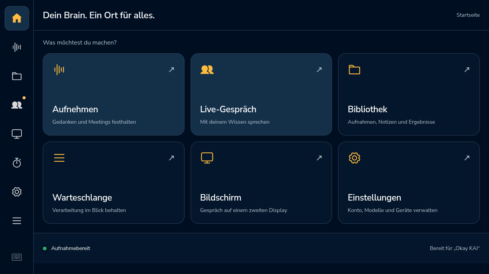

# Leerlauf-Aktualisierungen reduzieren · 0.5.55

15. Oktober 2026. Die schnelle Wake-Abfrage schrieb auch bei unverändertem
Zustand Titel, Detailtext, LED-Zustand und Sichtbarkeit erneut in den DOM.
Die Touch-Navigation setzte zusätzlich bei jeder Prüfung dieselbe
Seitenbeschriftung. Diese Schreibvorgänge lösten unnötige Beobachteraufrufe
und Stilprüfungen aus.

Die beiden Module schreiben diese Werte jetzt nur bei einer Änderung. Abfrage-
und Erkennungstakt bleiben gleich. Die lokale Ablaufzeit des Erkennungshinweises,
Schutz vor alten Statusmeldungen und Rücksetzung bei neuer Backend-Instanz bleiben
erhalten. Audio-, Mikrofon-, Konten- und Modellkonfiguration werden nicht geändert.

## Nachweis und Grenzen

Der [lokale Vergleich](../audio-release-0.5.54/idle-render-comparison.json) zeigt
in 30 Sekunden 33 statt 509 DOM-Beobachteraufrufe sowie 66 statt 266
Stil-Neuberechnungen. Ein wiederholter Kandidatenlauf bestätigt dieselben Zähler.
Diese Werte stammen vom instrumentierten Mac-Browser, nicht vom Pi. Sie belegen
vermeidbare Oberflächenarbeit, aber noch nicht die Ursache seines Speicheranstiegs.

Die [isolierte Vergleichsprüfung](../audio-release-0.5.54/check-idle-render-candidate.cjs)
führt 100 Zyklen mit insgesamt 1.400 Zustandsprüfungen durch: schneller
Erkennungshinweis, veraltete Vollabfrage, Verbindungsaufbau, Zuhören, Denken,
Sprechen, Schließen, Aufnahme, lokaler Test, Ablauf und neue Backend-Instanz.
Die sichtbaren Werte entsprechen jeweils dem unveränderten Stand. Zusätzlich
wird geprüft, dass der übernommene Quelltext genau dem gemessenen Kandidaten
entspricht. Die Vorversion wird dafür aus dem festen Commit `14f9dc5` gelesen.
Das ist ein VM-Test ohne Audiohardware, keine Serie echter Gespräche.

Alle **110 JavaScript-Tests auf dem Mac** bestehen, darunter neue Regressionen
für 100 unveränderte Wake-Abfragen ohne erneute Feedback-Schreibvorgänge und
unveränderte Pager-Beschriftungen mit weiterhin korrektem Beschriftungswechsel.
Die vollständige Python-Suite besteht mit **340 Tests auf dem Mac**.
[Testprotokolle: JavaScript](js-tests-mac.txt), [Python](python-tests-mac.txt),
[Zustandsvergleich](transitions.json). Die bekannte Qt-/GC-Aufräumwarnung
erscheint weiterhin; sie wird nicht als fehlgeschlagener Test ausgegeben.
Auf dem Pi ist kein Node-Testprogramm installiert; dafür wurde keine neue
Systemabhängigkeit eingerichtet.

## Bestehendes Gerät und Kunden-Image

Geändert werden `studio/device-status.js`, `studio/touch.js` und die App-Version
in `web_server.py`. Alle drei Dateien sind bereits Teil der App-Positivliste.
Keine neue Runtime, Bibliothek, Firmware, Datenmigration oder Modelle. Ein neues
SD-Image aus diesem Commit übernimmt die Dateien automatisch; das vorhandene
Image 0.5.44 wird dadurch nicht ersetzt.

Die Auslieferung erfolgt ausschließlich über das signierte App-Update mit
atomarer Wartungssperre. Aktive Aufnahmen oder Gespräche werden nicht beendet.
Der bisherige 0.5.54-Teilzeitraum muss erhalten bleiben und darf nicht mit einer
neuen Version als durchgehender 24-Stunden-Lauf zusammengerechnet werden.
Installation, Gerätestichproben und neuer Messplan sind nachfolgend belegt.
Vorläufe liefern keinen Nachweis eines vollständigen 24-Stunden-Tests.

## Auslieferung bestätigt

[Signiertes Update, Sequenz 12](deployment.json) aus Commit
`78687160e4acec9d05d7b144bfdf22e4b04d3c1b` ist auf dem Pi installiert.
Die vorhandene Wartungssperre war erfolgreich; gespeicherte Einstellungen
haben vorher und nachher dieselben Prüfsummen. Die Runtime blieb unverändert.
[18 Startstichproben](installation-check.json) zeigen 0.5.55 in API und HTML,
genau einen unveränderten Wake-Prozess in Bereitschaft und identische Hashes
der drei geänderten Laufzeitdateien auf Pi und getestetem Quellstand.

Die native Displayaufnahme zeigt die Startseite und „Bereit für Okay KAI“.
Das belegt die Anzeige, keinen akustischen Erfolg. Keine Testtöne, keine
künstlichen Gespräche und kein Wechsel von Mikrofon, Rufwort oder Brain-Konto.

Der [neue Messplan](observation-plan.json) läuft vom **15.10.2026, 22:21:44 Uhr
bis 16.10.2026, 22:21:44 Uhr Europe/Berlin**. Der tatsächliche Beobachterprozess
1272509 ist aktiv; ausschließlich lesend und weiterhin Evidenzrevision 2.
Die bestehende 15-Minuten-Nachprüfung wurde auf Version, Fenster und Frist
angepasst. Es wurde keine zweite Überwachungsautomation angelegt.

Der vorherige [0.5.54-Teilbericht](previous-partial-observation.json) umfasst
rund 85 Minuten bis zum Archivieren. Archiv auf dem Pi:
`baseline-054-before-idle-render-fix`. Der enthaltene Versionswechsel und die
Unterbrechung der Ruhezeitevidenz gehören zur kontrollierten Auslieferung;
sie werden nicht als bestandener Dauerlauf gewertet oder aus den Daten entfernt.
Die vollständige neue 24-Stunden-Messung, ein echter Ruf nach acht Stunden Ruhe
und die Einordnung des längerfristigen Speicherverlaufs bleiben offen.

## Erste zehn Minuten auf dem Pi

Der feste Abschnitt **22:21:44 bis 22:31:44 am 15.10.** hat 40 Messwerte und
99,9923 % Abdeckung. Browser-CPU: Median **25,46 % eines Kerns**, p95 26,46 %.
Die letzten 40 ruhenden 0.5.54-Stichproben vor dem Update lagen bei Median
31,83 %, p95 33,06 %. Das ist eine frühe beobachtete Entlastung, kein kontrollierter
Pi-A/B-Versuch: Backend und Oberfläche wurden beim Update neu gestartet bzw.
geladen. Die vollständige Messung bleibt erforderlich.

Lokale Gesundheitsabfrage: Median 6,67 ms, p95 96,41 ms. Der summierte RSS steigt
von 1.162,58 auf 1.173,77 MiB; **ein behobener Speicherverlust oder ein dauerhaftes
Plateau ist damit ausdrücklich nicht belegt**. Kein Wake-Ereignis in diesem
Abschnitt. [Vergleich mit Quellprüfsummen](first-ten-minute-comparison.json).
Die technischen Quelldateien sind zusätzlich außerhalb von Git gesichert.
Für diesen Zwischenbericht wurde weder die Beobachtung zurückgesetzt noch
ein weiterer Eingriff auf dem Pi vorgenommen.

## Zusammenspiel von Token-Erneuerung und Gesprächsabbruch

Zwei ergänzende [Integrationstests](../../tests/test_live_refresh.py) verbinden
die tatsächlichen Dienste `CdbService` und `LiveConversation` mit abgelaufenen,
rein synthetischen Anmeldedaten. Transport und Audio sind Testobjekte; es werden
keine Microsoft-/CDB-Anfragen und keine Hardwarezugriffe ausgeführt.

- Bei blockierter Token-Erneuerung bleiben Kontostatus und Gesprächssteuerung
  erreichbar. Abbruch schließt das Audio-Testobjekt sofort; die Reservierung
  bleibt bis zum Abschluss des Startarbeiters gesperrt. Die verspätete Antwort
  erstellt keine Cloud-Sitzung und öffnet das geschlossene Audio nicht erneut.
  Der anschließende neue Start verwendet das erneuerte Token ohne zweite
  Erneuerung und lässt sich vollständig schließen.
- Scheitert die Erneuerung, werden Audio und Reservierung freigegeben. Interne
  Anbieterfehler erscheinen nicht im öffentlichen Status; die alte gespeicherte
  Anmeldung wird nicht durch unbestätigte Daten ersetzt. Ein neuer Versuch
  erneuert und prüft das Konto erneut und kann anschließend starten und enden.

**77 gezielte Tests auf dem Mac bestanden**: die zwei neuen Fälle sowie die
vorhandenen Gesprächs-, CDB- und Wake-Stresstests. [Protokoll](live-refresh-tests-mac.txt).
Das ist keine Messung echter Microsoft-Latenz und kein Ersatz für Standzeit,
akustischen Wake oder ein natives Cloud-Gespräch. Die Begrenzung tatsächlicher
Netzwerkaufrufe wird durch diese kontrolliert freigegebenen Transportobjekte
nicht bewiesen.

Nur Tests und Nachweisdokumentation wurden ergänzt. Kein Laufzeit- oder
Image-Einfluss, keine neue Version und keine Pi-Auslieferung; die unveränderte
0.5.55-Beobachtung läuft weiter.

## 30 Minuten lokaler Browser ohne erzwungene Speicherbereinigung

Der zusätzliche Lauf am 15.10. von **22:40:59 bis 23:11:08 Europe/Berlin**
verwendet Chrome 155 auf dem Mac und die synthetische Vorschau mit drei
Aufnahmen. Die Vorschau meldet Backend 0.5.52; die untersuchten Frontend-Dateien
entsprechen über ihre Prüfsummen dem ausgelieferten 0.5.55-Stand. Der Pi verwendet
Chromium 142. Diese unterschiedlichen Umgebungen sind **kein kontrollierter
Vergleich und kein Pi-Speichernachweis**.

Nach der Initialisierung wurde die Seite nicht neu geladen und während der
natürlichen Messreihe keine Speicherbereinigung erzwungen. Die 31 Stichproben
decken 1.809,4 Sekunden ab; die erste liegt nach 20,4 Sekunden, der größte Abstand
beträgt 61,7 Sekunden. Alle Stichproben zeigen eine sichtbare Seite mit synthetisch
gesetztem Bereitschaftszustand. Es fand keine Sprachaktivierung statt.

| Messgröße | Beobachtung |
| --- | --- |
| JavaScript-Speicher in Nutzung | 2,54–3,61 MiB; erste/letzte Stichprobe 3,10/3,13 MiB |
| Angefügte HTML-Elemente | Durchgehend 1.123 |
| Dokumente | Durchgehend 29 |
| DOM-Objekte einschließlich noch nicht aufgeräumter Objekte | 2.421–7.074; Rückgang auf 2.421 nach rund 25 Minuten |
| Ereignisbehandler | 297–344; Rückgang auf 297 im selben natürlichen Aufräumzyklus |
| Browser-RSS ohne Testtreiber | 1.078,39 → 1.118,47 MiB, acht OS-Stichproben von Sekunde 157 bis 1.809 |
| Aktiver Renderer-RSS | 223,63 → 260,67 MiB im selben OS-Intervall |
| Separater Playwright-Treiber | 131,73 → 310,50 MiB; ausdrücklich nicht in Browser-RSS enthalten |

DOM und Ereignisbehandler werden in diesem Fenster wieder freigegeben. Der
steigende Prozess-RSS ist damit nicht vollständig erklärt. Der Treiber und die
Abfrage-/Routing-Instrumentierung können die lokale Messung beeinflussen; aus
dem höheren RSS allein folgt weder ein bestätigter Speicherverlust noch ein
behobener Fehler. Auch kurze Spitzen zwischen Stichproben bleiben unsichtbar.
RSS-Summen können gemeinsam genutzte Seiten mehrfach zählen.

**Separater Schritt nach Ende der natürlichen Messreihe:** Ein expliziter
GC-Aufruf lässt 2.421 DOM-Objekte, 297 Ereignisbehandler und rund 2,53 MiB
JavaScript-Speicher zurück. Der aktive Renderer liegt anschließend noch bei
256,38 MiB RSS. Die Bereinigung erklärt also nur einen Teil der Zunahme; sie
ist kein Beleg für ein dauerhaftes Speicherplateau. Der Testbrowser samt
Treiber wurde anschließend geschlossen und seine Prozessbeendigung geprüft.

[Auswertung mit Quellprüfsummen](natural-idle-mac/summary.json),
[natürliche Stichproben](natural-idle-mac/samples.jsonl),
[OS-Stichproben](natural-idle-mac/process-memory.jsonl),
[separate Bereinigung](natural-idle-mac/post-gc.json),
[Prozessabschluss](natural-idle-mac/cleanup.json).
Die verwendeten Browser-Snippets und das Auswertungsskript liegen im selben
Ordner. `summarize.py <Ordner>` berechnet den Bericht aus den gespeicherten
Messdateien neu; es startet keinen Browser und greift nicht auf den Pi zu.

Keine Laufzeitänderung, keine neue Auslieferung und kein Image-Einfluss.
Die echte Pi-Beobachtung bleibt unverändert aktiv. Ihr vollständiger
Speicherverlauf und der reale Wake nach langer Pause sind weiterhin offen.

## Erste volle Stunde auf dem unveränderten Pi

Der feste Abschnitt **15.10., 22:21:44 bis 23:21:44 Europe/Berlin** umfasst
240 gültige Messwerte, 99,9901 % Abdeckung und keinen Wechsel von Browser,
Backend oder Beobachterprozess. Es gab keine Warnungen und keinen beobachteten
Wake. [Stundenbericht mit Rohdaten-Prüfsummen](first-hour-observation.json).

- Browser-CPU: Median **27,33 % eines Kerns**, p95 30,20 %, Maximum 30,80 %.
  Der Median steigt innerhalb dieses Fensters von 25,86 % in der ersten auf
  28,93 % in der zweiten halben Stunde. Die frühe Entlastung darf daher nicht
  als bereits dauerhaft stabiler Verbrauch ausgegeben werden.
- Lokale Gesundheitsabfrage: Median **5,82 ms**, p95 99,49 ms, Maximum 153,34 ms.
- Browser-RSS: erste/letzte Stichprobe **1.162,58 → 1.228,73 MiB**, also
  **+66,15 MiB**. Ein Speicherplateau ist weiterhin nicht belegt. Die
  vorläufigen Warnschwellen wurden nicht erreicht; das erfüllt allein noch
  nicht das Abnahmekriterium eines erklärten, begrenzten Speicherverlaufs.

Eine ergänzende reine Leseprüfung mittels `smaps_rollup` über **7,705 Minuten**
bestätigt bei denselben neun Prozessen und Startkennungen einen Anstieg des
anteilig zugerechneten Speichers (PSS) von **738,91 auf 754,50 MiB**. Renderer
806009 trägt **+15,72 MiB PSS und +15,72 MiB private veränderte Speicherseiten**
bei; die übrigen Prozesse bleiben nahezu gleich. Die Zunahme ist in diesem
kurzen Intervall also nicht bloß ein Effekt mehrfach gezählter gemeinsamer
Seiten. [Detailstichproben mit Zeiten und Prozesskennungen](browser-memory-samples.json).
Ihre Messzeiten unterscheiden sich vom festen Stundenbericht; RSS und PSS
werden nicht als zeitgleiche identische Messungen dargestellt.

Die Ursache innerhalb des Renderers ist damit noch nicht bestimmt. Die später
abgeschlossenen [lokalen Kontrollläufe](memory-controls/README.md) zeigen weiter
Speicheranstieg bei angehaltenen `renderState`-Aufrufen und auch ohne
Anfrage-Zeitlimits. Diese Eingriffe bleiben reine Diagnose, keine produktiven
Lösungsvorschläge. Eine statische Seite zeigt einen kleineren Anstieg; die
Auswirkung der Instrumentierung ist weiterhin gesondert zu beachten.
Keine Pi-Laufzeitänderung, kein Neustart, keine Audioaktivierung und kein
Image-Einfluss. Der volle Dauerlauf und die akustische Langzeitabnahme bleiben offen.

### Längere Prüfung des privaten Renderer-Speichers

Eine weitere reine Leseprobe am **15.10.2026 um 23:56:28 Europe/Berlin**
vergleicht dieselben neun Prozesse samt Startkennungen mit der Probe von 23:14:55.
Nach **41,54 Minuten** zeigt Renderer 806009 **+47,90 MiB PSS**, **+47,91 MiB
private veränderte Seiten** und **+47,91 MiB anonymen Speicher**. Browser-, GPU-
und Hilfsprozesse ändern sich jeweils um weniger als 0,1 MiB PSS. Damit bleibt
die Zunahme im Renderer lokalisiert; ihre Ursache ist weiterhin nicht bewiesen.
[Stichproben, Differenzen und Rohdaten-Prüfsummen](renderer-memory-followup.json).

Die offizielle [Chromium-MemoryInfra-Dokumentation](https://chromium.googlesource.com/chromium/src/+/main/docs/memory-infra/README.md)
trennt physische Prozesswerte von Speicheranteilen für V8, Blink, PartitionAlloc
und Caches. Unsere Prozessmessung kann diese internen Anteile nicht zuordnen.
Ein kleiner JavaScript-Heap im **separaten Mac-Test** beweist insbesondere nicht,
dass der Pi-Renderer denselben Heap-Verlauf hat. Falls der Anstieg anhält, ist
eine gesonderte MemoryInfra-Aufzeichnung die nächste Eingrenzung; sie gehört
nicht in die unveränderte 24-Stunden-Baseline. Laut
[Heap-Profiling-Dokumentation](https://chromium.googlesource.com/chromium/src/+/main/docs/memory-infra/heap_profiler.md)
beeinflussen Profiling-Overhead, nicht erfasste frühe Allokationen und verfügbare
Symbole die Interpretation. Ein solcher Trace wurde hier noch nicht erzeugt.

Nur ergänzende Diagnose und Dokumentation, keine neue Pi-Auslieferung und kein
Image-Einfluss. Der debuggerfreie lokale Vergleich ist inzwischen abgeschlossen und bereinigt.
Sein strenger Prozessgruppenvergleich scheitert an einem temporären Hilfsprozess;
die [Rohdaten und ergänzende Beschreibung](memory-controls/README.md) behalten
diese Einschränkung ausdrücklich bei.

Eine ergänzende [CPU-Probe](cpu-followup/README.md) lokalisiert die Pi-Rechenzeit
im Hauptthread des Renderers. Die getrennte kurze Mac-Profilierung reproduziert
die höhere Last nicht und wird ausdrücklich nicht als Pi-Abnahme oder Fix gewertet.

## Erste zwei vollständige Stunden auf dem Pi

Festes Fenster **15.10., 22:21:44 bis 16.10., 00:21:44 Europe/Berlin**:
480 gültige Stichproben, **99,9902 % Abdeckung**, keine ungültigen Zeilen,
keine Browser-/Backendwechsel und ein durchgehend laufender Beobachter.
Es wurden weiterhin kein Wake und keine Warnung beobachtet. Das ist kein
Erkennungsnachweis. [Bericht und Herkunft der Daten](first-two-hours-observation.json).

Der Browser-RSS steigt von **1.162,58 auf 1.294,44 MiB** (**+131,86 MiB**).
Die CPU-Mediane pro halber Stunde liegen bei **25,86 / 28,93 / 30,63 / 32,50 %
eines Kerns**. Damit ist der wachsende Verbrauch nach zwei Stunden weiterhin
ungeklärt; die ausbleibende Warnung darf nicht als bestandene Ressourcenabnahme
interpretiert werden. Die Statusabfrage bleibt schnell: Median **5,18 ms**,
p95 **98,40 ms**, Maximum **153,34 ms** im betrachteten Fenster.

Die Rohkopie samt Prüfsummen bleibt außerhalb Git unter
`~/.local/share/cdb-stability-evidence-20261015/055-first-two-hours` erhalten.
Der Bericht verändert weder das geplante Ende der 24-Stunden-Beobachtung noch
die Anforderungen an den echten Acht-Stunden-Wake. Keine neue App-Auslieferung,
kein Image-Einfluss und kein automatischer Reparatur-/Neustarteingriff.

## Noch nicht ausgelieferte Folgekorrektur

Eine [isoliert belegte wiederholte SVG-Neuladung](probe-icon/README.md) im
Mikrofon-Testplayer ist im Quellstand korrigiert. Die beobachtete Pi-Version bleibt
unverändert. Dies belegt keinen Fix des langfristigen Ressourcenwachstums.
