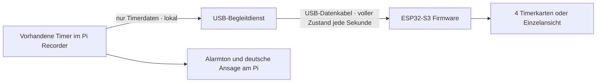

# LCD Remote Display · USB-Prototyp 0.2

21.10.2026. Zielgerät: Waveshare ESP32-S3-Touch-LCD-5B, SKU 28151,
1024 × 600, Touch. Hardwareprojekt `device-fdb89fd08b3a454a` im
[Pi Studio](https://pistudio.cdblab.de/library?project=device-fdb89fd08b3a454a).
Chris hat **USB zuerst** bestätigt. BLE folgt als getrennte Erweiterung.

**Pi vorbereitet, Geräteabnahme offen.** Am 21.10.2026 wurde PR #16 gemergt und
Recorder **0.5.70, signierte Sequenz 27**, im freien Zustand unter Wartung installiert.
Der zusätzliche USB-Dienst ist aktiviert und wartet ohne Display. Fünf Nachmessungen
zeigen `idle/listening`; keine Ton-/Gesprächstests. Bestehende Einstellungen blieben
unverändert. [Installationsnachweis](pi-deployment-0.5.70.json).
Chris erwartet die Hardware am 22.10. und meldet sich nach Ankunft. Kein Display
angeschlossen oder geflasht. Ein erfolgreiches Kompilat beweist weder die Passung
der Boardrevision noch die Bild-/Touchfunktion.

[Konkreter Ablauf für Lieferung, Flashen und erste Tests](FIRST-START.md).

## Automatisch nach dem Anstecken

Nach einmaliger Installation des Begleitdienstes und der passenden Displayfirmware
ist kein Schalter pro Timer nötig: USB anschließen, vorhandene Timer werden
übernommen. Ohne Timer steht „Keine offenen Timer“ auf dem Display. Abziehen
ändert am Pi keine Timer; nach erneutem Anstecken folgt der aktuelle Gesamtstand.
Der Dienst startet mit der Desktop-Benutzersitzung und wartet ohne Display.

Die Erkennung liest nur USB-Metadaten: Espressif VID/PID `303a:4001`, Hersteller
`CDB`, Produkt `CDB Timer Display`, zwölfstellige hexadezimale Chip-Seriennummer.
Erst bei genau einem Treffer wird dessen Port geöffnet und das Protokoll geprüft.
Andere Geräte, generische ESP-Boards und Bootloaderports werden nicht geöffnet.
Bei mehreren passenden Displays wird im unverbundenen Zustand keines ausgewählt;
eine bereits verbundene Anzeige bleibt verbunden. Mehrdisplaybetrieb ist noch
nicht vorgesehen. Metadaten sind keine kryptografische Geräteauthentifizierung.
Die Werksfirmware hat diese Kennung nicht: einmaliges gezieltes Flashen bleibt nötig.

## Zuständigkeiten



Der Pi besitzt alle Timer, Änderungen und Alarme. Das Display kann mit Touch
zwischen Seiten und einer Einzelansicht wechseln, aber keine Timer verändern.
Maximal 16 offene Timer werden übertragen, je vier pro Seite. Bei mehr Timern
zeigt die Kopfzeile die Gesamtanzahl und verweist auf die App. Fällige/verpasste
Timer stehen vorne. Nach drei Sekunden ohne gültige Aktualisierung werden Zahlen
entfernt und die Verbindung als unterbrochen angezeigt. Null Sekunden allein
bedeutet noch nicht „abgelaufen“; diese Entscheidung kommt vom Host.

Der neue GET-Endpunkt `/api/lcd/timers` übernimmt bestehende Authentifizierung,
ist zusätzlich auf Loopback-Clients begrenzt und liest ausschließlich den
Scheduler. Er ruft weder den vollständigen App-Zustand noch Audiofunktionen auf.
Der externe Begleitdienst liest nur diesen Endpunkt. Ein blockiertes oder fehlendes
USB-Gerät bremst dadurch weder Recorder noch Timer-Steuertakt.

## Hardwareabgleich

- Eigener ESP32-S3, 16 MB Flash, 8 MB PSRAM, RGB-Display, GT911-Touch, CH422G.
- Native USB-Datenverbindung; Firmware verwendet TinyUSB 3.0.0 CDC mit eigener Produktkennung als seriellen
  Datenkanal (USB-OTG auf GPIO 19/20). Diagnoseausgaben sind auf UART getrennt, damit kein Logtext in
  Timerpakete gerät. Kein aktives Abtasten fremder Ports. Die USB-Konfiguration meldet 500 mA;
  die Versorgung und Einschaltspitze müssen am echten Aufbau geprüft werden.
- Herstellerangabe Versorgung 5 V / 450 mA ist kein gemessener Spitzenverbrauch.
  USB-Budget gemeinsam mit Pi-Mikrofon, Lautsprecher und vorhandener Peripherie
  am realen Aufbau prüfen. Gehäusekonzept ohne Akku; BLE würde separate Versorgung
  benötigen. Kein GPIO-Anschluss und keine Änderung am Audiokabelbaum vorgesehen.
- Vor Flashen Aufdruck **5B Touch / 1024×600** und tatsächliche Boardrevision
  vergleichen. 800×480, ohne Touch und andere Waveshare-Modelle sind keine
  gleichwertigen Zielgeräte. Gehäusemaße/Schrauben bleiben Hardwareprojektaufgabe.

Quellen: [Waveshare Gerät](https://docs.waveshare.com/ESP32-S3-Touch-LCD-5),
[Hersteller ESP-IDF-Beispiele](https://docs.waveshare.com/ESP32-S3-Touch-LCD-5/ESP-IDF),
[Espressif USB](https://docs.espressif.com/projects/esp-usb/en/latest/esp32s3/usb_device.html).
Zusätzlich Konzept R1, Modulauswahl R2, Modell v0.1 und aktuelles Server-Projektbuch
vom 21.10. gelesen. Bestell-/Lieferrevision ist dort noch nicht bestätigt.

## Software und Aufbau

- `services/lcd_display.py`: minimale Projektion, echte monotone Restzeit,
  unbekannte Zeit nach Neustart ausdrücklich gekennzeichnet.
- `services/lcd_bridge.py`: separater, optionaler USB-Prozess, nur lokale Quelle;
  feste Größen-/Zeitgrenzen, Wiederverbindung, keine Kommandoweiterleitung.
- `firmware/lcd-usb`: ESP-IDF 5.5.2, LVGL 9.6.0, Touch-Navigation und USB-Empfänger.
- `scripts/lcd-display/prepare_vendor.py`: lädt exakt geprüftes Herstellerarchiv,
  extrahiert nur zwei BSP-Dateien, wählt 1024×600. Archiv/BSP bleiben außerhalb Git.
  Herstellerdateien enthalten keinen eigenen Lizenzheader; Weitergabe von
  Hersteller-BSP/Binärpaketen ist vor einer Kundenveröffentlichung zu klären.

Firmware lokal in einer eingerichteten ESP-IDF-5.5.2-Umgebung bauen:

```sh
python3 scripts/lcd-display/prepare_vendor.py
cd firmware/lcd-usb
idf.py -DIDF_TARGET=esp32s3 build
```

Der GitHub-Build erzeugt nur Prüfartefakte. Flashen ist ein eigener Arbeitsschritt
nach Anschluss/Modellprüfung, mit explizitem Port (`idf.py -p PORT flash`). Niemals
pauschal alle seriellen Ports flashen. Werksfirmware und dokumentierten
BOOT/RESET-Wiederherstellungsweg vorher bereithalten.

Begleitdienst in **separater** Python-Umgebung mit `pyserial==3.5`; keine Pakete
in die laufende Recorder-Umgebung nachinstallieren. Vom Repository starten:

```sh
python -m services.lcd_bridge --source 'Pi Recorder'
```

Der neue Recorder-Endpunkt muss zuvor bereitgestellt sein. Ohne ihn bleibt die
Anzeige offline. Für Diagnose bleibt `--port` als ausdrückliche manuelle Auswahl
möglich. Der Standard erkennt den Anschluss nach einem Kabelwechsel neu. Ohne
Protokollantwort wird die Verbindung nach fünf Sekunden freigegeben und nach
zwei Sekunden erneut geprüft. Auf dem Test-Pi ist der Autostart seit 21.10. eingerichtet.
Der Begleitdienst braucht nur Leserechte auf die lokale API und Zugriff auf den USB-Port.
Kein root, kein Managementtoken und kein Mikrofon-/Lautsprecherzugriff. Wenn der
Recorder mit einem API-Token betrieben wird, optional `--token-file` aus einer
privaten Datei; keine Geheimnisse in Befehlszeilen oder Git.

### Einmalige Einrichtung am Pi

Im geprüften Checkout als Recorder-Desktopbenutzer:

```sh
python3 scripts/lcd-display/install.py
```

Voraussetzung: Python mit venv/pip, systemd-Benutzersitzung und bereits wirksame
`dialout`-Gruppenmitgliedschaft. Der Installer erweitert keine Benutzerrechte und
bricht andernfalls mit Hinweis ab. Er richtet ausschließlich eine separate
Umgebung unter `~/.local/share/cdb-lcd/runtime` mit `pyserial==3.5` und
`cdb-lcd-display.service` ein. Niedrige Prozesspriorität, 10 % eines CPU-Kerns und
128 MiB Speichergrenze begrenzen den Begleitdienst. Zusätzlich gilt `LimitAS`
für den virtuellen Adressraum, da auf diesem Pi der Memory-Cgroup-Controller
nicht verfügbar ist. CPU-Quota 10 % und Adressraumlimit wurden am laufenden
Prozess nachgewiesen; keine Änderung an Kernel-/Boot-Einstellungen. Er startet bzw. erneuert nur
diesen Dienst, niemals Recorder, Audio oder USB-Treiber. Wiederholte Einrichtung
prüft seine Unit vor Aktivierung mit `systemd-analyze --user verify` und ersetzt sie atomar; vorhandene Timer/Einstellungen bleiben unberührt.
`--no-start` aktiviert nur den nächsten Sitzungsstart. Abweichender lokaler API-Port
und private Tokendatei können übergeben werden. Bei einem signierten Pi-Installationsstand den Installer getrennt bereitstellen
und `--app-root /home/chris/.local/share/cdb-recorder-app/current` übergeben.
Dieser stabile Symlink bleibt in der Unit erhalten; nicht auf einen einzelnen
Releaseordner auflösen. Bei normalem Checkout muss dessen Pfad erhalten bleiben. Bei signierten App-Updates im selben Checkout verwendet der Dienst
nach seinem nächsten Start den aktualisierten Code.

Ausschalten: `systemctl --user disable --now cdb-lcd-display.service`.
Das ist eine administrative Gesamteinstellung; keine neue Timer-Option in der App.

## Datenvertrag v1

UTF-8 JSON, eine Zeile pro Paket, höchstens 8192 Bytes einschließlich Zeilenende.
Display beginnt mit `hello`, Protokoll `cdb.lcd/1` und zufälligem 128-Bit-Nonce.
Host antwortet mit `bind`, demselben Nonce, neuer Sitzungs-ID und Quellenname.
Nach `bound` folgen vollständige `snapshot`-Pakete mit aufsteigender Sequenz und
ACK. Nach Timeout neuer Nonce: alte Pakete und fremde Sitzungen werden verworfen.
Das ist Schutz gegen Verwechslung/Wiederholung über ein lokales USB-Kabel, **keine
kryptografische Identitätsprüfung**. BLE benötigt später eigenes Pairing/Bonding.

Snapshot enthält nur Gesamtzahl, Zeitbereitschaft und Timer mit ID, Revision,
Titel (maximal 80 Zeichen; Schrift Latin-1 mit Umlauten/ß, keine universelle Emoji-Abdeckung), Status, Restmillisekunden und Zeitgültigkeit. Keine
Aufnahmen, Konten, Tokens, Gesprächsinhalte oder Konfiguration. Es wird nichts auf
dem Display dauerhaft gespeichert. Bei Quellenverlust keine Wiederholung alter
Zustände; beim Wiederverbinden ersetzt ein vollständiger Zustand die Anzeige.

## Tests und noch nötige Geräteabnahme

Automatische Tests prüfen Projektion ohne Datenbankmutation, monotone Restzeit,
Neustart ohne sichere Uhr, Entfernen erledigter Timer, Begrenzung, Authentifizierung,
Handshake, Replay, Reconnect, Abbruch unvollständiger Frames und atomaren Austausch.
Prüfstand 21.10.2026: 32 Python-Tests (LCD, vorhandene Timer, Remoteanzeige,
Kundenimage-Vertrag) bestanden. Der echte Begleitprozess wurde zusätzlich über
Pseudo-Terminal und synthetischen HTTP-Server geprüft: fragmentierte/zu große
Eingaben, Handshake, Feldfilter, Quellenverlust und neuer Verbindungs-Nonce bestanden.
C-Protokolltest mit Address-/UndefinedBehavior-Sanitizer bestanden, einschließlich
atomarer Ablehnung ungültiger und zu tief verschachtelter Pakete.

Reproduzierbar aus dem Repository:

```sh
PYTHONPATH=.:tests python -m unittest tests.test_lcd_discovery tests.test_lcd_display tests.test_schedules tests.test_remote_display tests.test_customer_image
# Separate Umgebung mit pyserial 3.5, Linux/macOS:
python scripts/lcd-display/test_serial.py
```

Die Anzeige ist eine sekundengenaue Orientierung, keine Echtzeit-Alarmschnittstelle:
Übertragungs-/Abfrageverzögerung ist nicht akustisch vermessen. Der Alarm und seine
Zeitentscheidung bleiben beim bestehenden Pi-Scheduler. Computerbetrieb ist als
Transport vorbereitet; vollständige Recorder-Zeitprüfung auf macOS/Windows und
USB-Treiber wurden noch nicht abgenommen.

Am realen Modul offen: USB-Erkennung, Versorgung unter Gesamtlast, Bild und Touch,
Lesbarkeit, Kabelverlust/Reconnect, Display-Neustart, mehrere Timer, Aufwecken des
Hosts, lange deutsche Titel, Ende/Abbruch/Quittierung in der App, mehrere Stunden
Betrieb sowie unveränderte Aufnahme-/Rufwortfunktion. Keine natürliche Rufwort-
Abnahme aus Softwaretests ableiten. Bluetooth, Remote-Timerbedienung und weitere
Statusansichten sind noch nicht implementiert.

## Update- und Image-Einfluss

API/Projektion liegen in vorhandenen erlaubten App-Verzeichnissen. Der Begleitdienst
ist ohne Installation wirkungslos und importiert pyserial erst beim Aufruf. Für
bestehende Geräte ist die obige einmalige Einrichtung separat vom signierten
App-Paket nötig; danach läuft die Erkennung bei jeder Desktop-Sitzung automatisch.
Firmware wird separat auf das Display geflasht. Keine Timer-Schemamigration,
keine neuen Recorder-Laufzeitabhängigkeiten. Auf dem vorhandenen Pi wurde nur
der separate Begleitdienst samt eigener Umgebung zusätzlich eingerichtet. Frisches SD-Image bekommt ohne explizite Provisionierung weder aktivierten
USB-Dienst noch Displayfirmware. Die derzeitige Factory-Rezeptur aktiviert ihn
bewusst noch nicht: erst nach Geräteabnahme separate Umgebung/Unit provisionieren,
`dialout` für den Image-Desktopbenutzer prüfen und Kaltstart mit/ohne Display testen.
Die Erzeugung der Unit ist für Erstinstallation und erneute Einrichtung getestet;
das ersetzt keinen systemd-/USB-Test auf einem gebooteten Pi-Image.
Kein SD-Image gebaut oder bootgeprüft.

## Entwicklungsnachweise

Software-Review: [PR #16](https://github.com/shortcutchris/cdb_brainrecorder_v2_desktop/pull/16).
Der dort verlinkte GitHub-Actions-Lauf gehört jeweils zu einem konkreten Quellcommit
und enthält Firmware, Bootloader, Partitionstabelle, Flashargumente und aufgelöste
Abhängigkeiten. Der Build prüft zusätzlich Zielchip, Flash/PSRAM, Farbtiefe,
Stackgröße und die vollständig abgeschaltete USB-Diagnosekonsole.
Firmware-Metadatenversion: 0.2.0 (Entwicklung).

Aktuelle Hardware-/Projektbuchsicherung: Commit
[`9e278bd`](https://github.com/shortcutchris/raspberry_pi_meeting_recorder/commit/9e278bd),
Live-Projektbuch Revision 6 `1fe4e7720eae481e9b56a7b1a2c24bf7` (Pi vorbereitet R5),
mit Installationsstand und dem Ablauf nach Lieferung am 22.10. Die vorherigen
Software-R3/R4 und alle historischen Hardware-/CAD-Stände bleiben erhalten.
Es wurde keine neue CAD-/Druckversion erzeugt.

Die Kundenimage-Prüfung enthält jetzt ausdrücklich die beiden LCD-Pythonmodule
und schließt die Display-Binärdatei aus. Der Begleitprozess lässt sich weiterhin
ohne installiertes pyserial importieren; nur sein Start benötigt
die separate Umgebung. Ein signiertes App-Update enthält die erlaubten Pythonmodule,
installiert aber weder die zusätzliche Umgebung noch einen Autostart oder LCD-Firmware.

## Installation 0.5.70 am 21.10.2026

PR #16 gemergt als `7359323`. Signierter App-Quellstand `2c5e7e7`, Sequenz 27;
Installer separat aus `f407aae`. Alle ausgelieferten App-Dateien und die bisherige
Recorder-Runtime geprüft. Die Änderungszeiten von Rufwort-, Lautsprecher-,
Ansage- und allgemeinen Einstellungen liegen vor der Installation; alle vier
Ansageoptionen sind weiterhin eingeschaltet. Keine Timer zum Test angelegt.

Beim ersten Start wurde eine falsch zitierte `WorkingDirectory`-Zeile durch
systemd abgewiesen. Recorder 0.5.70 war bereits gesund; nur die zusätzliche Unit
wurde korrigiert. Der Installer validiert sie jetzt vor Aktivierung. Ein weiterer
Begleitdienst-Neustart setzte das unabhängig vom Memory-Cgroup-Controller wirksame
Adressraumlimit. Kein weiterer Recorder-Neustart dafür nötig. Endzustand:
Autostart aktiviert, tatsächlicher Prozess geprüft, keine automatischen Neustarts,
keine passende LCD-Hardware vorhanden. Das ist eine Pi-Vorbereitung, keine
Display- oder natürliche Rufwortabnahme.

32 gezielte Python-Tests plus 59 Tests für Updates, Ansagen, Audioausgabe und
Aktivitätsschutz bestanden. PR-Build [39672538358](https://github.com/shortcutchris/cdb_brainrecorder_v2_desktop/actions/runs/39672538358)
inklusive C-Sanitizer, seriellem Prozesstest, ESP32-S3-Build und Konfigurationscheck
erfolgreich. Installer-Korrekturen zusätzlich mit fünf Installation-/Erkennungstests
und systemd auf dem Pi geprüft. [Flashpaket-Prüfsummen](firmware-0.2.0-manifest.json).
