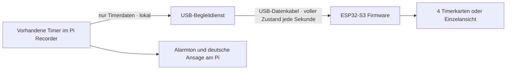

# LCD Remote Display · USB-Prototyp 0.1

21.10.2026. Zielgerät: Waveshare ESP32-S3-Touch-LCD-5B, SKU 28151,
1024 × 600, Touch. Hardwareprojekt `device-fdb89fd08b3a454a` im
[Pi Studio](https://pistudio.cdblab.de/library?project=device-fdb89fd08b3a454a).
Chris hat **USB zuerst** bestätigt. BLE folgt als getrennte Erweiterung.

**Entwicklungsstand, keine Geräteabnahme.** Kein Display angeschlossen oder
geflasht, kein Recorder-Update installiert. Aufnahme und Rufworterkennung des
produktiven Pi wurden für diese Arbeit nicht angesprochen. Ein erfolgreiches
Kompilat beweist weder die Passung der Boardrevision noch die Bild-/Touchfunktion.

## Zuständigkeiten



Der Pi besitzt alle Timer, Änderungen und Alarme. Das Display kann mit Touch
zwischen Seiten und einer Einzelansicht wechseln, aber keine Timer verändern.
Maximal 16 offene Timer werden übertragen, je vier pro Seite. Bei mehr Timern
zeigt die Kopfzeile die Gesamtanzahl und verweist auf die App. Fällige/verpasste
Timer stehen vorne. Nach drei Sekunden ohne gültige Aktualisierung werden Zahlen
entfernt und die Verbindung als unterbrochen angezeigt. Null Sekunden allein
bedeutet noch nicht „abgelaufen“; diese Entscheidung kommt vom Host.

Der neue GET-Endpunkt `/api/lcd/timers` übernimmt bestehende Authentifizierung,
ist zusätzlich auf Loopback-Clients begrenzt und liest ausschließlich den
Scheduler. Er ruft weder den vollständigen App-Zustand noch Audiofunktionen auf.
Der externe Begleitdienst liest nur diesen Endpunkt. Ein blockiertes oder fehlendes
USB-Gerät bremst dadurch weder Recorder noch Timer-Steuertakt.

## Hardwareabgleich

- Eigener ESP32-S3, 16 MB Flash, 8 MB PSRAM, RGB-Display, GT911-Touch, CH422G.
- Native USB-Datenverbindung; Firmware verwendet USB Serial/JTAG als seriellen
  Datenkanal. Diagnoseausgaben sind auf UART getrennt, damit kein Logtext in
  Timerpakete gerät. USB-Port wird ausdrücklich ausgewählt; keine Geräteabtastung.
- Herstellerangabe Versorgung 5 V / 450 mA ist kein gemessener Spitzenverbrauch.
  USB-Budget gemeinsam mit Pi-Mikrofon, Lautsprecher und vorhandener Peripherie
  am realen Aufbau prüfen. Gehäusekonzept ohne Akku; BLE würde separate Versorgung
  benötigen. Kein GPIO-Anschluss und keine Änderung am Audiokabelbaum vorgesehen.
- Vor Flashen Aufdruck **5B Touch / 1024×600** und tatsächliche Boardrevision
  vergleichen. 800×480, ohne Touch und andere Waveshare-Modelle sind keine
  gleichwertigen Zielgeräte. Gehäusemaße/Schrauben bleiben Hardwareprojektaufgabe.

Quellen: [Waveshare Gerät](https://docs.waveshare.com/ESP32-S3-Touch-LCD-5),
[Hersteller ESP-IDF-Beispiele](https://docs.waveshare.com/ESP32-S3-Touch-LCD-5/ESP-IDF),
[Espressif USB](https://docs.espressif.com/projects/esp-usb/en/latest/esp32s3/usb_device.html).
Zusätzlich Konzept R1, Modulauswahl R2, Modell v0.1 und aktuelles Server-Projektbuch
vom 21.10. gelesen. Bestell-/Lieferrevision ist dort noch nicht bestätigt.

## Software und Aufbau

- `services/lcd_display.py`: minimale Projektion, echte monotone Restzeit,
  unbekannte Zeit nach Neustart ausdrücklich gekennzeichnet.
- `services/lcd_bridge.py`: separater, optionaler USB-Prozess, nur lokale Quelle;
  feste Größen-/Zeitgrenzen, Wiederverbindung, keine Kommandoweiterleitung.
- `firmware/lcd-usb`: ESP-IDF 5.5.2, LVGL, Touch-Navigation und USB-Empfänger.
- `scripts/lcd-display/prepare_vendor.py`: lädt exakt geprüftes Herstellerarchiv,
  extrahiert nur zwei BSP-Dateien, wählt 1024×600. Archiv/BSP bleiben außerhalb Git.
  Herstellerdateien enthalten keinen eigenen Lizenzheader; Weitergabe von
  Hersteller-BSP/Binärpaketen ist vor einer Kundenveröffentlichung zu klären.

Firmware lokal in einer eingerichteten ESP-IDF-5.5.2-Umgebung bauen:

```sh
python3 scripts/lcd-display/prepare_vendor.py
cd firmware/lcd-usb
idf.py -DIDF_TARGET=esp32s3 build
```

Der GitHub-Build erzeugt nur Prüfartefakte. Flashen ist ein eigener Arbeitsschritt
nach Anschluss/Modellprüfung, mit explizitem Port (`idf.py -p PORT flash`). Niemals
pauschal alle seriellen Ports flashen. Werksfirmware und dokumentierten
BOOT/RESET-Wiederherstellungsweg vorher bereithalten.

Begleitdienst in **separater** Python-Umgebung mit `pyserial==3.5`; keine Pakete
in die laufende Recorder-Umgebung nachinstallieren. Vom Repository starten:

```sh
python -m services.lcd_bridge --port /dev/serial/by-id/GEPRUEFTES-GERAET --source 'Pi Recorder'
```

Der neue Recorder-Endpunkt muss zuvor bereitgestellt sein. Ohne ihn bleibt die
Anzeige offline. Kein produktiver Autostart installiert. Der Begleitdienst braucht
nur Leserechte auf die lokale API und Zugriff auf genau den gewählten USB-Port.
Kein root, kein Managementtoken und kein Mikrofon-/Lautsprecherzugriff. Wenn der
Recorder mit einem API-Token betrieben wird, optional `--token-file` aus einer
privaten Datei; keine Geheimnisse in Befehlszeilen oder Git.

## Datenvertrag v1

UTF-8 JSON, eine Zeile pro Paket, höchstens 8192 Bytes einschließlich Zeilenende.
Display beginnt mit `hello`, Protokoll `cdb.lcd/1` und zufälligem 128-Bit-Nonce.
Host antwortet mit `bind`, demselben Nonce, neuer Sitzungs-ID und Quellenname.
Nach `bound` folgen vollständige `snapshot`-Pakete mit aufsteigender Sequenz und
ACK. Nach Timeout neuer Nonce: alte Pakete und fremde Sitzungen werden verworfen.
Das ist Schutz gegen Verwechslung/Wiederholung über ein lokales USB-Kabel, **keine
kryptografische Identitätsprüfung**. BLE benötigt später eigenes Pairing/Bonding.

Snapshot enthält nur Gesamtzahl, Zeitbereitschaft und Timer mit ID, Revision,
Titel (maximal 80 Zeichen), Status, Restmillisekunden und Zeitgültigkeit. Keine
Aufnahmen, Konten, Tokens, Gesprächsinhalte oder Konfiguration. Es wird nichts auf
dem Display dauerhaft gespeichert. Bei Quellenverlust keine Wiederholung alter
Zustände; beim Wiederverbinden ersetzt ein vollständiger Zustand die Anzeige.

## Tests und noch nötige Geräteabnahme

Automatische Tests prüfen Projektion ohne Datenbankmutation, monotone Restzeit,
Neustart ohne sichere Uhr, Entfernen erledigter Timer, Begrenzung, Authentifizierung,
Handshake, Replay, Reconnect, Abbruch unvollständiger Frames und atomaren Austausch.
Prüfstand 21.10.2026: 27 Python-Tests (LCD, vorhandene Timer, Remoteanzeige,
Kundenimage-Vertrag) bestanden. Der echte Begleitprozess wurde zusätzlich über
Pseudo-Terminal und synthetischen HTTP-Server geprüft: fragmentierte/zu große
Eingaben, Handshake, Feldfilter, Quellenverlust und neuer Verbindungs-Nonce bestanden.
C-Protokolltest mit Address-/UndefinedBehavior-Sanitizer bestanden, einschließlich
atomarer Ablehnung ungültiger und zu tief verschachtelter Pakete.

Reproduzierbar aus dem Repository:

```sh
PYTHONPATH=.:tests python -m unittest tests.test_lcd_display tests.test_schedules tests.test_remote_display tests.test_customer_image
# Separate Umgebung mit pyserial 3.5, Linux/macOS:
python scripts/lcd-display/test_serial.py
```

Die Anzeige ist eine sekundengenaue Orientierung, keine Echtzeit-Alarmschnittstelle:
Übertragungs-/Abfrageverzögerung ist nicht akustisch vermessen. Der Alarm und seine
Zeitentscheidung bleiben beim bestehenden Pi-Scheduler. Computerbetrieb ist als
Transport vorbereitet; vollständige Recorder-Zeitprüfung auf macOS/Windows und
USB-Treiber wurden noch nicht abgenommen.

Am realen Modul offen: USB-Erkennung, Versorgung unter Gesamtlast, Bild und Touch,
Lesbarkeit, Kabelverlust/Reconnect, Display-Neustart, mehrere Timer, Aufwecken des
Hosts, lange deutsche Titel, Ende/Abbruch/Quittierung in der App, mehrere Stunden
Betrieb sowie unveränderte Aufnahme-/Rufwortfunktion. Keine natürliche Rufwort-
Abnahme aus Softwaretests ableiten. Bluetooth, Remote-Timerbedienung und weitere
Statusansichten sind noch nicht implementiert.

## Update- und Image-Einfluss

API/Projektion liegen in vorhandenen erlaubten App-Verzeichnissen. Der Begleitdienst
ist ohne Start wirkungslos und importiert pyserial erst beim Aufruf. Für eine
Auslieferung muss seine separate Umgebung und ein gezielt konfigurierter Dienst
zusätzlich eingerichtet und geprüft werden; kein automatischer Lauf bei Appstart.
Firmware wird separat auf das Display geflasht. Keine Timer-Schemamigration,
keine neuen Recorder-Laufzeitabhängigkeiten und keine aktive Pi-Konfiguration
geändert. Frisches SD-Image bekommt ohne explizite Provisionierung weder aktivierten
USB-Dienst noch Displayfirmware. Kein SD-Image gebaut oder bootgeprüft.
