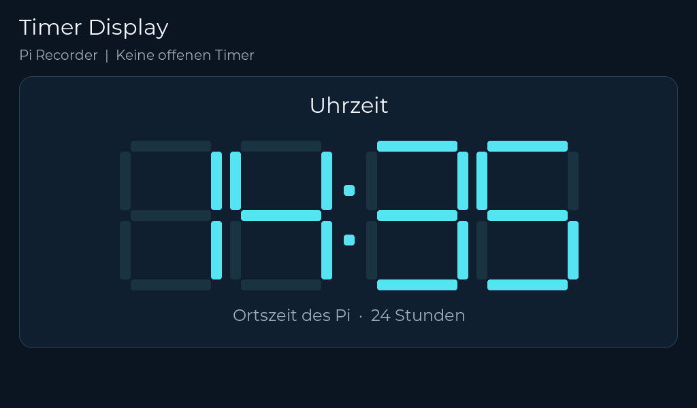

# Zusatzdisplay 0.4.0 · Uhr im Leerlauf

24. November 2026. Recorder-Begleitdienst 0.5.102; Waveshare ESP32-S3-Touch-LCD-5B,
1024×600. Keine Änderung am Pi-Touchlayout oder am Gehäuse.

## Verhalten

- Keine sichtbaren offenen Timer: große türkise Siebensegment-Uhr, HH:MM im
  24-Stunden-Format. Vier 220 Pixel hohe Ziffern. Funktioniert auch abgemeldet.
- Ein Timer: automatische Großansicht mit Restzeit einschließlich Sekunden.
  Mehrere Timer: bisherige Auswahl/Übersicht. Abgelaufene und verpasste Timer
  behalten Vorrang, bis sie am Pi bestätigt oder beendet wurden.
- Die Ortszeit kommt vom Pi; seine Zeitzone und Sommerzeit werden übernommen.
  Der Begleitdienst berechnet sie bei jeder Aktualisierung neu. Das Display
  zählt zwischen den Sekundenschnappschüssen monoton weiter, inklusive Mitternacht.
- Ohne bestätigten Zeitabgleich: `--:--` und „Zeitabgleich am Pi ausstehend“.
  Nach drei Sekunden ohne gültige Daten verschwinden die Zahlen und es erscheint
  der bestehende Verbindungshinweis. Keine scheinbar richtige eingefrorene Uhr.
- Kontotrennung bleibt erhalten. Die Uhr erscheint, wenn für die aktuelle Sitzung
  keine Timer sichtbar sind; fremde Timer und persönliche Titel werden nicht freigegeben.

## Prüfstand

- Python-Tests für Zeitfreigabe, Ortszeit, Mitternacht, Datenschutz, API und Erkennung.
- Native C-Prüfungen mit Address/UndefinedBehaviorSanitizer: Mitternacht, veraltete
  und rückwärts laufende Messzeit, unbekannte Uhrzeit, Alarmvorrang, alte Begleitdienste,
  ungültige Zeitpakete, transaktionales Aktualisieren und bisherige Timerbedienung.
- Vorschau mit derselben `display_ui.c` und LVGL 9.6.0: Uhr, Timer, Ablauf,
  Rückkehr zur Uhr, unbekannte Zeit, Verbindungsausfall. Keine Gerätefotos.
- Firmwarebau und Installation werden nach Abschluss unten ergänzt.

## Kompatibilität, Update und Image

Das optionale Feld `local_time_ms` erweitert `cdb.lcd/1` um die Millisekunden seit
lokaler Mitternacht; `clock_ready` muss wahr sein. Alte Displayfirmware ignoriert
das Feld und zeigt weiter Timer. Neue Firmware mit altem Begleitdienst zeigt
`--:--`, bis eine verlässliche Uhrzeit geliefert wird. Alte Zeitwerte werden bei
fehlendem Feld gelöscht. Keine neue Bibliothek oder Änderung der Partitionsaufteilung.

Bestehender Pi: signiertes App-Update 0.5.102 und Neustart ausschließlich des
separaten USB-Begleitdienstes zusätzlich zum normalen App-Update. Display: eigenes
gezieltes Update auf 0.4.0 nach BOOT, mit Sicherung und Rücklesen, ausschließlich
Anwendung ab 0x10000. Bootloader, Partitionen, NVS und PHY bleiben bestehen.

Frisches SD-Image: die versionierte Brücke und Hilfe sind in den vorhandenen
Positivlisten; der bestehende optionale Displaydienst wird weiterverwendet.
Ein neues Pi-Image flasht das Zusatzdisplay niemals automatisch. Neue Displays
benötigen separat Firmware 0.4.0. Kein neues SD-Image gebaut oder hardwarezertifiziert.
