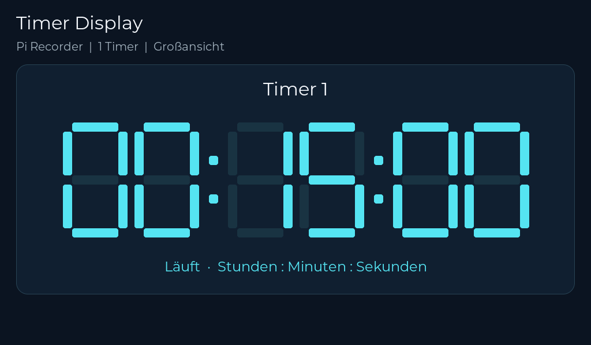

# Timerdisplay 0.3.0: automatische Großansicht

23. November 2026. Zielgerät bleibt das Waveshare ESP32-S3-Touch-LCD-5B mit
1024 × 600 Pixeln. Dies ist die Firmware des zusätzlichen USB-Displays; die
Recorder-Anwendung auf dem Pi erhält ihre Großansicht separat.

## Bedienung und Darstellung

- Ein offener Timer erscheint automatisch groß. Die türkisfarbenen Ziffern sind
  als Siebensegmentanzeige gezeichnet und 200 Pixel hoch. Stunden, Minuten und
  Sekunden bleiben eindeutig getrennt. Auch mehr als 99 Stunden passen hinein.
- Ab zwei Timern erscheint wieder die Übersicht mit bis zu vier Karten pro Seite.
  Antippen einer Karte öffnet deren Großansicht. „Alle Timer“ führt zurück.
  Die Auswahl bleibt beim Umsortieren am selben Timer gebunden. Verschwindet er,
  erscheint die Übersicht beziehungsweise der letzte einzelne Timer.
- „Weitere Timer“ wechselt zwischen den tatsächlich vorhandenen Seiten.
- Ein vom Pi als abgelaufen oder verpasst gemeldeter Timer wird bernsteinfarben
  gekennzeichnet. Eine lokal auf null gezählte Restzeit allein löst keine falsche
  Ablaufmeldung aus: Dann steht ausdrücklich „Warte auf Timerstatus“.
- Bei unbekannter Uhrzeit stehen Striche statt einer erfundenen Restzeit. Nach
  drei Sekunden ohne gültige Daten verschwinden alle Zahlen. Das Display zeigt
  den Verbindungsverlust und zählt keine alten Daten weiter.
- Touch wechselt ausschließlich die Ansicht. Timer starten, stoppen und
  quittieren sowie Alarmton und Ansage bleiben Aufgabe des Pi.

## Ansichten aus der tatsächlichen Oberfläche

Die Bilder wurden mit derselben `display_ui.c` und LVGL 9.6.0 auf dem Mac erzeugt,
mit ausschließlich künstlichen Timerdaten. Sie sind keine Fotos des Geräts.




[Vom Pi bestätigter Ablauf](large-timer-0.3/due.png) ·
[Verbindung unterbrochen](large-timer-0.3/offline.png)

Die Vorschau ist unter `firmware/lcd-usb/host-preview` nachbaubar. Sie benötigt
vorhandene LVGL-9.6.0- und cJSON-Quellen, lädt nichts nach und öffnet keine Hardware:

```sh
cmake -S firmware/lcd-usb/host-preview -B /tmp/lcd-preview-build \
  -DLVGL_ROOT=/pfad/zu/lvgl-9.6.0 -DCJSON_ROOT=/pfad/zu/cjson
cmake --build /tmp/lcd-preview-build -j 8
mkdir -p /tmp/lcd-preview-images
/tmp/lcd-preview-build/preview /tmp/lcd-preview-images
```

Erzeugt vier PPM-Bilder. Die dokumentierten PNGs wurden verlustfrei daraus
konvertiert. Die Vorschau nutzt einen 32-Bit-Bildpuffer; auf der Hardware bleibt
die vorhandene 16-Bit-Ausgabe erhalten. Sie ersetzt keinen Hardwaretest.

## Prüfstand

- Native C-Prüfungen mit AddressSanitizer und UndefinedBehaviorSanitizer bestanden:
  Einzelansicht, Übergang zu mehreren Timern, Auswahl nach ID, Rückweg, Seitenzahl,
  Entfernen, Sekundenrundung, Zeitgrenzen, Segmentmuster und Datenverlust.
- Bestehende Protokollprüfung bestanden: Bindung, Wiederholungen, Ablauf der
  Datenfrist, neue Verbindung, ungültige Pakete und geleerte Timerliste.
- Dieselbe LVGL-Oberfläche kompiliert und bei 1024 × 600 für Einzel-, Mehrfach-,
  Alarm- und Offlinezustand visuell geprüft.
- Der vollständige ESP32-S3-Build wird über den vorhandenen Workflow mit
  ESP-IDF 5.5.2 ausgeführt. Erst dessen erfolgreiche Artefakte dürfen zum Flashen
  verwendet werden. Buildnachweis und Prüfsummen werden nach Abschluss ergänzt.
- Bisher kein USB-Port geöffnet und kein Gerät geflasht. Die tatsächliche
  Touchbedienung, Anzeigeausrichtung und Darstellung am Zusatzdisplay müssen nach
  dem gezielten Firmwarewechsel am Gerät bestätigt werden.

## Auslieferung und Rücknahme

USB-Protokoll `cdb.lcd/1`, Produktkennung, Speicherlayout, Displaytreiber und
Abhängigkeiten bleiben unverändert. Neue Softwareversion der Firmware: 0.3.0.
Die Anwendung benötigt ein separates Firmware-Update des Zusatzdisplays;
ein Recorder-App-Update oder ein neues Pi-SD-Image allein verändert es nicht.
Das Kundenimage übernimmt die bereits vorhandene Brücke und die passende
Recorder-Anwendung; kein automatisches Flashen beim Anstecken.

Vor dem Schreiben Gerät und Port eindeutig zuordnen, Flashbestand sichern und
den Begleitdienst freigeben. Die konkret erzeugten `flasher_args.json`,
Partitionstabelle und Bootloader prüfen. Es gibt keine beabsichtigte Änderung
dieser Komponenten; ihre binäre Übereinstimmung darf erst nach dem Build
behauptet werden. Keine geratenen Offsets und kein pauschales Löschen des Flashs.
Eine Rücknahme verwendet den gesicherten, zum selben Gerät gehörenden Stand.
