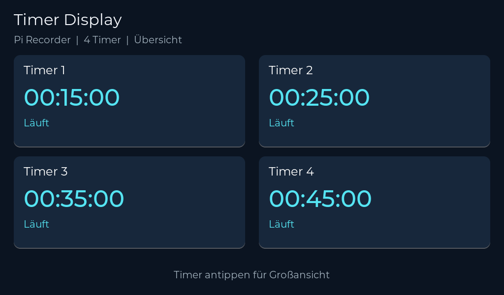

# Timerdisplay 0.3.0: automatische Großansicht

23. November 2026. Zielgerät bleibt das Waveshare ESP32-S3-Touch-LCD-5B mit
1024 × 600 Pixeln. Dies ist die Firmware des zusätzlichen USB-Displays; die
Recorder-Anwendung auf dem Pi erhält ihre Großansicht separat.

## Bedienung und Darstellung

- Ein offener Timer erscheint automatisch groß. Die türkisfarbenen Ziffern sind
  als Siebensegmentanzeige gezeichnet und 200 Pixel hoch. Stunden, Minuten und
  Sekunden bleiben eindeutig getrennt. Auch mehr als 99 Stunden passen hinein.
- Ab zwei Timern erscheint wieder die Übersicht mit bis zu vier Karten pro Seite.
  Antippen einer Karte öffnet deren Großansicht. „Alle Timer“ führt zurück.
  Die Auswahl bleibt beim Umsortieren am selben Timer gebunden. Verschwindet er,
  erscheint die Übersicht beziehungsweise der letzte einzelne Timer.
- „Weitere Timer“ wechselt zwischen den tatsächlich vorhandenen Seiten.
- Ein vom Pi als abgelaufen oder verpasst gemeldeter Timer wird bernsteinfarben
  gekennzeichnet. Eine lokal auf null gezählte Restzeit allein löst keine falsche
  Ablaufmeldung aus: Dann steht ausdrücklich „Warte auf Timerstatus“.
- Bei unbekannter Uhrzeit stehen Striche statt einer erfundenen Restzeit. Nach
  drei Sekunden ohne gültige Daten verschwinden alle Zahlen. Das Display zeigt
  den Verbindungsverlust und zählt keine alten Daten weiter.
- Touch wechselt ausschließlich die Ansicht. Timer starten, stoppen und
  quittieren sowie Alarmton und Ansage bleiben Aufgabe des Pi.

## Ansichten aus der tatsächlichen Oberfläche

Die Bilder wurden mit derselben `display_ui.c` und LVGL 9.6.0 auf dem Mac erzeugt,
mit ausschließlich künstlichen Timerdaten. Sie sind keine Fotos des Geräts.




[Vom Pi bestätigter Ablauf](large-timer-0.3/due.png) ·
[Verbindung unterbrochen](large-timer-0.3/offline.png)

Die Vorschau ist unter `firmware/lcd-usb/host-preview` nachbaubar. Sie benötigt
vorhandene LVGL-9.6.0- und cJSON-Quellen, lädt nichts nach und öffnet keine Hardware:

```sh
cmake -S firmware/lcd-usb/host-preview -B /tmp/lcd-preview-build \
  -DLVGL_ROOT=/pfad/zu/lvgl-9.6.0 -DCJSON_ROOT=/pfad/zu/cjson
cmake --build /tmp/lcd-preview-build -j 8
mkdir -p /tmp/lcd-preview-images
/tmp/lcd-preview-build/preview /tmp/lcd-preview-images
```

Erzeugt vier PPM-Bilder. Die dokumentierten PNGs wurden verlustfrei daraus
konvertiert. Die Vorschau nutzt einen 32-Bit-Bildpuffer; auf der Hardware bleibt
die vorhandene 16-Bit-Ausgabe erhalten. Sie ersetzt keinen Hardwaretest.

## Prüfstand

- Native C-Prüfungen mit AddressSanitizer und UndefinedBehaviorSanitizer bestanden:
  Einzelansicht, Übergang zu mehreren Timern, Auswahl nach ID, Rückweg, Seitenzahl,
  Entfernen, Sekundenrundung, Zeitgrenzen, Segmentmuster und Datenverlust.
- Bestehende Protokollprüfung bestanden: Bindung, Wiederholungen, Ablauf der
  Datenfrist, neue Verbindung, ungültige Pakete und geleerte Timerliste.
- Dieselbe LVGL-Oberfläche kompiliert und bei 1024 × 600 für Einzel-, Mehrfach-,
  Alarm- und Offlinezustand visuell geprüft.
- Finaler Firmwarekandidat vollständig mit ESP-IDF 5.5.2 gebaut:
  [CI-Lauf 45237756791](https://github.com/shortcutchris/cdb_brainrecorder_v2_desktop/actions/runs/45237756791),
  Quellstand `96b6cb85f216a063f3b2b49e8cfd94a75de7f3b4`. Native Tests,
  simulierte USB-Integration und Prüfung der Hardwarekonfiguration bestanden.
- Das Anwendungsbild meldet 0.3.0, Projekt `cdb_lcd_usb`, IDF `v5.5.2` und ist
  838.224 Bytes groß. Es passt in die bestehende 1-MiB-Anwendungspartition.
  [Dateigrößen, Prüfsummen, Abhängigkeiten und Grenzen](large-timer-0.3/build-manifest.json).
  SHA-256 der Anwendung:
  `6e02112557c498f6cd40c3b4db07e6f20db493af1656f3293a5095dced8d3242`.
- Der erste ebenfalls erfolgreiche
  [CI-Lauf 45235773704](https://github.com/shortcutchris/cdb_brainrecorder_v2_desktop/actions/runs/45235773704)
  wird durch diesen Kandidaten ersetzt. Der finale Kandidat wurde am 24.11.
  installiert und auf dem Gerät vollständig zurückgelesen (siehe unten).
- Der gezielte, rein lesende Verbindungsversuch am angeschlossenen Pi-Display
  (`read_mac`) erhielt keine Bootloaderantwort. Keine Flashdaten geschrieben;
  der USB-Begleitdienst wurde danach wieder gestartet. Der Firmwarewechsel
  benötigt den bestätigten BOOT/RESET-Ablauf des konkreten Geräts.
- Die tatsächliche Touchbedienung, Anzeigeausrichtung und Darstellung am
  Zusatzdisplay müssen nach dem gezielten Firmwarewechsel bestätigt werden.

## Auslieferung und Rücknahme

USB-Protokoll `cdb.lcd/1`, Produktkennung, Speicherlayout, Displaytreiber und
die bisherigen direkten Komponenten bleiben unverändert. Firmwareversion: 0.3.0.
Die erste Abhängigkeitsauflösung des finalen Builds stimmt bei allen 16 Einträgen
mit `firmware/lcd-usb/main/idf_component.yml` überein. Diese Vorgaben stammen aus
der ersten Auflösung des erfolgreichen 0.2-Builds
([CI 39670925360](https://github.com/shortcutchris/cdb_brainrecorder_v2_desktop/actions/runs/39670925360)).
IDF bleibt 5.5.2. Der alte finale Lock wurde wegen lokaler CI-Pfade und eines
zweiten Auflösungslaufs nicht als Buildbasis übernommen.

Auch der neue Build führt nach Einlesen der Kconfig erneut eine Auflösung durch.
Dabei stehen die lokalen Versionen und zusätzliche Registry-Versionen im
Protokoll. Im finalen Lock bleiben diese vier Abweichungen von den Vorgaben:

| Komponente | Vorgabe / erste Auflösung | Finaler Lock |
| --- | --- | --- |
| cmake_utilities | 0.5.3 | 1.4.1 |
| freetype | 2.14.3~1 | 2.15.0 |
| libpng | 1.6.58~2 | 1.6.59~1 |
| zlib | 1.3.2~1 | 1.4.0 |

Button 4.2.2 und Decoder 0.4.3 bleiben gegenüber 0.2 erhalten; QOI wird nicht
mehr aufgelöst. Der Decoder und Freetype des LVGL-Adapters sowie LVGL-Freetype,
LibPNG, LodePNG und LibJPEG-Turbo sind laut erzeugter `sdkconfig` deaktiviert.
Die entsprechenden statischen Bibliotheken werden dennoch kompiliert; daraus
folgt keine vollständige Abwesenheit ihres Codes im endgültigen Binärbild.
Es wird weder identische Abhängigkeitsauflösung noch binäre Reproduzierbarkeit
behauptet. Der vollständige Build ist erfolgreich, eine konkrete Inkompatibilität
wurde nicht festgestellt. Das ersetzt weiterhin keine Geräteprüfung.

Die Anwendung benötigt ein separates Firmware-Update des Zusatzdisplays;
ein Recorder-App-Update oder ein neues Pi-SD-Image allein verändert es nicht.
Das Kundenimage übernimmt die bereits vorhandene Brücke und die passende
Recorder-Anwendung; kein automatisches Flashen beim Anstecken.

Für ein gezieltes Update nur der Anwendung ist die Übereinstimmung mit dem
archivierten 0.2-Build belegt: IDF `v5.5.2`, DIO, 16 MB, 80 MHz sowie eine binär
identische Partitionstabelle. Die Factory-Anwendung beginnt bei `0x10000` und
hat 1 MiB. Der neu gebaute Bootloader hat eine andere Prüfsumme.

Vor dem Schreiben Gerät und Port eindeutig zuordnen und den Bootloaderzugang
bestätigen. Die tatsächliche Partitionstabelle und Bootdaten des angeschlossenen
Geräts lesen und mit dem Archiv abgleichen; anschließend die gesamte
1-MiB-Anwendungspartition sowie Boot- und Partitionsdaten sichern. Erst danach
ist das Schreiben von ausschließlich `cdb_lcd_usb.bin` an `0x10000` vorgesehen.
Bootloader, Partitionstabelle, NVS und PHY-Daten bleiben erhalten. Der begleitende
USB-Dienst wird für den Zugriff gestoppt und anschließend wiederhergestellt;
keine laufende Aufnahme oder Unterhaltung unterbrechen. Kein pauschales Löschen
des Flashs. Eine Rücknahme nutzt den gesicherten Stand desselben Geräts.

## Installation am 24. November 2026

Nach dem von Chris ausgelösten BOOT-Modus eindeutig das angeschlossene
ESP32-S3-Display identifiziert: Revision 0.2, 16 MB Flash, 8 MB PSRAM. Bootloader,
Partitionstabelle und alte Anwendung entsprechen exakt dem archivierten 0.2.0.
Vor dem Schreiben wurden 1.114.112 Bytes ab Adresse null privat auf dem Pi
gesichert (Bootdaten einschließlich NVS/PHY plus gesamte Anwendungspartition).
SHA-256 der Sicherung:
`3df006799a21d9e9321b10e14b30d3539f06e301248ba1f6daa019f15a9331d4`.

Nur die Anwendung an `0x10000` wurde auf 0.3.0 aktualisiert. Anschließend
denselben Bereich vollständig zurückgelesen: Anwendung bytegleich mit dem
freigegebenen Kandidaten; die ersten 64 KiB mit Bootloader, Partitionstabelle,
NVS und PHY unverändert. [Installationsnachweis](large-timer-0.3/deployment-2026-11-24.json).
Der Begleitdienst ist wieder gestartet. Ein softwareseitiger Reset beließ das
Display im USB-Downloadmodus; Chris wurde um einmaliges kurzes Drücken von
RESET gebeten. Normaler Anwendungsstart, Verbindung sowie Anzeige und Touch
sind deshalb noch zu bestätigen. Die erfolgreiche Flashprüfung allein belegt
noch keine funktionierende Anzeige.

Kandidat und Protokolle liegen dauerhaft außerhalb des Repos auf dem Pi unter
`~/.local/share/cdb-lcd/update-0.3.0-96b6cb8/`; die private Sicherung unter
`~/.local/state/cdb-display-backups/20261124T083042Z/`.
Quelle für BOOT beim USB-Anstecken und den anschließenden RESET:
[Waveshare USB Download Precautions](https://docs.waveshare.com/ESP32-S3-Touch-LCD-5/Instructions-For-Use).
