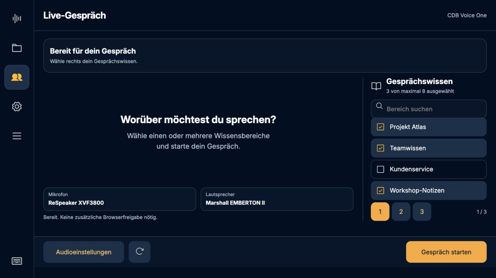
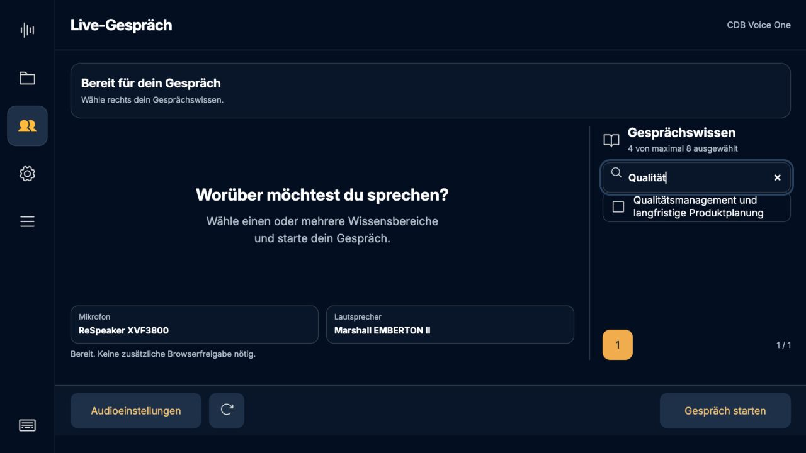
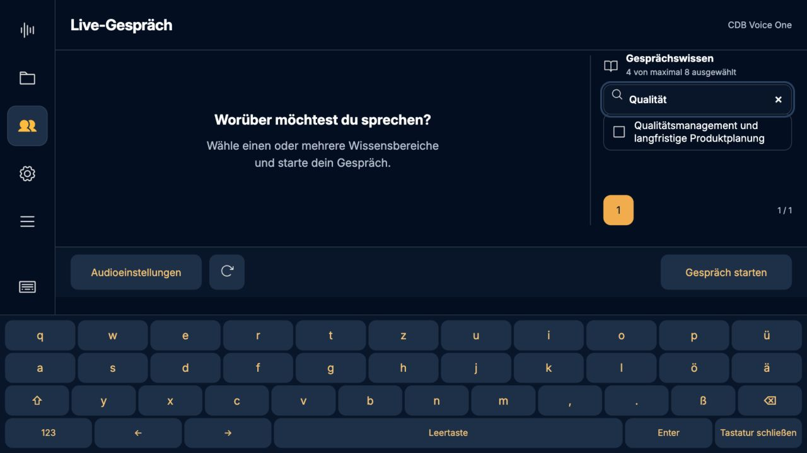
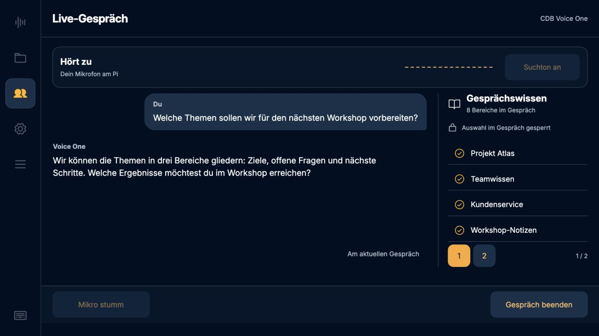
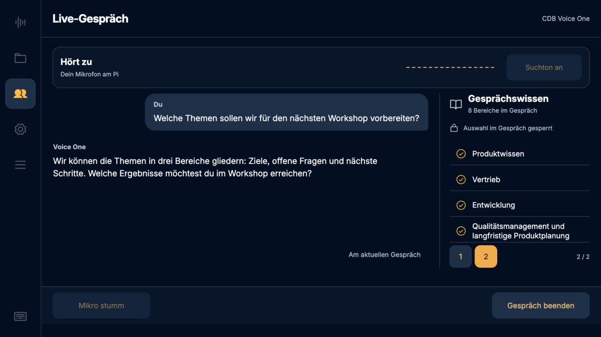
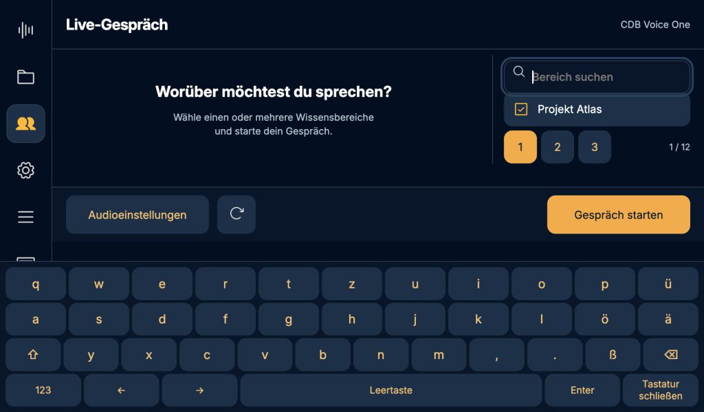
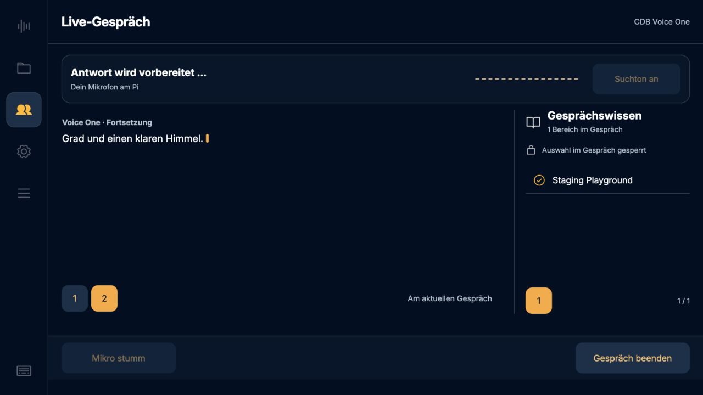
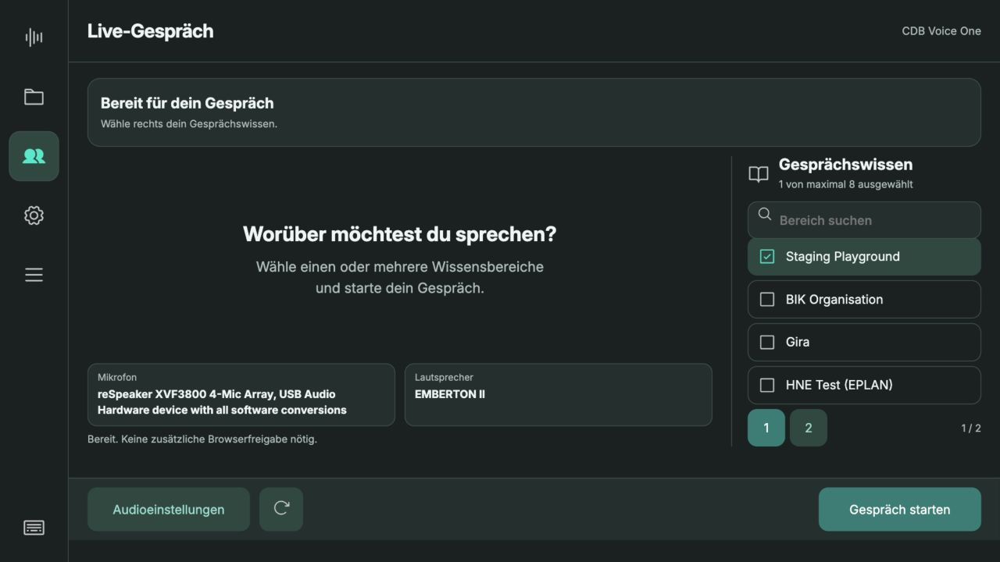

# Gesprächswissen – Variante 3, Version 0.5.27

Rechte Seitenleiste, Mehrfachauswahl, Suche und direkt anwählbare Seiten. Kein
Overlay, keine Scrollbars. Auswahl beim Verbindungsaufbau und während der gesamten
Sitzung gesperrt. In der aktiven Übersicht stehen nur die verwendeten Bereiche.

## Verifikation

- 69 JavaScript-Tests bestanden, einschließlich Suche/Seitenwechsel mit erhaltener
  Auswahl, Höchstzahl, leere Auswahl, Aktualisierung, gesperrten alten Klickhandlern
  und verspäteter Antwort nach Kontowechsel.
- 157 Python-Tests auf dem Pi bestanden, einschließlich Berechtigungsablehnung,
  Ressourcenfreigabe und Unterdrückung interner Providerdetails.
- Browserprüfung gegen die isolierte Testinstanz auf dem Pi bei 1280 × 720 und
  1024 × 600, mit und ohne Bildschirmtastatur. Mindestens 48 Pixel große Bereichs-
  und Seitenbuttons. Lange Namen umbrechen zweizeilig; vollständiger Name auch im
  zugänglichen Namen. Keine überlaufenden Seiten oder verdeckten Bedienleisten.
- Bei kleiner Höhe und offener Tastatur wird die Seitenleistenüberschrift
  vorübergehend ausgeblendet, damit mindestens eine komplette Auswahlzeile passt.
- Aktive Bereiche bleiben durchblätterbar, haben aber keine Auswahl-Klickhandler.
  Header und Footer bleiben beim Wechsel zwischen Auswahl und Gespräch stehen.
- Die neuen Symbole verwenden die bestehenden Theme-Farbfilter; der Startbutton
  nutzt die primäre Akzentfarbe. Kein neuer laufender Timer oder Framework.

## Echter CDB-Test auf dem Pi

`cdb-integration.json`: synthetische deutsche Anfrage, staging_playground,
Python-Audio mit stiller Prüfausgabe. Verbindung, Transkript, Antwort, echte Websuche,
Suchtonstatus, Stummschaltung, gegenseitige Sperren und Freigabe nach Ende bestanden.
Die ausgewählte Area wurde vom Backend bestätigt. Kein Raumton aufgenommen.

`cdb-multi-area.json`: echte Sitzung mit staging_playground und hne_test erfolgreich
verbunden, beide IDs bestätigt und Aufnahme gesperrt. Die Auswahl über zwei Seiten
wurde zusätzlich im Browser bedient. Eine Kombination mit dem gelisteten Bereich
„test“ wurde dagegen von CDB mit HTTP 403 abgelehnt; dessen Mandant ist ein anderer.
Die UI behält nach einer Ablehnung die Auswahl und gibt die Bedienung wieder frei.
Die App zeigt hierfür jetzt einen gezielten Berechtigungshinweis statt nur eines
allgemeinen Verbindungsfehlers. Keine automatische Umgehung oder Änderung der
Berechtigungen; keine Live-Änderung der Area-Auswahl.

## Screenshots

Die Gestaltungsbilder 01–06 zeigen kontrollierte synthetische Bereiche und
Gesprächszustände in der isolierten Pi-Testinstanz, im bestehenden CDB-Theme.
Bild 07 zeigt die tatsächliche synthetische CDB-Unterhaltung. Die deaktivierten
Mikrofon-/Suchtonbuttons in fremdgesteuerten Tests sind die normale Besitzersperre;
der steuernde Browser kann sie bedienen. Ein physischer Fingertest oder neuer
subjektiver Hörtest wird hieraus nicht abgeleitet.

## Produktiv aufgespielt

Version **0.5.27**, Laufzeit-Commit `49419f4`, auf dem Pi aktiviert. Backend und
Touchdisplay-Kiosk laufen. Alle zehn ausgelieferten Dateien stimmen per SHA256
mit dem gepushten Commit überein (`deployment.json`). 22 Aufnahmen, Konfiguration,
aktive Anbieter, Standardbereich und Anmeldung sind erhalten geblieben. Sicherung:
`/home/chris/backups/recorder-before-0.5.27`. Testinstanz beendet und temporäre
Anmeldedatei entfernt. Produktive Oberfläche anschließend über den lokalen
Pi-Zugang geöffnet und ohne Browserfehler geprüft.

