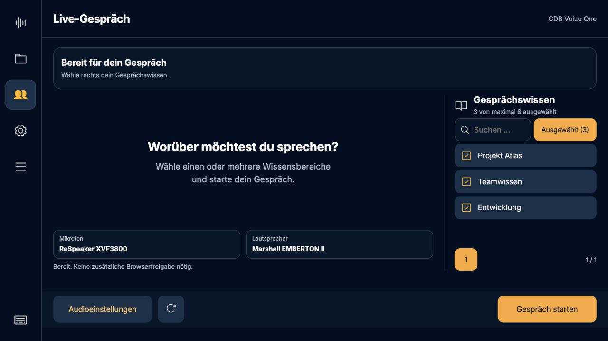
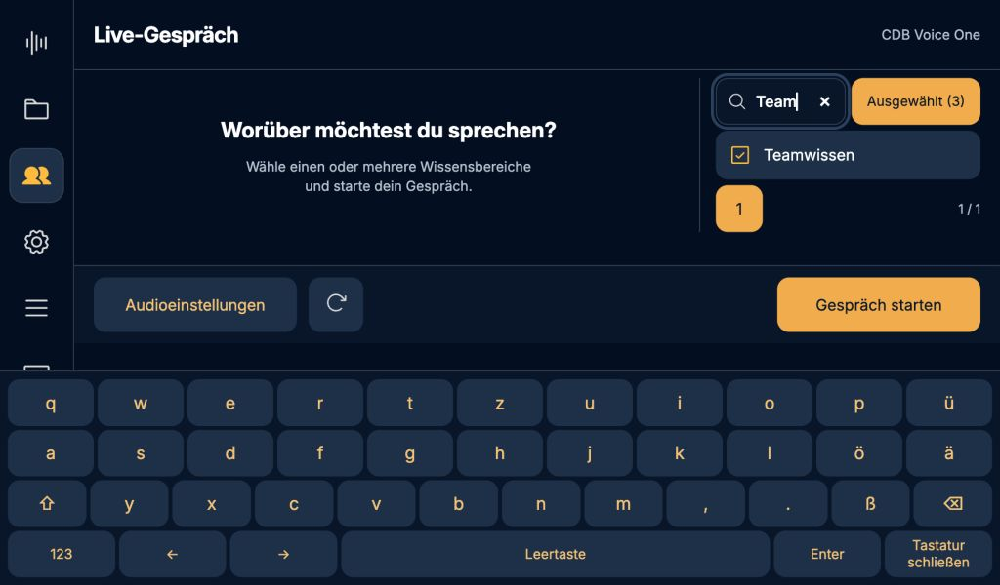

# Auswahlfilter 0.5.28

Ein fester 48 Pixel hoher Filter neben der Suche bündelt die gewählten Bereiche.
Kein Umsortieren bei jedem Antippen, keine zusätzliche Leiste, kein Layoutsprung.
Zähler über alle Seiten, Filter mit Suchfeld kombinierbar, leere Auswahl mit
Rückweg, während aktiver Sitzung gesperrt und verborgen.

71 JavaScript-Tests bestanden. Neue Prüfungen: Auswahl aus verschiedenen Seiten,
Filterwechsel mit Suchreset, Abwählen, vollständige IDs beim Start, leere Auswahl
und veralteter Filterhandler während einer Sitzung. Browserprüfung gegen die
isolierte Pi-Testinstanz: 1280 × 720 sowie 1024 × 600 mit Touch-Tastatur.
Suchfeld und Filter exakt auf 48 Pixel ausgerichtet. Keine Backendlogik geändert;
kein neuer Cloud-/Audiotest für diesen reinen Auswahlfilter erforderlich.

Screenshots mit synthetischen Bereichen in der Pi-Testinstanz:

