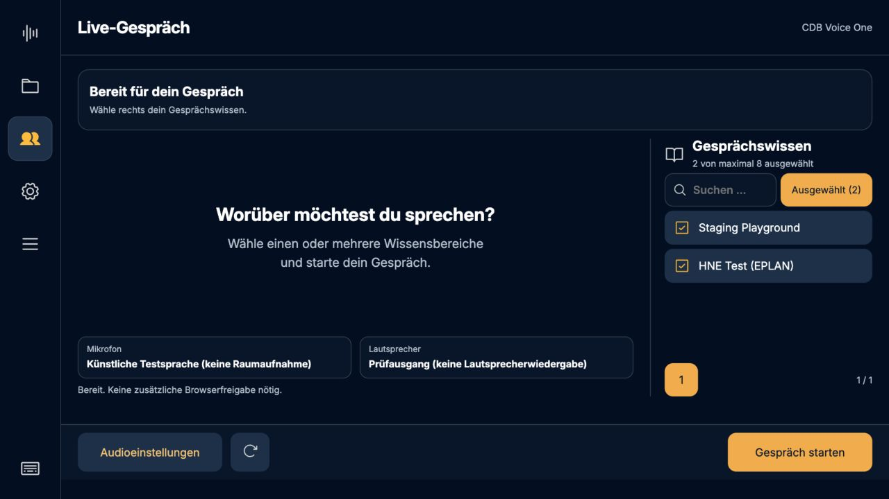

# Gemerkte Gesprächsbereiche · Studio 0.5.29

Die Auswahl unter **Gespräch → Gesprächswissen** wird nach jedem Antippen auf dem
Pi gespeichert. Beim nächsten Gespräch, Neuladen der Oberfläche und Neustart
wird sie wiederhergestellt – getrennt nach Brain-Benutzer, Mandant und Server.
Der Filter **Ausgewählt** zeigt die Auswahl über alle Seiten hinweg.

Ohne gespeicherte Auswahl ist der Standardbereich vorbelegt. Bewusst abgewählte
Bereiche bleiben abgewählt, auch eine leere Auswahl wird gespeichert. Nicht mehr
zugängliche Bereiche werden beim Laden entfernt. Während eines Gesprächs bleibt
die Auswahl gesperrt. Eine fehlgeschlagene Speicherung wird sichtbar gemeldet.
Das laufende Gespräch kann dann trotzdem mit der aktuellen Auswahl starten.

## Umsetzung und Prüfung

- Kontogebundene Dateien unter `live/areas-<sha256>.json`, Verzeichnis 0700,
  Dateien 0600. Keine Tokens in diesen Dateien.
- Schreibzugriffe laufen der Reihe nach; der Gesprächsstart wartet auf sie.
  Ein veralteter Kontoschlüssel wird zurückgewiesen.
- 160 Python-Tests auf dem Pi und 74 JavaScript-Tests bestanden. Abgedeckt:
  Wiederherstellung, Konto-/Mandanten-/Servertrennung, leere Auswahl, entzogene
  Bereiche, beschädigte Dateien, Schreibfehler und gesperrte Sitzung.
- HTTP-Prüfung: veralteter Kontoschlüssel und ungültiger CSRF-Schlüssel abgelehnt.
- Isolierte Pi-Testinstanz: zwei Bereiche gewählt, Dienst neu gestartet und
  Browser neu geladen. Beide Bereiche blieben ausgewählt. Keine Raumaufnahme
  und kein Cloud-Gespräch für diesen Präferenztest gestartet.

Die separate Untersuchung des externen Mira-Displays steht in
[Mira: Sender und Empfänger](../mira-receiver-review.md).
