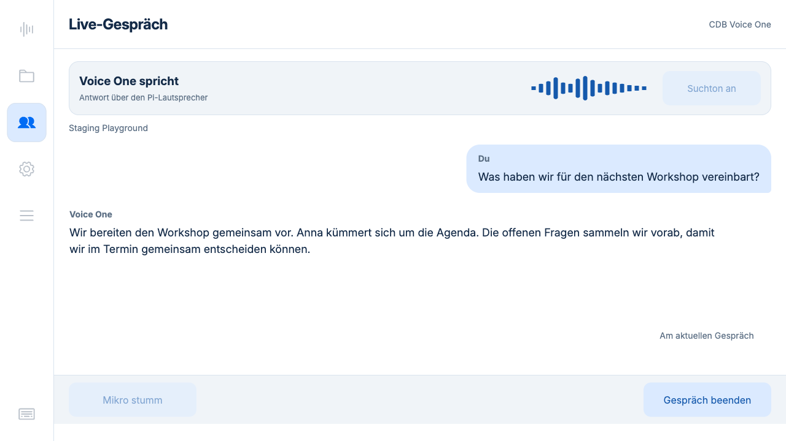
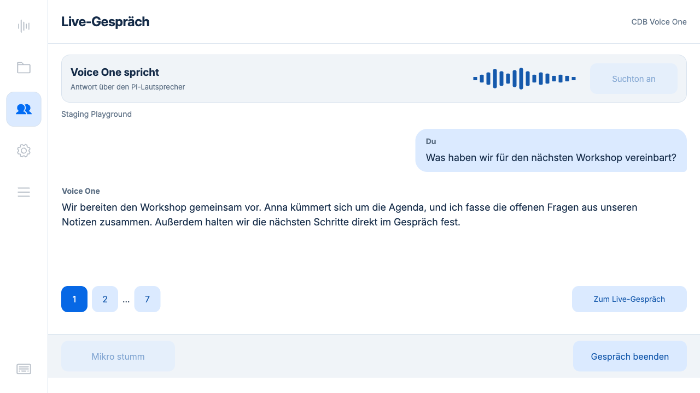
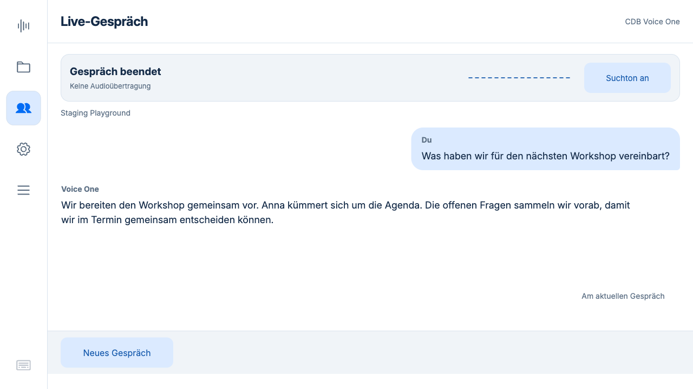

# Live-Gespräch 0.5.25

## Darstellung

Vom Benutzer gewählte Richtung: **kleine Nutzerblase rechts, Antworten ohne Rahmen**.
Die anfänglich getesteten großen Karten wurden verworfen.

- Eigene Beiträge passen sich ihrer Textbreite an (höchstens 76 %).
- Voice One antwortet links ohne Hintergrundfläche oder sichtbaren Rahmen.
- Neue Transkriptfragmente ergänzen denselben DOM-Knoten. Nur der Zusatz blendet
  kurz ein; keine künstliche Schreibsimulation, reduzierte Bewegung berücksichtigt.
- Seiteneinteilung anhand tatsächlich gemessener Schrift/Zeilenhöhe und verfügbarer
  Fläche, einschließlich Zeilenumbrüchen, langen Wörtern und Emoji.
- Feste Kopfzeile, Statusfläche, Seitennavigation und Fußleiste, keine Scrollleisten.
- Manuell gewählte Verlaufsseite bleibt bei neuen Fragmenten stehen.
  „Zum Live-Gespräch“ folgt wieder der neuesten Seite.
- Abgeschlossene Verläufe öffnen ohne erneute Cloud-/Geräteprüfung. Erst beim
  neuen Gespräch wird die Bereichs- und Geräteauswahl erneut geladen.

## Screenshots

Browseransicht der isolierten Testinstanz **auf dem Pi**, 1280 × 720 Pixel.
Die folgenden Texte und Zustände sind gezielte synthetische UI-Fixtures, keine
privaten Gesprächsinhalte und keine Fotos des physischen Displays. Der Browser
beobachtet die Sitzung; Mikro-Stummschaltung ist deshalb in aktiven Fixtures gesperrt.

Browserprüfung: Bei Textwachstum derselbe Antwortknoten, nur Textsuffix ergänzt.
Kopfzeile y=0/h=80, Fußleiste y=612/h=80 bei 1280 × 720. Sieben Seiten eines langen
Beitrags ohne Text-/Viewportüberlauf geprüft; manuell ausgewählte Seite blieb beim
Anhängen weiteren Textes stabil. Nach Ende sind Recorder, Bibliothek, Einstellungen
und Warteschlange wieder anwählbar. Aktive und abgeschlossene Screens visuell geprüft.

## Suchklang

Eine angefangene Phrase läuft bei kurzem Suchende mindestens 1,6 Sekunden, gefolgt
von 180 ms Ausblendung. Eine Folge-Suche innerhalb von 450 ms teilt denselben Player.
Beginnt eine Antwort, wird der Jingle auf 20 % abgesenkt und erst nach der kurzen
Phrase ausgeblendet. Danach pausiert er während der Antwort. Eigene Sprache,
Sound aus und Sitzungsende unterbrechen auch früher. Bei Antwortwiedergabe nutzt
Erkennung eigener Sprache die bestätigten Nutzer-Transkriptereignisse und ist
entsprechend von deren Latenz abhängig. Keine zusätzliche Raum-Echokompensation.

## Prüfungen

- **155 Python-Tests auf dem Pi**, **64 JavaScript-Tests**, alle bestanden.
- Neue Audioprüfungen: sehr kurze Suche; Folgeaufruf ohne Playerwechsel;
  Antwortbeginn mit Mindestphrase; eigene Sprache mit Pause/Fortsetzung;
  bestehende Ressourcenfreigabe, Sound-Schalter und Zustands-Sperren.
- `hardware.json`: echter ReSpeaker-Eingang und Marshall-Ausgang, bestehende
  Lautstärke 82 % unverändert. Kurze Suche erzeugte 89 × 20 ms = 1,78 s inklusive
  Ausblendung. Folgeaufruf behielt den Player; simuliertes bestätigtes
  Nutzer-Sprechereignis unterbrach und setzte anschließend fort. Nach Schließen
  null Audioprozesse. Kein Raumton gespeichert oder in die Cloud übertragen.
  Dies ersetzt keinen subjektiven Hör-/Sprechtest der neuen Ausblendung.
- `cdb-integration.json`: echte CDB-Anbindung mit synthetischer deutscher Sprache
  in staging_playground; Brain-Suche und zwei Websuchaufrufe erkannt, 277 Loop-Blöcke
  ausgegeben. Sound-Schalter, Mikrofonstumm, gegenseitige Sperren und Freigabe nach
  Gesprächsende bestanden. Dieser Cloudtest verwendet synthetischen Eingang und
  stillen Prüfausgang; Hardware separat wie oben geprüft.

Datenbank, Modellwahl, Anmeldung, Standardbereich und produktive Aufnahmen werden
nicht durch die isolierte Testinstanz verändert.

## Produktiv aufgespielt

Laufzeit **0.5.25**, Commit `0065ea7`, auf dem Pi aktiviert. Backend und Kiosk
laufen. Die sechs ausgelieferten Dateien stimmen per SHA256 mit dem Git-Commit
überein (`deployment.json`). Alle 22 vorhandenen Aufnahmen, Gerätekonfiguration,
Modellanbieter, Standardbereich und Anmeldung sind erhalten geblieben.
Vorheriger Stand: `/home/chris/backups/recorder-before-0.5.25`.
Die isolierte Testinstanz ist beendet; ihre temporäre Anmeldedatei wurde entfernt.
