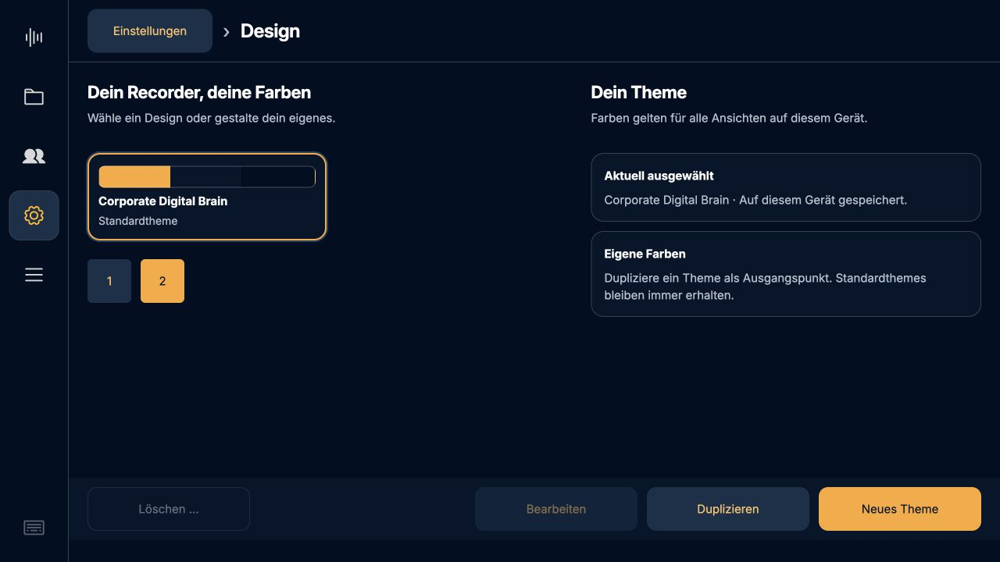
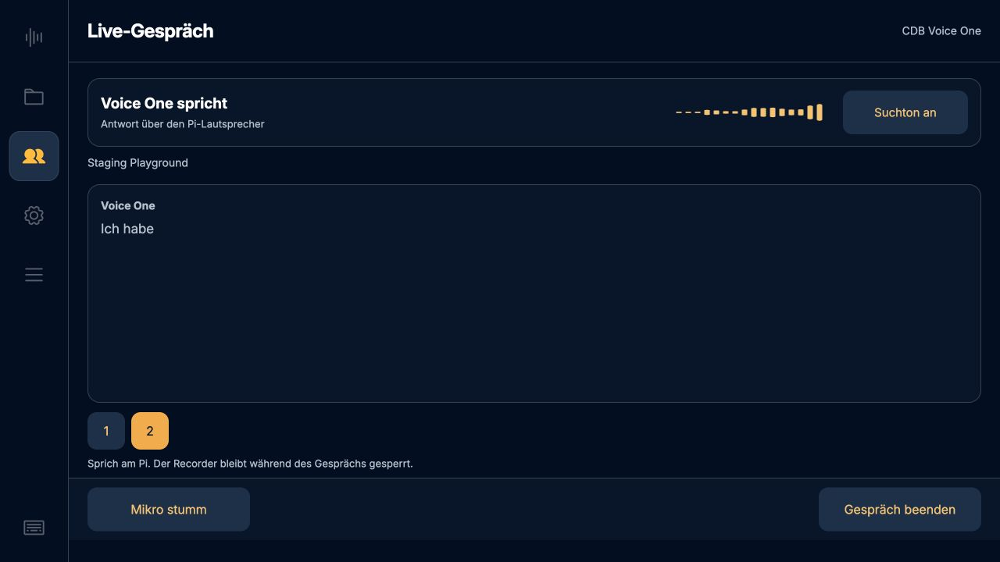
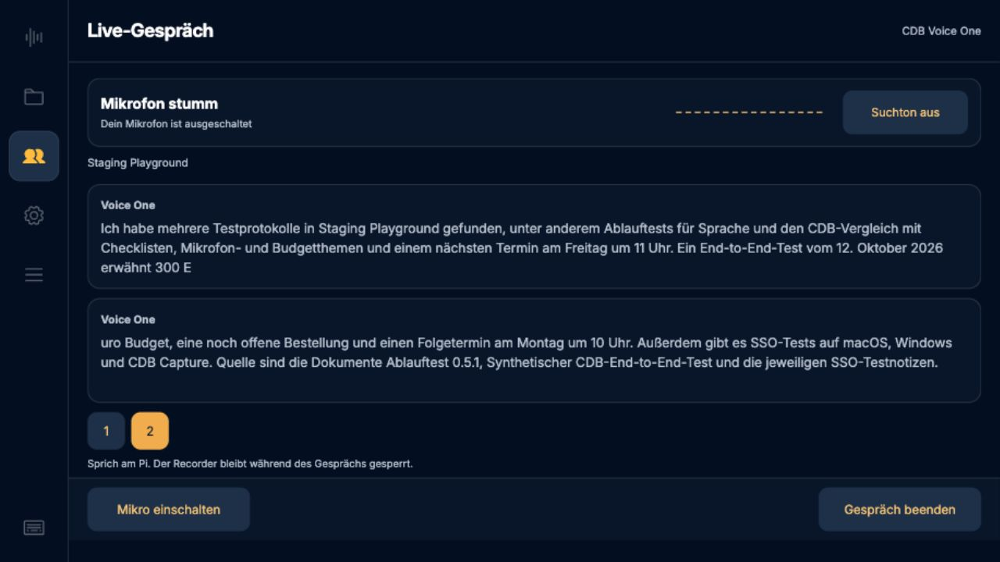
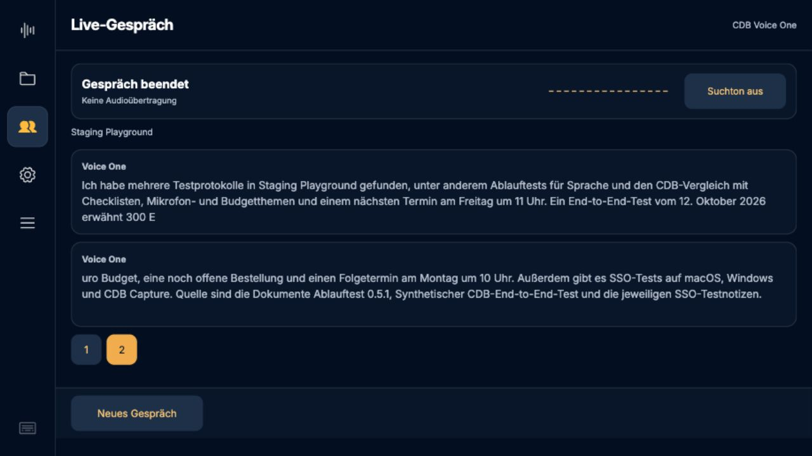

# Live-Feedback und CDB-Theme · 0.5.23

13.10.2026. Fester Statusbereich, echte PCM-Pegelhüllkurve, abschaltbarer Hinweiston, Brain-/Websuch-Erkennung sowie Corporate-Digital-Brain-Farbtheme.

## Reale Pi-Tests

- CDB/Azure-Sitzungen mit synthetischer deutscher Sprache und `staging_playground`, ohne Raumaufnahme und ohne Cloud-Ausgabe über die Lautsprecher. Brain-Suche und Websuche jeweils mit Start/Ende wirklich beobachtet, ebenso Antwortaudio. [Brain](brain-search-test.json), [Web](web-search-test.json).
- Websuche tatsächlich über den lesenden Datenkanal empfangen: zwei Aufrufe, je `in_progress`, `searching` und `completed`. Das SSE-Protokoll allein enthält bislang nur Brain-Suchen.
- Stumm ergibt 16 Nullwerte am Eingang. Suchton an/aus gespeichert. Neue Aufnahme und Einstellungsänderung während Live serverseitig abgewiesen, nach Ende wieder freigegeben; Waveform danach null.
- Lokaler Hardwaretest mit ReSpeaker und Marshall: Suchton aus bleibt still, an startet genau einen PCM-Hinweis bei 25 %, unmittelbare Wiederholung unterdrückt, danach alle Audioprozesse beendet. Kein Raumton an die Cloud geschickt. [Hardware](hardware-tone.json). Der neue Hinweiston ist technisch abgespielt, eine erneute menschliche Hörbestätigung wurde nicht eingeholt.
- Der erste Webtest verwendete einen synthetischen FFmpeg-Eingang, dessen angehängte Stille zu schnell erzeugt wurde. Vor dem Brain-Test wurde der Testeingang auf exakt 20-ms-Blöcke begrenzt. Das betrifft nur die Testzufuhr, nicht ReSpeaker/`parec`; die Webereignisse und Antworten waren echt. Performance-Angaben stammen nicht aus diesem ersten Test.

## Performance und Darstellung

[Messung am Pi](performance.json): PCM-Hüllkurve über 100 Sekunden äquivalentes Duplexaudio benötigt rund 0,45 % eines CPU-Kerns. 40 schlanke Statusanfragen unter zwei parallelen CPU-Lastprozessen: Mittel 1,65 ms, Maximum 17,21 ms. Dies ist ein Komponenten-/API-Test, kein vollständiger Chromium-FPS- oder Whisper-Benchmark. Die UI verwendet 16 Balken und maximal zehn lokale Aktualisierungen pro Sekunde.

Browserdarstellung bei 1280 × 720 über den Pi-Testserver geprüft. CDB-Theme aus dem vorhandenen Design System; aktive und deaktivierte Buttons, Suchton aus, Stumm und Ende. Screenshots der Tests verwenden synthetische Sprache und vorhandene synthetische Staging-Testprotokolle.

## Automatisiert

147 Python-Tests auf dem Pi und 62 JavaScript-Tests bestanden. Neue Prüfungen: reale Pegel/Stille/veraltete Werte, begrenzte Historien, doppelte und verspätete Suchereignisse, echte Webtool-Erkennung statt Denkstatus, Suchton-PCM, Eigentümerprüfung und persistenter Suchton-Schalter.

## Deployment

Code `1c9c804` als Version **0.5.23** auf den produktiven Pi gespielt. Backend und Kiosk aktiv; SHA256 aller acht geänderten Laufzeitdateien mit dem Commit verglichen. 22 Meetings, Brain-Anmeldung und Verarbeitungseinstellungen erhalten. Neuer Activity-Endpunkt liefert im Leerlauf keine aktiven Suchvorgänge und nur Nullpegel. Temporärer Testdienst beendet und seine temporäre Kontositzung entfernt. [Deployment-Protokoll](deployment.json).

Das CDB-Theme wurde in der separaten Testansicht ausgewählt. Die bestehende produktive Theme-Wahl wird nicht automatisch umgestellt.

