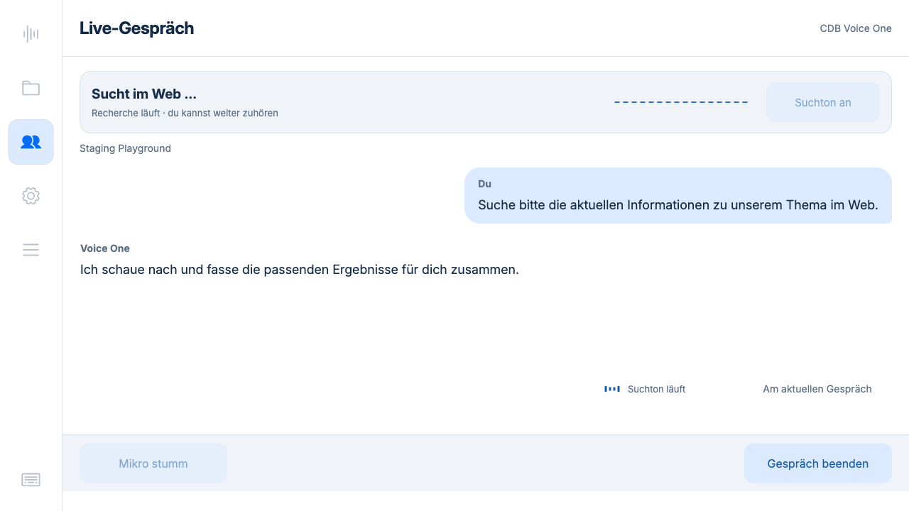
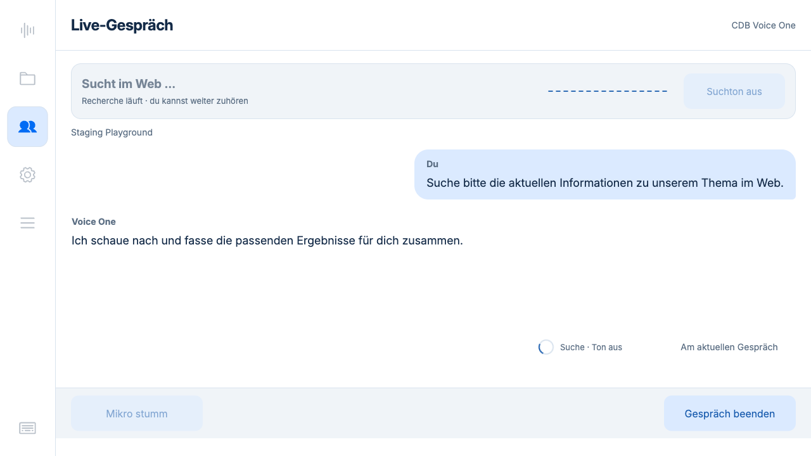
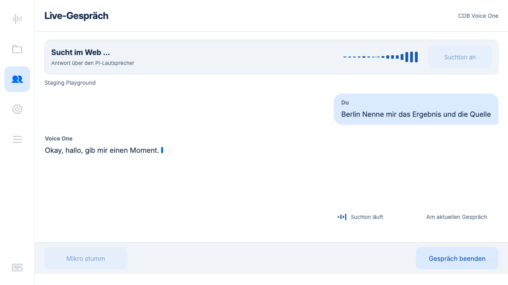

# Suchindikator 0.5.26

Unten rechts neben der Verlaufsteuerung ist ein Bereich von 184 × 48 Pixeln
reserviert. Die bestehende Textfläche und die Fußleiste bleiben unverändert.

- Vier kleine Balken bewegen sich bei vom Python-Player bestätigter Tonausgabe.
- „Suchton klingt aus“ begleitet eine noch laufende Phrase nach Suchende.
- Laufende Suche mit pausiertem/ausgeschaltetem Ton zeigt einen Suchkreis und Text.
- Ohne Suche/Tonausgabe unsichtbar; der Platz bleibt erhalten.
- Reduzierte Bewegung: statische Symbole. Keine neuen Timer, Frameworks oder
  Cloud-Anfragen. Animation ausschließlich per CSS-Transformationen.

Die API meldet `search_audio.playing` erst nach Schreiben und Drain eines PCM-Blocks.
Nach 250 ms ohne neuen Block, beim Stoppen/Fehler, Abschalten oder Sitzungsende
ist es falsch. Dies bestätigt den Audioplayer, nicht die Hörbarkeit im Raum;
Bluetooth kann den hörbaren Ton verzögern. Das Symbol ist keine zweite Waveform.

## Verifikation

**156 Python-Tests auf dem Pi und 65 JavaScript-Tests bestanden.** Geprüft wurden
Player-Rückmeldung, Nachklang nach Suchende, Sound aus/ein, Pausen, Player-Ausfall,
Sitzungsende und Freigabe, UI-Unterscheidung der Zustände sowie Offline-Verhalten.

Browserprüfung bei 1280 × 720: Textfläche x112/y236/h272, Fußleiste x88/y612/h80,
Verlaufsbutton x1046/y524, Indikator x850/y524/w184/h48. Beim Wechsel zwischen
laufendem Ton, stillem Suchen, Nachklang und unsichtbarem Indikator stimmen die
Positionen und Größen aller fünf geprüften Bereiche exakt überein. Transformwerte
ändern sich bei laufender Animation; bei reduzierter Bewegung ist sie deaktiviert.

Die folgenden Screenshots stammen aus der Browseransicht der isolierten
Testinstanz auf dem Pi, mit synthetischem Text und gezielt gesetzten UI-Zuständen.

## Pi-Audio und CDB

`hardware.json`: echter ReSpeaker-Eingang und Marshall-Ausgang. Die Box war zunächst
nicht verbunden; nach dem Einschalten durch den Benutzer erfolgreich geprüft.
Rückmeldung während Ausgabe und Nachklang, Löschen nach Ende, simulierte bestätigte
Nutzerunterbrechung und Fortsetzung sowie gemeinsamer Player bei Folgeaufrufen
bestanden. Nach Schließen null Audioprozesse. Kein Raumton gespeichert oder zur
Cloud übertragen. Die Tests bestätigen die technische Ausgabe; kein neuer
subjektiver Hörtest durch den Benutzer wird daraus abgeleitet.

`cdb-integration.json`: echte CDB-Websuche mit synthetischer deutscher Anfrage in
staging_playground. Laufender Suchton wurde über die Status-API und im Browser
beobachtet, 99 PCM-Blöcke ausgegeben. Sound-Schalter, Stummschaltung, gegenseitige
Sperren, Freigabe und gelöschte Tonanzeige nach Ende bestanden. Ein erster Test mit
kombinierter Brain-/Web-Anfrage führte nur die Brain-Suche aus; währenddessen lief
noch künstliche Eingabesprache, sodass der Suchton korrekt pausierte. Der gezielte
Websuchtest verwendet einen stillen Prüfausgang; physische Geräte separat wie oben.
Die synthetische Eingabe begann bereits während des Verbindungsaufbaus, weshalb
in diesem Test nur ihr letzter Teil transkribiert wurde. Der Prüfzweck ist der
bestätigte Suchaufruf samt Audio-/UI-Zustand, nicht Transkriptionsqualität.

Tatsächlicher Browserzustand während der bestätigten CDB-Websuche:

## Produktiv aufgespielt

Version **0.5.26**, Laufzeit-Commit `cd66db9`, auf dem Pi aktiviert. Backend und
Touchdisplay-Kiosk laufen; alle sechs ausgelieferten Dateien stimmen per SHA256
mit dem Commit überein (`deployment.json`). 22 Aufnahmen, Konfiguration, aktive
Anbieter, Standardbereich und Anmeldung sind erhalten geblieben. Sicherung unter
`/home/chris/backups/recorder-before-0.5.26`. Testinstanz beendet und temporäre
Anmeldedatei entfernt.
