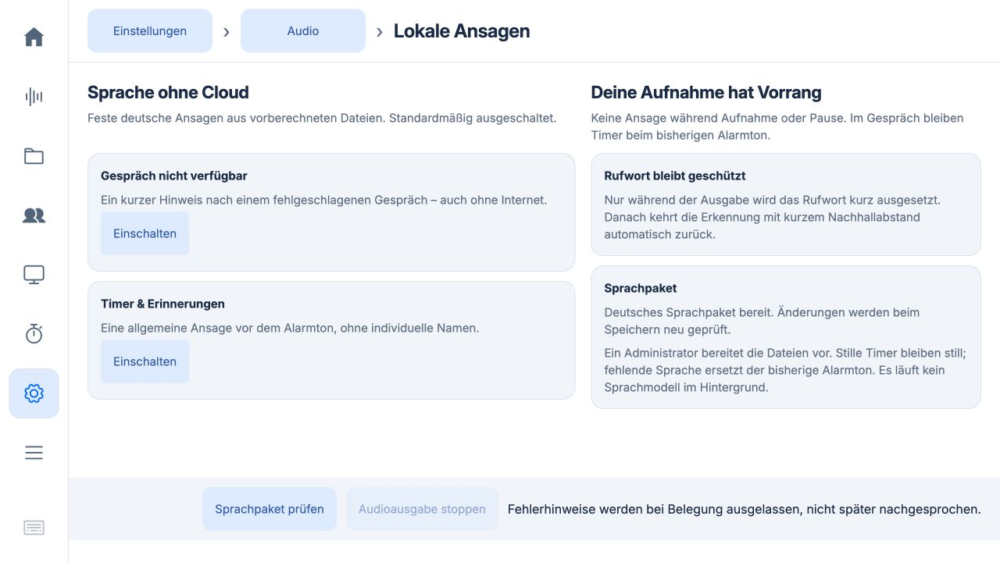

# Lokale deutsche Sprachansagen

Stand: 21. Oktober 2026. **Aktuell als 0.5.69 auf dem Pi installiert**, signierte
Sequenz 26, Quellcommit `eda2ba9`, PR #13, #14 und #15 gemergt. Offline- und Timer-Ansagen
wurden auf ausdrücklichen Nutzerauftrag im freien Zustand aktiviert. Bei
Ersteinrichtung bleiben beide Optionen aus. Das Sprachpaket wird getrennt
bereitgestellt; kein Modell und keine zusätzliche KI-Laufzeit auf dem Pi.

Die Erweiterung [„Ich verbinde dich.“](connecting.md) ist ebenfalls installiert
und bei freiem Gerät aktiviert worden. Sie ergänzt einen dritten Schalter und
ein optionales viertes Sprachpaket-Element. Abbruch und Start bis zur
Cloud-Begrüßung wurden am Pi geprüft. Chris bestätigte anschließend Stimme und
Ablauf: „läuft perfekt“. [Modell, Stimme, Arbeitsweise und Nutzerabnahme](voice-baseline.md).

Der separat einschaltbare [deutsche Timer-Countdown](countdown.md) ist ebenfalls
installiert und aktiviert. Er ergänzt den vierten Schalter und den fünften Clip.

## Bedienung

**Einstellungen → Audio → Lautsprecher → Lokale Ansagen einrichten** bietet
vier unabhängige Schalter einschließlich „Gespräch wird verbunden“ und
„Timer herunterzählen“. „Sprachpaket prüfen“ lädt ein vom Administrator
bereitgestelltes Paket neu, ohne Neustart. Ohne gültiges Paket lässt sich keine
neue Ansage einschalten; Ausschalten bleibt möglich. Der vorhandene
Lautsprecher, seine Lautstärke und die Stummschaltung werden respektiert.

| Anlass | Fester deutscher Text | Verhalten |
| --- | --- | --- |
| Fehlgeschlagenes Live-Gespräch | Das Gespräch ist gerade nicht verfügbar. Bitte prüfe die Anzeige und versuche es erneut. | Einmal nach abgeschlossenem Abbruch; höchstens einmal pro Minute. |
| Timer abgelaufen | Dein Timer ist abgelaufen. | Einmal vor dem bisherigen Alarmton. |
| Erinnerung fällig | Eine Erinnerung ist fällig. Bitte prüfe die Anzeige. | Einmal vor dem bisherigen Alarmton. |

„Offline“ bezeichnet die **lokal verfügbare Ausgabe**. Es gibt keinen neuen
Internet-Watchdog. Der Gesprächshinweis behauptet keine bestimmte Fehlerursache:
Auch Anmeldung, Server oder Audiogerät können ein Gespräch verhindern. Die
Meldung folgt nur einem endgültig beendeten fehlgeschlagenen Live-Versuch,
nicht einem gespeicherten Fehler beim App-Start. Fehler vor einer
Live-Reservierung (etwa fehlende Wissensbereiche) bleiben Bildschirmmeldungen.

Keine individuellen Timer-Namen, Uhrzeiten, Gesprächsinhalte oder frei
formulierten Texte werden gesprochen. Eine dynamische Synthese im laufenden
Betrieb gehört ausdrücklich nicht zu dieser ersten Integration.

## Schutz und Priorität

- Aufnahme **einschließlich Pause** verhindert neue Ansagen und Alarme. Ein
  fälliger Timer behält dabei die bisherige Wartelogik und wird nach Freigabe
  verarbeitet. Es wird keine laufende Aufnahme für eine Ansage gestoppt.
- Während eines Live-Gesprächs wird kein zusätzlicher Sprachhinweis abgespielt.
  Der bisherige Timer-Ton bleibt, wie schon zuvor, während Live erlaubt.
- Mikrofontest, andere Audioausgabe, Bluetooth-Einrichtung, Wartung,
  Modelldownload, Modelltest, offene Verarbeitung, Browser-Wiedergabeleases,
  erkannte Pi-Ausgabe und ein ausdrücklicher Rufwort-Test verhindern neue
  Sprachansagen. Timer fallen in diesen Kontexten auf den bisherigen Ton zurück,
  soweit dieser schon vorher erlaubt war; Aufnahme und Audiotests bleiben exklusiv.
- Fehlermeldungen werden bei Belegung **verworfen**, nicht nach einer Aufnahme,
  einem neuen Gespräch oder einem Kontowechsel nachgesprochen. Ereignisse älter
  als 15 Sekunden werden ebenfalls verworfen. Nur auf das Ende einer bereits
  erkannten Pi-Ausgabe (etwa den Nachhall des gerade beendeten Gesprächs) wartet
  der Hinweis innerhalb dieser Frist. Jede dazwischen begonnene Nutzeraktivität
  verwirft ihn. Es gibt keine persistente Ansagewarteschlange.
- Vor tatsächlicher Wiedergabe muss der Rufwortprozess bestätigt beendet sein.
  Scheitert das, beginnt keine Ausgabe. Die aktivierte Erkennung setzt danach
  über die bestehende Bereitschaftssteuerung wieder ein. Für einen alleinstehenden
  Hinweis wird zusätzlich ein Nachhallabstand von zwei Sekunden erzwungen;
  die bestehende Pi-Ausgabeerkennung hält das Rufwort bei weiteren Tönen gesperrt.
- Aufnahme-, Live-Reservierungs- und Mikrofontest-Anfragen beenden eine laufende
  alleinstehende Ansage zuerst. Der Wiedergabeprozess muss beendet und der
  Ausgabethread zurückgekehrt sein. Bei fehlgeschlagener Beendigung bleibt die
  Audioausgabe belegt und die neue Aktion wird abgewiesen. Die Oberfläche kann
  solange „Audioausgabe stoppen“ verwenden; Fernbedienungsstarts bleiben bei
  belegtem Audiogerät gesperrt.
- Timer bleiben dauerhaft vor der Ausgabe als „attempted“ markiert. Damit
  entsteht nach einem Absturz kein zweiter Ansageversuch. Stille Timer bleiben
  still und setzen auch nicht unnötig das Rufwort aus.
- Auf dem Pi läuft **nur Dateiwiedergabe** über den bestehenden Ausgang.
  Kein Phonon-Modell, keine zusätzliche Mikrofoninstanz und keine Cloudanfrage
  werden für Ansagen gestartet. Die vorherigen CPU-Experimente sind keine
  Grundlage für eine Freigabe von paralleler Live-Synthese.

## Sprachpaket vorbereiten

Die Dateien werden auf einem separaten Rechner erzeugt, nicht neben einer
produktiven Aufnahme auf dem Pi. Das Werkzeug lädt weder Modelle herunter
noch Anmeldedaten aus einem Browser. Es erwartet ein bereits lokal vorhandenes,
für die beabsichtigte Verwendung freigegebenes Modell. Die Modellbedingungen
bleiben vom Runtime-Code getrennt; dieser Test begründet keine kommerzielle
Nutzungsfreigabe.

Im Repository-Checkout auf dem Vorbereitungsrechner:

```sh
uv run --with ptts==0.4.0 python scripts/prepare_announcements.py build \
  --model /absoluter/pfad/zum/phonon-40m-de \
  --output /absoluter/pfad/zum/neuen-sprachpaket
python3 scripts/prepare_announcements.py check /absoluter/pfad/zum/neuen-sprachpaket
```

Benötigte lokale Modell-Dateien: `config.json`, `tokenizer.json`,
`model.q8.gguf`, `default-voice.safetensors`. Die optionale Build-Laufzeit ist
`ptts==0.4.0`; ein CPU-Thread, Q8, Deutsch, Standardstimme, Seed 42. Der Builder
schreibt erst nach erfolgreicher Prüfung in einen **neuen** Zielordner und
überschreibt keine bestehenden Pakete. Er öffnet weder Mikrofon noch Lautsprecher.

Das aktuelle Paket enthält vier WAV-Dateien und `manifest.json`. Bestehende
Drei-Clip-Pakete bleiben gültig; `connecting.wav` ist optional und auf drei
Sekunden begrenzt. Die App prüft
Paketversion, fest vorgegebenen Text, SHA-256 und WAV-Format. Erlaubt sind
Mono-PCM, 16 Bit, 24 kHz und 0,1 bis 15 Sekunden pro Datei. Größen sind begrenzt;
Dateiverweise und fremde Clip-Namen sind nicht erlaubt. Pfade kommen nicht aus
dem Manifest oder einer HTTP-Anfrage. Nach Prüfung werden unveränderliche Bytes
im Speicher gehalten, sodass eine spätere Dateiveränderung nicht während der
Wiedergabe untergeschoben wird. „Sprachpaket prüfen“ verwirft einen ungültigen Cache.

## Bereitstellung und Rücknahme

Die folgenden Schritte beschreiben den Bereitstellungsweg. App-Update und
Opt-in müssen autorisiert sein; keine Aufnahme, Pause oder Unterhaltung für
die Installation unterbrechen.

1. Die neue App regulär als signiertes Update bereitstellen. Bestehende
   Mikrofon-, Rufwort-, Lautsprecher-, Konto- und Timer-Einstellungen beibehalten.
2. Nur das geprüfte Sprachpaket über den vorhandenen, hostkey-geprüften
   SSH-Weg übertragen. Keine Modelle, Tokens, Raumaufnahmen oder Profile kopieren.
3. Aus dem vertrauenswürdigen Quellcheckout als App-Benutzer installieren:

   ```sh
   python3 scripts/prepare_announcements.py install /absoluter/pfad/zum/sprachpaket \
     --root /home/chris/.local/share/cdb-recorder-local
   ```

   Das Werkzeug prüft zuerst und legt dann ausschließlich den neuen Ordner
   `announcements-pack` an. Es verändert keine Einstellungen und überschreibt
   kein vorhandenes Paket. Für eine spätere Paketablösung alle drei Schalter
   ausschalten, die alte Paketversion separat sichern und erst dann neu installieren.
   Das Werkzeug ist ein Operator-Werkzeug im Quellcheckout, kein Bestandteil
   des signierten App-Pakets.
4. Auf der Ansagenseite „Sprachpaket prüfen“ wählen. Alle drei Schalter bleiben bei
   einer Ersteinrichtung aus. Anschließend nur die gewünschten Ansagen einschalten.
5. Eine koordinierte Hörprobe und einen natürlichen Rufwort-Ruf nach der Ausgabe
   durchführen, wenn der Nutzer beim Pi ist und keine Aufnahme läuft.

Zur Rücknahme alle drei Schalter ausschalten. Die vorhandenen Alarmtöne funktionieren
weiter. Keine Migration oder Rücksetzung der bisherigen Pi-Konfiguration ist nötig.

## Updates und frische SD-Images

`services/announcements.py` und die geänderten Python-/Studio-Dateien werden durch
die bestehende Positivliste im signierten App-Paket und im nächsten Quell-Export
für Kunden-Images erfasst. Keine neue Systemkomponente, kein neuer Dienst,
keine Datenbankmigration und keine Änderung an den Runtime-Anforderungen.

Das optionale Paket liegt **außerhalb** des App-Releases im Datenordner,
Einstellungen separat in `announcements.json`. Diese Dateien gehören nicht in
Quell-Export oder App-Paket und werden bei Updates nicht überschrieben. Ein
frisches Image sowie ein bestehendes Gerät ohne neue Opt-ins bleiben stumm.
Ein zukünftiges vorinstalliertes Sprachpaket wäre ein gesonderter, zu prüfender
Factory-Schritt. Für diese Änderung wurde kein SD-Image gebaut oder am Gerät
boot-zertifiziert.

## Prüfstand und offene Geräteabnahme

Die Integration übernimmt außerdem die bereits vorbereitete Korrektur aus
[PR #11](https://github.com/shortcutchris/cdb_brainrecorder_v2_desktop/pull/11)
(Commit `fcd06e7`) für `NativeLiveAudio`: Signalfehler werden nur nach bestätigtem
Reaping als erledigt gewertet; ein lebender Prozess bleibt gesperrt. Das behebt
den während der Regression erneut beobachteten Prozessende-Rennfall. PR #11
wurde dabei nicht gemergt; seine beiden Code-/Teständerungen sind im Entwurf
enthalten. Der vorhandene Suchton-Test wartet nun außerdem ausdrücklich auf
den vorgesehenen 250-ms-Nachhall, statt Prozessende mit Stille gleichzusetzen.

Die Tests verwenden temporäre Datenordner, künstliche Audiodaten und bei der
Prozessprüfung einen echten stummen Unterprozess. Sie lesen keine produktiven
Aufnahmen und öffnen keine Audiohardware. Der abschließende Gesamtlauf bestand **484 Python-Tests und 124 JavaScript-Tests**,
darunter 23 neue Ansagentests. Einzelheiten und Grenzen stehen in
[validation.json](validation.json). Der lokale Builder hat außerdem die drei
festen Texte tatsächlich mit Phonon erzeugt; Prüfsummen und Längen stehen in
[test-pack-manifest.json](test-pack-manifest.json). Die WAV-Dateien bleiben
außerhalb Git. Ihre technische Gültigkeit ist keine Hörqualitätsbewertung.

Browserprüfung in einer isolierten lokalen Vorschau: fehlendes Paket sperrt
Aktivierung; gültiges Paket gibt beide Schalter frei; getrenntes Ein-/Ausschalten
und „Sprachpaket prüfen“ funktionieren. Aufnahme-/Pause-, Live-, Konto-,
Rufwort- und Beendigungsfehler werden in automatisierten Tests geprüft.

## Geräteprüfung am 21. Oktober 2026

Das signierte Update von 0.5.65 auf 0.5.66 wurde über die atomare Wartungssperre
installiert. Runtime, Signatur und alle Programmdateien wurden geprüft;
Konfiguration sowie Rufwort- und Lautsprechereinstellungen blieben erhalten.
Beide Ansagen waren zunächst aus. Erst nach erneutem `idle` wurden das geprüfte
Paket geladen und beide Optionen eingeschaltet.

Je ein synthetischer Timer und eine Erinnerung wurden über die reguläre API
angelegt. Die lokale Ausgabe lief jeweils etwa 4,5 Sekunden und wurde durch
Quittieren des eigenen Testalarms beendet. Währenddessen war das Rufwort
suspendiert; danach wieder `listening`. Keine offene Test-Erinnerung und keine
Wartungssperre bleiben zurück. Die zusammengesetzte Erinnerungsdatei enthält
nachweislich den korrekten Sprachvorspann. Bestehende Lautstärke unverändert.
Der Benutzer bestätigte anschließend: „Der Sound hört sich sehr gut an.“

Zusätzlich bestanden 24 isolierte Ansagentests auf dem Pi ohne Mikrofon- oder
Lautsprecherzugriff. Die erste Testausführung fand das getrennt installierte
Fleet-Modul nicht; nach korrektem Test-Suchpfad bestand die gesamte Suite.
Ein beim Paketinstallieren entdeckter Locale-Fehler wurde im Operator-Werkzeug
mit explizitem UTF-8 korrigiert und durch einen Nicht-UTF-8-Regressionstest
abgedeckt. Die erste Installation brach vor Übernahme des Pakets ab. Der Fix
ändert keine signierten Runtime-Dateien und benötigt keinen weiteren App-Neustart.

Belege: [Deployment](deployment-0.5.66.json),
[Timer-/Erinnerungsprüfung](pi-smoke-0.5.66.json),
[abschließender Zustand](pi-final-0.5.66.json).

**Noch offen:** natürlicher Ruf nach der Ausgabe, umfassende Nachhallprüfung
und echte Geräteabnahme mit Aufnahme/Pause. Der Schutz dieser Zustände wurde
isoliert getestet, nicht durch Unterbrechen einer produktiven Aufnahme.
Der Offline-Fehlerpfad wurde automatisiert geprüft; auf dem produktiven Pi
wurde dafür kein Cloud-Gespräch absichtlich zum Scheitern gebracht.


