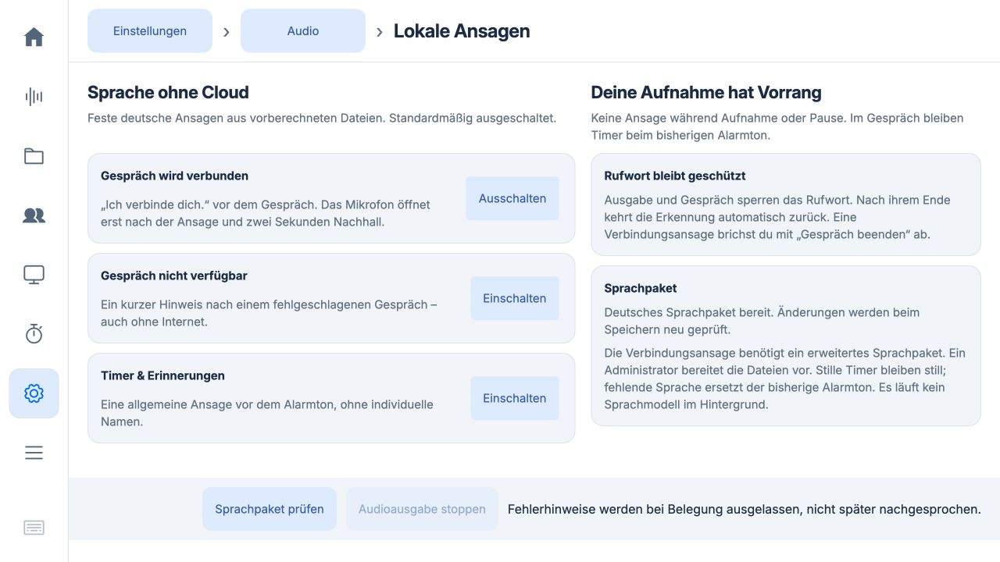

# „Ich verbinde dich.“ vor dem Gespräch

Stand: 21. Oktober 2026. **PR #14 gemergt und als 0.5.67 auf dem Pi installiert**,
signierte Sequenz 24, Quellcommit `a517be09b27c25f9a72dee8c35365f1153ddcd46`.
Die Verbindungsansage wurde auf Nutzerauftrag bei freiem Gerät aktiviert.
Offline-/Timer-Ansagen und die bisherigen Mikrofon-/Lautsprechereinstellungen
blieben erhalten. Die vorherige positive Hörprobe des Nutzers bezieht sich auf
die bestehenden Offline-/Timer-Ansagen.

## Bedienung und Ablauf

Unter **Einstellungen → Audio → Lautsprecher → Lokale Ansagen** gibt es die
separate Option **Gespräch wird verbunden**. Sie ist zunächst aus und lässt
sich erst mit einem geprüften erweiterten Sprachpaket einschalten.

Nach einem autorisierten Gesprächsstart reserviert die bestehende Live-Steuerung
das Gerät und setzt das Rufwort aus. Die native Live-Instanz spielt genau einmal
„Ich verbinde dich.“ und wartet zwei Sekunden auf Nachhall. **Erst anschließend
öffnet sie das Gesprächsmikrofon und startet den bisherigen Verbindungsaufbau.**
Der vorhandene Verbindungston, Bereitschaftston und die spätere Cloud-Begrüßung
bleiben erhalten. Wiederverbindungen lösen keine erneute lokale Ansage aus.
Das gilt für den gemeinsamen nativen Startweg von Oberfläche, Rufwort und
Handy-Fernbedienung.

Der vorbereitete Clip dauert 1,68 Sekunden; vor dem eigentlichen Aufbau kommen
somit etwa 3,68 Sekunden hinzu. Die Ansage bestätigt einen gestarteten Versuch,
keine bereits hergestellte Verbindung. Ihre Länge ist auf drei Sekunden begrenzt.
Es läuft keine Sprachsynthese auf dem Pi.

**Gespräch beenden** bricht auch die Ansage und den Nachhall ab. Die Audioinstanz
behält ihre Prozessverantwortung bis zur bestätigten Beendigung. Fehlgeschlagene
Bereinigung darf kein Mikrofon freigeben. Ein fehlender Player lässt die optionale
Ansage aus, sofern kein Ausgabekind mehr lebt. Aufnahme, Pause und bereits laufende
Gespräche bleiben durch die bestehende Live-Reservierung geschützt.

## Kompatibilität, Installation und Rücknahme

Das bisherige Paket mit drei Clips bleibt gültig. Die neue App akzeptiert
zusätzlich ausschließlich `connecting.wav` mit festem Text, geprüfter SHA-256
und Mono-PCM16/24 kHz. Alte Einstellungen bleiben erhalten; der neue Schalter ist
aus. Ein altes Paket kann weiter Offline-/Timer-Ansagen ausgeben, aber die
Verbindungsansage nicht neu aktivieren. Unbekannte Clip-Namen werden abgewiesen.

Der neue Builder erzeugt vier Clips. Für dieses Testpaket blieben die drei bereits
gehörten Dateien bytegleich; nur die Verbindungsansage wurde auf dem Mac ergänzt.
[Manifest und Prüfsummen](connecting-pack-manifest.json).

Vorgehen bei einer weiteren freigegebenen Bereitstellung: neue signierte App bei freiem Gerät installieren,
bisherige Ansageoptionen merken und kurz ausschalten, vorhandenen Paketordner lokal
sichern, neues geprüftes Paket mit dem Operator-Werkzeug in einen neuen Zielordner
installieren und über „Sprachpaket prüfen“ laden. Danach bestehende Optionen
wiederherstellen und die neue Option ausdrücklich einschalten. Bei Rückkehr zur
alten App **auch das alte Drei-Clip-Paket wiederherstellen**; 0.5.66 akzeptiert
keinen vierten Manifest-Eintrag. Niemals Daten oder vorhandene Einstellungen blind
überschreiben. Der Installer verweigert weiterhin ein bereits vorhandenes Ziel.

Code und Oberfläche sind in der bestehenden App-/Image-Positivliste enthalten.
Keine neue Abhängigkeit, kein neuer Dienst, keine Datenmigration. Das optionale
Sprachpaket bleibt außerhalb des signierten Codes und jedes frischen Images.
Kein SD-Image wurde für diese Erweiterung gebaut oder am Gerät bootgeprüft.

## Prüfung

491 Python-Tests und 125 JavaScript-Tests bestanden. Neue Prüfungen belegen
Abwärtskompatibilität des Drei-Clip-Pakets, separaten Opt-in, Längengrenze,
fehlenden Player, bestätigtes Prozessende vor Aufnahmebeginn, Abbruch und
fehlgeschlagene Bereinigung. Die Audio-Prozesstests schreiben künstliches PCM in
eine Datei oder starten einen stummen Warteprozess; sie öffnen keine Audiohardware
und keinen Cloud-Kanal. Die echten Mikrofon-/Gesprächssperren bleiben zusätzlich
in der bestehenden Suite abgedeckt.

Isolierte Browserprüfung bei 1280 × 720: ohne Paket ist Aktivierung gesperrt;
mit erweitertem Paket lässt sich allein die Verbindungsansage aktivieren. Der
Schalter bleibt nach Neuladen gesetzt. Alle drei Optionen sind ohne Scrollen
erreichbar; anschließend in der Vorschau wieder ausgeschaltet. Diese isolierte
Browserprüfung fand vor dem Deployment statt.

## Produktive Geräteprüfung am 21. Oktober 2026

Das signierte Update wurde bei `idle` über die atomare Wartungssperre installiert;
Signatur, Laufzeit und sämtliche ausgelieferten Datei-Prüfsummen wurden geprüft.
Mit dem bisherigen Drei-Clip-Paket blieb die neue Option zunächst ausgeschaltet.
Danach wurden die Ansagen kurz deaktiviert, das alte Paket unter
`/home/chris/recorder-backups/connecting-067/announcements-pack-066` gesichert
und das geprüfte Vier-Clip-Paket unter Wartung installiert. Erst bei wieder freiem
Gerät wurden die bisherigen Optionen wiederhergestellt und `connecting` aktiviert.
Die drei vorhandenen Clips sind bytegleich. Keine Synthese oder Modellinstallation
auf dem Pi. Nach der Versionsanhebung bestanden zusätzlich 45 gezielte Tests.

Zwei kurze Starts über die normale, besitzgebundene Gesprächssteuerung:

- **Abbruch während der Ansage:** bei etwa 0,55 Sekunden beendet; alle beobachteten
  Werte für erfasste und gesendete Gesprächsframes waren null. Anschließend wieder
  `idle/listening`.
- **Start bis zur Begrüßung:** Ansage technisch als abgespielt bestätigt; erste
  beobachtete Mikrofonframes bei etwa 4,34 Sekunden, nach Ansage und zwei Sekunden
  Nachhallpause. Begrüßung bei etwa 6,99 Sekunden vom Server bestätigt, Audioframes
  empfangen und ausgegeben. Nach etwa zehn Sekunden ausschließlich dieses
  Testgespräch beendet; anschließend wieder `idle/listening`.

Die Zeiten sind Abtastwerte aus der technischen Zustandsprüfung, keine präzise
akustische Latenzmessung. Es wurden keine Audiodateien oder Gesprächsinhalte
exportiert. Die Tests beweisen weder natürliche Rufwortqualität noch die
akustische Echofreiheit im Raum. **Die Hörabnahme der neuen Ansage und ihres
Nachhalls bleibt offen.** Während der Tests lief keine Nutzeraufnahme oder
bereits bestehende Unterhaltung.

Belege: [signiertes Deployment](connecting-deployment-0.5.67.json),
[Paket und Aktivierung](connecting-activation-0.5.67.json),
[Gerätetests](connecting-pi-smoke-0.5.67.json),
[abschließender Zustand und Prozessbaum](connecting-final-0.5.67.json).

