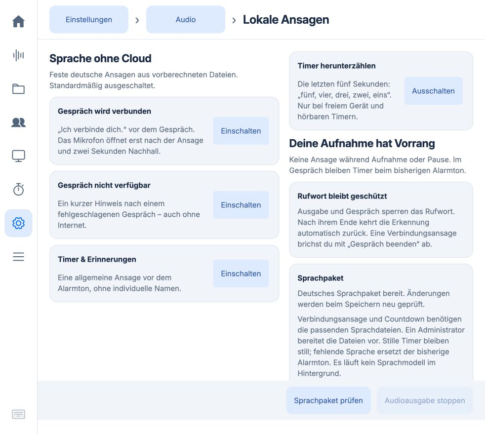

# Deutscher Timer-Countdown

Stand: 21. Oktober 2026. **Vorbereitete Erweiterung, noch nicht auf dem Pi
installiert oder aktiviert.** Produktiv bleibt die bestätigte 0.5.67 mit den
bisherigen vier Ansagen. Für diese Entwicklung wurde der Pi nicht angesprochen.

## Bedienung

Unter **Einstellungen → Audio → Lautsprecher → Lokale Ansagen** gibt es den
separaten Schalter **Timer herunterzählen**. Er startet ausgeschaltet und benötigt
`countdown.wav` im geprüften Sprachpaket. Die bisherigen Schalter und Einstellungen
bleiben unabhängig davon erhalten. Ohne Countdown-Datei ist Einschalten gesperrt;
Ausschalten bleibt auch bei später fehlendem Paket möglich.

Bei einem hörbaren Timer spricht das Gerät in den letzten fünf Sekunden
**„fünf, vier, drei, zwei, eins“**. Die Zahlen beginnen im Abstand einer Sekunde.
Danach folgt der gewählte Alarmton. Direkt nach einem Countdown wird die zusätzliche
allgemeine Ansage „Dein Timer ist abgelaufen“ wegen des Nachhallabstands ausgelassen.
Erinnerungen und stille Timer erhalten keinen Countdown.

**Aufnahme, Pause und Unterhaltung haben Vorrang.** Auch andere belegte
Audiozustände, Mikrofontests, Modelltests/-downloads, Wartung, Bluetooth-Einrichtung,
Browser-Wiedergabe, erkannte externe Audioausgabe, Rufworttests und offene
Verarbeitung verhindern einen neuen Countdown. Bereits verpasste Zahlen werden
nicht nachgesprochen. Kurze Timer oder verzögerte Starts mit weniger als fünf
verbleibenden Sekunden laufen ohne Countdown ab. Der Timer wird dabei nie verlängert.

Ein Aufnahme-, Gesprächs- oder Mikrofonteststart über die lokale Bedienung beendet
zuerst die eigene Countdown-Ausgabe. Die Prozessbeendigung muss bestätigt sein,
bevor der Eingang freigegeben wird. Fernbedienungsstarts behalten ihre bestehende
Belegungssperre. **Audioausgabe stoppen** oder das Abbrechen des Timers beendet
auch dessen Countdown; er wird danach für diesen Ablauf nicht erneut gestartet.
Ein über ein Gerätewerkzeug gelöschter Timer wird beim nächsten Steuertakt erkannt.

## Timing und Wiederholschutz

Die Steuerung reserviert die Ausgabe bis zu zwei Sekunden vor dem eigentlichen
Fünf-Sekunden-Abschnitt. Vor der Ausgabe wird die Rufworterkennung angehalten.
Der vorhandene Ausgabedienst bereitet die Datei vor und wartet auf den aus der
Timer-Restdauer abgeleiteten monotonen Startzeitpunkt. Die Zahlen liegen bereits
in festen Ein-Sekunden-Abschnitten einer fünf Sekunden langen WAV-Datei.

Langsamer Geräteaufbau oder ein verpasster Start lässt den Countdown aus.
Der Wiedergabeprozess bekommt höchstens die Restlaufzeit bis zum Timerende;
bei Fristablauf wird er beendet. Die normale Timer-Fälligkeit und Alarmquittierung
bleiben unverändert. Dies ist keine harte Echtzeitgarantie: Betriebssystem und
Audiotreiber können den hörbaren Beginn verschieben. Eine tatsächliche Pi-
Timing-/Hörprüfung gehört deshalb zur späteren Geräteabnahme.

Die separate Datei `timer-countdowns.json` enthält nur Timer-IDs und Revisionen,
keine Titel oder Inhalte. Ein Versuch wird vor Wiedergabe atomar mit fsync
festgehalten. Auch bei ausgeschalteter Funktion, Belegung oder überlappenden
Timern wird das betretene Vorlaufzeitfenster verbraucht. Von gleichzeitig
anstehenden Countdowns wird höchstens der früheste berücksichtigt; es gibt
keine Warteschlange. Ein Neustart wiederholt keinen bereits verbrauchten Versuch.
Schlummern erzeugt eine neue Revision und kann später erneut herunterzählen.

Die Datei ist begrenzt, erledigte Einträge werden entfernt. Bei beschädigter oder
nicht schreibbarer Datei bleibt nur der Countdown aus; normale Alarme funktionieren
weiter. Die Timer-Datenbank und ihr Schema werden nicht verändert.

## Stimme und Paketvorbereitung

Verwendet wird die [bestätigte Stimme](voice-baseline.md):
`gradium/phonon-40m-de`, Q8, `ptts==0.4.0`, `voice='default'`, Deutsch,
`rewrites='all'`, CPU mit einem Thread und Seed 42. Alle Synthese läuft auf dem
Mac. Auf dem produktiven Pi findet ausschließlich Dateiwiedergabe statt.

Die fünf Wörter werden einzeln synthetisiert. Leise Vor-/Nachlaufbereiche werden
mit kleinem Rand entfernt. Zahlen länger als 0,9 Sekunden werden abgewiesen,
nicht beschleunigt oder abgeschnitten. Anschließend wird jede Zahl in einen
Ein-Sekunden-Abschnitt gesetzt. Das Ergebnis enthält exakt 120.000 Mono-Samples
bei 24 kHz, PCM16. Die Datei wurde tatsächlich erzeugt und technisch geprüft;
die persönliche Hörabnahme dieses neuen Clips steht noch aus.

Der Builder kann vorhandene abgenommene Clips bytegleich übernehmen:

```sh
uv run --offline --with ptts==0.4.0 python scripts/prepare_announcements.py build \
  --model /absoluter/pfad/zum/phonon-40m-de \
  --base /absoluter/pfad/zum/bisherigen-sprachpaket \
  --output /absoluter/pfad/zum/neuen-sprachpaket
python3 scripts/prepare_announcements.py check /absoluter/pfad/zum/neuen-sprachpaket
```

Die Build-Abhängigkeiten und Modell-Dateien müssen dafür bereits lokal vorhanden
sein. Das neue Paket enthält fünf Clips; die bisherigen vier bleiben nachweislich
bytegleich. [Texte, Längen und SHA-256](countdown-pack-manifest.json).
Kein neuer Download oder Modellzugang war für diese Erweiterung nötig.

## Auslieferung, Rücknahme und Images

App und Paket erst nach Freigabe auf einem freien Gerät unter der bestehenden
Wartungssperre bereitstellen. Vor dem Paketwechsel Ansageoptionen merken und
abschalten, bisheriges Paket separat sichern, neues Paket validieren und in einen
neuen Zielordner installieren. Danach die bisherigen Optionen wiederherstellen;
Countdown separat aktivieren. Keine Aufnahme, Pause oder Unterhaltung unterbrechen.

Die neue App akzeptiert weiterhin Drei- und Vier-Clip-Pakete. Die alte App 0.5.67
akzeptiert den zusätzlichen Countdown-Eintrag noch nicht: Bei einem App-Rollback
auch das gesicherte Vier-Clip-Paket wiederherstellen. Der neue Opt-in und die
separate Wiederholschutzdatei können von der alten App ignoriert werden; bestehende
Timer und Alarmdaten behalten ihr Format.

Geänderte Laufzeitdateien liegen in der vorhandenen App-/Image-Positivliste.
Keine neuen Runtime-Abhängigkeiten, Dienste oder Datenbankmigrationen. Das Paket,
seine Opt-ins und die Wiederholschutzdatei bleiben außerhalb des Code-Releases
und frischer Image-Exporte. Ein frisches Gerät bleibt ohne separates Paket und
Opt-in stumm. Kein SD-Image wurde gebaut oder am Gerät bootgeprüft.

## Prüfung

Automatisierte Prüfungen decken Zeitfenster, monotone Timer trotz Wanduhrsprung,
Neustart/Deduplizierung, Schlummerrevision, stille/kurze/überlappende Timer,
Erinnerungen, beschädigte Quittungen, alte Pakete, separaten Opt-in,
WAV-Längengrenze, Schutz vor Aufnahme/Pause/Live und weitere Belegungen ab.
Wiedergabetests prüfen verspätete Starts und Fristablauf sowie Abbruch mit einem
echten **stummen** Kindprozess. Dabei wird keine Audiohardware geöffnet.

Browserprüfung in isolierter lokaler Vorschau: ohne Paket gesperrt, mit erweitertem
Paket nur Countdown einschaltbar, Auswahl nach Neuladen erhalten; anschließend
wieder ausgeschaltet. Alle vier Optionen sichtbar. Technische Ergebnisse:
[countdown-validation.json](countdown-validation.json).

Offen bleiben Merge/Deployment, koordinierte Pi-Timing-/Hörprüfung und natürliche
Rufwortprüfung nach der Ausgabe. Die bisherige Hörabnahme der Stimme ersetzt
nicht die Abnahme dieses neuen Countdown-Clips.


