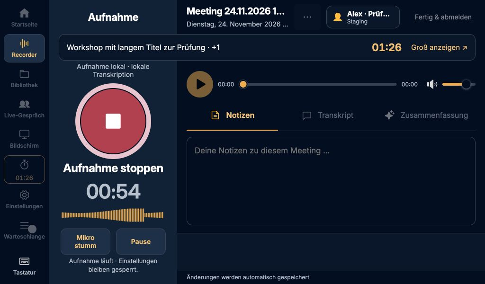
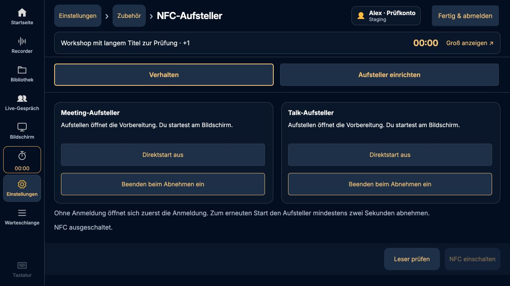
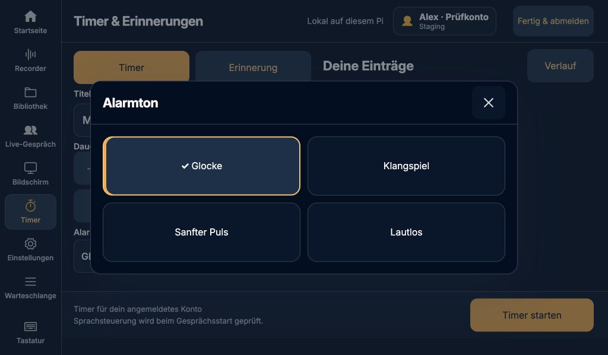
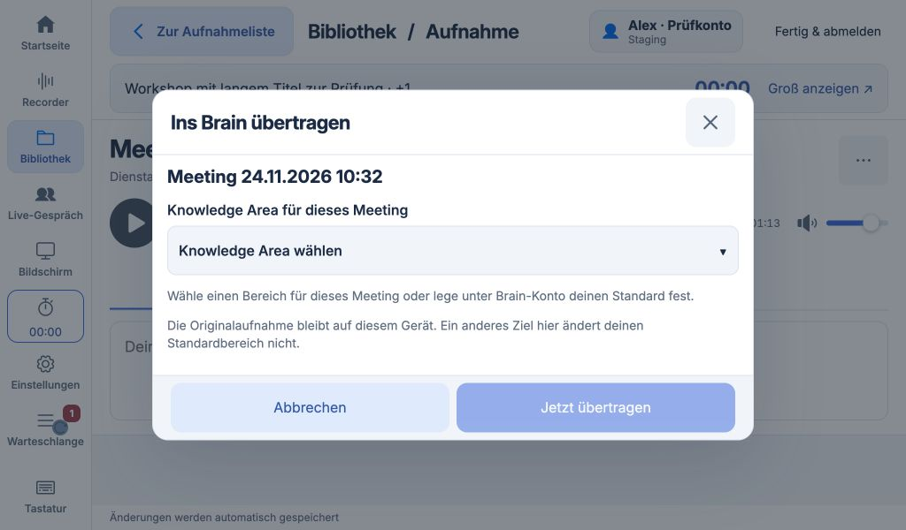

# Recorder Studio 0.5.101 · Pi-Touch

24. November 2026. Umsetzung der freigegebenen Befunde A01–A08.
Die [Bedienregeln](../PI-TOUCH-RULES.md) sind in `AGENTS.md` verbindlich verankert.

| Befund | Umsetzung |
| --- | --- |
| A01 Timer | Eigene reservierte 64-px-Zeile unter dem Kopf, auch bei Aufnahme/Pause, Talk und Bibliotheksdetails. Konto und Stopp bleiben frei. |
| A02 abgeschnittene Seiten | NFC in Einrichtung und Verhalten geteilt; Lautsprecher in zwei Spalten; variable Inhalte scrollbar mit festen Fußaktionen. |
| A03 Modelle | Aktives Modell separat; Auswählen → Prüfen → Aktivieren; scrollbare Informationen ohne überlagerte Lizenz-/Statustexte. |
| A04 kurze Auswahlen | Zwei bis sechs kurze Optionen als direkte Kacheln mit Auswahlhaken; lange Listen behalten Suche und Seiten. |
| A05 Ziffern | 3×4-Ziffernblock für PIN, Timer und Kopplung; Feldlängen werden respektiert; Fertig speichert nicht automatisch. |
| A06 Status | Lautsprecher erklärt Testton, NFC-Beschreibung folgt Direktstart; Talk benennt fehlende Bereitschaft; fehlende Audiodateien zuerst prüfen. |
| A07 Aktionen | Große Neustart-/Ausschaltkacheln, Wartung separat; Übertragungsdialog passend zum Inhalt; Minimieren vor vorzeitigem Timerstopp betont. |
| A08 Orientierung | Zubehör- und Gerätestatusübersicht, passende Rückwege, Bibliothek mit Datum/Dauer/Verarbeitung/Brain-Status. |

## Prüfungen

- 161 JavaScript-Tests, 137 Python-Tests bestanden. Zusätzlich Syntax und `git diff --check`.
- Beide Pi-Größen 1280×720 und 1024×600 geprüft, helles und CDB-Design.
- Synthetische Aufnahme gestartet, pausiert, fortgesetzt und gestoppt; Timer/Konto/Pause/Stopp per Trefferprüfung frei. Kein produktives Mikrofon für diese Prüfung verwendet.
- Numerische Eingabe 1,2 → 12; dritte Ziffer bei Feldlänge 2 abgewehrt; Löschen → 1. PIN wurde nicht gespeichert.
- Kurze Tonauswahl, mehrere Timer, fälliger Alarm, NFC, Lautsprecher, Ansagen, lokale/Online-Modellwahl, Bibliothek, fehlende Audio-Datei, Übertragung, Geräteaktionen geprüft.
- Aktiver Talk wurde als synthetischer Darstellungszustand eingespeist. Dies bestätigt Layout und Aktionssperren, kein echtes Sprachgespräch. Sein Beenden kann ohne echte Audioverbindung keinen vollständigen Hardwareablauf prüfen.
- Bestehende große Start-/Abmelde-/Lösch-/Neustartdialoge und Backend-Aktionssperren bleiben erhalten; Regressionstests decken Kontowechsel und laufende Aktivitäten ab.
- Lokale Vorschau enthält ausschließlich erzeugte Audiodaten und fiktive Konten. Keine Übertragung ins Brain.

## Sichtbare Ergebnisse

Weitere Bildschirmbilder in diesem Ordner dokumentieren Übersicht, Modelle, Ziffernblock,
Zubehör, Bibliothek, Fehler, Timerablauf und Talk. Hardwaremeldungen der Mac-Prüfkopie
sind keine Aussage über die am Pi angeschlossenen Geräte.

## Daten und Statusgrenzen

- Veröffentlichungen bekommen eine lokale Zuordnung zur Aufnahme. Diese ID wird
  nicht an Brain gesendet; Inhaltserkennung/Deduplizierung und Kontotrennung bleiben erhalten.
- Historische Veröffentlichungen ohne Zuordnung bzw. außerhalb der letzten 30
  Publikationen erscheinen als „Lokal gespeichert“, nicht als bestätigte Übertragung.
- Die USB-Erkennung liest nur Linux-Gerätekennungen, öffnet keinen seriellen Port
  und beansprucht den Displaydienst nicht. „Erkannt“ ist keine Bestätigung der Anzeige.
- Kein neues Python-Paket, kein Schemawechsel und keine Änderung an Audio-, NFC-,
  Raum-, Anmelde-, Geräte- oder Netzwerkeinstellungen.

## Update und frisches SD-Image

Alle Änderungen liegen in den bestehenden Positivlisten (`studio/`, `services/`,
`web_server.py`). Signiertes Codepaket und sauberes Image-Baupaket müssen dieselben
neuen Dateien enthalten. Keine Betriebssysteminstallation und kein Firmware-Update
notwendig. Ein Baupaket ist kein gebautes oder boot-zertifiziertes SD-Image.

Installation und bereinigte Abnahmedaten werden nach der Geräteprüfung ergänzt.
