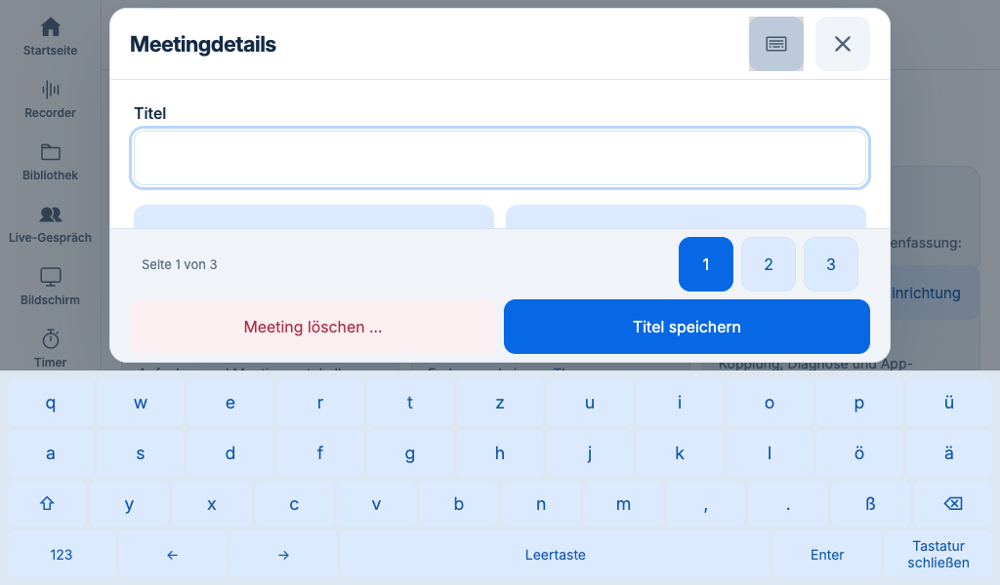
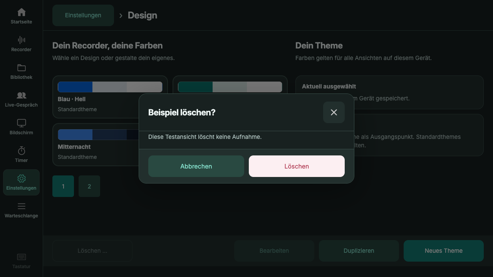
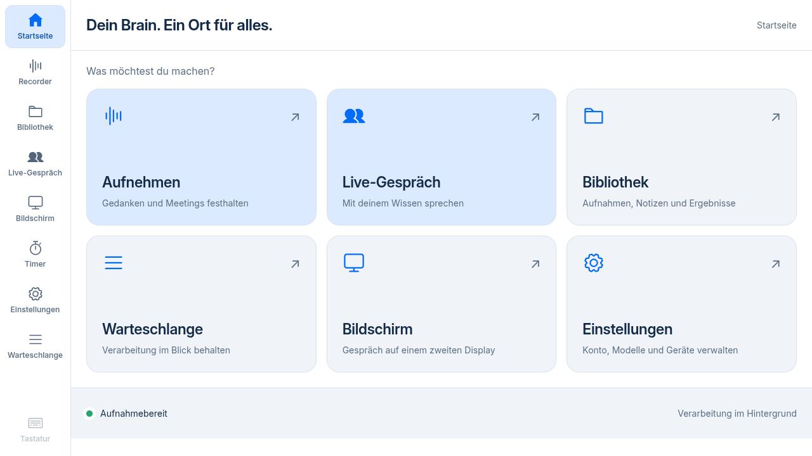

# Recorder Studio 0.5.80 – Pi-Touchdisplay

18.11.2026. Ziel ist die Recorder-Anwendung auf dem physischen Pi. Pi Studio für 3D-Modelle und Druckdateien ist eine andere Anwendung mit eigenem Rollout.

## Bedienung

- Das Seitenmenü zeigt Symbol und Beschriftung. Alle neun Einträge passen ohne Scrollen auf 1280 × 720 und 1024 × 600; die Touchflächen sind 68 bzw. 60 Pixel hoch.
- Dialoge haben einheitliche 56-Pixel-Schließen-Buttons und mindestens 56 Pixel hohe Aktionen. Lange Beschriftungen dürfen umbrechen.
- Seitenwahl und Entscheidungen stehen in getrennten Zeilen. Kurze Dialoginhalte zeigen keine überflüssige Ein-Seiten-Navigation. Die Sichtbarkeit erreicht einen stabilen Zustand ohne wiederholte Layoutänderungen.
- Wiedergabehinweis: Abbrechen steht zusammen mit der Wiedergabeaktion im Fußbereich; oben gibt es denselben Schließen-Button wie in den übrigen Dialogen.
- Die Sitzung bleibt unter Bestätigungen erhalten. Dialogaktionen bleiben auch mit eingeblendeter Bildschirmtastatur im sichtbaren Bereich.

## Prüfung

- 138 JavaScript-Funktionstests bestanden, einschließlich neuer Prüfung für stabile, bedarfsgerechte Dialogseitenwahl und bestehender Aufnahme-/Gesprächssperren.
- 10 Python-Tests bestanden: Versionsanzeige aus laufendem Backend, lokale HTTP-Grenzen, signierte Updates einschließlich Rückkehr bei Fehlern und erlaubte Dateien im SD-Image-Export.
- 72 Browserprüfungen mit Touch-Eingabe bei 1280 × 720 und 1024 × 600. Hauptnavigation, sämtliche Einstellungsbereiche, sechs sekundäre Dialoge, Auswahlfenster, Bildschirmtastatur und dunkle Bestätigung geprüft. Sichtbare Dialogaktionen liegen vollständig im Bildschirm, sind per Trefferprüfung erreichbar und mindestens 48 Pixel hoch; neue Aktionsbuttons mindestens 56 Pixel. [Ergebnisse](browser-checks.json).
- Browserdaten sind synthetisch. Die Browserprüfung ersetzt keinen manuellen Fingertest und keinen neuen Aufnahme-/Modellqualitätstest.

## Auslieferung und SD-Image

Vorheriger Stand am aktuellen Gehäuse-Pi: 0.5.79, Dateien mit Commit `6e65a14` abgeglichen. Eine Aktualisierung nur des Pi-Studio-Servers verändert diese Recorder-Oberfläche nicht.

Das Update enthält ausschließlich App-Code und Oberflächen-Dateien. `studio/pi-touch.css` liegt in der bestehenden Freigabeliste für App-Updates und Kunden-Images. Bestehende Laufzeit, Modelle und Datenformat bleiben gleich; keine Datenmigration, keine neuen Systempakete. Ein zukünftiger sauberer SD-Image-Bau muss diesen Commit enthalten. Für diese Oberflächenänderung wurde kein neues SD-Image gebaut.

Die Installation am vorhandenen Pi erfolgt in einem neuen Versionsverzeichnis. Vor dem Wechsel schützt die bestehende Wartungssperre laufende Aufnahmen, Gespräche, Verarbeitung, Wiedergabe und Timer. Der vorherige Versionsordner bleibt für die Rückkehr bestehen. Nach Startprüfung wird die Sperre gelöst und die lokale Anzeige kontrolliert. Der Gehäuse-Pi wurde am 18.11.2026 um 11:02 Uhr MEZ von 0.5.79 auf 0.5.80 aktualisiert. Alle 129 Dateien des signierten App-Pakets wurden geprüft. Die laufende API und ausgelieferte HTML-Seite melden 0.5.80, die neue CSS-Datei wird ausgeliefert. Beide Dienste laufen. Nach Neuladen der Kiosk-Anzeige zeigt ein Screenshot des physischen DSI-Displays das beschriftete Menü und „Aufnahmebereit“. Konfiguration und Sitzungsbestand wurden vor/nach dem Wechsel verglichen und sind gleich; die Wartungssperre ist wieder gelöst. Das Aktivierungswort bleibt wie zuvor ausgeschaltet. Es wurde keine neue reale Aufnahme gestartet.

[Installationsnachweis](deployment.json)

