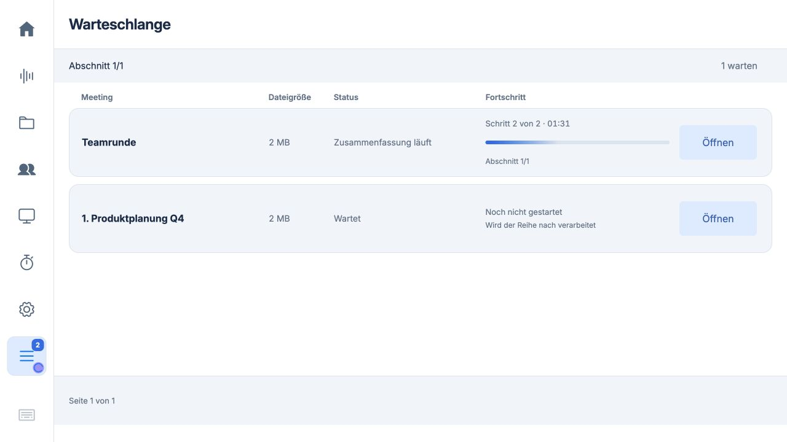
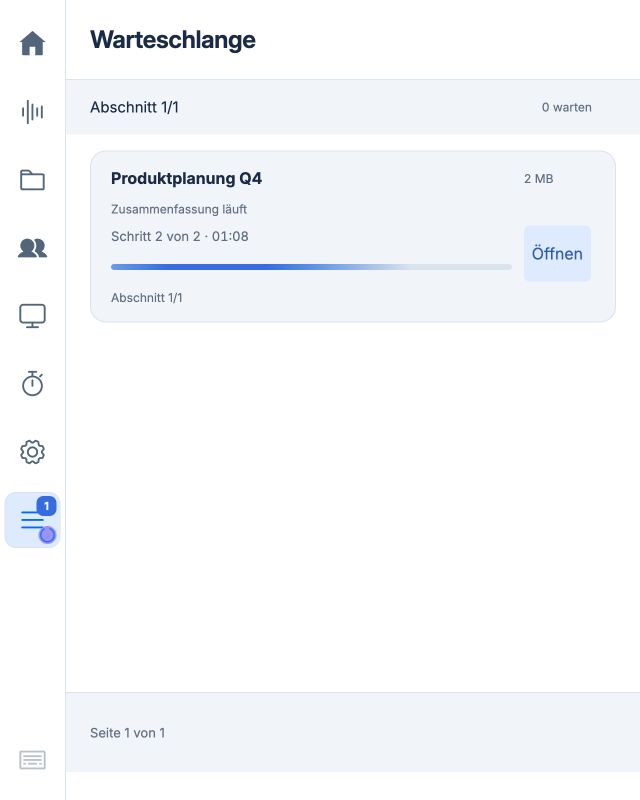

# Warteschlange mit Dateigröße und Fortschritt · 0.5.63

Anforderung vom 19.10.2026: pro Eintrag eine sichtbare Dateigröße und nach dem Status eine eigene Fortschrittsspalte.

Die Zeilen enthalten Meeting, Dateigröße, Status, Fortschritt und Öffnen/Wiederholen. Dateigrößen stammen aus dem Dateisystem, bevorzugt der fertigen WAV-Datei, während einer Aufnahme der PCM-Datei und während Importen der erzeugten WAV-Zwischendatei. Fehlende Datei wird als „–“ angezeigt, eine vorhandene leere Datei als „0 B“. Auch alte Sitzungen ohne Queue-Zuordnung erhalten ihre Dateigröße. Angezeigt wird die Größe der auf dem Pi gespeicherten Audiodatei, keine Upload- oder Originalkompressionsgröße. MB/kB sind dezimale Einheiten; der Tooltip nennt die genaue Bytezahl.

Fortschritt: Transkription „Schritt 1 von 2“, Zusammenfassung „Schritt 2 von 2“, jeweils mit der Laufzeit dieser Phase. Der vorhandene Worker meldet bei der Zusammenfassung Abschnitt und Zusammenführungsstufe. Da die unveränderte lokale Modellpipeline keine verlässlichen Gesamtprozente meldet, zeigt ein unbestimmter animierter Balken Aktivität. Es gibt keine Hochrechnung oder erfundene Prozentzahl. Wartende und fehlgeschlagene Aufträge erhalten keinen laufenden Balken. Offline wird die Aktivitätsanzeige angehalten und „Status nicht aktuell“ angezeigt. Reduzierte Bewegung wird berücksichtigt.

Dateigröße, Zeit und Abschnitt aktualisieren sich in bestehenden Elementen. Buttons und Fokus werden erhalten. Der Seitenwechsler verwendet stabile Auftragsschlüssel, berücksichtigt Spaltenkopf und tatsächliche Zeilenhöhe und springt bei einer laufenden Uhr nicht auf Seite 1 zurück. Auf schmalen Displays werden die Informationen innerhalb der Zeile umgebrochen.

Prüfung: Jeweils 55 Studio-Tests auf Mac und Pi sowie alle 115 JavaScript-Tests bestanden. Enthalten sind Größenformat, Phasen, Offline, fokuserhaltende Aktualisierungen und stabile Seitenauswahl. Der Pi-Test lief isoliert neben der unveränderten Produktions-App. Die Vorschau nutzt ausschließlich synthetische Meetings und künstliche KI-Verzögerungen. Sie belegt Darstellung und Zustandswechsel, keine Modellgeschwindigkeit. Noch kein Update dieser Ansicht am Pi und kein Neustart des produktiven Dienstes.

Image-Auswirkung: Änderungen an bereits erlaubten Dateien web_server.py, studio/app.js, studio/touch.js und studio/workspace.css. Keine neue Runtime, kein Schema, keine Factory-/Dienst-/Konfigurationsänderung. Bestehende Geräte erhalten ein signiertes Code-Update, ein frisches Image übernimmt denselben erlaubten App-Stand. Ein neues Image wurde nicht gebaut oder auf Hardware gebootet.

Der saubere Image-Export umfasst unverändert 125 Quelldateien; die vier
geänderten Laufzeitdateien sind bereits erlaubt. Die letzte CSS-Ergänzung
begrenzt lange Fehlermeldungen auf drei sichtbare Zeilen; der vollständige
Text bleibt im Tooltip und im Auftrag erhalten. Keine Daten wurden gelöscht.
