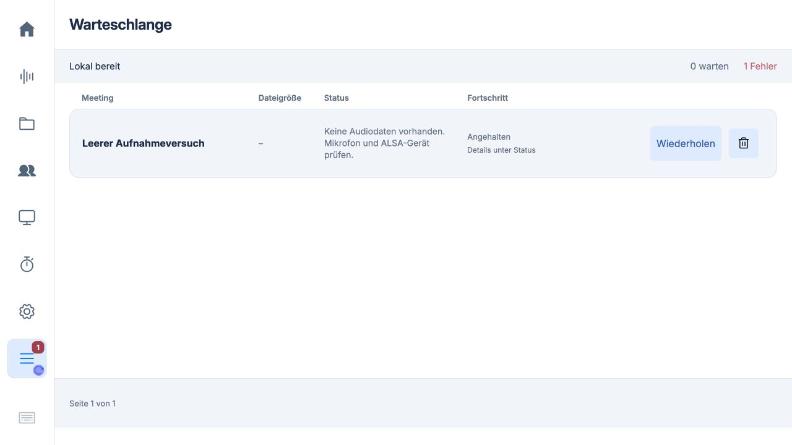

# Fehlgeschlagene Queue-Einträge löschen · 0.5.64

Bei fehlgeschlagenen Aufträgen steht neben Wiederholen ein Papierkorb mit eindeutigem zugänglichem Meetingnamen. Die Bestätigung nennt das konkrete Meeting und erklärt, dass vorhandene Audiodaten, Notizen und Ergebnisse gelöscht werden. Verwendet wird der bestehende geschützte Session-Löschweg; keine neue Lösch-API und kein Datenformat. Ein leerer fehlgeschlagener Job wird nach dem Löschen bei der Synchronisierung nicht wieder angelegt. Der interne Queue-Job bleibt wie bisher als verborgenes Auditobjekt erhalten. Andere ausgewählte Meetings und deren Editor bleiben erhalten. Bei Aufnahme, belegtem Live-Gespräch oder fehlender Verbindung ist die Aktion gesperrt. Wartende/laufende Aufträge erhalten keinen Papierkorb.

117 JavaScript-Tests und 56 Studio-Tests auf dem Mac bestanden. Neue Regressionen prüfen die zielgenaue Bestätigung, Abbrechen, Schutz einer anderen Auswahl, gesperrte Aufnahme und dauerhafte Entfernung eines leeren Fehlversuchs. Tests verwenden ausschließlich künstliche Meetings. Die drei produktiven leeren Einträge werden nicht automatisch gelöscht; der Benutzer kann sie selbst auswählen und bestätigen.

Image-Auswirkung: bereits erlaubte Laufzeitdateien studio/app.js, studio/workspace.css und Versionsquelle web_server.py. Das Papierkorb-SVG ist bereits enthalten. Keine neuen Abhängigkeiten, Factory-/Dienst-/Konfigurationsänderungen oder Datenmigration. Ein frisches Image übernimmt den App-Stand; kein neues Image gebaut oder boot-geprüft.

Installiert als signierte Sequenz 21, Quellcommit 9afe335f77f833f15a17ce6c72711e396a3eefa6. Alle Laufzeitdateien geprüft; drei geänderte App-Dateien, unveränderte Runtime. Zusätzlich 56 Studio-Tests auf dem Pi bestanden (33,519 s). Alle 28 vorherigen Sitzungsdatensätze sind identisch; die drei alten Fehler bleiben bis zur Benutzerentscheidung sichtbar. Wake ist eingeschaltet und hört zu. Sauberer Image-Export mit 125 Dateien erstellt; kein Image gebaut. Die Browser-Sichtprüfung zeigt den Papierkorb und die Bestätigung. Der automatisierte Browser-Dialogabbruch war durch das Steuerwerkzeug blockiert; Abbrechen und zielgenaues Löschen sind durch die JavaScript- und HTTP-Regressionen geprüft, nicht als erfolgreich abgeschlossener Browser-Klicktest ausgegeben.
