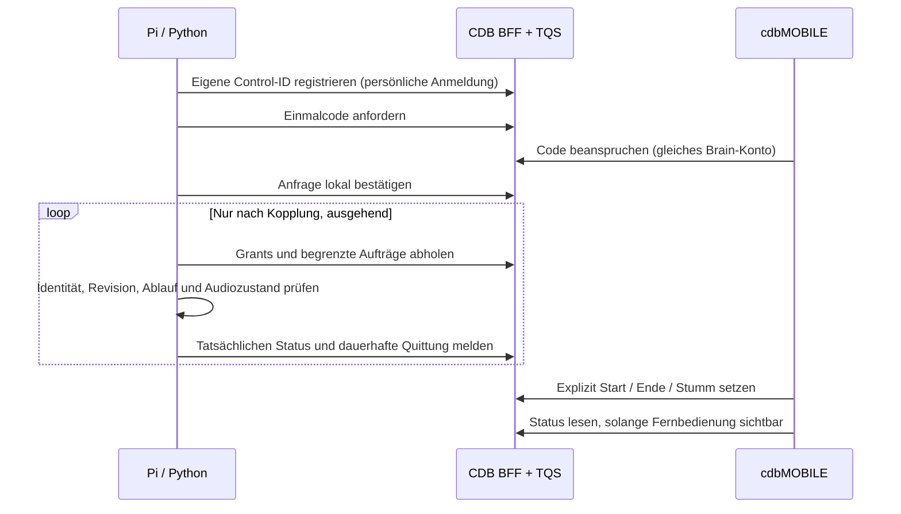
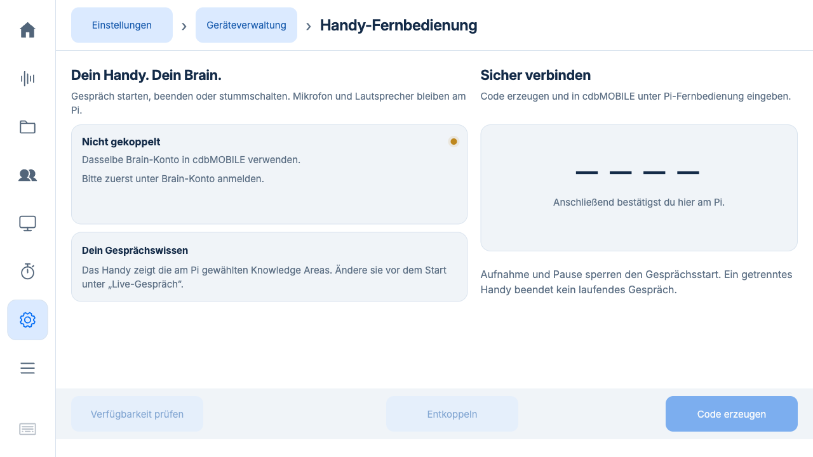
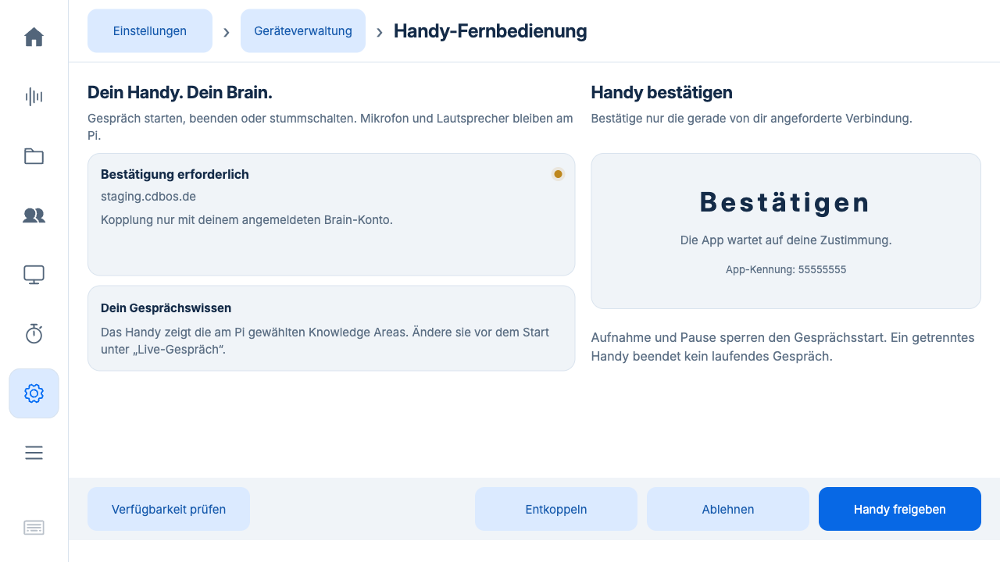

# Mobile Fernbedienung: Umsetzung zu Issue 63

Stand 16.10.2026. Feature-Branch, **nicht produktiv installiert**.
[Freigegebenes Issue](https://github.com/BIK-GmbH/cdb-knowledge-mobile/issues/63) ·
[Gemeinsamer Vertrag](contract-v1.md).

## Bedienung

1. Pi und cdbMOBILE mit demselben Brain-Konto in derselben Umgebung anmelden.
2. Am Pi **Einstellungen → Gerät & Verwaltung → Handy-Fernbedienung** öffnen.
3. Verfügbarkeit prüfen, einen fünf Minuten gültigen Code erzeugen und am Handy
   unter **Pi-Fernbedienung** eingeben.
4. Die Anfrage ausdrücklich am Pi bestätigen. Nur die eigene aktuelle Anfrage
   freigeben; die App-Kennung dient zum Unterscheiden.
5. Am Handy Gerät wählen, die am Pi gespeicherte Wissensauswahl prüfen/bestätigen
   und Gespräch starten. Ende und Stummschaltung bedienen dasselbe Pi-Gespräch.

Ohne serverseitige Freischaltung zeigt die App „noch nicht verfügbar“. Ein Update
aktiviert keine vorhandene Kopplung. Der Code gehört nicht zur Geräteverwaltung
oder zum nur lesenden Bildschirm-Empfänger. Bluetooth-Fernbedienungen sind nicht
Bestandteil dieser Stufe.

Die am Pi ausgewählten Knowledge Areas und seine Sprache bleiben maßgeblich.
Neue Bereichsnamen werden beim Öffnen der lokalen Gesprächseinstellungen
kontogebunden gespeichert. Ein älteres Profil ohne diesen Namensbestand zeigt
bis dahin die Bereichskennungen; einmal **Live-Gespräch** öffnen lädt die Namen.
Berechtigungen prüft CDB beim tatsächlichen Gesprächsstart erneut.

## Zustands- und Sicherheitsregeln

- Aufnahme, Pause, Wartung und belegte Audioressourcen verhindern Remote-Start.
  Start reserviert den bestehenden Live-Dienst; es entsteht kein zweiter Recorder.
- Konto, Mandant, Umgebung, Geräteprozess, Gesprächsgeneration und sichtbare
  Revision müssen passen. Ein Touch-Mute/Unmute macht ältere Handy-Aufträge ungültig.
- Maximal 15 Sekunden gültige Aufträge; unsichere Uhr sperrt Start und Entstummen.
- Vor dem Audioeffekt schreibt der Pi ein dauerhaftes Journal. Gleiche ID und
  gleicher Auftrag liefern dieselbe Quittung. Crash mit unklarer Ausführung wird
  `unknown`, niemals automatisch wiederholt. Ergebnisse bleiben mindestens 24 h.
- Start-Quittung bedeutet Verbindungsaufbau, nicht bereits verbundene Cloud.
  Ende wird erst nach tatsächlicher Freigabe quittiert. Solange Cleanup offen
  ist, bleibt die Belegung geschützt.
- Entkopplung sperrt lokal sofort; die Serverbestätigung wird bei Verbindungsfehlern
  nachgeholt. Ein bereits laufendes Gespräch endet dadurch nicht. Das Handy im
  Hintergrund oder ohne Netz verändert auch keine Pi-Gesprächszeitgrenzen.
- Nur ausgehendes HTTPS zu den zwei erlaubten CDB-Umgebungen. Zertifikatsprüfung,
  keine Redirects/Proxies, begrenzte Antworten, Geheimnisse nur im Header.
- Konto-/Umgebungswechsel verwirft lokale Control-Credentials und verspätete
  Antworten. Neue Kopplung ist erforderlich. Eine bereits gelieferte, gleichzeitig
  ausgeführte Aktion lässt sich durch verteilten Widerruf nicht rückwirkend aufheben.
- Status enthält keinen Raumton, Chat, Prompt oder Microsoft-Token. Namen der
  gewählten Wissensbereiche sind für den berechtigten Controller sichtbar.

## Technische Aufteilung

`services/remote_control.py` ist die interne Aktionsgrenze mit SQLite-Journal.
`remote_control_transport.py` ist ein serieller, begrenzter Hintergrundkanal.
Keine Netzwerkanfrage findet unter Studio-/Recorder-Sperren statt.
Die lokale API bietet nur Einrichtung und Widerruf; fremde HTTP-Aufträge können
keinen angeblich verifizierten Grant an die interne Steuerung übergeben.

`studio/remote-control.*` nutzt feste Header-, Inhalts- und Aktionsbereiche.
Die Browser-Vorschauen zeigen synthetische Zustände bei 1280 × 720:

## Prüfungen und Grenzen

Die Domain-/Transporttests verwenden echte Studio-Sperren und den Live-Lebenszyklus,
aber injizierte CDB-, Audio- und Broker-Ports. Sie öffnen kein Mikrofon.
Abgedeckt: lokale Bestätigung, falsches Konto/Grant, Pause, paralleler Start,
doppelte Befehle, Touch-Mute-ABA, verlorene Quittung, Neustart mit offenem Journal,
lokaler Widerruf während Poll, abgelaufene/falsche Antwort, Kontoänderung während
Netzwerkantwort, echtes Start/Mute/End-Cleanup, frisches und vorhandenes Profil.

Browser: echte gerenderte Pi-Seite und synthetische Bestätigungsanzeige. Das ist
keine produktive Kopplung und kein Hardwaretest. Mobile native iOS-/Android-Abnahme,
Staging-Verbundtest und Pi-Geräteabnahme sind vor Freischaltung noch erforderlich.
Der ältere sporadische macOS-Suchton-Cleanup-Fehler (`killpg: PermissionError`) trat
in einem Gesamtlauf wieder auf; er liegt außerhalb des Fernbedienungscodes und
wird nicht durch diese Änderung als behoben behauptet.

## Update und Kunden-Image

Nur Python-Standardbibliothek zusätzlich verwendet. Neue Dateien unter `services/`
und `studio/` werden bereits durch dieselbe App-/Image-Positivliste aufgenommen;
der Exporttest prüft sie explizit. Kein neuer Root-Dienst, keine Betriebssystem-
oder Fleet-Identitätsmigration, keine automatische Bluetooth-Kopplung.

`remote-control/connection.json` und `receipts.sqlite3` entstehen ausschließlich
im Geräteprofil mit privaten Dateirechten. Sie sowie die persönlichen Bereichsnamen
gehören niemals in ein SD-Image. Ein frisches Profil startet ungepaart. Vorhandene
Audio-, Wake-, Aufnahme- und Brain-Einstellungen werden nicht überschrieben.
Das Image-Rezept ist damit vorbereitet, aber kein neues Image gebaut oder gebootet.

## Freigabereihenfolge

1. Pi, Mobile, TQS und BFF gemeinsam reviewen; Vertrag bleibt synchron.
2. Erforderliche CI, PR-Freigabe und Merge nach den jeweiligen Repo-Regeln.
3. Servermigration und Deployment zunächst mit Feature aus; dann kontrollierte
   Staging-Freischaltung und echte Kopplung testen.
4. Native Mobile-/Pi-Abnahme mit denselben Szenarien, anschließend eigene
   Release-/OTA-/Pi-Freigabe. Die Issue-Freigabe allein ist kein Production-Deploy.

Konkreter letzter Stand: **48 Remote-Tests bestanden**; vollständiger macOS-Lauf
**453 bestanden, ein bestehender Suchton-Cleanup-Fehler bei 454 Tests**.
Die acht Suchton-Tests bestanden separat, was den Fehler im Gesamtlauf nicht
aufhebt. [Maschinenlesbarer Prüfstand](evidence/validation.json).

Nachtrag: Bereichsnamen sind im Steuervertrag auf 160 Unicode-Zeichen begrenzt.
Der Pi kürzt nur die Anzeige; die Bereichs-ID bleibt unverändert. Der Grenztest
verhindert abgelehnte Statusmeldungen bei längeren Bestandsnamen. Der oben
genannte Gesamtlauf stammt vor dieser kleinen Änderung; danach bestanden die
48 gezielten Remote-Tests.
