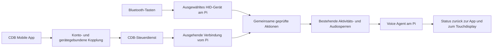

> Umsetzung zu Mobile #63: [aktueller Stand, Bedienung und Tests](IMPLEMENTATION-63.md).
> Der [Vertrag v1](contract-v1.md) ersetzt ältere Transport-/Lease-Annahmen.
> Noch nicht produktiv ausgeliefert; zunächst nur Software-Fernbedienung.

# Fernbedienung für den Voice Agent – gemeinsamer Entwurf

Stand: 16.10.2026. Auf Nutzerauftrag parallel geprüfte Erweiterung.
**Konzept, noch keine implementierte Fernsteuerung oder Hardware-Freigabe.**
Die bestehende Aufnahme, das Live-Gespräch und die Wake-Word-Tests bleiben erhalten.

**Nutzerentscheidung: zuerst nur die CDB-Mobile-App umsetzen.** Die physische
Bluetooth-Fernbedienung bleibt als spätere Möglichkeit dokumentiert.
Freigegebener Umsetzungsauftrag: [Mobile #63](https://github.com/BIK-GmbH/cdb-knowledge-mobile/issues/63).

## Ein Bedienmodell, zwei Zugänge

Die Fernbedienung übermittelt Steuersignale. ReSpeaker und Lautsprecher des Pi
bleiben die Audiogeräte. Es wird dabei kein zweites Gespräch auf dem Handy
geöffnet. Der Pi bleibt die verbindliche Quelle für Aufnahme- und Gesprächsstatus.

Erster Funktionsumfang:

- Gespräch starten mit der vorher bestätigten Knowledge-Area-Auswahl.
- Laufendes Gespräch beenden; ein Verbindungsaufbau muss ebenfalls abbrechbar sein.
- Mikrofon explizit stummschalten bzw. freigeben.
- Bereitschaft, Verbindungsaufbau, Gespräch, Stummschaltung und Sperrgrund anzeigen.

Keine Aufnahme durch einen Gesprächs-Stopp beenden. Kein Start bei Aufnahme,
Pause, Wartung oder anderen exklusiven Audiotests. Keine neue Sitzung durch
Doppeldruck, wiederholte Nachrichten oder verspätete Zustellung. Fernsteuerung
muss die existierende zentrale Reservierung nutzen, nicht bloß sichtbare Buttons
prüfen. Start und Ende sind verschiedene Befehle; kein transportseitiger Toggle.

## Kopplung und Bedienung

Im Pi-Menü **Fernbedienungen** zwei klar getrennte Einträge:

1. **Handy koppeln:** kurzlebiger QR-Code/Zahlencode, Bestätigung am Pi,
   verständlicher Gerätename, eigenes widerrufbares Steuerrecht.
2. **Bluetooth-Fernbedienung:** gezielter Such-/Kopplungsmodus, konkretes Gerät
   auswählen, Tastenfunktionen anzeigen und in einem ungefährlichen Test prüfen.

Gekoppelte Steuergeräte anzeigen und einzeln entfernen. Ein bestehender
Bildschirm-Empfänger darf nicht automatisch Steuerrechte erhalten. Ebenso darf
nicht jede gekoppelte Tastatur oder die Wiedergabetaste einer Bluetooth-Box
ungefragt den Voice Agent starten.

Auf dem Handy: große Start-/Ende-Taste, Mikrofonstatus und klare Rückmeldung
„Aufnahme läuft – Gespräch derzeit nicht möglich“. Keine Erfolgsmeldung allein
auf Basis eines versendeten Befehls; die Bestätigung muss vom Pi kommen.

## Umsetzung in getrennten, prüfbaren Schritten

1. Gemeinsamer Befehlsadapter am Pi: atomare Reservierung, Idempotenz,
   Ablaufzeit und Sitzungsgeneration. Tests für Aufnahme/Pause, Doppeldruck,
   Abbruch beim Verbinden, Konto-/Sitzungswechsel und veraltete Befehle.
2. CDB-authentifizierte Mobile-Kopplung und Steuerkanal ergänzen. Die bestehende
   Geräteverwaltung ist dafür allein noch kein persönliches Berechtigungssystem.
3. Mobile-Steuerung und Pi-Touch gleichzeitig prüfen: konkurrierender Start,
   Verbindungsabbruch, Widerruf, Mehrfachzustellung, Wiederverbindung und Schutz
   laufender Aufnahmen.
4. Später optional eine ausgewählte BLE-HID-Fernbedienung anbinden; eigene
   Hardware-, Berechtigungs- und Koexistenzprüfung.

Das Starten des CDB-Live-Gesprächs benötigt weiterhin dessen Online-Verbindung.
Eine lokale Bluetooth-Taste ändert das nicht. Eine vollständig offline nutzbare
Handy-Fernsteuerung wäre ein eigener Transport mit eigener Abnahme.

## Detailprüfungen und Image-Auswirkung

- [Bluetooth, Hardware und Linux-Eingaben](bluetooth-voice-remote-proposal.md)
- [Mobile-App, Kopplung und CDB-Steuerkanal](mobile-voice-remote-proposal.md)

Dieser Commit enthält ausschließlich Entwürfe; kein neues Paket, kein
Produktionsdienst, keine Cloud-Änderung und keine Image-Änderung. Spätere
HID-Berechtigungen, Runtime-Abhängigkeiten, Mobile-Builds, Server-Migrationen und
Kopplungsdaten müssen getrennt geplant und für bestehende Geräte sowie frische
Kunden-Images geprüft werden. Persönliche Kopplungen gehören niemals ins Image.
