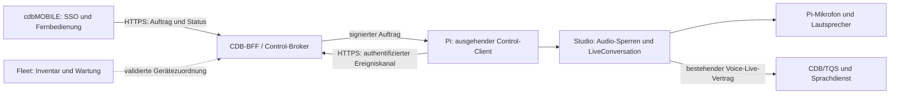

# cdbMOBILE als Fernbedienung für das Pi-Sprachgerät

Stand: 16.10.2026. **Entwurf aus lokaler Codeprüfung; keine implementierte oder live abgenommene Fernsteuerung.**

**Aktuelle Priorität des Nutzers:** „Erst nur die CDB-Mobile-App umsetzen“. Dieser Entwurf ist die Architekturgrundlage dafür. Eine physische Bluetooth-Fernbedienung ist zurückgestellt; hier wurde weiterhin ausschließlich diese Dokumentation bearbeitet.

## Entscheidungsvorschlag

Die mobile App kann als Software-Fernbedienung dienen: Gerät auswählen, Wissensbereiche bestätigen, Gespräch am Pi starten/beenden und dessen Gesprächsmikrofon stummschalten. Mikrofon, Lautsprecher, Wake-Erkennung und Audiozustand bleiben beim Pi. Das Handy baut dafür keine zweite WebRTC-/Cloud-Sprachsitzung auf.

Empfohlen ist ein **persönlich autorisierter CDB-Steuerkanal mit ausgehender Pi-Verbindung**. Derselbe Kanal funktioniert im WLAN und unterwegs. Vorhandene Geräteidentitäten, Kopplungsabläufe, Quittungen und Zustandsregeln werden weiterverwendet; ihre Berechtigungen werden ausdrücklich getrennt. Ein öffentlicher Zugriff auf den Studio-Port oder die Erweiterung des unverschlüsselten LAN-Empfängers um Steuerbefehle ist keine geeignete Umsetzung.

Erste Produktstufe: **Pi und Handy sind in derselben CDB-Umgebung mit derselben Person und demselben CDB-Mandanten angemeldet.** Gleiches WLAN oder gleicher Mandant allein berechtigen nicht. Gemeinsam genutzte Raumgeräte mit unterschiedlichen Personen benötigen später eine eigene Delegationsentscheidung, einschließlich der Frage, wessen Wissen und Kontingent verwendet werden.

## Untersuchter Bestand und Beleggrenzen

Lokale Quellstände:

- Pi: `/Users/chris/Dropbox/git_reps_v3/cdb_brainrecorder_v2_desktop`, HEAD `9d9caced3eaebd68cdfe1480b259124a5a9f08e6` bei Prüfung. Parallel vorhandene Wake-Forschungsänderungen wurden nicht bearbeitet.
- Mobile: `/Users/chris/Dropbox/git_reps_v5/cdb-knowledge-mobile`, HEAD `c56858c8c1069bd94a206490650c8082a7280d0d`.
- Systemübersicht und bestehender Serverbestand: [Architektur](../architecture/README.md), [Geräteverwaltung](../device-management-0.5.43/README.md), [Mira-Codeprüfung](../mira-receiver-review.md).

Keine Tokens, privaten Kontodateien oder Gesprächsinhalte wurden gelesen. Keine SSH-Verbindung, Audioaufnahme, Cloud-Sprachsitzung, Serveränderung oder Auslieferung wurde ausgeführt. Die ursprüngliche lokale App-Prüfung stützte Backenddetails auf das mobile `docs/LIVE-CONTRACT.md`. Eine nachfolgende, separate Server-Quellprüfung durch den Agenten `remote_control_server_contract` hat inzwischen die unten genannten `origin/staging`-Stände abgeholt und geprüft; sie ersetzt überholte Authentifizierungsannahmen des mobilen Vertrags. Weder diese Quellprüfung noch ein Fetch beweisen einen Deploymentstand oder erfolgreiche Live-Abnahme. Der Name `coolify-test` belegt laut vorhandener Bestandsdokumentation keinen installierten Coolify-Controller; beschrieben ist Docker Compose hinter Nginx. Dies wurde heute nicht erneut am Server verifiziert.

### Nachtrag: neuere Server-Quellprüfung

Der separate Server-Audit meldet folgende abgeholte Quellstände:

- TQS `origin/staging`: `104d2c9987746990a981e65a2b18ddd158076839`.
- WebOS/BFF `origin/staging`: `f74d68011c971a0374e29cfe32173ebf3a97d26c`.

**Sicherheitsrelevante Korrektur:** Die aktuelle Live-Authentifizierung erlaubt neben persönlichem JWT auch Portal-API-Key-Zugang mit verpflichtendem signiertem `X-CDB-Portal-Visitor`. `require_live_auth` darf deshalb **nicht unverändert** als Autorisierung für Fernsteuerung übernommen werden. Der neue Control-Vertrag muss ausdrücklich ein gültiges persönliches JWT mit bestätigter aktiver CDB-Person, passendem Mandanten/Scope und Geräte-Grant verlangen; Portal-Keys, allgemeine API-Keys und Visitor-Kontexte werden abgewiesen. Das ist eine Anforderung an die neue Fernsteuerung, keine Behauptung einer Lücke im für andere Zwecke vorgesehenen Live-Zugang. Beleg: [`voice_live.py:89` / `require_live_auth` ab Zeile 114](https://github.com/BIK-GmbH/cdb_tqs/blob/104d2c9987746990a981e65a2b18ddd158076839/app/api/routes/voice_live.py#L89).

`device_tools` stellt derzeit sitzungsgebundene Timer-/Erinnerungsaufträge bereit. Es liefert weder dauerhafte Pi-Kopplung noch Gerätebesitz-/Controller-Rechte oder den Start eines Gesprächs aus dem Ruhezustand. Dessen Quittungs-/Idempotenzmuster sind Referenzen, kein fertiger Idle-Steuerkanal. Die Routen prüfen bestehende Sitzung, Eigentümer und Sitzungsschlüssel; der Service bindet Eigentum an Person **und** Mandant. Portal-Keys sind für Conversation-Binding und Device-Tools ausdrücklich gesperrt. Belege: [`voice_live.py:284`](https://github.com/BIK-GmbH/cdb_tqs/blob/104d2c9987746990a981e65a2b18ddd158076839/app/api/routes/voice_live.py#L284), [`service.py:154`](https://github.com/BIK-GmbH/cdb_tqs/blob/104d2c9987746990a981e65a2b18ddd158076839/app/services/voice_live/service.py#L154), [`service.py:321`](https://github.com/BIK-GmbH/cdb_tqs/blob/104d2c9987746990a981e65a2b18ddd158076839/app/services/voice_live/service.py#L321), [Device-Tools-Vertrag](https://github.com/BIK-GmbH/cdb_tqs/blob/104d2c9987746990a981e65a2b18ddd158076839/docs/live-device-tools.md).

Der vorhandene Live-SSE-Strom enthält auch Transkripte und prüft keinen neuen laufenden Remote-Grant. Er darf nicht unverändert als minimaler Fernbedienungsstatus weitergereicht werden: eine eigene Statusprojektion mit laufender Grant-/Epoch-Prüfung ist nötig. BFF erlaubt Voice-Routen einzeln und weist unbekannte Pfade ab; neue Routen brauchen eine explizite Ergänzung. Belege: [`service.py:456`](https://github.com/BIK-GmbH/cdb_tqs/blob/104d2c9987746990a981e65a2b18ddd158076839/app/services/voice_live/service.py#L456), [`tqs_proxy.py:1056`](https://github.com/BIK-GmbH/cdb_webos/blob/f74d68011c971a0374e29cfe32173ebf3a97d26c/backend/app/api/routes/tqs_proxy.py#L1056).

Aktuelle Arbeitsregeln aus diesem Server-Audit: TQS verlangt jetzt `cdb-operator`-Onboarding. WebOS führt Changelog-Änderungen im aktuellen JSON-/Migrationsverfahren; ältere Hinweise auf bloßes SemVer bzw. `src/data/changelog.ts` aus der Arbeitsbereichsdokumentation dürfen nicht übernommen werden. Die neuen WebOS-Einträge liegen unter `migrations/postgres/changelog/<issue>-name.json` mit DE/EN-Titel/-Text ohne Version/Datum; die Buildversion folgt Datum/SHA. Vor Umsetzung die Anweisungen des konkreten aktuellen Worktrees lesen. Belege: [TQS `AGENTS.md:3`](https://github.com/BIK-GmbH/cdb_tqs/blob/104d2c9987746990a981e65a2b18ddd158076839/AGENTS.md#L3), [WebOS `CLAUDE.md:625`](https://github.com/BIK-GmbH/cdb_webos/blob/f74d68011c971a0374e29cfe32173ebf3a97d26c/CLAUDE.md#L625).

Diese Befunde sind **Quellcode-Evidenz**, kein Nachweis, dass diese Commits bereits auf Staging oder Production laufen. Der Meilenstein M1 bleibt geplant und noch nicht umgesetzt.

| Vorhanden | Konkrete Fundstelle | Eignung und Grenze |
| --- | --- | --- |
| Persönlicher mobiler Firmenlogin | Mobile `src/services/ssoProtocol.ts:4`, `:41`; `src/services/connection.ts:10` | Authorization Code mit PKCE, Identität über `/api/v1/auth/me`, SecureStore, eigener Anmeldebezug `sessionId`. Wiederverwenden; kein API-Key-Ersatz für persönliche Steuerung. |
| Pi-Firmenlogin | Pi `services/cdb_integration.py:138`, `:141`, `:153` | Device-Code-Anmeldung und geprüfte Identität; Bindung aus Server, `user_id`, `client_id`, zusätzlicher lokaler `generation`. Tokens bleiben beim jeweiligen Gerät. |
| Native mobile Live-Sitzung | Mobile `src/services/liveStore.ts:123`, `:141`; `src/services/liveApi.ts:33` | Startet eine eigene Live-Verbindung; Hintergrund/App-Sperre schließen diese. **Nicht** direkt als Pi-Fernbedienung instanziieren. |
| Wissensauswahl | Mobile `src/domain/live/scope.ts:12`, `:44`, `:93` | 1–8 eindeutige IDs, frische persönliche Rechte, keine stille Erweiterung auf alle Bereiche; Kontobindung und Auswahloberfläche wiederverwenden. |
| Pi-Audiobesitz | Pi `web_server.py:124`, `:234`, `:423`; `services/app_activity.py:9` | Gemeinsame `control_lock` → `controller.lock` → `recorder.lock`; `AppActivity` schützt Aufnahme **einschließlich Pause**, Gespräch, Tests, Wartung usw. Einzige Autorität für Starts. |
| Pi-Live-Lebenszyklus | Pi `services/live_conversation.py:210`, `:266`, `:393`, `:401`, `:430` | Reservierung, private Lease, Generation, native Audioöffnung, Mute, End und Freigabe. Fehler bei Audiofreigabe behalten die Reservierung. Wiederverwenden. |
| LAN-Display | Pi `services/remote_display.py:23`, `:92`, `:121`, `:206`; `studio/receiver/` | Browser erhält Code, Bestätigung am Pi, eigener Cookie, Heartbeat, Kontowechsel/Widerruf. Nur lesend, HTTP auf 8090, ein ausgewählter Empfänger. Kein mobiler Steuerkanal. |
| Fleet-Verwaltung | Pi `fleet/server.py:1`, `:21`, `:44`, `:57`; `services/device_management.py:1` | Einmalcode, getrennte widerrufbare Geräteberechtigung, feste Aufträge, Quittungen. Eine Organisation/Adminschlüssel, keine persönlichen Rollen. 30-s-Abfrage ist außerdem zu langsam für Gesprächssteuerung. |
| Mira-Relay-Prototyp | `docs/mira-receiver-review.md`, Abschnitt „Nachtrag“ | Ausgehender Sender, getrennte Sender-/Empfänger-Tokens, WebSockets, Snapshot/Delta. Nur dokumentierte Grundlage; noch offene Authentifizierungs-, Medien-, Origin-, Ablauf- und Mengenbegrenzungen. |

Im untersuchten mobilen `src/` wurde kein bestehender Pi-Pairing-/Receiver-/Remote-Control-Dienst gefunden. „Share receiver“ bezeichnet dort Dateiimporte und ist fachlich unabhängig. Die Live-Freigabe bleibt durch `src/config/liveFeature.ts` und Server-Capabilities begrenzt; dieser Entwurf behauptet keine produktive Freischaltung.

## Verbindungswege im Vergleich

| Weg | Vorteile | Voraussetzung / Nachteil | Entscheidung |
| --- | --- | --- | --- |
| Handy → Pi im LAN | Kurzer Weg; lokaler Status kann ohne Internet funktionieren | Vertrauenswürdiges TLS mit Geräteidentität, Erkennung/Adresswechsel, iOS-/Android-Netzwerkfreigaben und identische Rechteprüfung fehlen. Heutiges HTTP-Display genügt nicht. Cloud-Gespräch benötigt weiterhin Internet. | Spätere Optimierung, kein erster Steuerweg. |
| Handy → Pi per BLE GATT | Nähe genügt; nach sicherer Kopplung lokaler Status/Ende/Mute auch bei ausgefallenem WLAN möglich | Neuer nativer BLE-Client auf iOS/Android, Pi-GATT-Server, Account-Grant, Wiederverbindungs- und Plattformabnahme fehlen. Kein Ersatz für Cloud-Verfügbarkeit. | Technisch möglich, nachgelagerter Transport. |
| Handy → CDB-BFF/Control-Broker ← Pi | Bestehender SSO-Kontext; funktioniert ohne eingehende Pi-Ports und auch unterwegs; zentrale Rechte/Widerruf | Neuer begrenzter Geräte-Steuervertrag, ausgehender dauerhafter Kanal, Live-Status und Staging-Abnahme nötig | **Empfohlener erster Weg.** |
| Handy → Fleet-Portal | Geräteidentitäten und Betriebsinfrastruktur vorhanden | Organisationsweiter Adminschlüssel würde unverhältnismäßige Wartungsrechte eröffnen; keine persönliche Kontobindung; 30-s-Polling | Gerätebestand und bewährte Muster nutzen, Adminschnittstelle nicht an Handy geben. |
| Handy/Pi → Mira-Relay auf Infrastrukturhost | Sender-/Empfängertransport bereits prototypisch vorhanden | CDB-Autorisierung und Hardening fehlen; Betrieb muss separat qualifiziert werden | Optionaler Transport unter dem CDB-Rechtemodell, kein eigenständiges zweites Berechtigungssystem. |

Ein späterer LAN-Kanal muss **dieselben signierten Aufträge, Geräte-/Kontobindungen und Idempotenzregeln** transportieren. Eine frei eingegebene IP darf keinen schwächeren Authentifizierungspfad eröffnen. Kein automatisches Downgrade auf HTTP.

### Handy über Bluetooth: möglich, aber ein eigener nativer Weg

Für cdbMOBILE wäre das Handy der BLE-Central/GATT-Client und der Pi der GATT-Server. Ein eigener Service könnte `command` (Write), `receipt` (Notify/Indicate) und `status` (Read/Notify) anbieten. Aufträge werden begrenzt, versioniert und bei Bedarf fragmentiert; maximale Größe und Wiederzusammensetzen müssen Teil des Vertrags sein. BlueZ stellt dafür eine lokale GATT-Server-API bereit. Die bestehende Bluetooth-Audioverwaltung am Pi ist noch kein solcher Server. [BlueZ GATT API](https://bluez.readthedocs.io/en/latest/gatt-api/)

Die geprüfte mobile `package.json` enthält keine allgemeine BLE-Bibliothek; `modules/cdb-live-audio` steuert nur Audio-Routing zu Headsets. Für GATT braucht es einen nativen Expo-Adapter oder eine kompatible, geprüfte React-Native-BLE-Bibliothek. Das verändert den nativen Fingerabdruck und verlangt neue iOS-/Android-Builds, nicht nur ein JS-OTA. Unter iOS ist eine Bluetooth-Nutzungserklärung erforderlich; Hintergrundverhalten ist eingeschränkt und muss gesondert entwickelt/getestet werden. Android ab API 31 benötigt für Scan/Verbindung die entsprechenden Laufzeitrechte. [Apple Core Bluetooth](https://developer.apple.com/documentation/corebluetooth), [Apple Hintergrundverarbeitung](https://developer.apple.com/library/archive/documentation/NetworkingInternetWeb/Conceptual/CoreBluetooth_concepts/CoreBluetoothBackgroundProcessingForIOSApps/PerformingTasksWhileYourAppIsInTheBackground.html), [Android Bluetooth-Rechte](https://developer.android.com/develop/connectivity/bluetooth/bt-permissions)

Bluetooth-Bonding beweist Gerätebesitz, aber weder CDB-Konto noch Knowledge-Area-Rechte. Der Pi muss bei erstmaliger Kopplung das Handy bestätigen und dessen Installationsschlüssel an den verifizierten CDB-Grant binden. Für einen **wirklich offline** funktionierenden Kontrollweg wären kurzlebige delegierte, auf Aktionen/Gerät beschränkte Grants und lokal authentifizierte Challenge-/Sequenznachrichten nötig: Ein Broker, der jeden Auftrag live signiert, ist ohne Internet nicht erreichbar. Widerruf ist offline nur spätestens zum Grant-Ablauf erzwingbar. Deshalb keine stillschweigende „offline immer gültig“-Kopplung. Lokales Ende/Mute/Status kann damit funktionieren; ein neues CDB-Gespräch und frische Bereichsrechte benötigen weiterhin die CDB-Verbindung. Kein Audio über BLE und keine Umwandlung des Handys in eine Bluetooth-Tastatur.

**Empfehlung bleibt HTTPS zuerst:** vorhandene SSO-/Streaming-/UI-Bausteine nutzen, keine neuen BLE-Berechtigungen oder nativen BLE-Builds für die erste Fassung. BLE lohnt sich, wenn Chris die Bedienung ohne WLAN oder ohne Relay ausdrücklich priorisiert. Web Bluetooth ist hier keine zugesagte gemeinsame iOS-/Android-Lösung; untersucht und geplant ist die native Expo-App.

## Zielarchitektur



Ein lang laufender HTTPS/SSE-Kanal vom Pi zum Broker mit POST-Quittungen genügt für die erste Stufe und passt zu den vorhandenen Python-/CDB-HTTP-Bausteinen. WebSockets sind optional, wenn der gehärtete Mira-Transport später eingebunden wird. Der Kanal muss abbrechbar sein und darf weder Audio-Locks noch Login-/Upload-Locks während blockierender Netzwerkoperationen halten. Das bestehende Fleet-Polling wird nicht für jeden Tastendruck beschleunigt.

CDB/BFF bleibt die Autorität für die Person und ihre Rechte; der Pi bleibt die Autorität für tatsächlich ausgeführte Aktionen und den Audiozustand. Ein separat betriebener Relay auf dem Infrastrukturhost reicht nur vorab autorisierte Aufträge und Status weiter. Microsoft-Tokens werden niemals an einen allgemeinen Relay oder ein fremdes Pi-LAN-Ziel gesendet. Ein solcher Relay akzeptiert ausschließlich kurzlebige, audience-gebundene CDB-Berechtigungen und eigene Gerätecredentials.

### Ein gemeinsamer Command-Service und eine Einstellungsseite

Pi-Einstieg: **Einstellungen → Fernbedienungen → Handy koppeln**. Hier stehen Gerät, gekoppelte Handys, Rechte, Verbindung und Widerruf. „Bluetooth-Fernbedienung“ bleibt nach der neuen Nutzerpriorität ein späterer eigener Eintrag; in der ersten Fassung keine funktionslose Schaltfläche anbieten. Das bestehende Bildschirm-Pairing bleibt separat und ausschließlich lesend.

Alle Eingangswege führen in **einen** typisierten Command-Service: `execute(context, command)` und `snapshot(context)`. `context` enthält geprüfte Quelle/Identität, Geräte-/Konto-/Grant-Epoche und Rechte. Netzwerkadapter prüfen Authentifizierung und Signatur; der gemeinsame Service prüft zusätzlich die aktuellen lokalen Rechte und Zustände unter den Audio-Locks. Spätere ausgewählte HID-Tasten oder BLE-GATT-Nachrichten erzeugen denselben begrenzten Befehl, mit ihrem jeweils korrekt geprüften Quellenkontext. HID darf keine CDB-Person vortäuschen. Start/End/Mute/Auswahl, Quittungen und Session-Generationen werden nicht je Transport erneut implementiert.

### Geräteidentität und Kopplung

1. **Gerätebestand wiederverwenden:** Ein bereits verwalteter Pi wird über seine bestätigte Fleet-Geräte-ID referenziert. Eine vom Handy oder Pi frei behauptete ID genügt nicht. Ein serverseitiger Austausch muss Besitz dieser Enrollment-Identität prüfen und ein ausschließlich für den Control-Broker gültiges Gerätecredential ausgeben. Fleet-Adminschlüssel und Release-Signierschlüssel bleiben unbeteiligt. Für nicht verwaltete Geräte braucht es später einen expliziten Enrollment-Pfad; die erste Stufe darf Fleet-Enrollment voraussetzen.
2. Am Pi wird „Handy koppeln“ ausdrücklich geöffnet. Der Control-Broker registriert einen kurzlebigen Versuch, gebunden an Geräte-ID, aktuelle Gerätegeneration, bestätigtes Brain-Konto und Umgebung. **Vorschlag:** zwei Minuten Ablauf, nur ein offener Versuch je Gerät, begrenzte Versuche pro Konto/Gerät/Netzquelle.
3. Der Pi zeigt QR und alternativ einen lesbaren Einmalcode. Der QR enthält nur Protokollversion, erlaubte CDB-Umgebung und einen zufälligen mindestens 128-Bit-Pairing-Verweis; keine Microsoft-Tokens, dauerhaften Gerätecredentials oder Gesprächsinhalte. Kurze manuelle Codes sind nur mit Online-Limit und SSO verwendbar; nach erfolgreichem Claim sofort verbrauchen.
4. Die bereits angemeldete App beansprucht den Versuch. Der Broker prüft **Server/Umgebung + CDB-Mandant + CDB-Benutzer-ID** beider Seiten. Keine Zuordnung über Anzeigename/E-Mail; CDB-`client_id` nicht mit der OAuth-App-ID verwechseln. In Stufe 1 wird ein abweichendes Konto abgewiesen.
5. Pi und Handy zeigen Gerät und bestätigte Identität. Die Person bestätigt die konkrete Handy-Kopplung am Pi. Erst danach entsteht eine widerrufbare Zuordnung für diese App-Installation. Ein QR-Scan allein erlaubt noch keinen entfernten Mikrofonstart.
6. Separater Geräteschlüssel/Control-Credential beim Pi, eigenes App-Installationscredential im geschützten mobilen Speicher; öffentliche Kennungen dürfen in normaler App-Metadatenablage liegen. Eine bestehende Fleet-Identität erhält dadurch keine Gesprächsleserechte. Ein Display-Cookie erhält keine Steuerrechte.
7. Am Pi sind alle Handy-Kopplungen sichtbar und einzeln widerrufbar. Konto-/Mandanten-/Umgebungswechsel invalidiert Autorisierung und Streams. Neustart erzeugt eine neue Runtime-Generation; bestehende persönliche Kopplung darf erhalten bleiben, alte Aufträge dürfen nicht weiterlaufen. Kontowechsel beendet bestehende Pi-Live-Sitzungen bereits über `CdbService.generation`; daran anknüpfen.

Rechte zunächst getrennt: `device.status.read`, `voice.start`, `voice.end`, `voice.mute`, `voice.areas.select`. `display.history.read` ist eine zusätzliche, ausdrücklich bestätigte Freigabe. Fernbedienung allein überträgt keine Transkripte. Gerätewartung/Update/Neustart bleibt Fleet vorbehalten.

### Authentifizierte und signierte Befehle

Die App sendet einen eng validierten Befehl mit ihrem persönlichen Access-Token an die bekannte CDB-Umgebung. Der Broker prüft Konto, aktive Kopplung, Gerät, Rechte und aktuelle Kanalbereitschaft. Danach signiert die **CDB-Autorisierungsstelle** den vollständigen, kurzlebigen Auftrag. Der Pi prüft Signatur und Bindung zusätzlich zum TLS-Gerätekanal. So darf ein optionaler Transport-Relay keine neuen Befehle erfinden oder Parameter ändern.

Vorgeschlagener Envelope (neuer Vertrag, noch keine existierende API):

```json
{
  "version": 1,
  "command_id": "uuid",
  "device_id": "uuid",
  "device_epoch": "opaque-per-app-start",
  "pairing_id": "uuid",
  "grant_epoch": 3,
  "account": {"server": "https://staging.cdbos.de", "client_id": "uuid", "user_id": "uuid"},
  "action": "voice.mute",
  "session_instance_id": "opaque",
  "expected_revision": 17,
  "parameters": {"muted": true},
  "issued_at": "UTC timestamp",
  "expires_at": "UTC timestamp",
  "key_id": "control-signing-key-identifier"
}
```

Die Signatur umfasst alle Felder; Algorithmen/Schlüssel-IDs werden strikt zugelassen. Standardisierte Signaturbibliothek und feste kanonische Serialisierung mit Cross-Language-Testvektoren verwenden. `fleet/releases.py:31` zeigt bereits Ed25519-Verifikation mit `cryptography`; **keine Wiederverwendung des privaten Release-Schlüssels oder seines Vertrauenszwecks**. Neue Signierschlüssel sind ausschließlich für Control vorgesehen; Rotation und Widerruf müssen versioniert sein. Eine Schlüssel-/Bibliothekswahl ist vor Implementierung mit der tatsächlich installierten Runtime abzugleichen.

Vorschlag: Start und Unmute nur innerhalb von fünf Sekunden zustellbar, andere Änderungen höchstens zehn Sekunden. Kein Offline-Queueing von Start/Unmute. Fehlende vertrauenswürdige Gerätezeit sperrt diese Befehle; reine Heartbeat-Timer verwenden monotone Zeit. Device-Epoch, Grant-Epoch und Session-ID schützen zusätzlich vor verspäteter Zustellung, Widerruf und Neustart. Nicht aus einem Zeitstempel allein auf Sicherheit schließen.

Neue Broker-Routen können beispielsweise unter `/api/v1/tqs/device-control/` liegen: Capabilities, persönliche Geräteliste, Pairing-Claim/-Bestätigung/-Widerruf, Geräte-Snapshot/-Ereignisse, Commands und Command-Status. Gerätekanal/Quittung haben getrennte Geräteauthentifizierung. Diese Pfade sind **Vorschläge**, nicht vorhandene Endpunkte. BFF und mobiler Client benötigen eng gefasste Routen- und Payload-Allowlisten; Wildcard-Proxying ist unzulässig. Keine Credentials in URL, QR, Access-Log oder Fehlertext.

## Audiozustände und Ausführung

| Befehl | Voraussetzung am Pi | Ergebnis / Sperrverhalten |
| --- | --- | --- |
| `voice.start` mit 1–8 Bereichs-IDs | Passendes Konto/Grant/Epoch, frische Rechte, kein Gespräch, vollständiges Audio-Setup, `AppActivity.live` erlaubt; auch Wiedergabe und ausklingende Ausgabe prüfen | Unter denselben Locks wie Wake/Record reservieren, dann native Verbindung starten. Kein Stop/Pause einer Aufnahme als Vorbedingung. Busy wird endgültig quittiert, nicht später ausgeführt. |
| `voice.end` | Konkrete aktuelle `session_instance_id`, Steuerrecht | Native Ausgabe/Eingabe sofort schließen, Cloud-Ende asynchron; erst nach echter Freigabe als beendet melden. Nie Aufnahme/Timer oder eine neue Sitzung treffen. Wiederholung derselben Sitzung ist harmlos. |
| `voice.mute {muted: true/false}` | Konkrete aktuelle Sitzung und passender Zustand | Expliziten Sollwert setzen; kein Toggle. `LiveConversation.mute` → `NativeLiveAudio.mute` und vorhandenes Audio-Gate verwenden. Physische Mikrofon-Stummschaltung kann nicht entfernt werden. |
| `voice.areas.select` | Gerät frei, passendes Konto und erwartete Auswahlrevision | Auswahl vor dem Gespräch speichern und bestätigen. Während Aufbau/Live/Schließen ablehnen; nächste Sitzung nur mit bewusster Auswahl. Keine stille Änderung am Handy-Uploadziel oder Handy-Chat-Scope. |
| Status lesen | Aktive Kopplung + Read-Recht | Reduzierte technische Daten, keine Lease, SDP, Tokens, Audio oder Gesprächstexte. |

**Zwingende Regeln:**

- Aufnahme und **pausierte Aufnahme** besitzen die Audioressource weiter. Remote Start/Mute/End dürfen deren Zustand, Datei, Dauer oder Mikrofonkonfiguration nicht ändern. Die Aufnahmesteuerung wird nicht Teil der ersten Fernbedienung.
- Gleichzeitige Starts durch Wake, Pi-Touch und Handy gehen durch eine gemeinsame atomare Reservierung. Nur einer gewinnt. Keine zweite `LiveConversation`, kein zweiter Audio-Thread als Fernsteuerung.
- `StudioApp.action` hat Nebenwirkungen (z. B. Wake-Suspend und Alarmbehandlung). Eine neue Fernsteuerung darf daher nicht beliebige lokale Pfade weiterreichen. Gemeinsame explizite Domain-Methoden unter der etablierten Lockreihenfolge herausziehen, die auch lokale UI und Wake benutzen.
- `wake_reason()` berücksichtigt Wiedergabe-Leases und `output_busy_until` zusätzlich zu `AppActivity`. Diese Prüfung für Remote Start wiederverwenden, ohne dafür `wake.enabled` vorauszusetzen. Remote Start bleibt auch bei ausgeschaltetem Aktivierungswort möglich.
- Netzwerk/SSO-Prüfung außerhalb der globalen Audio-Locks vorbereiten. Vor Reservierung Konto-/Grant-/Gerätegeneration nochmals atomar prüfen; beim nativen Start gelten die vorhandenen frischen CDB-/Bereichsprüfungen weiter.
- Private `LiveConversation.lease` verlässt den Pi nicht. Adapter ordnet eine öffentliche Session-Instanz intern dieser Lease/Generation zu. `end(lease=None)` ist kein öffentliches „beende irgendwas“-Privileg.
- Audiofreigabefehler behalten `closing` und die Reservierung (`_finish`). Handy zeigt „Wird beendet“; „Ende angefordert“ ist kein Beleg für freigegebenes Audio.
- Mute bewahrt die bestehende Epoch-/Pufferlöschung in `services/live_audio.py:74`; ältere Audioblöcke dürfen beim Unmute nicht zurückkehren.
- TQS begrenzt laut lokalem Vertrag zusätzlich auf eine Sitzung **pro Person**, also möglicherweise auch gegenüber bereits laufendem Handy-Live. Ein 409 ist sichtbar zu behandeln; kein implizites Schließen oder Übernehmen der anderen Sitzung.

### Controller-Lebensdauer, Wiederverbindung und Idempotenz

Die Fernbedienung braucht einen eigenen Store; `installLiveLifecycle()` der mobilen Audiofunktion darf nicht auf eine am Pi gestartete Sitzung angewendet werden. Gerät und aktiver Audioort bleiben sichtbar: „Gespräch am Pi …“.

**Verbindlicher erster Lebenszyklus: Das Handy ist eine Software-Fernbedienung wie eine Taste; der Pi besitzt die Sitzung.** Ein bestätigter Remote-Start verwendet `owner_kind='device'` und die vorhandenen Pi-Regeln: 120 Sekunden Inaktivitätsfrist mit bestehender lokaler Aktivitätsverlängerung sowie höchstens 1200 Sekunden, gegebenenfalls weiter durch die Server-Capability begrenzt. App-Hintergrund, Handy-Sperre, Verbindungsabbruch oder das Schließen der Fernbedienung beenden das Pi-Gespräch **nicht** automatisch. Handy-/Status-Heartbeats verlängern die Pi-Lebensdauer ebenfalls nicht. Der Geräte-Grant berechtigt zu einzelnen Commands und ist keine dauerhafte Audio-Owner-Lease. Lokales Beenden, sprachlicher Ende-Befehl und bestehende Pi-/CDB-Lebenszyklusregeln bleiben maßgeblich; es gibt für M1 keinen neuen Remote-Audio-Eigentümertyp und keine 30-Sekunden-Abschaltung.

Ein schon per Wake oder Pi-Touch gestartetes Gespräch darf eine berechtigte Fernbedienung ebenfalls anzeigen und bewusst mit seiner Session-ID muten/beenden. Für per Handy, Wake oder Pi-Touch gestartete Gespräche gilt derselbe Geräte-Lebenszyklus. Lokales Beenden und Hardware-Mute haben immer Vorrang. Ein zweites Handy darf Status lesen; konkurrierende Befehle werden mit Revisionsprüfung serialisiert. Stufe 1 kann genau einen aktiven schreibenden Controller zulassen, ohne die vorhandene Display-Kopplung zu verdrängen. Ein expliziter Sicherheitswiderruf sperrt weitere Commands; ein Konto-/Berechtigungswechsel am Pi folgt den bestehenden Endregeln. Reiner Transportverlust ist kein Widerruf. Ein künftig optionaler Modus mit Anwesenheitsbindung müsste ausdrücklich gewählt und separat spezifiziert werden; er gehört nicht zu M1.

Jeder Auftrag erhält eine stabile `command_id`. Server und Pi führen einen begrenzten persistenten Quittungsspeicher, gebunden an Gerät, Grant, Payload-Hash und Epoche. Wiederholte Zustellung liefert den vorhandenen Status; dieselbe ID mit anderem Inhalt wird abgewiesen. Empfang/Reservierung/Ausführung sind getrennte Zustände: `accepted`, `executing`, `succeeded`, `rejected`, `expired`, `interrupted`, gegebenenfalls `unknown`. Nur der Pi meldet `succeeded`; ein HTTP-202 am Broker bedeutet nur angenommen.

Nach unbekanntem Ergebnis fragt die App **dieselbe** ID ab, statt Start erneut mit neuer ID zu senden. Nach Pi-Prozessabbruch werden alte Starts/Unmutes als unterbrochen markiert, niemals automatisch wiederholt. Cloud-Startkorrelation muss die `client_request_id` von `LiveConversation._start` stabil an den ursprünglichen Auftrag binden; der bestehende zufällige UUID-Aufruf pro Start allein bietet keine dauerhafte Remote-Idempotenz. Laut lokalem TQS-Vertrag ist serverseitige Deduplizierung auf 60 Sekunden begrenzt; nach diesem Fenster keine automatische Startwiederholung. Unklarer Cloud-Start bleibt sichtbar, bis abgeglichen/abgelaufen; kein fälschliches „läuft“.

Wiederverbindung: Snapshot zuerst, dann Ereignisse ab Sequenznummer. Snapshot enthält `device_epoch`, `account_epoch`, `session_instance_id`, `revision`, bestätigte Bereichs-IDs, `activity`, `voice_state`, `muted`, verfügbare Aktionen und letzte Quittung. Technischer Heartbeat und tatsächlicher Gesprächszustand sind getrennt. Nach 15 Sekunden ohne Nachricht zeigt die App „Verbindung verloren“ und sperrt mutationsabhängige Bedienelemente. Alte Ereignisse mit falscher Epoche/Sitzung werden verworfen; bei Sequenzlücke vollständiger Snapshot. Ein „Ende“ bei Offline wird als nicht bestätigt angezeigt. Logs/Audit enthalten IDs, Aktion, Zeit, technischen Ausgang; keine Gesprächsinhalte oder vollständigen Auth-Claims.

## Konkrete Integrationsstellen

### Pi

- `web_server.py`: zentralen Remote-Command-Adapter im `StudioApp`-Lebenszyklus einbinden; gemeinsame Reservierung/Busy-Prüfung aus `action()`/`wake_start()` wiederverwenden. Studio bleibt ausschließlich `127.0.0.1:8088` (`StudioServer`, Zeile 785).
- Neuer eng begrenzter Dienst, z. B. `services/remote_control.py`: Signatur-/Grantprüfung, Geräte-/Session-Epochen, Command-Quittungen und Statusprojektion. Kein allgemeiner HTTP-/Shell-Dispatcher.
- Neuer ausgehender Client, z. B. `services/remote_control_transport.py`: abbrechbarer SSE-Kanal, Backoff, authentifizierte Quittungen, keine Audioarbeit. In der App statt als root-/Wartungsagent ausführen; die App ist der Audioeigentümer.
- `services/live_conversation.py`: vorhandenen Gerätebesitz (`owner_kind='device'`) und dessen Inaktivitäts-/Maximalfristen wiederverwenden; öffentliche Session-Instanz und Startkorrelation ergänzen. Kein neuer Remote-Audio-Owner. Vorhandene Reserve/Start/Mute/End/Generation-/Cleanup-Pfade weiterführen. `services/live_audio.py` bleibt gemeinsame Audioimplementierung.
- `services/remote_display.py`: Snapshot-/Kontobindungsmuster nutzen, aber bestehenden Display-Cookie nicht hochstufen. Ein späterer Relay-Sender kann Display-Snapshots mit eigenem Read-Grant senden; Control-Status bleibt davon unabhängig.
- Fleet: bestätigte Gerätezuordnung und optionaler Credential-Austausch am Server; bestehende Wartungs-Aktionsliste und lokale Wartungsberechtigung nicht um Voice-Befehle erweitern.

### Mobile

- `src/services/connection.ts` und `ssoProtocol.ts`: vorhandenen SSO-/SecureStore-/Kontowechselmechanismus nutzen. Remote-Responses zusätzlich nach **jeder** asynchronen Antwort gegen den aktuellen `sessionId` prüfen; reine Prüfung vor dem Request reicht für alte UI-Ergebnisse nicht.
- Neuer `src/services/deviceControlApi.ts` und `deviceControlStore.ts`, reine Zustandsregeln unter `src/domain/deviceControl/`. Bestehendes Auth-/401-Erneuerungsmuster wiederverwenden; eigene explizite Pfad-Allowlist oder präzise Erweiterung von `src/domain/chat/access.ts`.
- Geräteauswahl/Kopplung und Pi-Fernbedienung als eigene Oberfläche; Teile von `LiveAreaSheet.tsx`, Zustandsdarstellung, DE/EN-Texten und Design-Tokens wiederverwenden. **Nicht** `startLive()`, `createLiveMedia()` oder den mobilen `WebRtcLiveTransport` öffnen.
- `src/domain/live/scope.ts`: Auswahlvalidierung wiederverwenden, Remote-Auswahl pro Konto **und Geräte-ID** getrennt speichern. Tatsächlich bestätigte Pi-Auswahl anzeigen; aktuelle Live-Auswahl bleibt unveränderlich.
- App-Lock/Background pausiert Controller-Kommunikation, ohne das Pi-Gespräch zu beenden oder dessen Fristen zu verlängern. Kein Mikrofonprompt, Audiofokus oder Bluetooth-Routing für reine Fernbedienung. QR-Scanner optional: manueller Code bildet den ersten nativen-unabhängigen Weg; Scanner benötigt Prüfung vorhandener Module/Berechtigungen und ggf. neuen nativen Build.

### CDB/BFF / optionaler Relay

- Persönliche JWT-Authentifizierung ausdrücklich erzwingen und zusätzlich Geräte-Grant/Voice-Live-Rechte prüfen; `require_live_auth` wegen erlaubter Portal-Key-/Visitor-Kontexte nicht unverändert verwenden. Neue device-control-Routen ausdrücklich in BFF-Allowlist/Streaming-Konfiguration aufnehmen. Mobile `docs/LIVE-CONTRACT.md:98` beschreibt das bestehende Streaming-Muster, keine Device-Control-Freigabe.
- Persistente Kopplungen/Grants, Gerätebindung, Ablauf/Widerruf, Aufträge/Quittungen und Status mit Tenant-/Person-Filter. Capability `device_control_v1` getrennt von `voice-live.enabled`; alte Clients/Server fallen sichtbar auf „Nicht unterstützt“ zurück.
- Signieren nur nach vollständiger Autorisierung; Controller-Heartbeat darf widerrufene Grants nicht erneuern. Rechte bei Claim, Command und Stream prüfen; laufende Streams bei Widerruf schließen.
- Optionalen Mira-Transport erst nach versionierter Übernahme und Hardening nutzen. Keine historischen breiten CORS-Regeln, frei lesbaren Medien oder URL-Tokens übernehmen. Ein zusätzlicher Coolify-Dienst ist eine Betriebsentscheidung, kein fachlich notwendiger Teil der Kopplung.

### Server-Repos und Voraussetzungen für eine nutzbare Auslieferung

Die vorhandene Repo-Inventur verweist auf `/Users/chris/Dropbox/git_reps_v5/cdb_all/repos/cdb_tqs` (Basis `staging`, `BIK-GmbH/cdb_tqs`) und `/Users/chris/Dropbox/git_reps_v5/cdb_all/repos/cdb_webos` (Basis `staging`, `BIK-GmbH/cdb_webos`). Der gefundene TQS-Voice-Routeneinstieg heißt `app/api/routes/voice_live.py`; BFF-Vertragsregressionen liegen unter `backend/tests/test_1160_voice_live_proxy.py`. Die Dateinamen stammen aus der lokalen Inventur; die neuere Server-Quellprüfung und deren SHAs sind im Nachtrag oben gesondert ausgewiesen. Eine Live-Abnahme ist weiterhin offen. Vor Änderungen gelten die aktuellen `AGENTS.md`/`CLAUDE.md` des jeweiligen Worktrees, insbesondere TQS-`cdb-operator`-Onboarding und das aktuelle WebOS-JSON-/Migrationsverfahren für Changelogs; außerdem eigene Worktrees und die jeweiligen Review-/Auslieferungsregeln.

Für die erste echte Cloud-Fernsteuerung fehlen noch: persönliche Device-Control-API und Migration, bestätigter Fleet→Control-Gerätebezug, separater Gerätecredential-Austausch, Control-Signaturvertrauen, TLS-/Streaming-Konfiguration, serverseitige Feature-Freigabe, Client-Release und ein tatsächlicher Staging-End-to-End-Nachweis. Ein Pi-/App-Patch allein macht die vorgeschlagenen Serverrouten nicht verfügbar. Bestehende Microsoft-Registrierungen müssen nicht vorsorglich erweitert werden: zunächst vorhandenen delegierten CDB-Scope serverseitig für die eng begrenzten Routen prüfen. Kein zusätzlicher Graph-Vollzugriff und keine Weitergabe persönlicher Refresh-Tokens. Ein neuer Token-Audience-/Scope-Vertrag wäre ausdrücklich zu konfigurieren und abzunehmen, falls ein separater Dienst nicht hinter dem bestehenden BFF betrieben werden kann.

Für erste lokale Entwicklung sind diese Betriebsarbeiten kein Blocker: temporäre Testkeys, synthetischer Broker und Fake-Audio genügen. Für die nutzbare Auslieferung sind sie reale Voraussetzungen; entsprechende Serverarbeiten dürfen nicht als bereits erledigt dargestellt werden.

## Erster Implementierungsmeilenstein

**M1: geplant; vom Nutzer priorisiert ist ausschließlich die CDB-Mobile-App. Noch keine Implementierung oder Live-Freigabe durch dieses Dokument.**

**Ein vollständig synthetischer, lokal testbarer vertikaler Ablauf mit ausgeschalteter Audioausführung:** mobile Code-Kopplung → Konto-/Geräteprüfung → Statusstream → signierter Start/Mute/End-Auftrag → Pi-Adapter mit Fake-Audio/Fake-CDB → bestätigter Status. Das Ergebnis muss bereits alle Sicherheits- und Race-Regeln demonstrieren, bevor echte Mikrofone oder Cloud-Gespräche freigeschaltet werden.

1. Vertrag, Zustands-/Fehlercodes und Signatur-Testvektoren festlegen; protokollversionierte Capabilities, standardmäßig aus.
2. Broker-Harness und Pi-Adapter mit temporären Datenbanken, Fake-Clock und synthetischer Identität. Einmalcode/QR-Datenmodell, Rollen, Quittungen, Snapshot und Reconnect implementieren.
3. Mobile Fernbedienungsansicht mit manueller Codeeingabe und Fake-Broker; Start/End/Mute, Bereichsauswahl und technische Bestätigungen. DE/EN, kompakt/breit, Hell/Dunkel, VoiceOver/TalkBack-Zustände vorbereiten.
4. Gezielte Integrationsprüfung gegen echte `StudioApp`-/`LiveConversation`-Instanzen mit injizierten Fake-Audio-/CDB-Ports, nicht nur Tests eines nachgebauten Zustandsmodells.
5. Danach separater Staging-Meilenstein: aktuelle TQS-/BFF-Verträge prüfen, isolierte Testgeräte koppeln, reale iOS-/Android-Hintergrund-/Netzwechsel und erst dann ausdrücklich freigegebene synthetische Pi-Sprachtests. Ein lokaler Fake-Test ist keine Geräte- oder Live-Abnahme.

Pflichttests:

- Falsche Person, falscher Mandant, falsche Umgebung, allgemeiner oder Portal-API-Key statt persönlichem JWT, signierter Besucher, abgelaufener/revokter Grant, wiederverwendeter Code, Rate-Limit, abweichender Gerätebeweis; keine Steuerung und kein fremder Status.
- Veränderte Parameter/Signatur, unbekannter Schlüssel, falsches Ziel, falsche Epoch, abgelaufener Auftrag, unsichere Uhr; Ablehnung vor jeder Audiomutation.
- Aufnahme **und Pause**: alle Remote-Voice-Aktionen abweisen bzw. sitzungsgebunden wirkungslos; kein Stop/Resume/Mute, unveränderte Aufnahme-ID. Barrier-Test für gleichzeitigen Record-/Wake-/Remote-Start: genau ein Besitzer.
- Wiederholte Start-ID öffnet Audio/Cloud exakt einmal; neue ID während Connecting wird Busy; gleiche ID mit anderem Body abweisen. Quittung verloren, Netzabbruch und Prozessneustart an jeder Übergangsgrenze; keine automatische erneute Aufnahme.
- Veraltetes End/Mute von Sitzung A trifft Sitzung B nie. Kontowechsel während Claim/Start/Status; alte Frames und später bestätigter Cloud-Start werden korrekt verworfen/geschlossen.
- Mute/Unmute-Reordering und verspätete Capture-Blöcke; physischer Mute bleibt wirksam. Cleanup-Fehler hält Reservierung und verhindert neue Sitzung.
- Heartbeat-/Streamverlust, App-Sperre/Hintergrund, Relay-Neustart, LTE/WLAN-Wechsel: Pi-Gespräch läuft nach denselben lokalen Inaktivitäts-/Maximalfristen weiter; Handy-Heartbeats dürfen diese weder verlängern noch verkürzen. Offline sind neue Commands gesperrt und ausstehende Ergebnisse unbestätigt; Wiederverbindung lädt Snapshot, ohne Start/Unmute/End automatisch zu wiederholen. Konto-/Berechtigungswechsel am Pi und expliziten Widerruf getrennt vom Transportverlust prüfen.
- Bereich 0/9, Duplikate, widerrufene ID, während aktiver Sitzung geändert; keine stille Erweiterung oder Reduzierung. TQS `session_active` darf keine andere Handy-/Pi-Sitzung übernehmen.
- Display-Cookie kann keine Commands senden; Fleet-Gerätecredential kann keine persönliche Sitzung beanspruchen; App-Grant kann weder Reboot noch Update anfordern. Keine Credential-/Transkriptwerte in Status/Logs.
- Frischer leerer Gerätezustand, bestehendes Profil ohne Remote-Felder, Upgrade, zurückgerollter App-Stand und unbekannte Capability; Kopplung standardmäßig aus, keine kopierten Geräteidentitäten.

Vorhandene Regressionseinstiege: Pi `tests/test_app_activity.py`, `tests/test_studio.py`, `tests/test_live_conversation.py`, `tests/test_live_audio.py`, `tests/test_live_event_scope.py`, `tests/test_remote_display.py`, `tests/test_fleet.py`; Mobile `tests/sso.test.ts`, `tests/liveScope.test.ts`, `tests/liveSession.test.ts`, `tests/liveWebRtcTransport.test.ts`. Neue Tests müssen den neuen Vertrag und reale Adaptergrenzen prüfen. In diesem Entwurf wurden diese Tests gelesen, **nicht neu ausgeführt**.

## Update- und SD-Image-Auswirkung

**Dieses Dokument:** keine Runtime-/Image-Auswirkung.

**Spätere Implementierung:** App-Dateien können über die bestehende signierte Positivliste aktualisiert und in neue Images übernommen werden, sofern Runtime und Datenschema kompatibel bleiben. Neue Dateien, öffentliche Control-Vertrauensschlüssel, Protokollversionen und Capabilities müssen in Manifest/Allowlist geprüft werden. `schema: unchanged` nicht behaupten, falls bestehende Datenbanken tatsächlich geändert werden; einen neuen separaten, kompatiblen Remote-State-Speicher bzw. explizite Migrationsfreigabe planen.

Ein zusätzliches Python-Paket, neues Systemdienst-/Netzwerksetup oder Fleet-Agent-Änderung benötigt getrennte Runtime-/Factory- und Upgrade-Abnahme; normale App-Updates ersetzen den Agent nicht. Persönliche Kopplung, private Geräteschlüssel, Runtime-Epoch, Tokens und Auftragsjournal entstehen erst auf dem Zielgerät und gehören nie ins Kunden-Image. Frische Installation startet ungepaart und ohne Fernsteuerungsfreigabe. Ein gebautes Image bleibt bis zum Test auf einer zweiten SD-Karte ein Testkandidat.

## Noch zu bestätigende Produktpunkte

Die Empfehlung liefert einen umsetzbaren Default: gleiche Person, ausdrückliche Kopplung am Pi, ein schreibender Controller, geräteeigene Gesprächssitzung mit unveränderten lokalen Inaktivitäts-/Maximalfristen und keine Transkriptfreigabe durch Kopplung allein. Handy-Hintergrund oder Verbindungsverlust beendet das Gespräch nicht und verlängert es nicht. Vor Produktionsfreigabe festlegen: Fernstart auch außerhalb des WLAN ausdrücklich anbieten oder zunächst nur im Pilot; später gemeinsame Raumgeräte und gesonderte Inhaltsanzeige. Diese Entscheidungen verhindern die synthetische erste Implementierungsstufe nicht.
