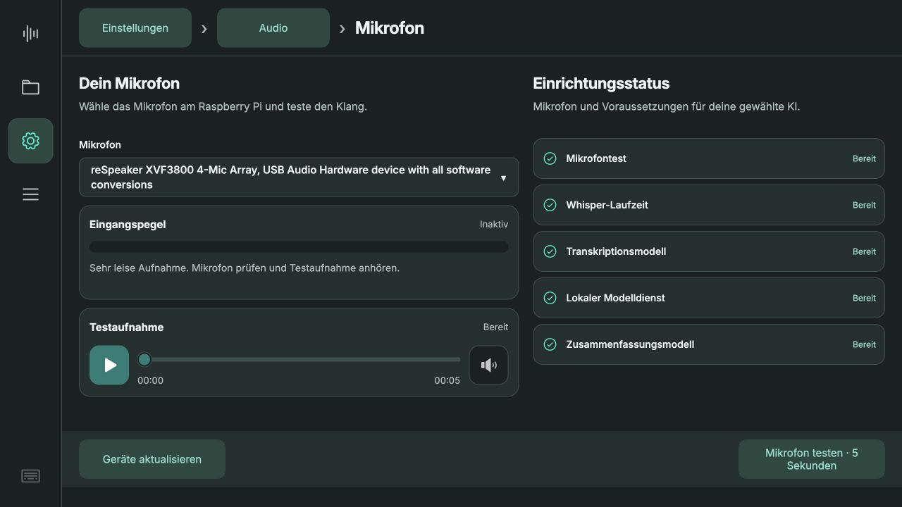
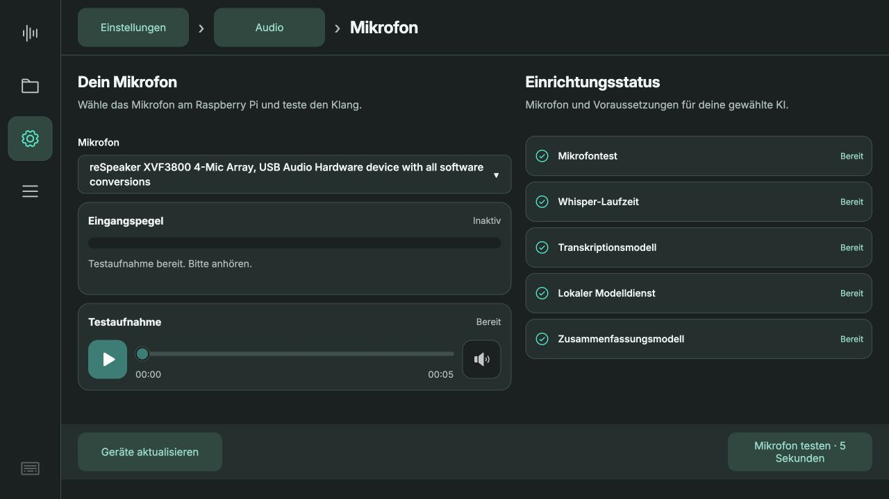

# ReSpeaker XVF3800 am Pi · 13.10.2026

## Ergebnis

Mit ausdrücklicher Zustimmung des Benutzers wurde im Safe Mode die offizielle USB-Firmware **2.1.1**, Variante mit zwei Kanälen, in die **Upgrade-Partition (alt 1)** installiert. Factory- und DataPartition wurden nicht gezielt beschrieben. Die zuvor installierte Betriebsfirmware war nicht auslesbar und wurde nicht gesichert. Der ursprüngliche I²S-Modus bleibt daher eine plausible Diagnose, keine bestätigte Versionsmessung.

- Offizielles Quellrepository: https://github.com/respeaker/reSpeaker_XVF3800_USB_4MIC_ARRAY
- Geprüfter Commit: `4b49bfd19977c63cf6e90dfe9e5827e74e20bf6d`
- Image: `xmos_firmwares/usb/respeaker_xvf3800_usb_dfu_firmware_v2.1.1.bin`
- SHA-256: `85e9a89d859f0a73c52df661190adf77a6fb655c58d8bf4162924d45849c5057`
- DFU-Abschluss erfolgreich; anschließend `VERSION: [2, 1, 1]` über das offizielle Python-Hosttool ausgelesen.
- USB-ID `2886:001a`. ALSA: `reSpeaker XVF3800 4-Mic Array`, Karte `Array`.
- Vom Gerät gemeldetes Capture-/Playback-Format: **S16_LE, 2 Kanäle, 16000 Hz**.
- App-Mikrofon gewählt: `plughw:CARD=Array,DEV=0` (ALSA konvertiert für die App auf Mono).
- Werkseitige Kanalauswahl unverändert: links `AUDIO_MGR_OP_L=[8,0]`, rechts `AUDIO_MGR_OP_R=[7,3]`.
- Hardware-Mute-Funktion weiter aktiviert: `MUTE_FUNCTION_ENABLE=[1]`.

## Prüfung

Die produktive App 0.5.17 hat eine echte 5-Sekunden-Testaufnahme erstellt, ohne diese an die Transkriptionsqueue oder an die Cloud zu senden. Messung: 80000 Mono-Samples, Peak 49/32768, RMS 9,17/32768. Ein schwaches Signal ist vorhanden, die App meldet zutreffend „Sehr leise Aufnahme“. Dieser erste Test enthielt kein ausreichend lautes Sprachsignal. Der anschließende gesprochene Test ist unten dokumentiert.

Die Einrichtung ist abgeschlossen und Aufnahme erlaubt. Alle 22 bestehenden Meetings erhalten; Transkriptions-/Zusammenfassungsmodelle und Brain-Konto unverändert. Der Audioausgang des Arrays wird vom Betriebssystem erkannt; angeschlossene Lautsprecher und deren Klang wurden in diesem Firmwaretest nicht geprüft.

LED-Test über das offizielle Python-Hosttool: Einzel-Farbmodus, Blau `0x2266ff`, Grün `0x22cc66`, jeweils geschrieben und zurückgelesen. Ursprüngliche Werte anschließend nachweislich wiederhergestellt: Effekt 4 (DOA), Farbe `0x002040`, Helligkeit 127. Siehe `led-test.json`. Keine dauerhafte LED-Konfiguration gespeichert. Die automatische Kopplung von App-Aufnahmestatus und Hardware-LEDs ist noch nicht implementiert. App-Mute speichert Stille und ist unabhängig von der Hardware-Mute-Taste.

## Dateien am Pi

`/home/chris/respeaker-tools/` enthält das unveränderte offizielle `xvf_host.py`, eine separate Python-Umgebung (PyUSB 1.3.1, libusb-package 1.0.30.0), das geprüfte Firmware-Image und das DFU-Protokoll. `dfu-util 0.11` wurde aus dem Debian-Paketrepository installiert. Der vorhandene `snd-usb-audio`-Treiber genügt für Audio.

Für Diagnose: `sudo /home/chris/respeaker-tools/venv/bin/python /home/chris/respeaker-tools/xvf_host.py VERSION`.

## Herstellerquellen

- [FAQ: USB-Erkennung und Recovery](https://wiki.seeedstudio.com/respeaker_xvf3800_faq/)
- [XIAO-Variante: I²S ab Werk](https://wiki.seeedstudio.com/respeaker_xvf3800_xiao_getting_started/)
- [Offizieller DFU-Ablauf](https://github.com/respeaker/reSpeaker_XVF3800_USB_4MIC_ARRAY/blob/master/xmos_firmwares/dfu_guide.md)
- [USB-Firmware und Changelog](https://github.com/respeaker/reSpeaker_XVF3800_USB_4MIC_ARRAY/blob/master/xmos_firmwares/usb/readme.md)

## Gesprochener Folgetest

Nach „Bereit“ des Benutzers erneut fünf Sekunden direkt am Pi aufgenommen.
Pegelanzeige **61/100**, Peak **17433/32768**, RMS **−26,3 dBFS**, **keine geclippten Samples**. Die App meldet „Testaufnahme bereit. Bitte anhören.“ Das Array liefert jetzt ein deutliches Sprachsignal; die zuvor sehr leise Messung war bei diesem Test nicht mehr vorhanden. Testdatei nur lokal am Pi, keine Cloudübertragung und kein neues Meeting in der Bibliothek. Audio und gesprochener Inhalt werden nicht ins Repository aufgenommen.

Lokaler Verständlichkeitstest: Whisper `ggml-medium.bin`, Deutsch, drei Threads, Exit 0, **79,99 Sekunden** für die fünf Sekunden Audio. Sprache erkannt, aber Ausgabe nicht fehlerfrei und Satzanfang abgeschnitten. Damit sind Audioaufnahme und lokale Erkennung bestätigt; eine belastbare Beurteilung der Erkennungsqualität braucht eine längere, gezielt gesprochene Probe. Es wurde kein Referenztext als Prompt mitgegeben. Nicht mit einer Echtzeit-Leistungszusage verwechseln.
