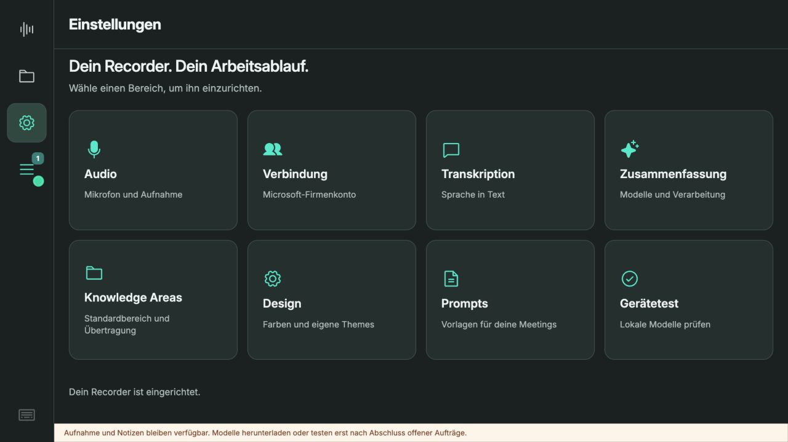
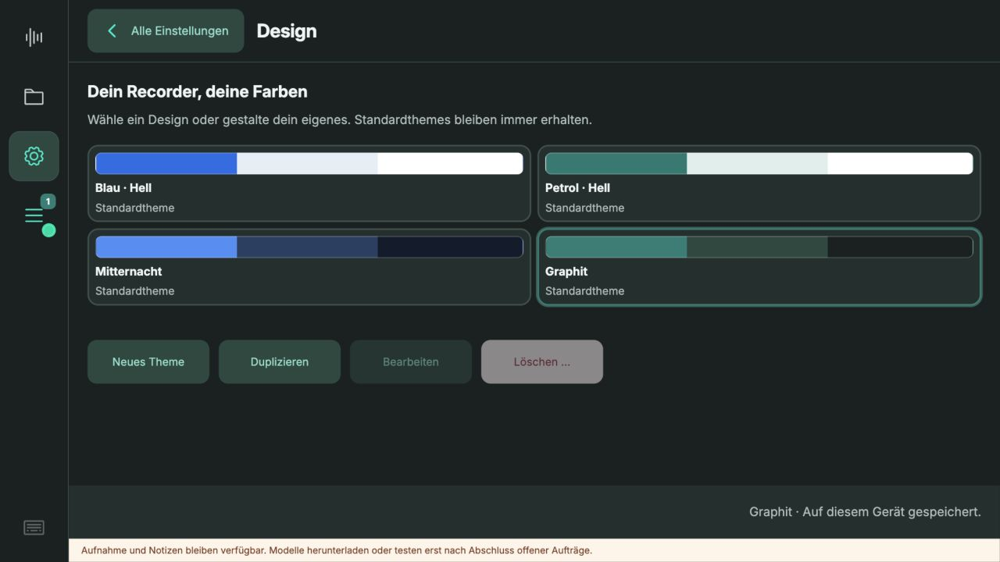
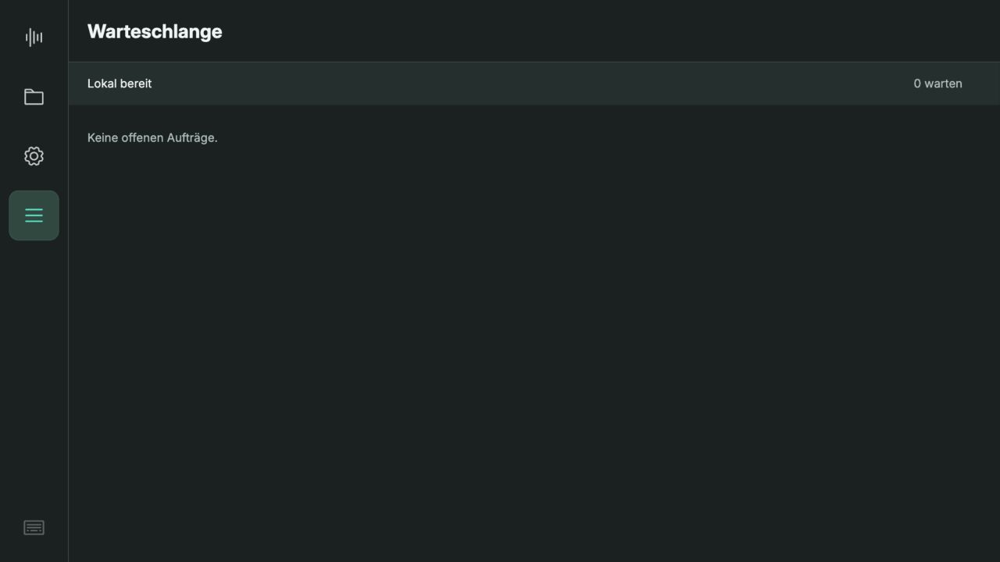

# Recorder Studio 0.5.8 – Aufgabenqualität und Touch-Design

Geprüft am 12.10.2026 auf Raspberry Pi 5 mit 16 GB RAM. Ausschließlich künstliche Sprache und isolierte Testdatenbank; die persönliche Bibliothek wurde nicht für Tests geändert. Produktion behält lokale Transkription und CDB-Zusammenfassung. Der Test verwendet CDB für beide Schritte.

## Frischer Stundentest

Exakt 3.600 Sekunden kontinuierliche synthetische deutsche Sprache, 16 kHz mono, 115.200.078 Bytes. SHA256 `b38c8a96634bdc962a969ec6e67bfd2bdc388b9ba07234b90ecdbe35270e9758`. Identische unveränderte Audiodatei zum vorherigen Test, aber **neuer CDB-Transkriptionsauftrag**, keine wiederverwendete Transkription.

| Schritt | Gemessene Dauer |
|---|---:|
| CDB-Transkription einschließlich lokaler Kodierung, Upload und Warten | 175,99 s (2:56 min) |
| Belegextraktion und deterministische Zusammenführung | 294,74 s (4:55 min) |
| Gesamter Verarbeitungsversuch | 470,75 s (7:51 min) |

Neun Abschnittsantworten; keine generative Zusammenfassung von Zusammenfassungen. Die Beleglisten bleiben nach einem Neustart wiederverwendbar. Ein zusätzlicher Mitschnitt lief während der Verarbeitung, wurde nach Stoppen eingereiht und erst nach dem Stundentest verarbeitet. Während der Aufnahme waren Bibliothek, Einstellungen und Aktionen gesperrt; nach Stoppen wieder frei. Die spätere Queue-Ansicht ist ebenfalls während der Aufnahme gesperrt. Verarbeitung läuft unabhängig davon weiter.

Die erste Negativkontrolle enthält 17,028 Sekunden vorbereitete Sprache samt Randstille. Die tatsächliche Aufnahme dauerte **133,028 Sekunden**; nach der Sprache wurde Stille aufgenommen. Transkription 13,80 s, Zusammenfassung 10,15 s, gesamter Versuch 23,96 s. Ergebnis: **keine bestätigten Aufgaben oder Entscheidungen**; Kaufvorschlag und unklare Zuständigkeit bleiben offene Punkte. Ein weiterer synthetischer Mitschnitt von 21 Sekunden prüfte die spätere UI-Überarbeitung.

Beide Haupttests wurden unverändert als Text nach **staging_playground** übertragen. Die Serverprüfung bestätigt für beide Dokumente alle sechs Verarbeitungsschritte als `completed`, einschließlich Graph und Vektorisierung. Siehe [Servernachweis](server-evidence.json).

## Was die Aufgabenprüfung leistet – und was nicht

Bei Standardvorlagen werden Modellangaben nur übernommen, wenn Zitat und Handlung wörtlich im Transkript stehen. Name und Frist müssen im selben Satz belegt sein. Fragen, Vorschläge und negative/unbestätigte Aufträge dürfen keine bestätigten Aufgaben werden. Namensfragmente wie A, AA und An werden nicht zu Anna ergänzt. Aus fehlender Zuständigkeit entsteht keine neue Aufgabe „Zuständigen benennen“. Der finale Text wird aus den geprüften Belegen aufgebaut, nicht nochmals frei generiert.

Im Stundentest wurden 19 unbelegte oder unklare Kandidaten verworfen. Alle übernommenen Aufgaben wurden zusätzlich gegen das gespeicherte Transkript geprüft. Die Negativkontrolle blieb ohne Aufgaben. **Das ist keine Garantie für beliebige Aufnahmen.** Das synthetische Sprachsignal wird weiterhin stellenweise falsch erkannt: Ben wird beispielsweise zu „Wen“ und die Aussage damit uneindeutig. Diese Fälle erscheinen als offene Punkte. Wiederholungen mit unterschiedlichen Namensfragmenten werden vorsichtig separat gruppiert; dadurch bleibt das Ergebnis länger und weniger glatt. Die Erkennung ist bewusst konservativ und kann Aufgaben auslassen. Eigene Prompts verwenden weiterhin die freie generative Verarbeitung. Die Standardausgabe fokussiert belegte Aufgaben, Termine, Entscheidungen und offene Punkte; sie liefert keinen frei formulierten Kurzüberblick.

Auditable Daten: [Transkript](hour-transcript.txt), [Ausgabe](hour-summary.md), [Belege](hour-evidence.json), [Negativkontrolle](negative-summary.md), [Zeitverlauf](timeline.json). Keine Audio-Originaldateien, Tokens oder kopierten Sitzungen im Repository.

## Prüfung der Screens

Ausgangspunkt waren die Screenshots 01–03. Probleme: durchgehende aktive linke Fläche, kleine Textgrößen, konkurrierende Fußleisten, überbreite Aktionen und ständig sichtbare Queue-Leiste. Die neue Gestaltung behält die gewünschten Rundungen und Theme-Farben.

- **Recorder:** große Record-/Stop-Fläche; eingerückte 64 × 64 px App-Icons; nur hier Aufnahme-Widget.
- **Bibliothek:** abgerundete einzelne Einträge, fester Suchbereich, klarer Rückweg aus Details. Textaktionen und Blättertasten teilen sich eine Reihe, wodurch mehr Lesefläche bleibt.
- **Einstellungen:** acht große Zielkacheln; Unterseiten ohne seitliche Bereichsnavigation. Rückweg immer „Alle Einstellungen“. Audio öffnet vom Mikrofon aus direkt.
- **Audio:** eigener Titel, konsistente Aktionen, getrennte Prüfanzeigen; kein leerer Audioplayer. Abschlussaktion nur bei offener Einrichtung.
- **Verbindung:** Konto und Standardbereich visuell getrennt; kompakte Fußaktionen.
- **Transkription / Zusammenfassung:** lokale Felder nur bei lokaler Verarbeitung. Online-Status und Datenübertragung ausdrücklich erkennbar.
- **Knowledge Areas:** Standardbereich und Übertragungsstatus getrennt; kompakte direkt anwählbare Übertragungsseiten.
- **Design:** Theme-Karten und kompakte Verwaltungsaktionen. Eigener Theme-Editor vollständig im Seitenbereich. Zurück verwirft die ungespeicherte Vorschau.
- **Prompts:** Auswahl und Name nebeneinander, normal gewichteter Text, direkt anwählbare Textseiten für lange Arbeitsaufträge.
- **Gerätetest:** technische Programmpfade unter „Erweiterte Programmeinstellungen“; kompakte Testaktion.
- **Warteschlange:** eigener Menüpunkt und normale rechte Ansicht, **kein Overlay und keine feste Fußleiste**. Anzahl am Icon, Animation bei Verarbeitung, eigene Statuszeile in der Ansicht. Während Aufnahme gesperrt.
- **Meetingaktionen / Auswahl / Tastatur:** gleiche Rundungen und Touchgrößen; feste Hauptaktionen, gefährliche Aktion räumlich getrennt. Tastatur-Initialisierung funktioniert auch mit der neuen Queue-Ansicht ohne Formularkopf.

Alle acht Einstellungs-Unterseiten wurden bei **1280 × 720** einzeln geöffnet, auf Rückweg und fehlende Seitennavigation geprüft und vermessen: kein Überlauf der Haupt-Inhaltsfläche im geprüften Zustand ([Messungen](layout-checks.json)). Lange Textfelder behalten eigene Blätter- bzw. Textseiten. Umfangreiche benutzerdefinierte Inhalte, kleine Fenster und Fehlermeldungen können zusätzliche Inhaltsseiten benötigen. Kein vollständiger Accessibility-Konformitätsnachweis; physische Touchbedienung bleibt am Display zu beurteilen.

Orientierung: Microsoft beschreibt [kompakte Icon-Navigation](https://learn.microsoft.com/en-gb/windows/apps/develop/ui/controls/navigationview) und [Touch-Interaktionen](https://learn.microsoft.com/en-us/windows/apps/develop/input/touch-interactions). Metro-inspirierte große Ziele werden hier mit den ausdrücklich gewünschten Rundungen kombiniert.

## Finale Vorschauen

Weitere finale Einstellungsseiten: [Audio](final-audio.jpg), [Verbindung](final-connection.jpg), [Transkription](final-transcription.jpg), [Zusammenfassung](final-summary.jpg), [Knowledge Areas](final-knowledge.jpg), [Prompts](final-prompts.jpg), [Gerätetest](final-device.jpg).

Nummerierte ältere Vorschauen dokumentieren Zwischenstände, einschließlich der inzwischen ersetzten Queue als Overlay. Maßgeblich sind die finalen Bilder und die produktiven Screenshots.

## Automatische Prüfung

72 Python-Tests auf dem Pi bestanden. 22 JavaScript-Tests bestanden: Kontowechsel/Standardbereich/Übertragung, CDB-Modellansichten, Kacheln und Rückwege, Aufnahme-Sperren, Bibliothekskontext, Queue als Workspace, Textseiten und Statusanzeige. Zusätzliche Browserprüfung von Aufnahme/Stoppen, Theme-Abbruch, Bildschirmtastatur und allen acht Einstellungsseiten. Der während der Überarbeitung gefundene Tastaturfehler beim neuen Queue-Dialog ist korrigiert; erneutes Laden und Öffnen der Tastatur erzeugte keinen neuen Fehler.

Der abschließende [Navigationsaudit](NAVIGATION-AUDIT.md) dokumentiert die sechs geprüften Abläufe, entfernte doppelte Rückwege und Grenzen der Browserprüfung. Hauptansichten besitzen keine Schließen-/Recorder-Zurück-Tasten mehr.

Produktiv auf 0.5.8 aktualisiert und geprüft: Dienst und Kiosk aktiv, 22 bestehende Meetings, Microsoft-Sitzung und Standardbereich erhalten. Testdienst nach vollständig abgeschlossenen Aufträgen beendet, kopierte Sitzung entfernt. [Produktive Einstellungen](production-settings.jpg), [produktive Warteschlange](production-queue.jpg), [lokale Transkription](production-local-asr.jpg).
