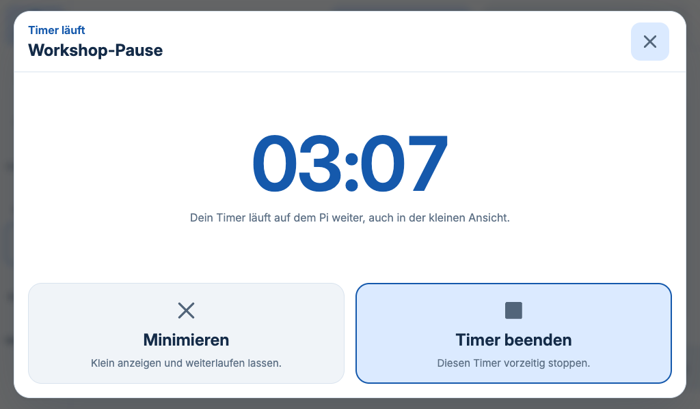
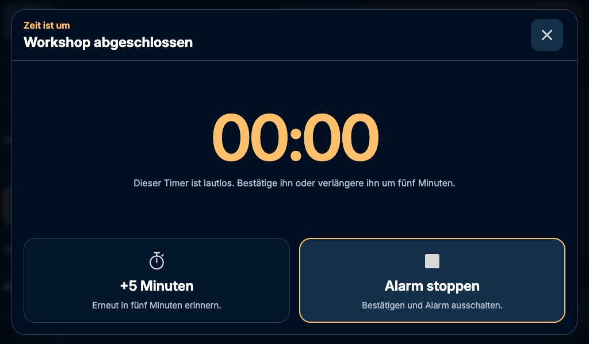
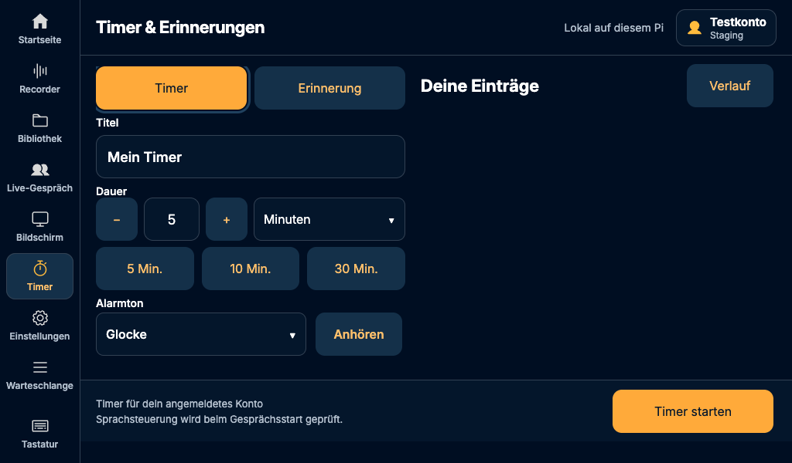

# Große Timeransicht · Recorder Studio 0.5.99

23. November 2026. Implementierung und lokale Prüfung abgeschlossen,
committet und gepusht. Das signierte App-Paket liegt auch auf dem Pi bereit.
**Noch nicht installiert:** Der Updateschutz hat den ersten Installationsversuch
wegen eines weiterhin offenen, bereits abgelaufenen Timers abgewiesen.
Der Pi läuft unverändert mit 0.5.98. Nutzer wurde um Bestätigung des Alarms gebeten.

## Bedienung am Pi

- Laufenden Countdown oben rechts antippen: große Restzeit mit zwei großen
  Touchflächen, **Minimieren** und **Timer beenden**. Das funktioniert auch
  während einer Aufnahme oder eines Gesprächs, wenn das Timer-Hauptmenü gesperrt ist.
- Ablauf öffnet die Alarmansicht automatisch: **+5 Minuten** oder **Alarm stoppen**.
  Bestätigen beendet auch die bestehende Tonausgabe dieses Timers.
- Das Kreuz minimiert, quittiert aber nicht. Ein bewusst minimierter Alarm
  öffnet sich nicht jede Sekunde neu; der kompakte Hinweis bleibt anklickbar.
- Mehrere fällige Timer werden nacheinander gezeigt. Eine laufende Anfrage
  bleibt auf ihren Timer und seine Revision begrenzt, auch wenn ein weiterer abläuft.
- Ein anderer Bestätigungs- oder Anmeldedialog wird nicht überdeckt; danach
  erscheint der noch offene Alarm. Verliert das Konto Zugriff, schließt die Ansicht.
- Auch erledigte oder abgebrochene Timer lassen sich über ihren Listentitel
  erneut öffnen. Sie zeigen ihren Status ohne irreführende Stoppaktion.

Minimieren und Anzeigen ändern weder Mikrofon noch Aufnahme oder Talk-Verbindung.
Die Bildschirmtastatur wird vor der Großansicht geschlossen. Unterbrochene
Verbindung und fehlgeschlagene Aktionen werden ausdrücklich angezeigt. Ein
lautloser Timer verspricht keine spätere Tonausgabe. Die bestehenden Regeln für
Alarmtöne, Ansagen und Ruhe während Aufnahmen bleiben erhalten.

## Prüfungen

- 160 JavaScript-Tests bestanden: automatische Öffnung, Minimieren, Snooze,
  mehrere fällige Timer, Kontowechsel, konkurrierende Dialoge, Doppeltippen,
  Fehler/Offlinezustand sowie lautlose Alarme während einer Aufnahme.
- 55 Python-Tests für Scheduler, Raummodus, LCD-Ausgabe und Kundenimage bestanden.
  Zusätzlich 86 Tests für lokale Hilfe/Fernbedienung und Audioausgabe sowie
  22 Prüfungen für Countdown und den erweiterten Image-Export bestanden.
- Browser mit synthetischer Aufnahme bei 1024 × 600 und 1280 × 720 geprüft:
  laufenden Timer öffnen/minimieren/beenden, Ablauf, Verlängern, Quittieren,
  Wiederöffnen aus dem Verlauf. Beim Quittieren lief die Aufnahme unverändert weiter.
  Eine vorher offene Bildschirmtastatur verschwand korrekt. Helle und CDB-Ansicht.
  Die Zeiteinheit hat auch als Touch-Auswahl ausreichend Breite; alle Eingaben
  passen bei 1024 × 600 auf die Seite. Auf größeren Displays bleiben zusätzliche
  Hinweise bei Bedarf scrollbar.
- Reale Touch-, Lautsprecher- und Zusatzdisplayprüfung wird getrennt dokumentiert;
  die lokale Vorschau verwendet künstliche Audiodaten und keine Geräteaufnahme.

## Update und sauberes Kundenimage

Die beiden neuen Dateien `studio/timer-focus.js` und `studio/timer-focus.css`
werden von den bestehenden Freigabelisten für signierte App-Updates und saubere
Image-Baupakete erfasst. Keine neue App-Abhängigkeit, Datenmigration, Systemrechte
oder Änderung der gespeicherten Einstellungen. Der App-Neustart beendet wie
bisher eine persönliche Anmeldung; gespeicherte Aufnahmen bleiben erhalten.

Die Darstellung auf dem separaten Waveshare-Zusatzdisplay ist eine eigene
Firmwareänderung. Sie wird nicht allein durch dieses App-Paket installiert.
Ein Image-Baupaket ist kein gebautes oder auf Hardware geprüftes SD-Image.

## Tatsächlicher Gerätestand vor der Installation

- Auf dem Pi wird die ausgewählte USB-Soundbar nicht mehr als USB-Gerät oder
  Audioausgang erkannt. Ein vorhandener Alarm hat `sound=failed`; der reSpeaker
  ist weiterhin vorhanden. Keine automatische Umleitung auf dessen Ausgang,
  keine Lautstärkeänderung. Nutzer wurde um Prüfung des Soundbarsteckers gebeten.
- Der Kiosk wurde bei 1280 × 720 per Bildschirmaufnahme geprüft. Dabei entdeckter
  Zeilenumbruch in der Zeiteinheit wurde in der neuen Oberfläche korrigiert.
  Die neue Alarmansicht wurde bislang im lokalen Browser, nicht im echten Kiosk,
  geprüft. Eine tatsächliche Hörprobe bleibt offen.
- Der Zusatzdisplay-Dienst ist aktiv und das Gerät über seine eindeutige
  CDB-USB-Kennung erreichbar. Ein einzelner, lesender Bootloader-Verbindungsversuch
  konnte keine Verbindung herstellen; es wurde nichts in den Flash geschrieben.
  Der Begleitdienst wurde danach wieder gestartet. Für das separate Firmwareupdate
  ist voraussichtlich der manuelle BOOT-/RESET-Schritt nötig.

App-Quelle `120f02be54b143660aaaed9d8961fb37d3f09cb6`, Sequenz 99 für 0.5.98:
Signatur und 152 App-Dateien geprüft. Sauberes Image-Baupaket mit 159 Quelldateien
vollständig per SHA-256 geprüft; beide neuen Timerdateien enthalten.
Kein SD-Image gebaut oder auf Hardware gebootet. Keine tatsächliche Aufnahme,
Talk-Verbindung oder Benutzeranmeldung für diese Tests angelegt.
