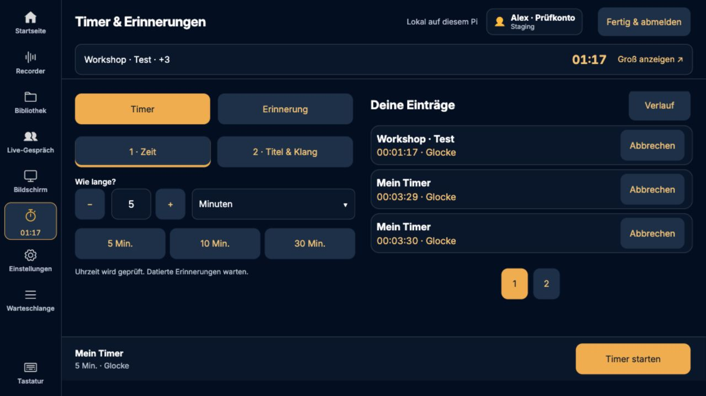
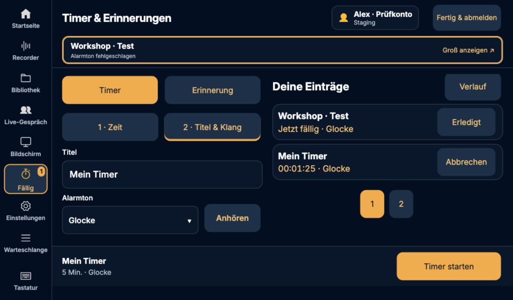

# Recorder Studio 0.5.103 · Außentipp und Timerseiten

24. November 2026. Ausgangsstand 0.5.102; Ziel: Pi-Touch, 1280 × 720 und 1024 × 600.

## Ergebnis

Die linke Timer-Spalte war eine überlaufende Formularliste. Sie hat jetzt zwei feste
Seiten: **Zeit** und **Titel & Klang**. Eingaben bleiben beim Wechsel bestehen.
Unten stehen Titel, Zeit/Klang und die Starttaste. Die rechte Liste hat eigene
Seitentasten, zwei Einträge auf dem kleinen Display, drei auf dem großen.
Die Zeile für laufende oder fällige Timer bleibt erreichbar. Bedienelemente sind
mindestens 56 px hoch. Bei geöffneter Tastatur bleibt das bearbeitete Feld sichtbar.

Außentippen funktioniert zentral für alle 14 aktuellen Modaldialoge und künftig
auch dynamisch ergänzte native Dialoge. Es löst deren vorhandenen Abbruchweg aus.
Die Vollseiten der Anwendung sind keine Modaldialoge. Klicks innerhalb, Ziehen nach
außen, rechte Maustaste und abgebrochene Zeigergesten schließen nichts.

## Dialoginventar und Verhalten

| Dialog | Außentipp |
| --- | --- |
| Brain-Konto | Anzeige schließen, angemeldet bleiben; laufende Kontoaktion geschützt |
| Meetingdetails | Schließen; Titelentwurf bleibt beim Wiederöffnen dieser Sitzung erhalten |
| Brain-Übertragung | Abbrechen vor dem Senden; während der Übertragung gesperrt |
| Wiedergabehinweis | Keine Wiedergabe beginnen |
| Lokalen Stand sichern | Anzeige schließen, Entwurf behalten |
| Entwurf vergleichen | Keine Konfliktentscheidung treffen, Entwurf behalten |
| Allgemeine Bestätigung | Ablehnen, Promise auflösen, ursprünglichen Fokus wiederherstellen |
| Ausschalten/Neustarten | Während des Systembefehls geschützt; vorhandener cancel-Guard |
| Auswahlfenster | Schließen ohne Auswahländerung |
| Gesprächswissen | Auswahl verwerfen; laufendes Speichern geschützt |
| Meeting-/Talk-Vorbereitung | Bestehende Vorbereitung abbrechen, keine Aufnahme starten |
| Anmeldung & Geräteschutz | Schließen und PIN-Eingabe leeren |
| Abmeldewarnung | Ruhefrist erneuern, angemeldet bleiben |
| Timer-Großansicht | Minimieren, Timer/Alarm läuft weiter; laufende Timeraktion geschützt |

Bei einem Fehler im Vorbereitungsabbruch wird nun der vorhandene Fehlerhandler
verwendet. Ein Titelentwurf wird nicht automatisch als Umbenennung gespeichert.
Er überlebt keinen Browser-Neustart; dauerhaft speichern bleibt explizit.

## Prüfung

- Codeprüfung aller 14 Dialoge inklusive ihrer bestehenden Abbruch-/Sperrlogik.
- Frische Browserprüfung in einer isolierten Kopie mit synthetischem Konto und
  Testmeetings; keine produktiven Daten und keine Cloud-Aufrufe.
- 1024 × 600 hell: Zeit, Detailseite, Texttastatur, Ziffernblock, mehrere Timer,
  Eintragsseiten. 1280 × 720 CDB: drei Einträge und separate Seitensteuerung.
- 1024 × 600 CDB: Detailseite und Erinnerung bei fälligem, minimiertem Alarm.
- Außentipp real im Browser geprüft: Konto, Abmeldebestätigung, kurze Auswahl,
  laufender und abgelaufener Timer, Abmeldewarnung, Meetingdetails mit Titelentwurf.
- Gemessene Spalten- und Listenhöhen: kein Inhalt läuft über den sichtbaren Bereich
  der geprüften Timerseiten. Ein zuvor entdeckter Überlauf bei aktiver Timerzeile
  und drei Einträgen wurde vor Auslieferung behoben.
- 170 JavaScript-Tests bestanden; 101 Python-Tests für Studio, Raummodus und
  Kunden-Image bestanden. Neue Fälle prüfen Gesten, Abbruch-Sperren, Seitenwechsel,
  erhaltene Eingaben, Erstellen auf der passenden Seite und Asset-Auslieferung.
- Talk zusätzlich in der lokalen Prüfkopie geprüft: Timer-Navigation und Abmelden
  gesperrt; Konto per Außentipp geschlossen, Gespräch blieb aktiv.
- Bestehende Aufnahme-/Pause-/Talk-Sperren unverändert, durch die bestehende
  automatisierte Suite geprüft. Kein neuer manueller Hörtest oder physischer
  Aufnahmetest für diese reine Oberflächenänderung.

## Update und frische Installation

`studio/modal-dismiss.js` ist das einzige neue Laufzeit-Asset. Die bestehenden
Dateipositivlisten nehmen es in signierte App-Updates und saubere Image-Baupakete
auf. Keine neuen Abhängigkeiten, Dienste, Datenmigrationen oder LCD-Firmware.
Aufnahmen, NFC-Zuordnung, Geräteschutz und Konfiguration bleiben erhalten.

Das signierte Paket und ein sauberes SD-Image-Baupaket werden aus dem committeten
Stand geprüft. Ein Baupaket ist kein gebautes oder hardwaregeprüftes SD-Image.

Historischer Deployment-Stand von 0.5.103: vorbereitet; die Vorprüfung meldete
einen unbestätigten Timer-Alarm. Nach ausdrücklicher Freigabe durch den Benutzer
wurde dieser bestätigt und die Oberfläche am 24. November 2026 gemeinsam mit der
Update-Sitzungsübergabe als **0.5.104** installiert. Geräteprüfung und Grenzen:
[Abnahme 0.5.104](../update-session-0.5.104/README.md).
