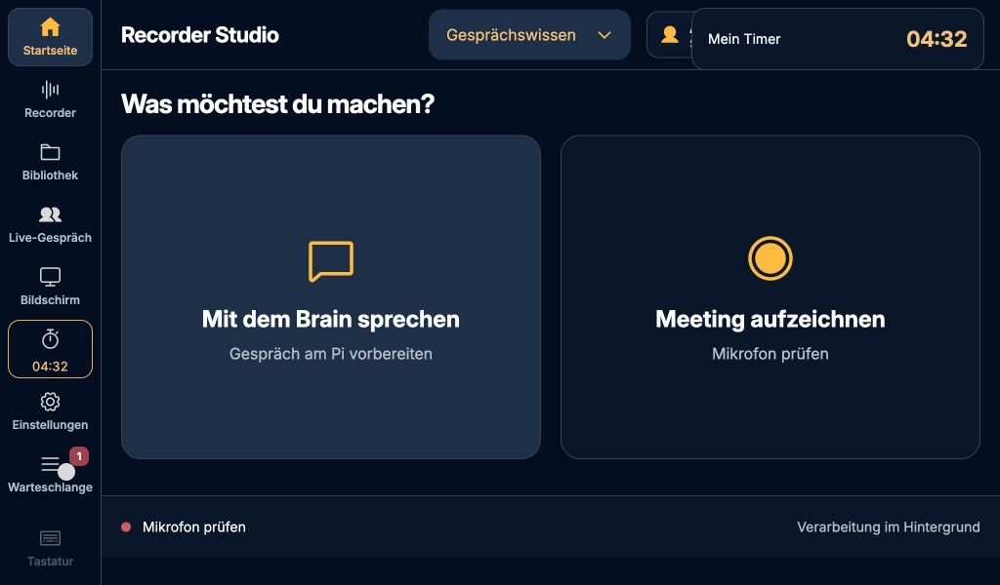
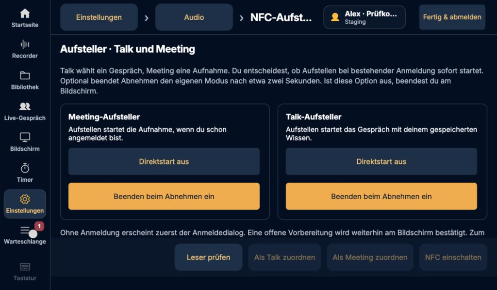
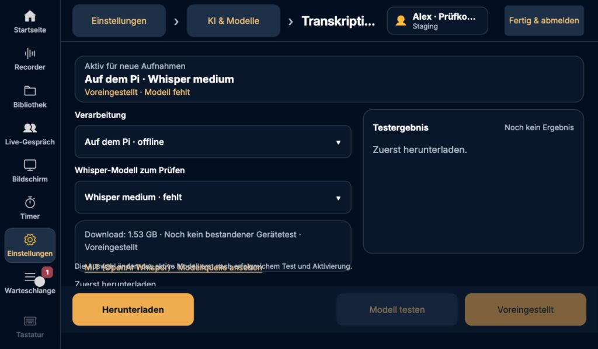

# Recorder Studio: Oberflächen- und Bedienungsprüfung

**24. November 2026 · Version 0.5.100 · geprüfter Ausgangsstand `c4133bd`**

Die großen Entscheidungskacheln sind eine gute und inzwischen konsistente Grundlage. Der größte Handlungsbedarf liegt bei überlagerten Bedienelementen, abgeschnittenen Einstellungsseiten und unnötig aufwendigen Auswahlfeldern.

**Dies ist ein Audit mit Verbesserungsvorschlägen, keine umgesetzte Fehlerkorrektur.** App-Code, Pi-Konfiguration und veröffentlichte Version wurden nicht geändert. Kein Einfluss auf bestehende Geräteupdates oder neue SD-Images.

[Visueller Bericht mit allen geprüften Ansichten](report.html) · [Messungen der Bedienelemente](measurements.json) · [Timer-Kollision](timer-overlap-1024.json)

**Nachtrag:** Umsetzung A01–A08 in [0.5.101](../pi-touch-0.5.101/README.md); der folgende Bericht beschreibt weiterhin den historischen Ausgangsstand.

## Umfang und Nachweis

Geprüft wurde die echte Weboberfläche aus dem Repository in zwei lokalen Prüfkopien, primär bei **1280 × 720**, zusätzlich bei **1024 × 600**, mit hellem Design und CDB-Design. Alle Screenshots stammen aus diesem Audit. Die Hauptansichten und wesentlichen Dialoge wurden durchgeklickt, eine synthetische Aufnahme gestartet, pausiert und beendet, ein lautloser Timer bis zum Ablauf geprüft und die Abmeldevorwarnung ausgelöst.

Die zweite Prüfkopie verwendete ausschließlich ein künstliches Konto, künstliche Meetingtexte und erzeugtes Audiosignal. Externe Brain-Anfragen waren dort abgefangen. Der aktive Talk-Zustand wurde als Darstellungszustand eingespeist; es fand kein echtes Cloud-Gespräch statt. Fehlende Linux-Audio-, Bluetooth- und WLAN-Dienste auf dem Prüf-Mac sind **keine Feststellung über den Zustand des Pi**. Ihr Einfluss auf Fehlermeldungen und Layout wurde geprüft.

Eine anfängliche Anmeldung in der ersten Prüfkopie erzeugte einen Microsoft-Gerätecode; die Anmeldung wurde abgebrochen. Der Screenshot mit Code/QR ist ausdrücklich nicht Bestandteil des Berichts oder Commits. Ein noch ladender Netzwerk-Screenshot wurde ebenfalls verworfen.

## Priorisierte Befunde

### A01 · P1 · Der minimierte Timer verdeckt Konto und Abmelden

**Reproduktion:** angemeldet einen Timer starten und zur Startseite wechseln. Der feste Timer oben rechts liegt über dem Kontobutton und über „Fertig & abmelden“. Vom Nutzer zusätzlich gemeldet, in beiden Zielgrößen reproduziert.

Bei 1024 × 600 liegt der Timer bei x=708, y=8, Breite 300, Höhe 64. Der Kontobutton beginnt bei x≈662, der Abmeldebutton bei x≈864. Die Mitte beider Buttons trifft bei einer Berührungsprüfung den Timer statt den gewünschten Button. Auch bei 1280 × 720 ist dies der Fall. Es handelt sich um eine echte Bedienblockade, nicht nur um einen optischen Eindruck.

**Vorschlag:** eine eigene, im Layout reservierte Timer-Statuszeile unter dem Kopfbereich. 56–64 px Höhe, Titel, Restzeit und „Groß anzeigen“. Bei mehreren Timern eine eindeutige Anzahl. Der Alarm verwendet denselben Platz. Konto, Abmelden, Seitentitel und Wissensauswahl bleiben frei. Die linke Timer-Navigation darf die Restzeit zusätzlich anzeigen.

**Abnahme:** keine Überschneidung mit sichtbaren Buttons in Startseite, Recorder, Bibliothek, Talk und Einstellungen, bei beiden Auflösungen, langem Namen, langem Timertitel, mehreren und fälligen Timern. Aufnahme-Stopp und Gesprächsende dürfen nie verdeckt werden. Quellen: `studio/device-status.css:12`, `studio/assistant-tools.css:9`, `studio/timer-focus.css`.

### A02 · P1 · Einstellungsinhalte sind abgeschnitten und nicht scrollbar

**NFC:** Bei 1024 × 600 enthält der sichtbare Bereich 420 px Höhe, benötigt aber 600 px; `overflow: hidden` verhindert das Scrollen. Leserstatus, Zuordnung und Einrichtungshinweise verschwinden unter dem Fußbereich. Bei 1280 × 720 fehlt weiterhin ein Teil der unteren Hinweise.

**Lautsprecher:** Bei 1024 × 600 stehen 420 px für einen 960 px hohen Inhalt zur Verfügung. „Ausgabestatus“ landet in einer zweiten Rasterzeile; die Links zu lokalen Ansagen und „Start & Abschied“ sind im normalen Touchablauf nicht erreichbar. Das Problem tritt auch bei 1280 × 720 auf. Die aktuell fehlende Audiohardware ist nur der Testzustand; die fehlerhafte Aufteilung ist im HTML/CSS nachvollziehbar.

**Lokale Ansagen:** Die unteren Informationen zum Sprachpaket werden bereits bei 1280 × 720 angeschnitten.

**Vorschlag:** NFC in „Aufsteller einrichten“ und „Verhalten“ aufteilen; pro Aufsteller eine Karte mit klaren Ein/Aus-Schaltern. Lautsprecher links mit Ausgang/Lautstärke, rechts mit Test/Ergebnis, zusätzliche Klänge als eigene erreichbare Kacheln. Längere Hilfen separat öffnen. Wo Inhalt variabel bleibt, einen klaren Scrollbereich mit dauerhaft sichtbaren Abschlussaktionen verwenden.

**Abnahme:** kein abgeschnittener Status oder unerreichbarer Button bei langen Gerätenamen, Fehlertexten und sichtbarer Tastatur. Quellen: `studio/cdb.css:11`, `studio/index.html` (`speaker-page`, `nfc-page`, `announcements-page`), `studio/speakers.css:1`.

### A03 · P1 · Modellinformationen überlagern sich auf dem kleineren Display

Bei Transkription und Zusammenfassung kollidieren Download-/Lizenzinformation, Prüfungshinweis und der Satz zur Aktivierung. Bei 1280 × 720 ist die Darstellung wesentlich besser; bei 1024 × 600 sind Zeilen übereinandergedruckt und teilweise hinter der Fußleiste.

**Vorschlag:** drei erkennbare Schritte „Auswählen → Prüfen → Aktivieren“. Informationen nur im aktuellen Schritt ausführlich zeigen. Ein kleiner, dauerhaft sichtbarer Status nennt das aktuell verwendete Modell. Die Haupthandlung richtet sich nach dem Zustand: herunterladen, testen oder aktivieren. Variable Textblöcke nicht in eine zu niedrige feste Rasterzeile zwingen.

**Abnahme:** beide lokalen Modelle, Online-Verarbeitung, lange Lizenz-/Fehlertexte, noch nicht installiert, laufender Download, bestanden/fehlgeschlagen jeweils ohne Überlagerung. Quellen: `studio/settings.css:29`, `studio/settings.css:88`, `studio/models.css`.

### A04 · P2 · Auswahl von drei oder vier Möglichkeiten ist zu aufwendig

Vier Alarmtöne werden in einem großen Dialog mit Suchfeld auf zwei Seiten aufgeteilt. Seite 2 enthält nur „Lautlos“. Auch die Auswahl Minuten/Sekunden/Stunden benutzt die vollständige Suchdialogstruktur. Das kostet zusätzliche Berührungen und nutzt den Bildschirm schlecht.

**Vorschlag:** bei zwei bis sechs kurzen Optionen eine direkte Kachelauswahl, ohne Suche und Pagination. Bei langen dynamischen Listen bleiben Suche und Seiten sinnvoll. Immer klar markieren, was gewählt ist; dieselbe Regel für Rufwort, Verarbeitungsart und Standarddesigns prüfen.

Nachweis: [Vier Optionen auf zwei Seiten](screenshots/28-four-options-two-pages-1024.jpg). Quelle: `studio/touch.js`.

### A05 · P2 · PIN-Eingabe nutzt eine allgemeine Symboltastatur

Das Betreiber-PIN-Feld verlangt Ziffern, öffnet aber die normale Tastatur mit Ziffernreihe, Sonderzeichen, Umschaltung und Leertaste. Die Eingabe bleibt möglich, ist am Pi jedoch unnötig kompliziert.

**Vorschlag:** eigene große 3×4-Zifferntastatur für PIN und numerische Kopplungscodes; Löschen und Bestätigen direkt erreichbar. Normale Texte und WLAN-Passwörter behalten die vollständige Tastatur. Formatprüfung bleibt zusätzlich serverseitig bestehen.

Nachweis: [PIN und Tastatur](screenshots/07-room-keyboard-1024.jpg). Quelle: `studio/keyboard.js` (numeric-Zweig).

### A06 · P2 · Statusmeldungen und Handlungsempfehlungen widersprechen sich stellenweise

- Lautsprecher erklärt „Nach dem Countdown ... deine Stimme ...“, obwohl ein Testton und keine Mikrofonaufnahme gemeint ist. Derselbe Text steht auch im Mikrofonbereich.
- NFC-Karte verspricht „Aufstellen startet die Aufnahme“, während der zugehörige Schalter „Direktstart aus“ anzeigt. Die Beschreibung muss sich nach der Einstellung richten.
- Talk zeigt im geprüften Fehlerzustand „Bereit für dein Gespräch“, obwohl die Verbindung bzw. Audioauswahl noch nicht bereit ist. Besser „Noch nicht bereit“ mit einem konkreten nächsten Schritt.
- Die Warteschlange bietet bei „Audiodatei fehlt“ ein prominentes „Wiederholen“ an. Zuerst Datei erneut prüfen; bleibt sie weg, den fehlenden Wiederherstellungsweg erklären und „Eintrag entfernen“ anbieten. Ein erneuter Verarbeitungsversuch allein kann die Datei nicht ersetzen.

Nachweise: [Lautsprecher](screenshots/48-speaker-1024.jpg), [NFC](screenshots/49-nfc-dark-1024.jpg), [Talk](screenshots/33-talk-idle-1280.jpg), [Warteschlange](screenshots/32-queue-1280.jpg). Der künstliche Verbindungsfehler ist absichtlich erzeugt; beanstandet wird die widersprüchliche Darstellung.

### A07 · P2 · Große-Button-Regel und Aktionshierarchie konsequent anwenden

Die neuen Entscheidungsdialoge sind gut: Meeting starten, Sitzung abschließen, automatische Abmeldung, Löschen, Neustart und Timer. Sie verwenden große Flächen mit Icon, Titel und kurzem Erklärungssatz. Bei 1024 × 600 passen sie vollständig.

Der Übertragungsdialog dagegen enthält unter zwei normalen Buttons eine große leere Fläche. In der Geräteverwaltung stehen bis zu fünf gleich gewichtete Aktionen nebeneinander. „Gerät koppeln“ konkurriert mit den täglichen Aktionen Neustart/Ausschalten und dem Geräteschutz. Im CDB-Design wirkt „Timer beenden“ im laufenden Timer stärker hervorgehoben als „Minimieren“, obwohl das vorzeitige Beenden einen laufenden Vorgang abbricht.

**Vorschlag:** Entscheidungsdialoge mit zwei Möglichkeiten immer als große Kacheln. Formulare dürfen normale 56-px-Aktionsleisten verwenden, benötigen aber eine zur Inhaltsmenge passende Höhe. Verwaltung nach „Gerät bedienen“ und „Einrichten & warten“ gruppieren. Bei laufenden Vorgängen Weiterlaufen/Minimieren als normalen Weg und vorzeitiges Beenden eindeutig gesondert kennzeichnen.

Nachweise: [guter Abschluss](screenshots/22-finish-1024.jpg), [gute Abmeldevorwarnung](screenshots/42-idle-warning-1024.jpg), [Übertragung](screenshots/26-transfer-1024.jpg), [Verwaltung](screenshots/04-device-1024.jpg), [Timer](screenshots/29-timer-focus-1024.jpg).

### A08 · P2 · Zugänge und Zustandsinformationen verständlicher ordnen

„Bildschirm“ bezeichnet die Browseranzeige eines Gesprächs; das USB-Timerdisplay hat dort keine eigene erkennbare Stellung. Die Browser-Fernbedienung liegt unter Hilfe & Fernzugriff, die cdbMOBILE-Fernbedienung unter Geräteverwaltung. Die Diagnoseansicht zeigt hauptsächlich Modelle und Laufzeitpfade. Für eine Person am Gerät ist die Zuordnung schwierig.

**Vorschlag:** eine Zubehör-/Verbindungsübersicht mit getrennten Karten für USB-Timerdisplay, NFC, Gesprächsbildschirm, Browser-Fernbedienung und cdbMOBILE. Dazu „Gerätestatus“ mit Version, Netzwerk, Mikrofon, Soundbar, freiem Speicher und verbundenem Zubehör sowie direkter passender Hilfe. Bestehende Zugriffsgrenzen bleiben erhalten.

Die Bibliothek bietet gut treffbare Zeilen, zeigt aber nur Titel und ISO-Datum. Dauer, Verarbeitungszustand und „nur lokal / ins Brain übertragen“ würden die Auswahl deutlich erleichtern. Vollständige Seitentitel haben in der Kopfzeile Vorrang: auf dem kleinen Display werden sie durch breite Pfadbuttons und Kontoaktionen gekürzt.

Nachweise: Screenshots 23, 31, 38–44.

## Verbindliche Bedienregeln für die nächste Überarbeitung

1. **Zwei Entscheidungen → zwei große Kacheln.** Bei 1024 × 600 etwa 148–164 px hoch; Icon, klare Tätigkeit und ein Erklärungssatz. Sichere Abbruchoption zuerst fokussieren.
2. **Formulare → feste, überschaubare Aktionsleiste.** Mindestens 56 px hohe Hauptaktionen; eine eindeutige Hauptaktion, höchstens eine zusätzliche gleichrangige Aktion. Kein großes leeres Modal unter einer kleinen Buttonzeile.
3. **Kurze Auswahllisten → direkte Auswahl.** Zwei bis sechs Optionen als Kacheln; Suche und Seiten erst für größere/dynamische Mengen.
4. **Zustand und Aktion unterscheiden.** Schalter mit „Ein/Aus“ und Textlabel; Aktionen als Verben. Rot für laufende Aufnahme bzw. gefährliche Handlung nicht allein als Bedeutungsträger verwenden.
5. **Layout reserviert Platz.** Timer, Konto, Warnungen, Tastatur und Fußaktionen dürfen einander nicht überdecken. Inhalte entweder passend aufteilen oder sichtbar scrollbar machen.
6. **Sperren erklären.** Während Aufnahme/Pause/Talk nur zulässige Aktionen; ein kurzer Grund muss ohne Hover lesbar sein. Stopp und Mikrofonsteuerung jederzeit erreichbar.
7. **Einheitliche Eingabe.** Ziffernfeld bekommt Ziffernblock; Text bekommt Texttastatur. Fokus, Feld und Abschlussaktion bleiben im sichtbaren Bereich.
8. **Prüfmatrix vor jeder UI-Auslieferung.** Beide Pi-Auflösungen, hell/CDB, lange Texte, Fehler, fehlende Hardware, Tastatur offen, aktiver/minimierter/fälliger Timer, aktive/pausierte Aufnahme, aktives Talk-Gespräch und Abmeldewarnung.

## Ablaufübersicht und Gesundheitszustand

| Schritt | Geprüfter Bereich | Ergebnis |
|---|---|---|
| 1 | Startseite, Anmeldung, Vorbereitung, Sitzung beenden, Ruhefrist | Große Entscheidungen gut; Timer-Kollision im Kopf; echter Login nicht abgeschlossen |
| 2 | Aufnahme, Pause, Kontosperre, automatisches Speichern | Gut im synthetischen Durchlauf; Kontowechsel und Abmelden gesperrt |
| 3 | Bibliothek, Meetingdetails, Löschen, Übertragen, Warteschlange | Gut bedienbar; Informationshierarchie und Fehleraktionen verbessern |
| 4 | Talk, Zustand bereit/Fehler, aktive Gesprächsansicht | Große Sprachsteuerung gut; Statusklarheit verbessern; aktiver Zustand simuliert |
| 5 | Timer erstellen, Auswahl, Großansicht, Ablauf, Minimierung | Großansicht gut; minimierter Timer kritisch; Auswahl unnötig aufwendig |
| 6 | Audio, Mikrofon, Lautsprecher, NFC, Rufwort, Ansagen, Bluetooth | Übersicht gut; Lautsprecher/NFC/Ansagen benötigen Layoutkorrektur |
| 7 | KI/Modelle, Vorlagen, Designs, Konto, Verwaltung, Fernzugänge, Netzwerk | Grundstruktur brauchbar; Modellseiten kritisch bei 1024 × 600, PIN optimieren |
| 8 | Lokale Hilfe, Tastaturen und Querschnittsbedienung | Hilfe erreichbar; Begriffe und Zugänge vereinheitlichen; keine vollständige Barrierefreiheitsabnahme |

Der [visuelle Bericht](report.html) enthält die einzelnen Unteransichten mit Bild und jeweiliger Einordnung.

## Funktionsschutz und Tests

Zusätzlich zum Browserdurchlauf wurden vorhandene Tests ausgeführt:

- **46 Python-Tests bestanden:** `tests.test_app_activity`, `tests.test_room_activity`, `tests.test_room_mode` mit `PYTHONPATH=.:tests:vendor`.
- **44 JavaScript-Tests bestanden:** `management`, `room-finish`, `assistant-tools`, `timer-focus`, `live`.
- Ein erster Python-Aufruf ohne `tests` im Suchpfad hatte einen Importfehler. Der korrigierte Aufruf oben lief vollständig durch; dies ist kein Anwendungsfehler.
- Im Browser: während Aufnahme und Pause bleiben Navigation, Abmelden und Kontowechsel gesperrt; der Kontodialog erklärt den Grund. Der große Stoppknopf bleibt verfügbar.
- Lautloser Timer: Start, Großansicht, Ablauf und Bestätigung funktionieren in der Prüfkopie. Die Timer-Überlagerung wird von den bestehenden Funktionsprüfungen nicht erfasst.
- Die Quellenprüfung in `studio/*.js` fand keine direkten Aufrufe nativer `alert()`, `confirm()` oder `prompt()`-Dialoge. Farbfelder verwenden weiterhin native Color-Inputs; deren Betriebssystem-Picker wurde nicht geöffnet.

## Grenzen und noch offene Abnahme

Keine Aussage über reale Lautstärke, Klangqualität, NFC-Erkennung, Bildschirmfirmware, tatsächliche Funkverbindung oder Hardware-Stabilität. Kein Neustart oder Herunterfahren des Pi. Keine Modellpakete heruntergeladen, keine produktiven Aufnahmen verändert, keine Inhalte ins Brain übertragen.

Der vollständige Erststart einer frischen SD-Karte, Online-Modelltests, erfolgreiche externe Kopplungen, alle Lade-/Fehlerkombinationen und die komplette Langtext-/Screenreader-Bedienung sind nicht praktisch durchlaufen. „Start & Abschied“ ist wegen des oben dokumentierten Zugangsproblems nicht als eigenständige Ansicht visuell abgenommen. Der Bericht deckt die Hauptansichten und wesentlichen Dialoge ab, nicht jeden möglichen Systemzustand.

Sichtbare Fokusrahmen und große Touchflächen sind positiv. Verdeckte Elemente und überlagerte Texte sind Zugänglichkeitsprobleme. Eine formale Kontrast- oder WCAG-Konformitätsprüfung wurde nicht durchgeführt. Hinweise mit 12–14 px und die teilweise gekürzten Kopfzeilentitel sollten am echten Pi aus normalem Sitzabstand geprüft werden.

## Empfohlene Reihenfolge

1. **Bedienblockaden beseitigen:** Timer-Platz, Lautsprecher/NFC/Ansagen, Modellseiten.
2. **Bedienmuster vereinheitlichen:** kurze Auswahllisten, Ziffernblock, Aktionshierarchie, verständliche Zustände.
3. **Orientierung verbessern:** Zubehör und Gerätestatus bündeln, Bibliotheksmetadaten, lesbare Kopfzeile.
4. Danach visuelle Regression der genannten Zustandsmatrix und reale Pi-Touchabnahme; erst dann neue App-Version ausliefern.
