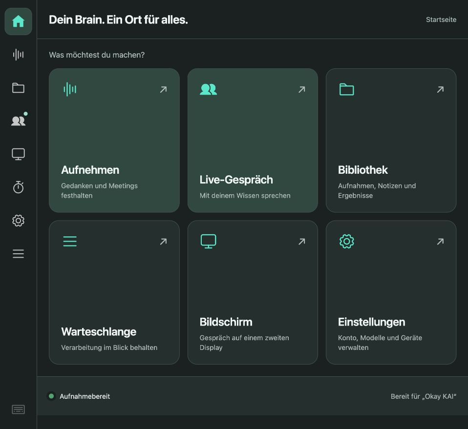
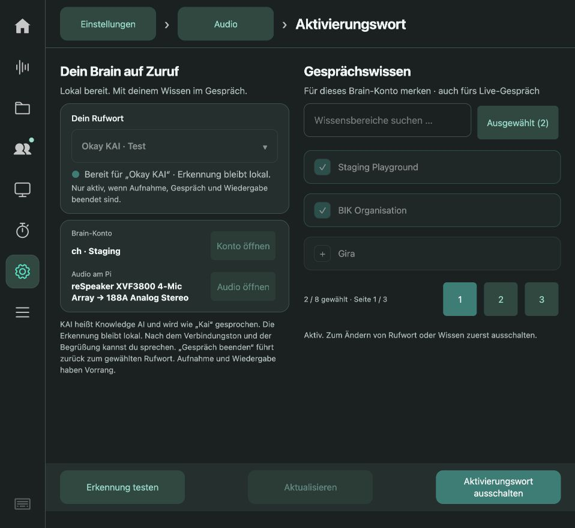

# 0.5.53 – Rufwörter zum Vergleichen

Unter **Einstellungen → Audio → Aktivierungswort** stehen „Hey Brain“,
„Hey KAI · Test“ und „Okay KAI · Test“ zur Wahl. KAI wird wie der Name Kai
und nicht als einzelne Buchstaben gesprochen. Vor einem Wechsel Erkennung
und lokalen Test ausschalten. Die Wahl wird sofort gespeichert. Aufnahme,
pausierte Aufnahme, Gespräch und Wartung sperren den Wechsel auch in der API.

**Erkennung testen** hört für 30 Sekunden lokal zu und zeigt die Zahl der
Erkennungen; es startet kein Cloud-Gespräch. Für den normalen Betrieb mit
gewähltem Brain-Konto und Wissen **Aktivierungswort einschalten** wählen.
Status auf der Startseite, Bereitschaft und Erkennungshinweis nennen das
gewählte Wort. „Gespräch beenden“ bleibt unverändert.

## Bestehende Installation und neues Image

Alte Konfigurationen ohne `phrase` verwenden weiterhin Hey Brain; der bestehende
Ein-/Aus-Zustand und die Kontobindung bleiben erhalten. Eine unbekannte gespeicherte
Phrase wird sicher ausgeschaltet. Neue Profile starten ausgeschaltet mit Hey Brain.
Abmelden hebt wie bisher die Aktivierung auf, behält aber die Rufwortauswahl.
Es gibt keine neue Runtime, Abhängigkeit, Firmware oder Modellinstallation.
Die App-Dateien liegen in der bestehenden Positivliste. Künftige saubere SD-Images
übernehmen sie; das bereits gebaute Image 0.5.44 wird nicht ersetzt. Teststimmen
und Testskripte sind keine App-Paketdateien.

## Erkennung und Schutz

Nur das ausgewählte Profil aktiviert. Konkurrierende ähnliche Phrasen bleiben
in der Grammatik, Konfidenzen 0,8/0,9 und Dauerprüfung bleiben unverändert.
„OK“ wird nicht zusätzlich zu „Okay“ in dieselbe Grammatik aufgenommen: dieselbe
Aussprache teilte im Vorversuch die Wortkonfidenz auf etwa 0,5 auf. Kein neues
Modell wird trainiert; Kai und Okay sind im vorhandenen Modellwortschatz enthalten.
Der Kindprozess erhält die ausgewählte Profil-ID ausdrücklich. Test-/Profilwechsel
erneuern den Feedback-Zähler-Kontext, damit alte Erkennungshinweise nicht wieder
erscheinen. Es entsteht kein zweiter Mikrofonbesitzer.

## Prüfungen und Grenzen

- **320 Python-Tests auf dem Pi bestanden**, einschließlich HTTP-Sperren,
  Einstellungen-Migration, ausgewähltem Kindprozessprofil und Doppelnennungen.
  [Vollständiges Protokoll](python-tests-pi.txt). Der Lauf meldete anschließend
  einen vorhandenen GC-Hinweis sowie eine Locale-Warnung des Übersetzungsladers.
- **108 JavaScript-Tests bestanden**, inklusive Auswahl, Speicherung und Sperren.
  [Protokoll](javascript-tests.txt). Touch-Auswahl in der laufenden lokalen
  Vorschau bei 1280 × 720 geöffnet und Okay KAI ausgewählt; feste Leisten erhalten.
- Zusätzlich 28 Beobachter-/Auswertungstests lokal bestanden. Der Beobachter
  erfasst die Phrase, setzt die Ruhezeit bei deren Wechsel zurück und kennzeichnet
  gemischte Rufwörter als prüfpflichtigen Lauf.
- Ein zusätzlicher vollständiger Mac-Lauf hatte einen reproduzierbaren
  `PermissionError` beim Beenden eines Suchton-Testprozesses. Er wird nicht als
  bestanden gezählt; der Linux/Pi-Lauf desselben App-Codes bestand. Kein neuer
  Mac-Shutdown-Fix gehört zu dieser Auslieferung. [Mac-Protokoll](python-tests-mac.txt).

### Dateien durch den echten Pi-Decoder

[108 Dateifälle](pi-file-comparison.json), Vosk 0.3.45 auf dem Pi, ein künstlicher
Sprecher, Einzel-/Doppelruf und Faktoren 1/0,3/0,03. Kein Lautsprecher und kein
Mikrofon in diesem Test. 107/108 Erwartungen erfüllt:

| Profil | Positive Varianten erkannt | Fehlaktivierungen bei Gegenbeispielen |
| --- | --- | --- |
| Hey Brain | 6/6 | 0/30 |
| Hey KAI | 5/6 | 0/30 |
| Okay KAI | 6/6 | 0/30 |

Der übersehene Hey-KAI-Einzelruf war auf 3 % Amplitude abgesenkt. Keine breite
Qualitätsquote: Pegel-/Wiederholungsvarianten derselben Stimme sind keine
unabhängigen Nutzerstimmen. Der Mac-Vorversuch mit Vosk 0.3.44 zeigte denselben
Fehlschlag; maßgeblich ist der verlinkte Pi-Lauf.

**Nachprüfung der Zählung:** Die ursprünglichen 107/108 prüfen lediglich,
ob mindestens eine Aktivierung stattfand. Für zwei getrennte Dateirufe reicht
das nicht als Nachweis beider Erkennungen. Die [strengere Auswertung derselben
unveränderten Rohdaten](pi-file-count-review.json) erfüllt **105/108** genaue
Zählerwartungen: Bei 3 % Amplitude wurden ein einzelner Hey-KAI-Ruf sowie
je einer von zwei Hey-KAI- bzw. Okay-KAI-Rufen übersehen. Alle Negativbeispiele
bleiben ohne Aktivierung. Das ist keine neue Aufnahme oder weitere unabhängige
Messung. Der Testbericht enthält jetzt sowohl Anwesenheits- als auch exakte
Zählprüfung; drei Regressionstests schützen vor übersehenen und zusätzlichen
Erkennungen. Die gewünschte Sperre mehrfacher Cloud-Starts ist davon getrennt:
zwei erkannte Rufe dürfen während eines Gesprächs weiterhin keinen zweiten
Audioeigentümer erzeugen. Diese Änderung betrifft nur Testwerkzeuge und Doku;
App-Paket, Image-Runtime und laufende Pi-Baseline bleiben unverändert.

### Lautsprecher → Raum → ReSpeaker

Je ein angekündigter synthetischer Ruf unter atomarer Wartungsreservierung:
[Hey KAI](hey-kai-acoustic.json) **0/1**, [Okay KAI](okay-kai-acoustic.json) **0/1**,
[Hey Brain als Kontrolle](hey-brain-acoustic.json) **1/1**. Capture wurde jeweils
beendet und die Wartung freigegeben. Diese Versuche liefen mit dem neuen
Decoder aus einem isolierten Testordner, während die produktive App noch 0.5.52
war. Keine Änderung an Mikrofon-, Lautsprecher- oder Firmwareeinstellungen.

**Die neuen Rufwörter sind daher Testvarianten, keine nachgewiesene Verbesserung.**
Eine natürliche Stimme vor dem Pi muss separat geprüft werden. Die eigene
Pi-Wiedergabe unterdrückt den produktiven Wake-Pfad bewusst; der isolierte
Raumtest belegt keinen normalen Live-Start oder gesprochenen Ende-Befehl.

## Langzeitmessung

### Zusätzliche lokale Eingrenzung ohne Pi-Last

`scripts/check_wake_room_noise.py --phrase <Profil>` unterstützt nun auch die
neuen Rufwörter. Historische Baselines sind ausdrücklich nur für Hey Brain
zulässig. Auf dem Mac mit Vosk **0.3.44** wurden pro Rufwort zwölf Kombinationen
aus vier Rauschstärken und drei Sprachpegeln nach jeweils zwei beschleunigt
verarbeiteten Audio-Minuten getestet. Kein Mikrofon, Lautsprecher, Cloud-Aufruf
oder Eingriff in den produktiven Beobachter:

| Rufwort | Genau ein Zielruf erkannt | Aktivierungen im Rauschvorlauf |
| --- | --- | --- |
| [Hey Brain, Kontrolle](hey-brain-noise-mac.json) | 8/12 | 0 |
| [Hey KAI](hey-kai-noise-mac.json) | 3/12 | 0 |
| [Okay KAI](okay-kai-noise-mac.json) | 2/12 | 0 |

Das ist ein strenger künstlicher Vergleich, keine Feldquote. Die Wortdateien
verwenden dieselbe synthetische Sprecheridentität, aber unterschiedliche Takes
und Sprechgeschwindigkeiten; sie isolieren nicht allein die Wortwahl. Die
Pi-Runtime ist Vosk 0.3.45, deshalb ist dies ausdrücklich ein lokaler Befund.
Die Kontrolle reproduziert hier die zuvor berichteten 8/12 für Hey Brain.
Auch Okay KAI kann nach digitaler Stille bei reduziertem Pegel ausfallen.
Damit ist eine Empfehlung „KAI ist besser“ derzeit nicht belegt; die beiden
Profile bleiben Testvarianten. Die aktive Auswahl wurde nicht geändert.

Die [Diagnose ausschließlich bekannter synthetischer Dateien](synthetic-confidence-trace.json)
zeigt bei den leisen Doppelrufen korrekt dekodiertes `kai`, aber einmal nur
0,856727 bzw. 0,868806 Wortkonfidenz. Die bestehende Mindestkonfidenz 0,9 verwirft
diese Kandidaten. Das erklärt diese lokalen Dateifehler, nicht rückwirkend
die realen Nutzer-Aussetzer oder Raumtests. Keine Schwelle wurde zum Bestehen
der Tests abgesenkt. Die Diagnose enthält ausschließlich erzeugte Rufwörter,
keine Raumaufzeichnung oder Gesprächsinhalte. App-/Image-Runtime unverändert.

Der Nutzerauftrag für neue Rufwörter löste den bisherigen Lauf nach etwa
67 Minuten ab. [Erhaltener Zwischenstand 0.5.52](../wake-stability-0.5.52/partial-observation.json).
Kein abgeschlossener 24-Stunden- oder echter Acht-Stunden-Ruhetest. Die neue
Beobachtung muss App-Version und Rufwort berücksichtigen; ein Wechsel während
des Laufs gilt nicht stillschweigend als Abnahme einer einzelnen Phrase.

## Installation und aktueller Teststand

### Isolierter deutscher Modellkandidat

Die [offizielle Vosk-Modellliste](https://alphacephei.com/vosk/models) nennt
`vosk-model-small-de-0.15` als kleines deutsches Raspberry-Pi-Modell unter
Apache 2.0. Das Archiv wurde ausschließlich in eine temporäre lokale
Laborumgebung geladen; SHA256
`b7e53c90b1f0a38456f4cd62b366ecd58803cd97cd42b06438e2c131713d5e43`
ist der gemessene Download-Hash, kein separat veröffentlichter Herstellerbeleg.
Keine Installation auf dem Pi und kein Austausch des produktiven englischen Modells.

[Dateivergleich auf dem Mac mit Vosk 0.3.44](german-model-files-mac.json):
Hey Brain 36/36, Hey KAI 31/36, Okay KAI 36/36 genaue Zählerwartungen, jeweils
einschließlich 30 Negativvarianten. Die sechs positiven Varianten bestanden für
Hey KAI nur einmal; ein genereller Wechsel auf Deutsch wäre eine Verschlechterung.
Für Okay KAI verbessert sich der [Stille-/Rauschvergleich](okay-kai-german-noise-mac.json)
bei identischer Datei und unveränderten Schwellen hingegen von 2/12 auf 8/12,
ohne Aktivierung im künstlichen Rauschvorlauf. Das Ergebnis wurde nach Ergänzung
der Modellmetadaten im Werkzeug erneut reproduziert.

**Einschränkung:** Das deutsche Vokabular enthält `kyle` nicht. Vosk verwirft
dieses Gegenwort aus der Grammatik; die Vergleichsgrammatik ist dadurch nicht
vollständig identisch. Die Testberichte erfassen nun Modellname und fehlende
Grammatikwörter ausdrücklich. Der bestehende kleine Negativkorpus deckt diesen
fehlenden Gegenspieler nicht ausreichend ab. Mehrere unabhängige Stimmen,
deutsche ähnlich klingende Negativbeispiele, echte Raumtests sowie Vosk 0.3.45
auf dem Pi bleiben vor einer Übernahme erforderlich. Die Verbesserung bei einer
Stimme beweist keine allgemeine Zuverlässigkeit oder endgültige Fehlerursache.

Der folgende Mehrstimmenvergleich verwirft eine unmittelbare Übernahme dieses
Modellkandidaten. Testwerkzeuge und Dokumentation sind die einzigen Änderungen;
App-Paket, SD-Image, Konfiguration und bestehender 24h-Lauf bleiben erhalten.

### Mehrstimmenvergleich: deutsches Modell nicht übernehmen

Zwei weitere synthetische Sprecheridentitäten (Pauli und Otto), jeweils sieben
Dateien, normale Geschwindigkeit. Identische Dateien je Modell, zwei Sekunden
digitale Stille vorab, normale/3-%-Amplitude, Einzel-/Doppelruf. Lokal Vosk 0.3.44;
keine Messlast oder Wiedergabe auf dem Pi. Reproduzierbar mit
`scripts/check_wake_multivoice.py`, Modellwahl über `CDB_WAKE_MODEL`.

| Profil | EN: positive Fälle exakt | DE: positive Fälle exakt | EN/DE: negative Fälle mit Aktivierung |
| --- | --- | --- | --- |
| Hey Brain | 8/8 | 8/8 | 0/40 · 0/40 |
| Hey KAI | 4/8 | 3/8 | 0/40 · 0/40 |
| Okay KAI | 4/8 | 4/8 | 0/40 · 4/40 |

[Englische Rohdaten](multivoice-en-mac.json): 136/144 eindeutige Zählerwartungen;
[deutsche Rohdaten](multivoice-de-mac.json): 131/144. Jeweils 24 mehrdeutige
Kay-Fälle separat, ohne Pass/Fail. Bei Okay KAI mit deutschem Modell bestanden
alle vier Otto-Varianten und keine der vier Pauli-Varianten. Die vier negativen
Aktivierungen stammen sämtlich aus der Datei mit Syntheseauftrag „Okay, Kyle.“
und Stimme Pauli. Diese vier Varianten sind kein Nachweis vier unabhängiger
Fehlaktivierungen; Aussprache der Synthese und fehlendes `kyle` im deutschen
Wortschatz sind noch nicht als Ursachen getrennt.

Die Referenz ist der Syntheseauftrag, kein manuell bestätigtes Transkript.
Kay kann im Deutschen homophon zu Kai sein und zählt deshalb nicht einfach
als falsche Erkennung. Der begrenzte Korpus liefert keine Fehlalarmrate pro
Raumstunde. Die früheren Vincent-Ergebnisse bleiben gültige Einzelmessungen,
aber ihr Vorteil trägt nicht über diese zusätzlichen Stimmen. **Der deutsche
Kandidat wird nicht produktiv übernommen.** Für KAI ist eine breiter trainierte
und getrennt geprüfte Rufworterkennung zu untersuchen; eine niedrigere Schwelle
oder das Zusammenlegen aller Modelltreffer wäre durch diese Befunde nicht
gerechtfertigt. Der aktuelle Pi bleibt bei 0.5.53 mit dem bisherigen EN-Modell.

### Größeres englisches Modell ebenfalls verworfen

Ein weiterer isolierter Vergleich nutzt das offiziell angebotene dynamische
`vosk-model-en-us-0.22-lgraph` (laut [Herstellerliste](https://alphacephei.com/vosk/models)
128 MB, Apache 2.0). Gemessener Archiv-SHA256:
`d9838b4aaa82a75c4a17f5aca300eaca129aaab2a7cbf951bafbb500eb9c4334`.
Alle verwendeten Grammatikwörter sind darin vorhanden. Identischer
Mehrstimmenkorpus, Vorlauf, Pegel, Zählkriterien und unveränderte Konfidenzen;
lokale Vosk-Runtime 0.3.44.

[Rohdaten](multivoice-en022-mac.json): **129/144** eindeutige Fälle bestanden,
24 mehrdeutige Kay-Fälle separat. Positive Zählerwartungen: Hey Brain **8/8**,
Hey KAI **0/8**, Okay KAI **1/8**. Pro Profil keine Aktivierung in den jeweils
40 eindeutigen Gegenbeispielvarianten. Für die KAI-Ziele ist das schlechter als
das bisherige kleine englische Modell; kein Anlass für Pi-Installation oder
zusätzlichen Ressourcenverbrauch. Daraus folgt keine allgemeine Aussage über
die Transkriptionsqualität des Modells. Der Test prüft ausschließlich diese
Rufwörter und Dateistimmen. Die Stärke eines größeren Spracherkennungsmodells
ersetzt hier keine gezielte Prüfung einer Rufworterkennung.

Kein Laufzeitcode verändert; ausschließlich Laborergebnisse dokumentiert.
Bestehendes App-Paket, Kunden-Image und 24h-Pi-Messung bleiben unverändert.

0.5.53 aus Commit `eda03c3296990982a6a2f0166ab828bcd047ecc5` wurde als
signiertes App-Update (Sequenz 10) auf dem Pi installiert.
[Installationsnachweis](deployment.json): die geprüften Einstellungen blieben
während der Installation erhalten. Anschließend wurde für den ausdrücklich
gewünschten Rufwortvergleich bewusst **Okay KAI** ausgewählt und aktiviert.
Audioauswahl, Kontobindung und Wissensbereiche wurden dabei nicht geändert.

Die neue rein lesende Beobachtung läuft laut `plan.json` vom **15.10.2026,
19:38:35 Uhr bis 16.10.2026, 19:38:35 Uhr (Europe/Berlin)**. Der erste Status
meldet Version 0.5.53, Phrase `okay-kai`, Zustand `listening` und keine Warnungen.
Das beweist noch keinen akustischen Erfolg. Ein natürlicher Ruf „Okay Kai“ und
anschließend „Gespräch beenden“ wurde beim Nutzer angefragt; eine bestätigte
Antwort liegt zum Dokumentationszeitpunkt noch nicht vor. Die bestehende
15-Minuten-Nachprüfung wurde auf diesen Lauf umgestellt; sie greift nicht
automatisch in Aufnahmen, Gespräche oder Dienste ein.

Vorschauen der produktiven Pi-App im Browser:

