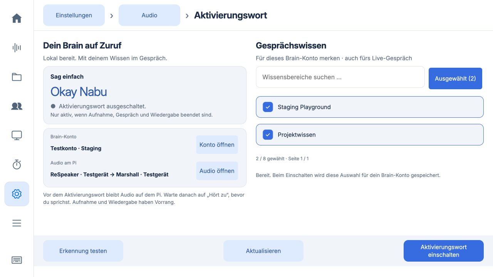
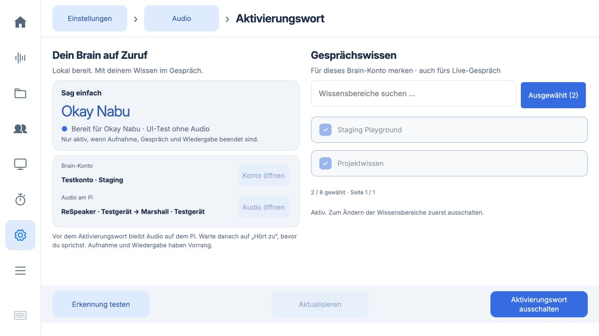
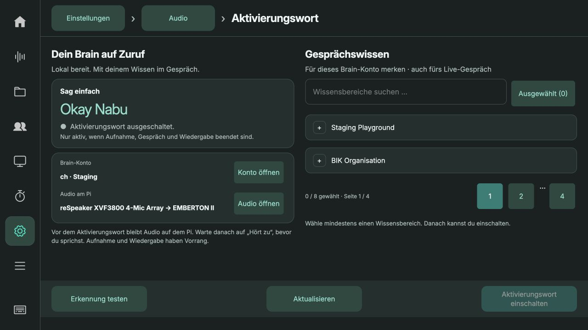

# Aktivierungswort und Browserlast · 0.5.33

## Bedienung

Einstellungen → Audio → Aktivierungswort zeigt auf einer Seite Konto, Audiogeräte,
Erkennungsstatus und Gesprächswissen. Keine Fehlerdialoge für normale fehlende
Voraussetzungen. Mindestens einen Bereich auswählen, dann einschalten. Suche,
Seiten und „Ausgewählt“ behalten die gesamte Auswahl; bis zu acht Bereiche bzw.
das vom Server erlaubte Limit. Erst beim Einschalten wird die Auswahl gespeichert.
Die kontogebundene Auswahl gilt auch für das nächste manuell gestartete Gespräch.
Bestehende Gesprächsverläufe werden dabei nicht gelöscht.

Während aktivierter Erkennung ist die Auswahl gesperrt. Ausschalten bleibt
möglich. Konto- und Audioeinstellungen sind direkt verlinkt. Erkennung testen
bleibt lokal und startet kein Cloud-Gespräch. Die bestehenden Backend-Sperren für
Aufnahme, Gespräch und Wiedergabe bleiben unverändert.

## Performance

`touch.js` beobachtet `disabled`-Änderungen und aktualisiert Auswahlbuttons im
nächsten Frame. Das erneute Setzen des gleichen booleschen Attributes konnte
wieder eine Mutation erzeugen und so weitere Frames auslösen. Schreiben nur bei
tatsächlichem Unterschied beendet diese Rückkopplung. Ein Regressionstest bildet
die reflektierte Eigenschaft samt erneuter Mutation ab.

`live.js` vermisst unsichtbare Gesprächsverläufe nicht mehr mit einer fiktiven
Standardgröße. Beim Öffnen wird weiterhin anhand der echten Fläche paginiert.
Die neue Wake-Seite lädt Cloud-Bereiche nur beim Öffnen bzw. Aktualisieren, nicht
im sekündlichen Statuspoll. Kein zusätzliches Audio und kein Modell im Browser.

## Verifikation

- 93 JavaScript-Tests bestanden, darunter Auswahl über Seiten, Kontoänderung
  während Laden/Speichern, fehlendes Audio, Fehler beim Speichern, Aufnahmesperren,
  unsichtbare Chatpagination und Terminierung der Touch-Aktualisierung.
- 191 Python-Tests auf dem Pi bestanden (unveränderte Backendlogik).
- Isolierte Pi-Instanz mit ausdrücklich synthetischen Konto-/Gerätedaten:
  Auswahl über Seiten, ausgewählte Bereiche filtern, Suche, Touch-Tastatur,
  Aktivierung/Sperren, Ausschalten und erneutes Laden der gespeicherten Auswahl.
- 1280 × 720: fester Header/Footer, kein Content-Überlauf nach Anpassung.
- Aktivierung in der Vorschau simuliert, kein Raumgespräch gestartet.

## Produktiver Pi

Version 0.5.33 aufgespielt, Backend und Kiosk neu gestartet. Alle 22 Aufnahmen,
Konfiguration, Anmeldung, Zielbereich und ausgeschaltete Wake-Einstellung geprüft
und erhalten. ReSpeaker und EMBERTON II werden erkannt, echte CDB-Wissensbereiche
laden erfolgreich. Die Auswahl war vorher leer; sie wird nicht stillschweigend
mit beliebigen Bereichen gefüllt. Auf dem Gerät kann jetzt direkt gewählt werden.
Backup: `/home/chris/backups/recorder-before-0.5.33`.

Zehnsekündige `/proc`-CPU-Stichproben des Kiosk-Renderers: vor Update 8,3 %, nach
Update 4,0 % eines CPU-Kerns; Python 6,7 % bzw. 6,3 %. Diese Leerlauf-Stichproben
sind keine Langzeitmessung und beweisen nicht die alleinige Ursache der früheren
Dauerlast von über 150 %. Die konkreten unnötigen UI-Arbeiten sind durch Tests
abgesichert; Wake Word war bei beiden Messungen ausgeschaltet.

