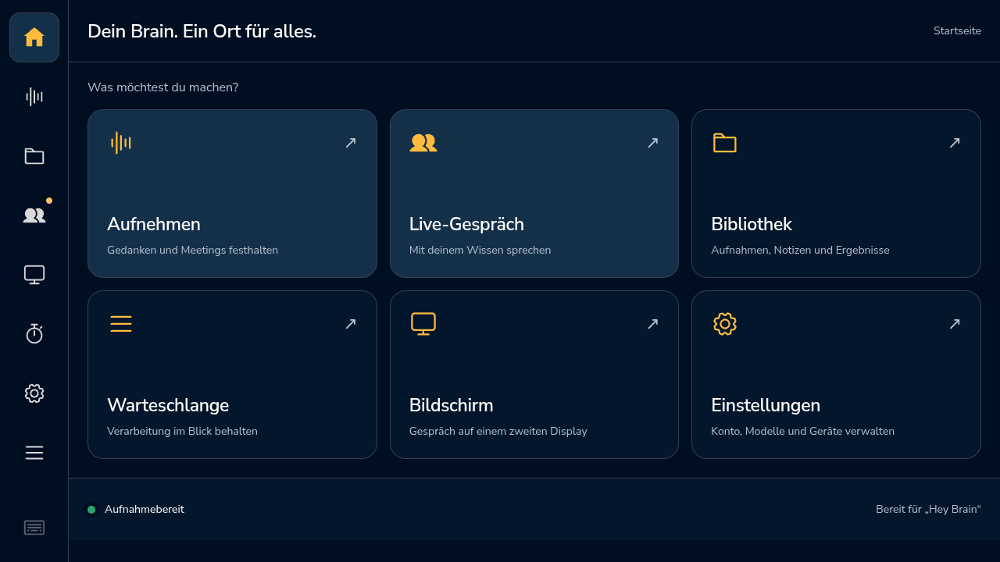

# Verbindungsfehler sauber abschließen · 0.5.50

15. Oktober 2026. [Stabilitätsziel](../idle-wake-0.5.45/stability-goal.md),
[vorherige Decoder-Korrektur und Sprachtests](../wake-stability-0.5.49/README.md).

## Reproduzierte Randfälle

Beim Nachweis der Netzwerk-Ausfälle fanden sich zwei Fehler in der Rückmeldung:
Nach ausgeschöpften Ereignisstrom-Wiederholungen wurde die gesetzte Fehlermeldung
beim Freigeben durch einen normalen Ende-Zustand ersetzt. Ein verspäteter
Audiofehler konnte außerdem noch während eines gewollten Schließens eine
Fehlermeldung setzen. [Beide neuen Regressionstests scheiterten vorher](faults-before.txt).

Die endgültige Freigabe bewahrt jetzt eine bereits gesetzte lokale Fehlermeldung,
auch wenn die Bestätigung des Cloud-Schließens zuerst eintrifft. Ein fehlgeschlagener
Heartbeat erhält ebenfalls einen verständlichen lokalen Hinweis; Anbieterdetails
werden nicht ausgegeben. Audio- und erschöpfte Netzwerk-Rückmeldungen dürfen
einen bereits gewollten Abbruch nicht nachträglich zum Fehler machen. Alle
Rückmeldungen bleiben an ihre Sitzungsgeneration gebunden. Beim nächsten Start
wird die alte Fehlermeldung zurückgesetzt.

Das ändert weder Retry-Anzahl noch Netzwerk-Timeouts und behauptet keine sofortige
Cloud-Freigabe bei unbekanntem Serverzustand. Lokales Audio wird vor Freigabe der
Reservierung geschlossen. Nach Abschluss können die normalen Aktivitätsregeln
Wake-Bereitschaft und einen neuen Start wieder zulassen.

## Nachweise

- [292 Python-Tests bestanden](python-tests.txt). Die fünf zusätzlichen Fälle
  prüfen neun ausgeschöpfte Netzwerkversuche mit begrenzter Wartefolge,
  sichtbaren Fehler nach Freigabe, erneute Reservierung, späten Audiofehler
  während Abbruch, Heartbeat-Timeout, Cloud-Schließbestätigung vor lokalem
  Abschluss und Abbruch während der letzten Wiederholungswartezeit. Die
  Netzwerkfehler werden isoliert injiziert; das produktive WLAN wurde nicht
  getrennt. Qt-/DBus-Warnungen im Log sind keine fehlgeschlagenen Tests.
- [Eine weitere native CDB-Runde](native-cycle.json) mit synthetischem
  „Gespräch beenden“ bestanden: Aktivierung nach 2,45 Sekunden ab kaltem
  Quellenstart, Hallo-Begrüßung nach 6,18 Sekunden, Reservierung 0,10 ms,
  beide Audiopegel vorhanden und normaler Ende-Grund `voice_command`.
  Nichtstumme PCM-Blöcke unverändert durch den lokalen Puffer weitergegeben.
  Vorher absichtlich abgelaufener Token in privater Testkopie, anschließend
  kontrolliertes Schließen. Nur `staging_playground`, keine Raummikrofone oder
  Lautsprecher. Der normale Abschluss bleibt erfolgreich und wird nicht als
  Fehler markiert.
- Wake-Decoder, Oberfläche, Aufnahmeformat und Audioreservierung ändern sich
  gegenüber 0.5.49 nicht. Dessen Sprach-, Parallelitäts- und Auslieferungsnachweise
  bleiben dafür relevant. Historische nicht vollständig erkannte Cloud-Sätze
  bleiben dokumentiert; keine Garantie für jedes natürliche Sprachsignal.

## Auslieferung und Kunden-Image

Produktiv ändern sich `services/live_conversation.py` und die App-Version.
Keine neuen Pakete, Modelle, Berechtigungen, Firmware, Datenformate oder
Kundeneinstellungen. Bestehende Geräte erhalten ein signiertes Code-Paket unter
atomarer Wartungssperre. Ein zukünftiger Image-Build übernimmt die Dateien über
die vorhandene Positivliste; das vorhandene Image 0.5.44 wird nicht verändert.
Die temporäre Beobachtung wird nicht automatisch Teil eines Kunden-Images.

[Signiertes Deployment](deployment.json) von Commit
`5d7d460f53c8b3197d613d51e8ef6a1f74936c75` bestätigt 0.5.50 und erhaltene
Einstellungen. API und HTML melden 0.5.50. Der installierte Live-Code hat
SHA256 `9a1d397d5961afeea006db4b7b37d17d64d0ed858957838b96832888a97995b7`,
identisch zum getesteten Quelltext. Der echte Bildschirm zeigt Bereitschaft.

Die [ursprüngliche Startsonde](installed-startup-raw.json) meldete `passed: false`,
weil sie bereits unmittelbar nach Freigabe der Wartung ausschließlich `listening`
erwartete. Ihre erste Stichprobe sah noch die reguläre Startpause. Nach 2,007
Sekunden folgten 17 Stichproben bzw. 32,147 Sekunden durchgängige Bereitschaft
mit derselben PID und dem erwarteten Detektor-Hash. Die Rohdaten bleiben
unverändert. Die [getrennte Bewertung von Anlauf und stabiler Bereitschaft](installation-audit.json)
prüft höchstens 30 Sekunden Anlauf und anschließend mindestens 30 Sekunden
stabile Bereitschaft. Es wurde kein Neustart oder Code-Fix wegen dieser
normalen Startpause durchgeführt.

Der aktuelle 24-Stunden-Lauf beginnt am **15.10.2026, 17:24:13 Europe/Berlin**
und endet am **16.10.2026, 17:24:13**. Die früheren Läufe einschließlich
`baseline-049` bleiben als `superseded` erhalten. Alle künstlichen
Belastungsprozesse sind beendet. Kein automatischer Browser-, Backend- oder
Pi-Neustart wird aktiviert.

## Abnahmeabgleich

| Anforderung | Autoritativer Nachweis | Stand / Grenze |
| --- | --- | --- |
| 24 Stunden Stabilität und mindestens 99 % Messabdeckung | Laufender Messdienst, `run/plan.json`, `metrics.jsonl`, `events.jsonl` | Offen bis zum tatsächlichen Ende; keine Hochrechnung aus Minuten |
| Echter Wake nach mindestens acht Stunden Ruhe | Beobachteter Wake-Zählerwechsel mit vorausgehender Bereitschaftsdauer und Verbindungszeit | Offen; kein künstlicher Lautsprecheraufruf im Raum |
| Doppelnennungen und konkurrierende Reservierung | `test_wake_stress.py`, Bestandteil der 292 Tests: 100 doppelte Erkennungen, 100 Runden mit je acht gleichzeitigen Reservierungen | Bestanden; isolierte Zustände, keine 100 echten Cloud-Gespräche |
| Lange Audiostreams und Negativbeispiele | 0.5.49: 1.000/1.000 Abschnitte, 28 Sprachfälle, eine Stunde Hintergrundsprache; alter Stille-Vorlauf bis acht Audiostunden | Bestanden im beschriebenen synthetischen Umfang; keine Feld-Fehlalarmrate |
| Fehler bei Cloud, Audio und Detektor | `test_wake_stress.py`, `test_live_conversation.py`, `test_live_audio.py` | Isolierte Timeouts/Abbrüche, veraltete Rückmeldungen, stummer Detektor und erneute Reservierung geprüft |
| Schutz laufender/pausierter Aufnahmen | `test_wake_word.py` und `test_studio.py`: Sperren, Präemption, gemeinsame Server-Sperre, Konkurrenztests | Bestanden; kein automatischer Browser-/Pi-Eingriff aktiviert |
| Wiederholte native Gespräche, Token-Erneuerung, Begrüßung, Ende und echte Pegeldaten | Native CDB-Berichte 0.5.46/0.5.49/0.5.50 | Sechs instrumentierte Folgerunden bestanden; frühere unvollständige Cloud-Transkription bleibt dokumentiert |
| Latenz und Ressourcen | Rohmesswerte der Sprachtests; laufende HTTP-/CPU-/RAM-Messreihe | Einzelwerte belegt; p95 und Trend der vollen Beobachtung noch offen |
| Sichtbare Oberfläche | Echter Display-Screenshot nach Installation, dynamische Versionsauslieferung und vorhandene UI-Tests | Startansicht geprüft; reine API-Messung beweist keine animierte Waveform |
| Sichere Auslieferung und Dokumentation | Signiertes Paket, atomare Wartung, Einstellungenvergleich, Quelltext-Hashes, Git-Commits | Installiert und dokumentiert; Kunden-Image unverändert, zukünftiger Build übernimmt App-Code |
| Watchdog ohne Aufnahmerisiko | [Beobachter und Konzept](../idle-wake-0.5.45/watchdog.md), 13 Tests für Messung/Warnungen | Nur Beobachtung; automatischer Browser-Eingriff bleibt deaktiviert |

Das Gesamtziel ist ausdrücklich noch nicht abgeschlossen. Die nächsten
Nachweise sind Zeitablauf, vollständige Messauswertung und ein echter Aufruf
nach langer Pause; zusätzliche kurze Testwiederholungen ersetzen diese nicht.
