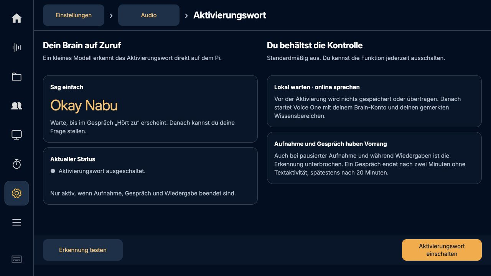
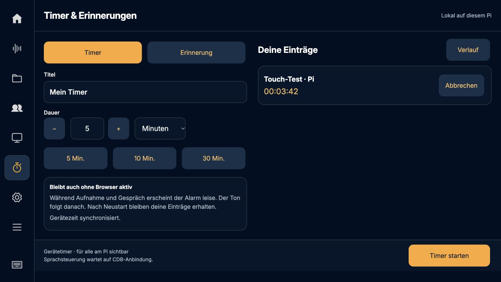
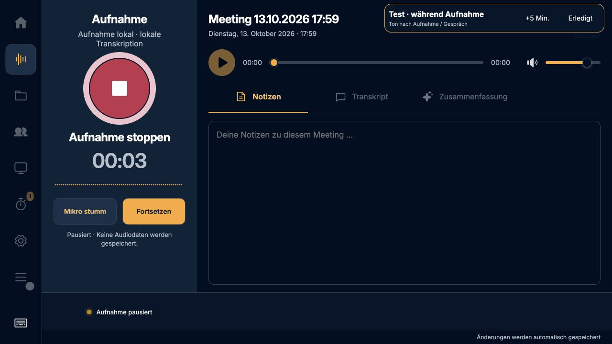
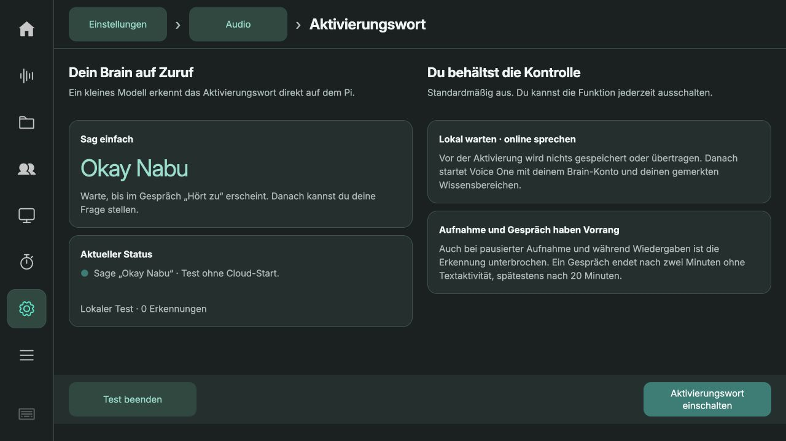
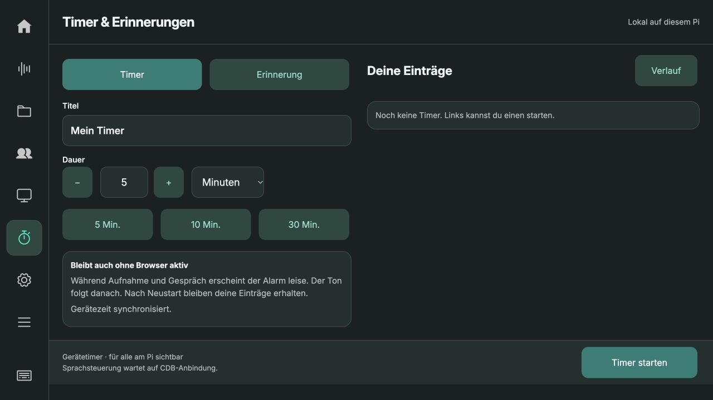

# Aktivierungswort, Timer und Erinnerungen · 0.5.31

Stand: 13. Oktober 2026.

## Bedienung

**Einstellungen → Audio → Aktivierungswort:** „Okay Nabu“ mit microWakeWord
lokal erkennen. Standardmäßig aus. Zuerst im Live-Gespräch die gewünschten
Knowledge Areas auswählen und Mikrofon/Lautsprecher einrichten, dann einschalten.
Die Freigabe bleibt nach Neustart bestehen, ist aber an das Brain-Konto gebunden.
Abmelden, Kontowechsel oder eine abgelaufene Sitzung schalten die Freigabe aus.
Nach dem Wort warten, bis im Gespräch „Hört zu“ steht; erst dann die Frage stellen.
Es wird kein vor der Aktivierung gesprochener Satz nachträglich übertragen.

„Erkennung testen“ lauscht 30 Sekunden lokal und zählt Erkennungen, ohne eine
Cloud-Sitzung zu starten. In Bereitschaft wird kein Audio gespeichert oder
hochgeladen. Die Home-Fußleiste zeigt die eingeschaltete Bereitschaft an.

Aufnahme (auch pausiert), Live-Aufbau, laufendes/abbauendes Gespräch, Audio- und
Modelltests, Gerätewechsel sowie Wiedergaben unterbrechen die Erkennung.
Explizite App-Aktionen beenden zuerst den eigenen Capture-Prozess unter denselben
Backend-Sperren wie Recorder und Live. Browserplayer reservieren die Wiedergabe
vor dem Abspielen; weitere Pi-Ausgaben werden über PipeWire geprüft. Nach
Wiedergabe gibt es einen kurzen Nachlauf. Eigene Ausgaben anderer Programme
werden im Sekundentakt erkannt, nicht samplegenau; dies ersetzt keine AEC-Kette.

Ein Wake-Start verwendet eine ausdrücklich geräteeigene Sitzung: Sie bleibt ohne
Browser-Heartbeat aktiv und ist am Touchscreen stummschaltbar und beendbar. Nach
120 Sekunden ohne Transkriptaktivität, spätestens nach 20 Minuten, endet sie.
Die bestehenden 25-Sekunden-Leases manuell gestarteter Browser-Sitzungen bleiben
unverändert. Neue Sitzungen validieren Brain-Freigabe und Bereichsrechte erneut.

**Timer-Symbol in der linken Leiste:** Timer mit Dauer oder einmalige Erinnerung
mit Datum/Uhrzeit (Europe/Berlin) erstellen. Große Presets, laufende Einträge und
Seitentasten; erledigte/abgebrochene Einträge unter „Verlauf“. Abbrechen beendet
den Timer. Fällige Einträge bleiben sichtbar, bis „Erledigt“ oder „+5 Min.“
gewählt wird. Die Alarmkarte ist auch während Aufnahme und Gespräch bedienbar.
Timer gehören diesem Gerät und sind für alle Personen am Pi sichtbar.

## Timer-Zuverlässigkeit und Audio

- SQLite, vollständige synchrone Transaktionen, idempotente Erstellung und
  Revisionsprüfung bei Änderungen. Maximal 100 offene Einträge.
- Countdown nutzt die Linux-Bootuhr; Wandzeitsprünge verändern ihn innerhalb
  desselben Boots nicht. Nach Reboot wird der gespeicherte UTC-Termin benutzt.
- Datierte Erinnerungen und Timer aus einem früheren Boot warten auf bestätigte
  Zeitsynchronisierung. Nicht existierende/doppelte Sommerzeit-Uhrzeiten werden
  abgewiesen, nicht still verschoben.
- Browser und Internet müssen für einen bereits laufenden Timer nicht offen sein.
  Der Pi und der Studio-Dienst müssen laufen; ein ausgeschalteter Pi klingelt nicht.
- Bis fünf Minuten nach dem Termin wird einmal hörbar nachgemeldet; bei größerer
  Verspätung während Stillstand erscheint „Verpasst“. Erledigte/abgebrochene
  Einträge werden nach 30 Tagen entfernt.
- Während Aufnahme und Live bleibt der Alarm zunächst visuell. Der kurze lokale
  Zweiklang folgt im freien Zustand am ausgewählten Pi-Lautsprecher. Keine
  automatische Aufnahmeunterbrechung. Stummgeschaltete/fehlende Ausgänge melden
  einen fehlgeschlagenen Ton; die sichtbare Quittierung bleibt verfügbar.
- Ein Ausgabeversuch wird vor Wiedergabe gespeichert. Ein Absturz kann deshalb
  zu einem sichtbaren Alarm ohne Ton führen; ein unendlich wiederholter Alarm
  wird vermieden. Quittieren stoppt einen gerade laufenden Alarmton.

## Was noch nicht enthalten ist

**Timer per Voice-One-Sprachauftrag sind noch nicht verfügbar.** Der aktuelle
CDB-Vertrag enthält keinen authentifizierten Weg für lokale Tool-Aufträge samt
Ergebnisrückgabe. Die Oberfläche benennt diese Grenze. Es wird weder aus
Transkripttext ein Timer erfunden noch dem Modell ein Erfolg vorgetäuscht.
Für den nächsten Schritt siehe [Tool-Brücke](../timer-reminders-research.md).
Ebenso noch nicht enthalten: wiederkehrende Erinnerungen, ein eigenes „Hey Brain“
und zuverlässige Sprecheridentifikation.

## Installation

`./scripts/install-wake.sh` installiert `pymicro-wakeword==2.5.0` und
`pymicro-features==2.0.2` in die vorhandene Pi-Umgebung. Keine Firmwareänderung.
Der offizielle Modellbestand ist im Paket enthalten; keine Downloads beim ersten
Zuruf. [Python-API und Lizenz](https://github.com/OHF-Voice/pymicro-wakeword),
[Modell-Lizenz](https://github.com/esphome/micro-wake-word-models/blob/main/LICENSE).

## Prüfungen auf dem Pi

- 184 Python-Tests und 85 bestehende JavaScript-Tests bestanden.
- Drei offizielle Okay-Nabu-Referenzdateien erkannt, neun Dateien mit anderen
  Aktivierungswörtern nicht. Die wiederholten positiven Modellframes im
  Benchmark sind keine getrennten Gesprächsstarts: der Capture-Prozess wird
  nach der ersten Erkennung beendet. [Messwerte](model-benchmark.json).
- Modelltestprozess: maximal 31.168 KiB RSS; insgesamt 0,207 CPU-Sekunden.
  Das ist ein kurzer Offline-Test, kein 24-Stunden-Last- oder Raumtest.
- ReSpeaker `plughw:CARD=Array,DEV=0`: acht Sekunden lokale Erkennung;
  Freigabe in 0,064 Sekunden, keine Audiodatei gespeichert.
  [Hardwaretest](microphone-test.json).
- Geräteseitiger Wake-Startpfad mit synthetischer Sprache über das echte
  CDB-Staging: Benutzertranskript und Antwort empfangen; Gerätebesitzer,
  Stummschaltung ohne Browser-Lease und Freigabe nach Ende geprüft.
  Dieser Test bewertet Start/Transport/Ende, nicht die inhaltliche Antwortqualität.
  [Nachweis](device-live-test.json).
- Browserprüfung: Timer erstellen, fällig werden lassen, Backend neu starten,
  Alarm weiterhin sichtbar, fünf Minuten schlummern, abbrechen, datierte
  Erinnerung speichern. Kein Raumgespräch für diese Tests aufgezeichnet.
- Synthetische Aufnahme mit gleichzeitig fälligem Timer: Ton bleibt aus,
  Wake-Test bei Aufnahme und Pause abgewiesen; nach Stoppen Ton beendet und
  alle Recorder-Sperren gelöst. Alarm am Pi ausgegeben; keine menschliche
  Hörbestätigung in diesem Durchlauf.
- Oberfläche bei 1280 × 720 geprüft: feste Kopf-/Fußleisten, Touchflächen,
  Breadcrumb „Einstellungen → Audio → Aktivierungswort“, Timer-Seitenbuttons.

Die reale Trefferquote mit deiner Stimme, Entfernung und Raumgeräuschen muss
noch vor Ort erprobt werden; die zwölf Referenzdateien belegen diese nicht.

## Auslieferung

Laufzeit-Commit `6217a7d` auf dem produktiven Pi installiert. Backend und Kiosk
aktiv, alle zwölf ausgelieferten Laufzeitdateien per SHA256 mit dem Repository
verglichen. Die 22 bestehenden Aufnahmen, das Konto und die Verarbeitungseinstellungen
sind erhalten. Sicherung: `/home/chris/backups/recorder-before-0.5.31`.
[Auslieferungsnachweis](deployment.json).

Nach der kompletten Testsuite wurde zusätzlich die explizite Stopptaste für den
lokalen Erkennungstest ergänzt und mit zwei gezielten Tests sowie am produktiven
Touch-Frontend geprüft (ein zusätzlicher Testfall: insgesamt 185 unterschiedliche
Python-Tests). Die isolierte Testinstanz ist beendet; ihre synthetischen Timer
laufen nicht im Produktivsystem.

Der lokale Test wurde auch nach Auslieferung gestartet und ausdrücklich beendet.
Beim Aktivierungsversuch im produktiven Konto fehlt derzeit eine gültige gemerkte
Bereichsauswahl: Der Backend-Check verhindert korrekt den automatischen Start und
fordert zur Auswahl im Live-Bereich auf. Wake Word wurde ausgeschaltet hinterlassen;
keine produktiven Timer oder Gespräche für den Test angelegt.

